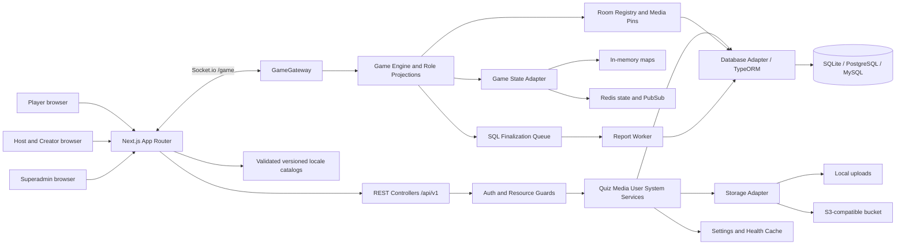
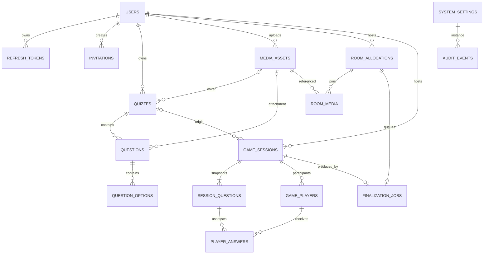
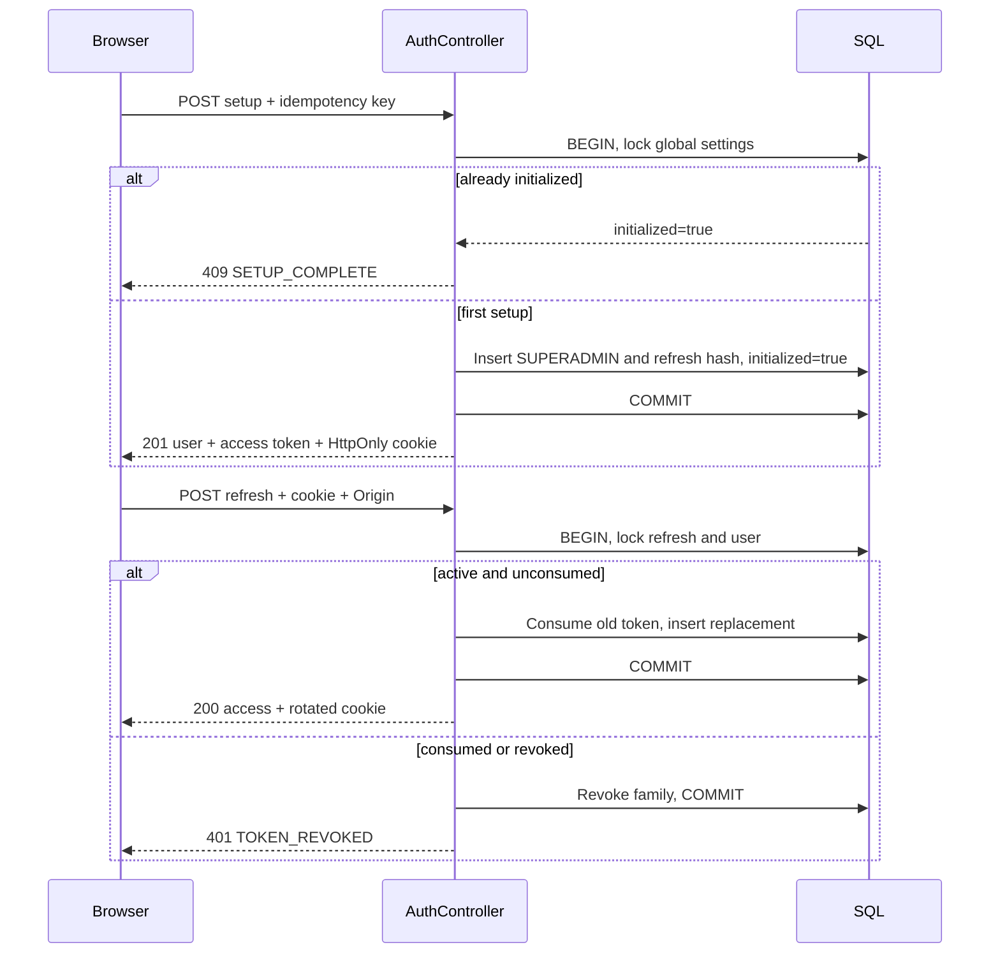
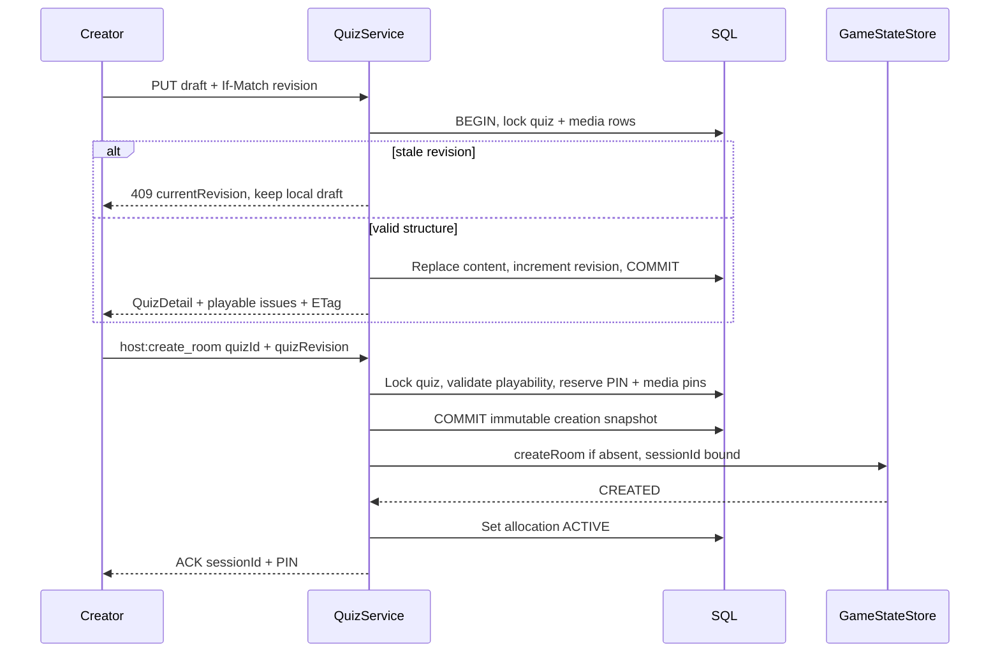
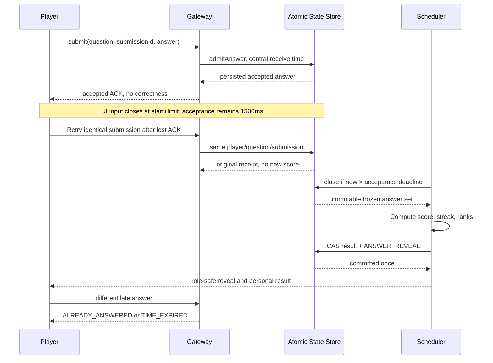
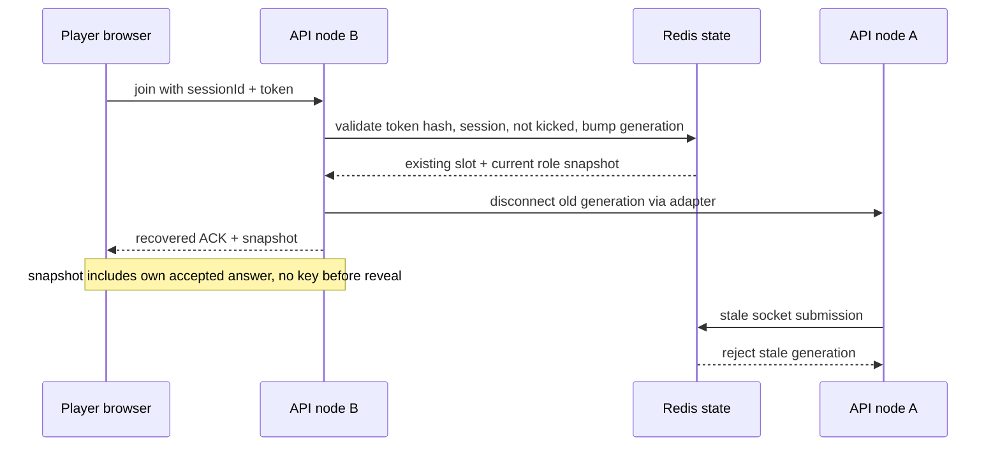
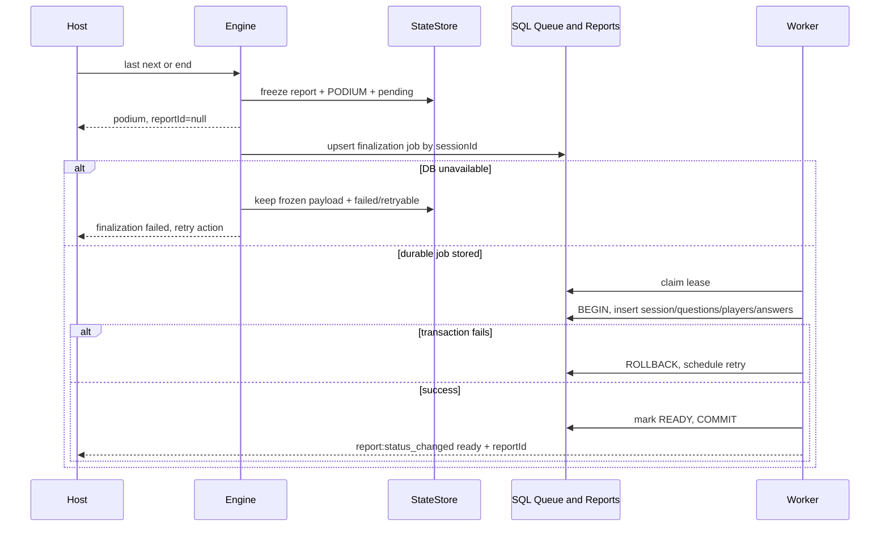
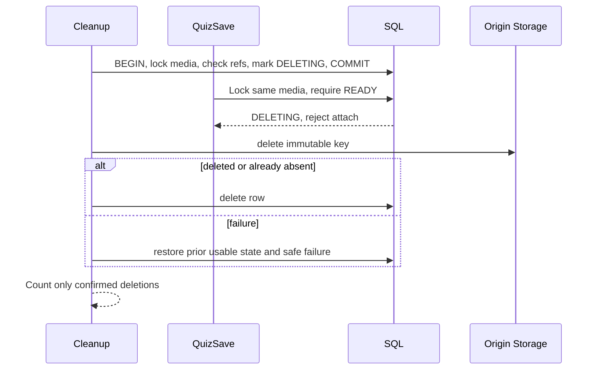

# 03 — System Analysis & Technical Architecture: Kabuki Neko

Tanggal: **2026-10-29 (Asia/Jakarta)**. Versi **1.0**. Status: **Stage 3, spesifikasi untuk review; belum implementasi**.

Sumber normatif: [00-project-context.md](00-project-context.md), [01-prd.md](01-prd.md) v1.3.0, dan [02-design-spec.md](02-design-spec.md) v1.0. D-01–D-04, BR-01–BR-20, US-01–US-21 dan seluruh fitur P0 dipertahankan. Dokumen ini menuntaskan detail yang didelegasikan kepada SA, termasuk SA-01–SA-12. Bila contoh kontrak ringkas PRD tidak lengkap, kontrak rinci di sini menjadi acuan implementasi tanpa mengubah aturan bisnis PRD.

Inspeksi: workspace berisi tiga dokumen upstream dan `.DS_Store`; Git tersedia, commit terakhir `2b4578b`. Belum ada models, migrations, routes, services, middleware, manifest, lockfile, atau aplikasi untuk diuji. Perubahan upstream yang sudah ada tidak ditimpa. Seluruh file pada pemetaan berikut adalah **rencana file baru**, bukan klaim file telah dibuat.

## 1. Arsitektur dan keputusan dasar

Modular monolith NestJS melayani REST dan Socket.io. Next.js merender shell dan menjalankan UI; tidak mengakses database. SQL menyimpan akun, konten, referensi media dan histori. State pertandingan aktif berada pada memory/Redis; SQL juga menyimpan koordinasi PIN, pin media dan pekerjaan finalisasi, bukan jawaban per paket. Tidak diperlukan broker eksternal: antrean pekerjaan durable memakai SQL dan worker di proses API.



### 1.1. Stack dan versi baseline

| Area | Keputusan |
| --- | --- |
| Runtime/workspace | Node.js **26** (pin `26.13.0`, keputusan pengguna 2026-11-08), pnpm **10**, Turborepo **2**, TypeScript strict **5**; patch/minor dipilih saat bootstrap, dipin persis dalam `.node-version`, `packageManager`, manifests dan lockfile setelah compatibility/security checks; `engines.node >=26.13.0` mencegah binding native ABI lain. Ini pilihan major baseline, bukan klaim semua patch terkini sudah diuji. |
| Web | Next.js **16** App Router (memenuhi 15+), React/React DOM **19**, Tailwind **4**, Shadcn source components, Framer Motion, Zustand, React Hook Form, Zod **4**. |
| API | NestJS **11**, Express adapter, Socket.io/client **4**, TypeORM **0.3**, `better-sqlite3`, `pg`, `mysql2`. EntitySchema factory memilih tipe kolom per driver; `synchronize=false`. |
| State/storage | ioredis **5**, `@socket.io/redis-adapter` **8**; Redis **7** baseline. AWS SDK **3**, Sharp, file-type. S3 SDK melayani storage asal setiap aset. |
| i18n | `intl-messageformat` + `@formatjs/icu-messageformat-parser`; provider React ringan milik proyek, namespace lazy, katalog ICU JSON tervalidasi. Tidak memakai routing locale. |
| Media/interaction | Howler.js **2**, DiceBear core + enam collection imports dengan versi sama; dnd-kit, canvas-confetti lazy. `qrcode` untuk output, `@zxing/browser` lazy untuk scanner; native BarcodeDetector hanya fast path jika didukung. |
| Verification | Vitest untuk shared/web, Jest + Supertest untuk API, Playwright untuk E2E, axe-core untuk bantuan audit a11y, ESLint + Prettier. Contract suite driver terpisah dari unit tests. |

Node 26 ditetapkan pengguna pada 2026-11-08 (menggantikan baseline awal Node 24 LTS) setelah `.node-version` naik ke 26.13.0 dan binding `better-sqlite3` ABI 137 gagal dimuat di runtime ABI 147; seluruh paket memakai `@types/node` 26.x dan `better-sqlite3` 12.11.1 yang `engines`-nya mencakup `26.x`. Rujukan jalur rilis: [Node releases](https://nodejs.org/en/about/previous-releases). Instalasi App Router mengikuti [Next.js installation](https://nextjs.org/docs/app/getting-started/installation). Dukungan SQLite dan migrasi TypeORM dirujuk pada [SQLite driver](https://typeorm.io/docs/drivers/sqlite/) dan [migration setup](https://typeorm.io/docs/migrations/setup/). Pemilihan ini tetap membutuhkan build dan driver tests pada bootstrap; jangan memasukkan `latest` ke manifest/image produksi.

### 1.2. Pemetaan modul dan file

Notasi `{a,b}` berarti dua file nyata, bukan placeholder; semua path relatif root proyek. Setiap modul API mempunyai `<name>.module.ts`, `<name>.service.ts` dan, bila ada REST, `<name>.controller.ts` di direktorinya. Setiap service memakai repository/adapter; controller hanya boundary validation, auth, mapping response.

| Tanggung jawab | File target |
| --- | --- |
| Bootstrap | `package.json`, `pnpm-workspace.yaml`, `pnpm-lock.yaml`, `turbo.json`, `.node-version`, `.env.example`, `eslint.config.mjs`, `.prettierrc.json`, `packages/tsconfig/{base,nextjs,nestjs}.json`, `apps/api/src/{main,app.module}.ts` |
| Contracts | `packages/shared/src/schemas/{auth,users,quiz,question,media,report,system,import,locale,game}.schema.ts`, `constants/{game,geometry,limits,audio}.ts`, `socket-events.ts`, `errors.ts`, `unicode.ts`, `index.ts` |
| DB | `packages/database/src/{data-source.factory,index}.ts`, `schema/{settings,users,auth,quizzes,media,runtime,reports,jobs}.schema.ts`, `repositories/{users,quizzes,media,runtime,reports,jobs}.repository.ts`, `migrations/{sqlite,postgres,mysql}/0001-initial.ts`, `migrations/migration-runner.ts` |
| Env/guards | `apps/api/src/config/{env.schema,config.service,secrets.service}.ts`, `common/guards/{jwt,roles,ownership,origin}.guard.ts`, `common/{zod-validation.pipe,error.filter,request-context.middleware,idempotency.service,rate-limit.service,audit.service}.ts` |
| Providers | `apps/api/src/providers/database/database.module.ts`, `providers/storage/{storage.module,storage.interface,local-storage.adapter,s3-storage.adapter,storage-registry}.ts`, `providers/state/{state.module,game-state.interface,memory-state.store,redis-state.store}.ts`, `providers/state/lua/{admit-answer,mutate-room,close-question,bind-player,release-room}.lua` |
| Auth/users | `apps/api/src/modules/auth/{auth.module,auth.controller,auth.service,refresh.service,setup.service}.ts`, `modules/users/{users.module,users.controller,users.service,invitations.service}.ts` |
| Quiz/import | `apps/api/src/modules/quizzes/{quizzes.module,quizzes.controller,quizzes.service,quiz-validator,quiz-snapshot,quiz-import,quiz-export}.ts` |
| Media | `apps/api/src/modules/media/{media.module,media.controller,media.service,media-processor,media-gc.service,media-reference.service}.ts` |
| Engine | `apps/api/src/modules/game-engine/{game-engine.module,game.gateway,game.service,room-registry.service,room-projector,score-calculator,ranking,question-shuffler,room-scheduler,recovery.service}.ts` |
| Histori/worker | `apps/api/src/modules/reports/{reports.module,reports.controller,reports.service,report-finalizer,report-worker,report-csv}.ts` |
| System | `apps/api/src/modules/system/{system.module,system.controller,system.service,health.service,locale-registry.service,audio-catalog.service}.ts` |
| Web public/auth | `apps/web/src/app/{layout,page,not-found,error}.tsx`, `app/(public)/join/page.tsx`, `app/(public)/help/languages/page.tsx`, `app/(public)/about/page.tsx`, `app/(auth)/{setup,login,register}/page.tsx` |
| Dashboard | `apps/web/src/app/(dashboard)/dashboard/{layout,page}.tsx`, `dashboard/quizzes/page.tsx`, `dashboard/quizzes/[quizId]/page.tsx`, `dashboard/{media,reports,settings,users,about}/page.tsx`, `dashboard/reports/[sessionId]/page.tsx`, `app/(dashboard)/studio/[quizId]/page.tsx` (dashboard subpaths share the same `(dashboard)` prefix) |
| Live UI | `apps/web/src/app/(host)/host/[sessionId]/page.tsx`, `app/(player)/play/[pin]/page.tsx`, `components/{host,player,studio,media,reports,admin,ui}/`, component names B01–B12/F01–F20 from design mapped to kebab-case filenames |
| Client boundary | `apps/web/src/lib/{api-client,socket-client,avatar,qr,preferences}.ts`, `hooks/{use-socket,use-audio-engine,use-session-recovery}.ts`, `stores/{game,studio}.store.ts`, `providers/{auth,locale,theme}-provider.tsx`, `lib/i18n/{resolve,format,catalog-loader}.ts` |
| Locale sources/tools | `packages/shared/locales/{en,id,ja,zh-Hans,es,fr}/{manifest,common,auth,quizzes,studio,media,host,player,reports,admin,validation,accessibility,about}.json`, `packages/shared/locales/message-contracts.json`, `scripts/{locales-validate,locales-build,locales-template}.ts`, `extensions/locales/`, `docs/localization.md` |
| Assets | `apps/web/public/brand/{logo,mascot,favicon}.svg`, `public/audio/{lobby,tick,reveal,podium}.mp3`, `public/fonts/noto-sans-latin.woff2`, `public/legal/{LICENSE,THIRD-PARTY-NOTICES}.txt`, `LICENSE`, `THIRD-PARTY-NOTICES.md` |
| Deploy/checks | `docker/{Dockerfile.api,Dockerfile.web,docker-compose.yml,entrypoint.sh}`, `scripts/{start-profile,migrate,benchmark-game}.ts`, `docs/{deployment,operations,import-format}.md`, `tests/{contracts,integration,e2e,performance}/`, `.github/workflows/ci.yml` |

Routes `/dashboard` redirect ke `/dashboard/quizzes`; `/dashboard/about` dan `/about` memakai komponen dokumen sama. `/help/languages` publik; template dapat diunduh dari `/locales/template-v1.zip`. File statis tersebut dibangun saat packaging, bukan endpoint upload. API `/system/locales` dan web catalog build harus membawa `catalogVersion` sama; startup/readiness menolak distribusi yang tidak cocok.

## 2. Model data dan skema persisten

### 2.1. Konvensi kolom, null, index dan migrasi

Setiap kolom di bawah **NOT NULL dan tanpa default** kecuali diberi `?` (NULL/default NULL) atau `=nilai`. `id:ID=uuid` berarti UUID v4 buatan aplikasi dan PRIMARY KEY. `TS=now` berarti integer epoch milliseconds dari aplikasi, bukan default SQL. `J` berarti teks JSON UTF-8 yang melewati schema versi 1; `{}`/`[]` adalah nilai serialisasi. Semua field timestamp DTO adalah number integer aman, kecuali tanggal CSV ISO UTC.

| Alias | PostgreSQL | MySQL 8.0+ | SQLite |
| --- | --- | --- | --- |
| ID | uuid | varchar(36), ascii_bin | varchar(36) |
| S(n) | varchar(n) | varchar(n), utf8mb4_bin | varchar(n) + app validation |
| T / J | text | longtext | text |
| I | integer | int | integer |
| L / TS | bigint | bigint | integer (64 bit) |
| B | boolean | boolean | integer CHECK IN (0,1) |

`TS`, `L` ORM transformers menolak nilai di luar JS safe integer; BIGINT driver strings diubah eksplisit. `S(n)` kapasitas DB dihitung code points/bytes menurut driver, sehingga field UI yang dihitung grapheme memakai T jika perlu (lihat §3). UUID FK mengikuti tipe PK. Setiap FK di bawah memiliki `ON UPDATE NO ACTION`; aksi `ON DELETE` disebut eksplisit. Semua FK wajib index, meskipun tidak diulang dalam daftar index sekunder. Composite FK diberi composite index. Tidak memakai native DB enum/JSON untuk mempertahankan portabilitas. Enum/range dicek Zod dan SQL CHECK pada migrasi yang mendukung; MySQL minimum 8.0.16 agar CHECK ditegakkan.

SQLite: WAL, foreign_keys ON, busy_timeout 5000ms, single API process; transaksi write `BEGIN IMMEDIATE`. PostgreSQL/MySQL: row locks untuk resource induk, InnoDB, UTC, transaksi `READ COMMITTED` dengan lock eksplisit. Retry deadlock/serialization maksimum 3 kali dengan jitter 25–100ms; mutasi memakai idempotency key. Unique violations dipetakan 409, bukan 500. DDL MySQL tidak dianggap rollback-atomic: migration runner menyimpan versi/checksum, melakukan preflight dan langkah resumable; lock Postgres advisory, MySQL GET_LOCK, SQLite file/process lock. `DB_AUTO_MIGRATE=false` memerlukan schemaVersion cocok untuk ready. `synchronize` selalu false.

### 2.2. ERD



Room–media adalah M:N melalui `room_media`; session–player adalah 1:N; session–finalization job maksimal 1:1 melalui PK sessionId. Session questions mencakup seluruh snapshot (minimal satu untuk kuis host valid), termasuk soal yang tidak dimainkan. ERD tidak menggantikan definisi FK berikut.

### 2.3. Tabel konfigurasi dan akun

| Tabel | Kolom lengkap | Constraint/index tambahan |
| --- | --- | --- |
| `system_settings` | `id:S(36)='global'` PK; `initialized:B=false`; `instance_name:T='Kabuki Neko'`; `registration_mode:S(20)='PUBLIC'`; `max_image_size_mb:I=5`; `max_audio_size_mb:I=10`; `max_video_size_mb:I=25`; `max_players_per_room:I=200`; `profanity_words:J=[]`; `default_locale:S(63)='id'`; `revision:I=1`; `updated_at:TS=now` | CHECK id='global'; registration enum SINGLE_ADMIN/INVITE_ONLY/PUBLIC. Batas §3. Singleton dibuat migrasi; initialized menjadi true hanya di setup transaction dan tidak dapat diubah melalui settings. |
| `users` | `id:ID=uuid`; `email:S(255)`; `password_hash:S(255)`; `name:T`; `role:S(20)='CREATOR'`; `avatar_style:S(50)='bottts'`; `avatar_seed:S(100)='kabuki'`; `is_active:B=true`; `auth_version:I=1`; `revision:I=1`; `created_at:TS=now`; `updated_at:TS=now` | UNIQUE(email), email canonical lowercase/ASCII domain; INDEX(role,is_active,id), INDEX(created_at,id). Role CREATOR/SUPERADMIN. Tidak ada delete user baseline; deactivation mempertahankan ownership/histori. |
| `refresh_tokens` | `id:ID=uuid` (JWT jti); `user_id:ID`; `family_id:ID`; `token_hash:S(64)`; `issued_at:TS=now`; `expires_at:TS`; `consumed_at:TS?`; `revoked_at:TS?`; `replaced_by_id:ID?` | UNIQUE(token_hash); INDEX(user_id,family_id); INDEX(expires_at); FK user CASCADE, replaced_by self SET NULL. Consumed/revoked token hashes disimpan sampai family expiry + 24h untuk mendeteksi reuse. |
| `invitations` | `id:ID=uuid`; `created_by:ID`; `code_hash:S(64)`; `created_at:TS=now`; `expires_at:TS`; `used_at:TS?`; `used_by:ID?`; `revoked_at:TS?` | UNIQUE(code_hash); INDEX(created_at,id); INDEX(expires_at); FK created_by RESTRICT, used_by SET NULL. Status diturunkan dengan prioritas USED, REVOKED, EXPIRED, ACTIVE. |
| `audit_events` | `id:ID=uuid`; `settings_id:S(36)='global'`; `occurred_at:TS=now`; `actor_type:S(10)`; `actor_id:S(36)?`; `action:S(80)`; `resource_id:S(100)?`; `outcome:S(10)`; `correlation_id:ID`; `error_code:S(64)?` | FK settings RESTRICT; INDEX(occurred_at,id), INDEX(actor_id,occurred_at). actor_type USER/GUEST/SYSTEM/ANONYMOUS, outcome SUCCESS/DENIED/FAILURE. Tidak menyimpan payload bebas/nama/password/token/IP mentah. actor_id polymorphic bukan FK. |
| `request_dedup` | `id:ID=uuid`; `actor_scope:S(80)`; `operation:S(100)`; `key:ID`; `request_hash:S(64)`; `state:S(10)='PENDING'`; `http_status:I?`; `response_json:J?`; `resource_id:S(100)?`; `created_at:TS=now`; `expires_at:TS`; `lease_until:TS?` | UNIQUE(actor_scope,operation,key); INDEX(expires_at). state PENDING/DONE. Tidak menyimpan credential response; aturan khusus auth/invite §4. |

### 2.4. Konten dan media

| Tabel | Kolom lengkap | Constraint/index/FK |
| --- | --- | --- |
| `media_assets` | `id:ID=uuid`; `uploader_id:ID`; `storage_driver:S(10)`; `storage_location_id:S(64)`; `storage_key:S(500)`; `public_url:S(1000)`; `original_name:T`; `mime_type:S(100)`; `size_bytes:L`; `width:I?`; `height:I?`; `duration_ms:L?`; `state:S(12)='UPLOADING'`; `accessibility:J`; `revision:I=1`; `created_at:TS=now`; `updated_at:TS=now` | UNIQUE(storage_key) (UUID key global); INDEX(uploader_id,created_at,id); INDEX(state,created_at,id); FK uploader RESTRICT. state UPLOADING/READY/DELETING/FAILED. width/height >0 bila ada; duration >=0. `accessibility` schema §3. |
| `quizzes` | `id:ID=uuid`; `creator_id:ID`; `title:T`; `description:T?`; `cover_media_id:ID?`; `visibility:S(10)='PRIVATE'`; `bgm_track:S(100)='kabuki-matsuri'`; `revision:I=1`; `created_at:TS=now`; `updated_at:TS=now` | FK creator RESTRICT, cover RESTRICT; INDEX(creator_id,updated_at,id), INDEX(visibility,updated_at,id). visibility PRIVATE/PUBLIC. Reference guard must run before deletion. |
| `questions` | `id:ID=uuid`; `quiz_id:ID`; `order_index:I=0`; `type:S(30)='SINGLE_CHOICE'`; `prompt_text:T=''`; `media_id:ID?`; `external_video_url:S(500)?`; `video_start_sec:I=0`; `video_end_sec:I?`; `media_reveal_mode:S(20)='NONE'`; `time_limit_sec:I=20`; `points_multiplier:I=1`; `explanation_text:T?`; `accessibility:J` | FK quiz CASCADE, media RESTRICT; UNIQUE(quiz_id,order_index). type/reveal/time/multiplier enum §3; order_index>=0. Media RESTRICT deliberately strengthens PRD SET NULL: deletion cannot silently break questions. |
| `question_options` | `id:ID=uuid`; `question_id:ID`; `option_index:I`; `color_index:I=0`; `option_text:T=''`; `is_correct:B=false`; `sort_order:I=0` | FK question CASCADE; UNIQUE(question_id,option_index); INDEX(question_id,sort_order). option_index contiguous; colors 0–3; for TYPE_ANSWER all color=0 and sort_order=0, for other types color=option_index. sort_order puzzle 0–3 unique in application; no unconditional SQL unique on it. |

`accessibility` default is exactly `{"altText":null,"transcript":null,"captions":[],"visualDescription":null}`. Metadata pada question merupakan copy context-specific dari media saat dipilih, kemudian independen; snapshot menyimpan nilai question sehingga perubahan library tidak mengubah game aktif. Cover menggunakan media altText. JSON caption bukan arbitrary VTT/HTML.

### 2.5. Koordinasi runtime, antrean, histori

| Tabel | Kolom lengkap | Constraint/index/FK |
| --- | --- | --- |
| `room_allocations` | `id:ID=uuid` (=sessionId); `pin_code:S(6)`; `host_id:ID`; `quiz_id:ID?`; `quiz_revision:I`; `creation_snapshot:J`; `state_driver:S(10)`; `state_namespace:S(64)`; `status:S(12)='CREATING'`; `created_at:TS=now`; `expires_at:TS`; `last_heartbeat_at:TS=now` | UNIQUE(pin_code); INDEX(host_id,status); INDEX(expires_at); FK host RESTRICT, quiz SET NULL. status CREATING/ACTIVE/FINALIZING/CLOSED/LOST. `creation_snapshot` = QuizSnapshot, private server-only. `state_namespace` deployment state generation, not secret. PIN string ASCII digits. |
| `room_media` | `session_id:ID`; `media_id:ID`; `created_at:TS=now` | PK(session_id,media_id); FK allocation CASCADE, media RESTRICT. Durable active snapshot references. |
| `finalization_jobs` | `session_id:ID` PK; `host_id:ID`; `payload:J`; `payload_hash:S(64)`; `state:S(10)='PENDING'`; `attempts:I=0`; `next_attempt_at:TS=now`; `lease_owner:ID?`; `lease_until:TS?`; `last_error_code:S(64)?`; `created_at:TS=now`; `updated_at:TS=now`; `completed_at:TS?` | FK allocation RESTRICT, host RESTRICT; INDEX(state,next_attempt_at,lease_until). state PENDING/RUNNING/FAILED/READY. Payload = FrozenReport §5, version=1. session_id matches game_sessions logically, not FK (job exists before report). |
| `game_sessions` | `id:ID` PK (=sessionId); `quiz_id:ID?`; `quiz_title_snapshot:T`; `quiz_revision:I`; `host_id:ID`; `pin_code:S(6)`; `display_mode:S(10)`; `end_reason:S(20)`; `total_players:I`; `total_questions:I`; `played_questions:I`; `started_at:TS?`; `ended_at:TS`; `created_at:TS=now`; `schema_version:I=1`; `snapshot:J` | FK quiz SET NULL, host RESTRICT; INDEX(host_id,ended_at,id), INDEX(host_id,quiz_id,ended_at). end_reason COMPLETED/HOST_ENDED/EXPIRED; display PROJECTOR/STREAMER. Snapshot QuizSnapshot §5. |
| `session_questions` | `id:ID=uuid`; `session_id:ID`; `source_question_id:ID?`; `question_index:I`; `snapshot:J`; `status:S(12)`; `opened_at:TS?`; `closed_at:TS?`; `close_reason:S(16)?`; `eligible_player_ids:J=[]` | UNIQUE(session_id,question_index); UNIQUE(session_id,id); FK session CASCADE, source question SET NULL. status UNPLAYED/PLAYED; close_reason TIMER/ALL_ANSWERED/HOST_SKIP/HOST_END/EXPIRED. snapshot PrivateQuestionSnapshot. |
| `game_players` | `id:ID` PK (stable playerId); `session_id:ID`; `nickname:T`; `avatar_style:S(50)`; `avatar_seed:S(100)`; `join_order:I`; `is_kicked:B=false`; `final_score:I=0`; `final_rank:I?`; `correct_count:I=0`; `unanswered_count:I=0`; `max_streak:I=0`; `avg_response_time_ms:L?`; `joined_at:TS`; `kicked_at:TS?` | FK session CASCADE; UNIQUE(session_id,id), UNIQUE(session_id,join_order); INDEX(session_id,final_rank). Kicked participants retained for host audit, excluded from final ranking. |
| `player_answers` | `id:ID=uuid`; `session_id:ID`; `player_id:ID`; `session_question_id:ID`; `question_id:ID?`; `question_index:I`; `submission_id:ID?`; `submitted_payload:J?`; `result:S(16)`; `is_correct:B?`; `accuracy_numerator:I=0`; `accuracy_denominator:I=1`; `response_time_ms:L?`; `received_at:TS?`; `points_awarded:I=0`; `streak_bonus_awarded:I=0`; `current_streak:I=0` | UNIQUE(session_id,player_id,question_index); FK(session_id,player_id) -> game_players(session_id,id) CASCADE; FK(session_id,session_question_id) -> session_questions(session_id,id) CASCADE; FK question SET NULL. result CORRECT/PARTIAL/INCORRECT/UNANSWERED/POLL/NOT_ELIGIBLE. Submitted payload follows type union §3. |

`points_awarded` adalah **delta total termasuk bonus**, bukan poin dasar. Base = points_awarded − streak_bonus_awarded. UNANSWERED dibuat saat close untuk eligible participant tanpa submission; NOT_ELIGIBLE bukan baris jawaban, melainkan derived report view untuk player yang tidak termasuk kesempatan soal. Tidak membuat unanswered untuk UNPLAYED. Source FK boleh NULL setelah editor menghapus soal; snapshot dan indeks tetap utuh. Serialized finalization payload tidak memuat token/password atau state socket.

### 2.6. Transaksi dan referensi lintas pemilik

Bulk save mengunci quiz, memeriksa revision, mengambil media locks dengan ID urut, memvalidasi ownership, lalu memperbarui metadata dan seluruh questions/options dalam satu transaksi. Reorder memakai delete/reinsert options/questions dengan ID stabil pada transaksi; FK histori menjadi NULL tetapi snapshot tetap. Save tidak boleh mengubah ID milik kuis lain. ID baru dicek terhadap seluruh tabel sebelum delete/insert; existing IDs hanya boleh berasal dari kuis ini.

Duplicate PUBLIC mengambil snapshot authorized dalam transaksi, membuat semua ID baru, visibility PRIVATE, creator=caller; media refs disalin tanpa memberikan hak library/edit media asal. Save berikutnya boleh mempertahankan media refs yang sudah ada pada quiz; penambahan media baru harus dari library sendiri READY. Media dari quiz PUBLIC lain hanya dapat dibawa melalui duplicate, bukan forged ID. Host snapshot mem-pin seluruh media sebelum state ACTIVE. Quiz delete aman bagi sesi aktif karena snapshot; media tidak terhapus secara cascade. Cleanup mengunci asset row yang sama dengan transaksi attach/duplicate/pin sehingga race reference-vs-delete tidak mungkin berhasil keduanya.

## 3. Shared schema dan validasi

### 3.1. Primitif dan batas

Semua JSON object **strict** (unknown key 422), numbers finite safe integers kecuali rasio/mean yang disebut, UUID lowercase canonical v4, TS integer >=0. String user dinormalisasi NFC; display length dihitung **extended grapheme clusters** dengan satu helper shared (Intl.Segmenter + fixture Unicode yang sama). Batas byte UTF-8 tambahan = 32 × limit grapheme untuk mencegah combining-mark abuse; DB T menampungnya. Nickname key = NFC(trim).toLowerCase(); comparison locale-independent, bukan transliteration. Tolak NUL, control C0 selain newline/tab pada multiline, dan bidi override/isolate dalam nickname/identifiers; render teks dengan escaping React, bukan menghapus semua karakter Unicode.

| Data | Aturan tepat |
| --- | --- |
| Auth | name trim 1–100 grapheme; email trim <=255 ASCII setelah IDNA domain, syntax email valid, lowercase seluruh address sebagai kebijakan login; password 12–128 Unicode code points dan <=512 UTF-8 bytes, tanpa trim/normalisasi, boleh paste/spasi; inviteCode 43 base64url chars (32 random bytes). |
| Quiz | title trim 1–150; description nullable, <=5000; visibility PRIVATE/PUBLIC; bgmTrack enum katalog; questions array 0–200; serialized QuizWrite max5MiB; default create satu slide SINGLE_CHOICE prompt kosong, dua opsi kosong. |
| Draft question | promptText 0–500; explanationText null atau <=1000; options array 0–20 TYPE_ANSWER, 0–4 lainnya; optionText 0–250; optionIndex=array index; IDs unik; valid enum/range, attachment exclusive, references authorized. Incomplete semantics menghasilkan validationIssues, bukan save error. |
| Playable question | prompt nonblank; option text nonblank, distinct normalized values; SINGLE_CHOICE 2–4/tepat 1 key; TRUE_FALSE 2/tepat 1 key; MULTIPLE_SELECT 2–4/minimal 1 key; TYPE_ANSWER 1–20 key semuanya isCorrect=true; ORDER_PUZZLE 4 dengan sortOrder permutasi 0–3; POLL 2–4 semua isCorrect=false, pointsMultiplier=0. Semua soal harus playable untuk host. |
| Question configuration | type enam enum PRD; timeLimitSec ∈ {5,10,20,30,60,90,120,240}; pointsMultiplier ∈ {0,1,2}; revealMode NONE/GRID_3X3/GRID_5X5/BLUR, selain NONE hanya untuk image READY. |
| Media fields | mediaId UUID/null, externalVideoUrl null atau canonical YouTube HTTPS (lihat §7); tidak boleh keduanya non-null. videoStartSec integer 0–86400, videoEndSec null atau start+1..86400; clip range hanya video/YouTube, nonvideo start=0/end=null. |
| Accessibility | `{altText:string\|null,transcript:string\|null,captions:Caption[],visualDescription:string\|null}`; alt <=500, transcript <=50000, visualDescription <=5000; Caption `{startMs,endMs,text}` integer 0..86400000, end>start, text 1–1000, max2000 cue, urut/non-overlap; serialized Accessibility max256KiB. Empty alternatif menjadi warning a11y, tidak diklaim otomatis tersedia. |
| Player | pinCode regex `^[0-9]{6}$`; nickname trim 1–15; avatar `{style,seed}` style bottts/adventurer/fun-emoji/pixel-art/lorelei/avataaars, seed regex `^[A-Za-z0-9_-]{1,100}$`. Profanity substring pada normalized nickname; daftar sama diload saat join. |
| Answer | single/true-false/poll: integer optionIndex valid; multiple: array 1..N integer unik (urut canonical ascending); puzzle: array panjang4 permutasi semua public index (urutan dipertahankan); text: trim nonempty <=250 grapheme/8000 bytes. Tidak menerima timestamp, score, correctness dari klien. |
| Settings | instanceName trim1–100; limits image1–25/audio1–100/video1–250 MiB; maxPlayers1–5000 (200 default, >200 belum performance-certified); profanityWords array0–1000 unik, tiap trim1–30; defaultLocale valid installed; registration enum; PATCH minimal satu field. |
| Paging | page integer1–100000 default1; limit1–100 defaults quiz12/media24/report15/users20/invite20; search trim0–150; unknown filter/sort ditolak422. Escaped LIKE literal substring, parameterized. Sort tie selalu id ascending. |

TRUE_FALSE menyimpan text creator untuk kedua opsi dengan identitas true index0 / false index1; template awal memakai string label dari locale creator dan tidak diterjemahkan saat bermain. TYPE_ANSWER normalize **NFC → trim → toLowerCase** pada input dan key, exact dahulu; Levenshtein pada Unicode code points <=1 hanya jika normalized correct key panjang >=6 code points. Tidak accent-fold, tidak locale-sensitive casing; spec tambahan ini tidak mengubah toleransi BR-10.

### 3.2. DTO lengkap (JSON structural notation)

Notasi `Type[]`, `A|B`, `?` untuk optional request, `T|null` untuk nullable response. Response properties di bawah selalu hadir. Referensi type diekspansi secara transitif; tidak ada field bebas yang tidak didefinisikan. Request missing optional memakai default yang disebut; null berbeda dari absent pada PATCH.

```text
Avatar = {style:AvatarStyle,seed:string}
User = {id:UUID,email:string,name:string,role:CREATOR|SUPERADMIN,avatar:Avatar,
        isActive:boolean,revision:int,createdAt:TS}
Issue = {path:string,code:ErrorCode,params:SafeParams,severity:error|warning}
SafeParams = {min?:number,max?:number,limit?:number,actual?:number,expectedRevision?:int,
              currentRevision?:int,row?:int,column?:string,retryAfterMs?:int}
PaginationMeta = {page:int,limit:int,total:int,totalPages:int}
Page<T> = {items:T[],meta:PaginationMeta}
QuizCapabilities = {canEdit:boolean,canDelete:boolean,canDuplicate:boolean,canHost:boolean,canExport:boolean}
Option = {id:UUID,optionIndex:int,colorIndex:int,optionText:string,isCorrect:boolean,sortOrder:int}
Question = {id:UUID,orderIndex:int,type:QuestionType,promptText:string,mediaId:UUID|null,
            externalVideoUrl:string|null,videoStartSec:int,videoEndSec:int|null,
            mediaRevealMode:RevealMode,timeLimitSec:int,pointsMultiplier:0|1|2,
            explanationText:string|null,accessibility:Accessibility,options:Option[]}
QuizSummary = {id:UUID,creatorId:UUID,creatorName:string,title:string,description:string|null,
               coverMedia:Media|null,visibility:PRIVATE|PUBLIC,bgmTrack:string,revision:int,
               questionCount:int,isPlayable:boolean,updatedAt:TS,capabilities:QuizCapabilities}
QuizDetail = QuizSummary + {createdAt:TS,questions:Question[],media:Media[],validationIssues:Issue[]}
Media = {id:UUID,uploaderId:UUID,storageDriver:local|s3,publicUrl:string,originalName:string,
         mimeType:string,sizeBytes:int,width:int|null,height:int|null,durationMs:int|null,
         accessibility:Accessibility,revision:int,createdAt:TS,inUse:boolean,canDelete:boolean}
Settings = {instanceName:string,registrationMode:RegistrationMode,maxImageSizeMb:int,
            maxAudioSizeMb:int,maxVideoSizeMb:int,maxPlayersPerRoom:int,profanityWords:string[],
            defaultLocale:string,revision:int,updatedAt:TS}
StorageMetrics = {fileCount:int,totalBytes:int,checkedAt:TS,status:fresh|stale|unavailable}
HealthPart = {status:up|down|unknown,checkedAt:TS,errorCode:ErrorCode|null}
Health = {app:"Kabuki Neko",status:ok|degraded,dbDriver:sqlite|postgres|mysql,
          storageDriver:local|s3,stateDriver:memory|redis,storageHealth:up|down|unknown,
          checkedAt:TS,db:HealthPart,storage:HealthPart,state:HealthPart}
Invitation = {id:UUID,status:ACTIVE|USED|REVOKED|EXPIRED,createdAt:TS,expiresAt:TS,
              usedAt:TS|null,revokedAt:TS|null}
FinalizeStatus = {sessionId:UUID,status:pending|ready|failed|lost,reportId:UUID|null,
                  retryable:boolean,errorCode:ErrorCode|null,updatedAt:TS}
```

`QuizWrite` = `{title,description,coverMediaId,visibility,bgmTrack,questions:Question[]}` dengan batas di atas; coverMediaId bukan coverMedia. Bulk save request tidak menerima creatorId/capabilities/isPlayable. CREATE metadata = `{title,description?=null,coverMediaId?=null,visibility?=PRIVATE,bgmTrack?=kabuki-matsuri}`. ID pertanyaan/opsi baru dibuat klien UUID, disahkan server; import/duplicate mengganti semua ID. Server selalu menghitung orderIndex dari urutan yang divalidasi identik, tidak mempercayai susunan berbeda diam-diam.

## 4. REST contracts `/api/v1`

### 4.1. Header, autentikasi, limit dan error bersama

Requests JSON: `Content-Type: application/json`, `Accept: application/json`; multipart hanya upload/import (boundary browser), file download Accept sesuai MIME. GET/DELETE tidak punya body kecuali dicatat. Auth `Authorization: Bearer <accessJWT>`; cookie hanya refresh/logout. Semua mutation browser memerlukan `Origin` persis allowlist dan header `X-Kabuki-Client: web-v1`; trusted CLI memakai Origin allowlist juga. CORS exact origins, credentials true, Vary Origin; bukan wildcard. Correlation `X-Request-Id` server UUID, tidak mencerminkan arbitrary input.

`If-Match: "<revision>"` wajib PUT quiz, DELETE quiz, PATCH settings/user/media; absent/invalid422, mismatch409 REVISION_CONFLICT. Success baru mengembalikan ETag yang sama format. `Idempotency-Key: UUID` wajib POST setup/register/create quiz/duplicate/import/upload/invite/cleanup/finalize retry; save/delete aman lewat revision. POST login/refresh/logout tidak memakai dedup umum karena credential lifecycle. Query dan body yang tidak disebut = kosong.

Dedup retention24h; lease120s, renewal30s untuk upload/cleanup. Hash canonical method/path/query/body (file SHA256 untuk multipart). Claim dan resource reservation/SQL-only mutation berada pada transaksi yang sama; DONE response bukan dibuat sebelum commit. Pending key dengan hash sama409 OPERATION_PENDING; hash berbeda409 IDEMPOTENCY_CONFLICT. Expired lease direkonsiliasi dari resourceId/state, tidak langsung mengulang side effect. Failed rolled-back operasi tanpa resource boleh dicoba lagi memakai key sama. Response replay mengikuti authorization terkini dan tidak pernah mengembalikan credential; pengecualian auth/invite di §4.2.

| Tier | Limit sliding window | Key |
| --- | --- | --- |
| PUBLIC | 60/min | normalized client IP |
| AUTH | 10/min/IP + 5/min/email untuk login | email hash untuk limiter, bukan log |
| READ | 120/min | userId |
| WRITE | 30/min | userId |
| UPLOAD | 10/min + 2 concurrent | userId |
| EXPORT | 10/min | userId |
| ADMIN | 30/min | userId |
| CLEANUP | 1/min + satu active job | instance |

Semua limit diterapkan memory satu instance atau Redis atomic counter shared lintas instance. Limiter outage fail503 untuk auth/mutasi; tidak bypass. IP dari socket remote address kecuali proxy CIDR terpercaya `TRUST_PROXY_CIDRS`; header spoof tidak dipercaya. 429 menyertakan Retry-After detik dan params.retryAfterMs.

Error envelope memenuhi PRD dan menambah localization/correlation:

```json
{"statusCode":422,"errorCode":"VALIDATION_FAILED","message":"Request validation failed","params":{},"details":[{"path":"questions.0.timeLimitSec","code":"INVALID_ENUM","params":{},"severity":"error"}],"correlationId":"8a16b9fb-64e1-4e98-9daf-4bfe691d518b"}
```

`message` aman bahasa Inggris fallback; UI memakai errorCode + params. details selalu array Issue (kosong bila tidak ada); jangan kirim stack, SQL, hash atau field yang tidak authorized.

Issue validation registry: `REQUIRED`, `INVALID_TYPE`, `INVALID_FORMAT`, `INVALID_ENUM`, `OUT_OF_RANGE`, `TOO_LONG`, `TOO_MANY_ITEMS`, `DUPLICATE_ID`, `DUPLICATE_OPTION`, `NONCONTIGUOUS_ORDER`, `INVALID_OPTION_COUNT`, `INVALID_KEY_COUNT`, `INVALID_PUZZLE_ORDER`, `EMPTY_PROMPT`, `EMPTY_OPTION`, `INVALID_REFERENCE`, `INVALID_VIDEO_RANGE`, `INCOMPATIBLE_MEDIA_EFFECT`. Structural violations severity=error/status422; completeness issues EMPTY_PROMPT/EMPTY_OPTION/INVALID_OPTION_COUNT/INVALID_KEY_COUNT/INVALID_PUZZLE_ORDER severity=warning for draft save and error for host validation. Accessibility warnings use `MISSING_ALT_TEXT`, `MISSING_TRANSCRIPT`, `MISSING_CAPTIONS`, `MISSING_VISUAL_DESCRIPTION`; no automatic claim that every image needs all four alternatives. `IMPORTED_AS_PRIVATE` is a warning in returned validationIssues. ErrorCode shared union consists of this registry plus all named HTTP/WS domain codes in §4–§8 and §10; unknown internal exception maps INTERNAL_ERROR, not arbitrary string from a dependency.

| HTTP | Kode / kapan |
| --- | --- |
| 400 | MALFORMED_JSON, MALFORMED_MULTIPART, MALFORMED_CSV, MALFORMED_IMPORT; syntax/parse rusak |
| 401 | AUTH_REQUIRED, INVALID_CREDENTIALS, TOKEN_EXPIRED, TOKEN_REVOKED; cookie/access salah atau expired |
| 403 | FORBIDDEN, REGISTRATION_CLOSED, ORIGIN_DENIED; role/owner yang resource-nya boleh diketahui tetapi aksi dilarang |
| 404 | NOT_FOUND; resource hilang **atau** PRIVATE/laporan milik orang lain; respons identik tanpa title |
| 409 | SETUP_COMPLETE, EMAIL_EXISTS, INVITE_UNAVAILABLE, REVISION_CONFLICT, IDEMPOTENCY_CONFLICT, OPERATION_PENDING, MEDIA_IN_USE, LAST_SUPERADMIN, FINALIZATION_PENDING, ROOM_ACTIVE, RESOURCE_BUSY |
| 422 | VALIDATION_FAILED, INVALID_ENUM, INVALID_REFERENCE, QUIZ_NOT_PLAYABLE, UNSUPPORTED_IMPORT_VERSION, IMPORT_VALIDATION_FAILED, UNSUPPORTED_MEDIA, INVALID_LOCALE; schema/semantic invalid |
| 413 / 415 | PAYLOAD_TOO_LARGE / UNSUPPORTED_CONTENT_TYPE |
| 429 | RATE_LIMITED |
| 500 | INTERNAL_ERROR; invariant bug, correlated generic response |
| 503 | DEPENDENCY_UNAVAILABLE, STORAGE_UNAVAILABLE, STATE_UNAVAILABLE, REPORT_SAVE_FAILED; transient dependency failure |

Setiap endpoint mewarisi 400/422 (jika punya input), 429,500,503; protected endpoint juga 401,403. Resource endpoints mewarisi404. Tabel endpoint mencantumkan error domain tambahan, bukan menyembunyikan error umum; public endpoint tidak menggunakan401 kecuali refresh. Tidak ada HTTP204 dalam kontrak ini.

### 4.2. Setup, auth, users dan undangan

| Method/path | Scope/tier | Request | Success JSON | Domain errors |
| --- | --- | --- | --- | --- |
| GET `/auth/setup-status` | public/PUBLIC | none | 200 `{isInitialized,registrationMode,instanceName,license:"Apache-2.0-with-Commons-Clause",defaultLocale}` | — |
| POST `/auth/setup` | uninitialized/AUTH | `{instanceName,name,email,password}` | 201 `{user:User,accessToken,expiresIn:900}` + refresh cookie | 409 SETUP_COMPLETE/EMAIL_EXISTS |
| POST `/auth/register` | policy/AUTH | `{name,email,password,inviteCode?}` | 201 `{user:User,accessToken,expiresIn:900}` + cookie | 403 REGISTRATION_CLOSED;409 EMAIL_EXISTS/INVITE_UNAVAILABLE |
| POST `/auth/login` | public/AUTH | `{email,password}` | 200 `{user:User,accessToken,expiresIn:900}` + cookie | 401 INVALID_CREDENTIALS (inactive identical) |
| POST `/auth/refresh` | refresh cookie/AUTH | empty JSON `{}` | 200 `{accessToken,expiresIn:900}` + rotated cookie | 401 TOKEN_EXPIRED/TOKEN_REVOKED |
| POST `/auth/logout` | access or valid refresh/WRITE | `{}` | 200 `{success:true}` + clear cookie; revoke current family | Repeated logout200; forged token401 |
| GET `/auth/me` | active user/READ | none | 200 User | — |
| GET `/users` | SUPERADMIN/ADMIN | page,limit,search; role? enum; isActive? boolean; sort=created_desc | 200 Page<User> | — |
| PATCH `/users/:id` | SUPERADMIN/ADMIN | `{role?,isActive?}` at least1; If-Match | 200 User | 409 LAST_SUPERADMIN/REVISION_CONFLICT |
| GET `/users/invitations` | SUPERADMIN/ADMIN | page,limit,status? invitation enum; sort=created_desc | 200 Page<Invitation> | — |
| POST `/users/invitations` | SUPERADMIN/ADMIN | `{expiresInHours?:168}` int1–720 | 201 `{invitation:Invitation,inviteCode:string}` one-time code | 409 OPERATION_PENDING |
| DELETE `/users/invitations/:id` | SUPERADMIN/ADMIN | none | 200 `{revoked:true}`; repeated revoke200 | 409 INVITE_UNAVAILABLE if already used |

Setup locks global row, checks initialized=false and users count=0, creates SUPERADMIN + refresh row and flips initialized atomically. Register first requires initialized=true (403 SETUP_REQUIRED), then locks settings and invitation row, consumes once and creates CREATOR in same transaction; PUBLIC rejects supplied inviteCode422 to avoid accidental consumption. Role/deactivation locks global row then user, counts active admins under same lock, rejects removing last active SUPERADMIN. auth_version increments and all refresh families revoked on role/status change; active REST/host commands recheck user state/version server-side.

JWT HS256 access claims `{iss:"kabuki-neko",aud:"kabuki-neko-web",sub:userId,jti,ver:authVersion,iat,exp}`; role claim not authorization source. Refresh HS256 separate secret/aud `kabuki-neko-refresh`, claims `{sub,jti,familyId,ver,iat,exp}`; 7d absolute family expiry, rotation does not extend it. Hash SHA256 raw token in DB, Argon2id only passwords. Refresh transaction locks token and user; reuse consumed token revokes family. Browser uses Web Locks API + BroadcastChannel to serialize refresh across tabs; fallback tab leader with bounded lease; on uncertain rotation reauthenticate rather than replay stale cookie endlessly.

Cookie `refresh_token`: HttpOnly, SameSite=Lax, Path=/api/v1/auth, no Domain, Max-Age remaining family lifetime, Secure=true on HTTPS; localhost HTTP development exception. Access token memory only, never localStorage. Same-site web/API default; non-same-site deployments unsupported until explicit cookie policy change. Password Argon2id m=65536 KiB,t=3,p=1, random salt16 bytes; cap concurrent hash jobs2 and queue20 (503 when full). These exceed [OWASP minimum Argon2id parameters](https://cheatsheetseries.owasp.org/cheatsheets/Password_Storage_Cheat_Sheet.html); latency/memory must be measured on target host.

Auth setup/register idempotency rows store only created userId; replay returns409 `OPERATION_COMPLETED_REAUTH_REQUIRED` (add to409 family), never another account/token. UI reconciles setup-status/login. Invitation code replay cannot recover plaintext: returns409 `INVITE_CODE_ALREADY_ISSUED`; UI opens existing invitation metadata and can revoke/create anew. These explicit outcomes prevent duplicate mutations after lost responses without storing recoverable secrets.

### 4.3. Kuis dan import/export

| Method/path | Scope/tier | Request | Success JSON | Domain errors |
| --- | --- | --- | --- | --- |
| GET `/quizzes` | user/READ | page,limit,search,scope=own(default)/public,visibility? PRIVATE/PUBLIC,sort=updated_desc/title_asc; public+PRIVATE422 | 200 Page<QuizSummary> | — |
| POST `/quizzes` | user/WRITE | CREATE metadata | 201 QuizDetail | 422 INVALID_REFERENCE |
| GET `/quizzes/:id` | owner or PUBLIC/READ | none | 200 QuizDetail + ETag | 404 hidden PRIVATE |
| PUT `/quizzes/:id` | owner/WRITE | QuizWrite + If-Match | 200 QuizDetail + ETag | 403 nonowner visible PUBLIC;409 revision;422 structural invalid |
| POST `/quizzes/:id/duplicate` | owner or PUBLIC/WRITE | `{}` | 201 QuizDetail (new IDs, PRIVATE, title retained) | 404 hidden |
| DELETE `/quizzes/:id` | owner/WRITE | If-Match | 200 `{deleted:true}` | 409 revision; repeated missing404 treated already deleted by UI after reconciliation |
| GET `/quizzes/:id/export` | owner or PUBLIC/EXPORT | format=json only | 200 QuizExportV1 JSON file; Content-Disposition safe ASCII ID filename | 422 format invalid |
| GET `/quizzes/import-template` | user/READ | format=json/csv | 200 template download per §7 | — |
| POST `/quizzes/import` | user/UPLOAD | multipart file + mediaMap optional JSON | 201 QuizDetail | 400 parse;413 limit;422 version/row/ref errors;409 pending/key conflict |
| GET `/operations/:key` | actor of key/READ | operation query exact endpoint operation name | 200 `{key,operation,status:pending\|done,resourceId:string\|null}` | 404 unknown/other actor |

Resource lookup `/operations` is for reconciling quiz/create/duplicate/import/upload/cleanup/room creation; credentials/invites use flows above. Key length UUID. operation string enum `quiz.create|quiz.duplicate|quiz.import|media.upload|cleanup|report.retry|room.create`. It never returns stored secret/data of another actor. Resource authorization is rechecked on idempotent replay; deletion/private policy change cannot make dedup a bypass.

### 4.4. Media, system et locales

| Method/path | Scope/tier | Request | Success JSON | Domain errors |
| --- | --- | --- | --- | --- |
| POST `/media/upload` | user/UPLOAD | multipart one file; folder covers/questions/audio/video; accessibility optional JSON | 201 Media (READY only) | 413 size;415 MIME;422 signature/accessibility;503 storage |
| GET `/media` | own assets/READ | page,limit,type? image/audio/video,search,sort=created_desc,inUse? boolean | 200 Page<Media> (READY only) | — |
| PATCH `/media/:id` | owner/WRITE | `{accessibility:Accessibility}` + If-Match | 200 Media | 409 revision/resource busy |
| DELETE `/media/:id` | owner/WRITE | none | 200 `{deleted:true}` | 409 MEDIA_IN_USE/RESOURCE_BUSY;503 origin unavailable |
| GET `/system/health` | public/PUBLIC | none | 200 Health if ok;503 same Health if degraded | No URLs/credentials/exception text |
| GET `/system/settings` | SUPERADMIN/ADMIN | none | 200 `{settings:Settings,metrics:StorageMetrics}` | Metrics may be unavailable without failing settings |
| PATCH `/system/settings` | SUPERADMIN/ADMIN | partial Settings editable fields only, If-Match | 200 Settings | 409 revision;422 locale |
| POST `/system/storage/cleanup-orphans` | SUPERADMIN/CLEANUP | `{}` | 200 CleanupResult defined §7 | 409 RESOURCE_BUSY;503 total inability to start |
| GET `/system/public-config` | public/PUBLIC | none | 200 `{instanceName,defaultLocale,registrationMode,limits:{imageMb,audioMb,videoMb},catalogVersion,audioTracks:AudioTrack[]}` | — |
| GET `/system/locales` | public/PUBLIC | none | 200 `{catalogVersion:"1",buildId:string,locales:LocaleEntry[]}` | — |
| GET `/system/about` | public/PUBLIC | none | 200 `{name:"Kabuki Neko",version:string,license:"Apache-2.0-with-Commons-Clause",licenseUrl:"/legal/LICENSE.txt",noticesUrl:"/legal/THIRD-PARTY-NOTICES.txt",languageGuideUrl:"/help/languages"}` | version from build, not user input |

`AudioTrack={id:"kabuki-matsuri",labelKey:"common.audio.kabukiMatsuri",lobbyUrl:"/audio/lobby.mp3",tickUrl:"/audio/tick.mp3",revealUrl:"/audio/reveal.mp3",podiumUrl:"/audio/podium.mp3"}`. Baseline satu track dan mute; switch selector berasal dari katalog (bukan janji track tambahan). Menambah track dilakukan source/asset packaging dengan validasi file/atribusi. UI Howler mute/volume lokal0..1, tidak mempengaruhi peserta lain/timer. Default playback setelah gesture; stop pada exit, dedup reconnect by phaseVersion.

### 4.5. Reports

| Method/path | Scope/tier | Request | Success JSON | Domain errors |
| --- | --- | --- | --- | --- |
| GET `/reports` | host only/READ | page,limit,quizId? UUID,search,sort=ended_desc | 200 Page<SessionSummary> (ready only) | — |
| GET `/reports/:sessionId/status` | host only/READ | none | 200 FinalizeStatus | 404 hidden; lost state explicit |
| POST `/reports/:sessionId/retry-finalize` | host only/WRITE | `{}` + key | 200 FinalizeStatus (pending or already ready) | 409 pending;503 no frozen state/queue storage |
| GET `/reports/:sessionId` | host only/READ | none | 200 SessionFullReport | 409 FINALIZATION_PENDING;503 REPORT_SAVE_FAILED;404 hidden |
| GET `/reports/:sessionId/players` | host only/READ | page,limit,search,sort=rank_asc | 200 Page<PlayerReport> | same status gate |
| GET `/reports/:sessionId/players/:playerId/answers` | host only/READ | page,limit,sort=question_asc | 200 Page<AnswerReport> | same status gate,404 foreign player |
| GET `/reports/:sessionId/export-csv` | host only/EXPORT | none | 200 text/csv UTF-8 BOM, streamed stable schema §7 | same status gate |

```text
SessionSummary = {id:UUID,quizId:UUID|null,quizTitle:string,hostId:UUID,pinCode:string,
 displayMode:DisplayMode,endReason:COMPLETED|HOST_ENDED|EXPIRED,totalPlayers:int,
 startedAt:TS|null,endedAt:TS,status:"ready"}
Metric = {numerator:number,denominator:int,value:number|null}
PlayerReport = {id:UUID,nickname:string,avatar:Avatar,isKicked:boolean,finalScore:int,
 finalRank:int|null,correctCount:int,unansweredCount:int,maxStreak:int,
 avgResponseTimeMs:number|null,accuracy:Metric}
QuestionReport = {questionIndex:int,question:Question,status:UNPLAYED|PLAYED,
 eligibleCount:int,acceptedCount:int,correctCount:int,partialCount:int,incorrectCount:int,
 unansweredCount:int,accuracy:Metric,optionCounts:{optionId:UUID,count:int}[]}
AnswerReport = {questionIndex:int,status:NOT_PLAYED|NOT_ELIGIBLE|ANSWERED|UNANSWERED,
 submittedPayload:number|number[]|string|null,result:Result|null,isCorrect:boolean|null,
 accuracyNumerator:int,accuracyDenominator:int,responseTimeMs:int|null,
 pointsAwarded:int,streakBonus:int,basePoints:int}
SessionFullReport = {session:SessionSummary,totalQuestions:int,playedQuestions:int,
 accuracy:Metric,accuracyDefinition:"weighted-success-scored-opportunities-v1",
 questions:QuestionReport[],hardestQuestionIndexes:int[],players:Page<PlayerReport>,
 displayTimezone:"UTC",snapshotVersion:1}
```

Initial players page1/limit20; answers melalui endpoint terpisah agar respons bounded. Metric accuracy memakai eligible opportunity pada **PLAYED non-POLL multiplier>0**. Correct memberi numerator1, partial C/K, salah/unanswered0. Denominator = jumlah opportunity; tidak ada denominator -> value=null, bukan0. correctCount/tie-break = sukses CORRECT atau PARTIAL pada soal berpoin. UnansweredCount hanya scored eligible opportunities; QuestionReport tetap memperlihatkan unanswered seluruh tipe secara eksplisit. avgResponseTimeMs = arithmetic mean semua accepted submissions termasuk POLL/no-points, null jika tidak ada; report stores rounded ms, ranking membandingkan sum/count integer cross-products sebelum pembulatan. Hardest=max5 eligible scored questions dengan accuracy rendah, tie denominator lebih besar lalu questionIndex; soal unplayed/denominator0 dikecualikan. Kicked player hanya dihitung untuk opportunity sebelum kick; accepted answer sebelum kick tetap ada, tidak mengubah skor orang lain.

## 5. Socket.io protocol dan game engine

### 5.1. Transport, envelopes, scopes

Namespace `/game`, Engine.IO path `/socket.io`. Browser transports websocket lalu polling fallback; scale load balancer **sticky sessions untuk polling**, idle timeout >=75s. Redis adapter hanya distribusi event, bukan penyimpanan authoritative/recovery. [Socket.io Redis adapter](https://socket.io/docs/v4/redis-adapter) tidak menyediakan connection-state recovery; gunakan snapshot aplikasi. Redis private network, ACL dan TLS bila lintas host. Adapter pub/sub tidak pernah diberi secret pemain melalui room broadcast.

Handshake `{protocolVersion:1,accessToken?:string}`; host wajib token aktif sebelum host action, player boleh anonymous sampai join. Origin allowlist diperiksa sebelum accept. Handshake max8KiB, client event max16KiB; oversize disconnect `PAYLOAD_TOO_LARGE`. Public anonymous socket expire setelah120s tanpa join. Host JWT expiry meminta reauth; server tidak mempercayai handshake lama selamanya. `auth:update` untuk mengganti access token atau reconnect. Player permission diambil dari binding socket sessionId/playerId/connectionGeneration server, bukan dari payload pin saja.

Semua client event memiliki `requestId:UUID`; mutasi room selain create/join membawa `sessionId:UUID,pinCode:PIN`. Host phase commands tambahan `expectedPhaseVersion:int`; avatar/lock/kick tidak perlu phaseVersion tetapi tetap state-check atomik. Successful ACK `{ok:true,requestId,serverTime:TS,data:T}`; error `{ok:false,requestId,serverTime,error:{statusCode,errorCode,message,params,details,correlationId}}` dengan envelope §4. Submit success data mempertahankan `{accepted:true}` PRD. ACK deadline client5s; timeout memicu sync/status, bukan asumsi sukses atau immediate mutation ulang.

Push envelope `{protocolVersion:1,sessionId,pinCode,phaseVersion:int,revision:int,serverTime:TS,eventId:UUID,data:T}`. `phaseVersion` berubah hanya transisi fase, `revision` setiap committed room mutation. Events dengan revision sama dapat merupakan proyeksi host/player berbeda dari mutasi sama; client dedup eventId, bukan sekadar <=revision. Tidak menuntut revision berurutan karena beberapa event host-only. Public heartbeat `room:version` setiap5s berisi publicRevision (hanya perubahan visible), sehingga packet hilang memicu `room:sync`; response snapshot atomik. Event revision lebih kecil dari snapshot diterapkan? **Tidak**: drop semua event dengan revision<=snapshotRevision; untuk revisions sesudah snapshot, dedup eventId dan drop stale phaseVersion. Fase tidak boleh mundur. Heartbeat hanya indikator; bukan tick timer server tiap detik.

Rate tiers WS: CHECK_JOIN total gabungan10/60s/IP (PRD); FRIENDLY10/60s/IP; HOST30/60s/user plus create5/min/user; ANSWER5/s/player dan30/min/player; SYNC12/min/socket; AVATAR10/min/player; TIME12/min/socket; AUTH10/min/IP. Invalid payload tetap menghabiskan budget. Authenticated recovery memakai CHECK_JOIN juga; UI exponential backoff 1/2/4/8/16/30s + jitter dan obey retryAfter. Restriksi shared IP pada acara/NAT tetap konsekuensi PRD10/min/IP, bukan diam-diam dinaikkan; kapasitas200 bukan jaminan200 join serentak dari satu IP.

### 5.2. Semua client-to-server methods

Field requestId/envelope di atas berlaku untuk semua baris. Payload `none` berarti hanya requestId, bukan undefined. Tidak ada endpoint WebSocket admin atau bypass role.

| Event | Scope/tier | Data request di luar envelope | Success ACK data | Errors domain |
| --- | --- | --- | --- | --- |
| `auth:update` | active user/AUTH | `{accessToken:string}` max8192 chars | `{authenticated:true}` |401 token |
| `host:create_room` | owner/PUBLIC quiz/HOST | `{quizId:UUID,quizRevision:int,displayMode:PROJECTOR\|STREAMER,friendlyNicknames:boolean}` | `{pinCode,sessionId,phaseVersion:1}` |404 quiz;409 revision;422 QUIZ_NOT_PLAYABLE;503 PIN_EXHAUSTED |
| `host:recover_room` | session host/SYNC | `{sessionId:UUID}` (pin not required) | `{snapshot:HostRoomSync}` |401 token;404 room;409 ROOM_LOST |
| `host:lock_room` | session host/HOST | `{isLocked:boolean}` | `{isLocked:boolean}` |409 INVALID_PHASE (LOBBY only) |
| `host:kick_player` | session host/HOST | `{playerId:UUID}` | `{kicked:true,playerId}` |404 player;409 INVALID_PHASE (LOBBY/COUNTDOWN/PREVIEW/ANSWERING/REVEAL/LEADERBOARD allowed) |
| `host:start_game` | session host/HOST | expectedPhaseVersion only | `{phase:"GAME_START_COUNTDOWN",phaseVersion:int}` |409 NO_PLAYERS/INVALID_PHASE/STALE_PHASE |
| `host:skip_timer` | session host/HOST | expectedPhaseVersion only | `{phase:"ANSWER_REVEAL",phaseVersion:int}` |409 INVALID_PHASE/STALE_PHASE |
| `host:next_step` | session host/HOST | expectedPhaseVersion only | `{phase:GamePhase,phaseVersion:int}` |409 INVALID_PHASE/STALE_PHASE |
| `host:end_game` | session host/HOST | expectedPhaseVersion only | `{phase:"PODIUM",phaseVersion:int,finalization:FinalizeStatus}` |409 STALE_PHASE; idempotent if already ended |
| `player:check_pin` | anonymous/CHECK_JOIN | `{pinCode}` | `{friendlyNicknames:boolean,displayMode,maxPlayers:int,availability:"OPEN"}` |404 ROOM_NOT_FOUND;409 ROOM_LOCKED/ROOM_FULL/GAME_IN_PROGRESS |
| `player:request_friendly_name` | anonymous/FRIENDLY | `{pinCode}` | `{nickname:string,friendlyNameTicket:string,expiresAt:TS}` |409 ROOM_LOCKED/GAME_IN_PROGRESS;404 room |
| `player:join_room` | new or token/CHECK_JOIN | `{pinCode,nickname?:string,avatar?:Avatar,sessionToken?:string,friendlyNameTicket?:string,sessionId?:UUID}` | `{playerId,sessionId,sessionToken:string,recovered:boolean,snapshot:PlayerRoomSync}` |401 INVALID_SESSION_TOKEN;403 PLAYER_KICKED;409 name/lock/full/phase;404 room |
| `player:update_avatar` | bound player/AVATAR | `{avatar:Avatar}` | `{avatar:Avatar}` |409 INVALID_PHASE;401 binding |
| `player:submit_answer` | bound player/ANSWER | `{questionIndex:int,questionId:UUID,submissionId:UUID,answer:Answer}` | `{accepted:true,submissionId,questionIndex,receivedAt:TS}` |409 ALREADY_ANSWERED/INVALID_PHASE/QUESTION_MISMATCH;422 INVALID_ANSWER;409 TIME_EXPIRED |
| `room:sync` | bound player or host/SYNC | `{sessionId,pinCode}` | `{snapshot:HostRoomSync\|PlayerRoomSync}` |401/403 binding;404/409 lost |
| `room:time` | bound member/TIME | `{sessionId,pinCode,clientSentAt:TS}` | `{clientSentAt,serverReceivedAt:TS,serverSentAt:TS}` |401 binding |

All events:400 malformed,422 schema,429 limit,500 invariant,503 dependency. Nonhost trying host action403, hidden session404. New join requires nickname+avatar; recovery requires sessionToken+sessionId and ignores/rejects changes to nickname/avatar (422 if supplied fields differ). New join requestId dedup on socket/retry key with session-scoped server token issuance; returned token generated once and recoverable for ACK replay for 120s in restricted state, then only hash retained. A lost ACK within120s can retry same requestId to receive same slot/token. Client persists `{sessionId,playerId,sessionToken,pinCode}` in localStorage key `kabuki:player:<sessionId>` plus pin lookup; never user JWT. Expiry/kick clears it. One player connection is bound by incrementing `connectionGeneration`; previous socket disconnected with event SESSION_REPLACED and stale generations rejected, even if disconnect notification is lost.

Friendly name ticket is 32 random bytes base64url, held hash + nickname + expiresAt(now+120s) in room state, single-use. Candidate from server safe adjective/noun lists, <=15 grapheme, unique reservation (max10 outstanding per IP/room); re-roll invalidates prior ticket for that socket. Join verifies ticket and exact nickname atomically; supplied nickname cannot circumvent friendly mode. Generic errors NICKNAME_TAKEN/NICKNAME_FORBIDDEN/NICKNAME_INVALID map409/422 with localized copy.

### 5.3. Public and private snapshots

```text
GamePhase = LOBBY|GAME_START_COUNTDOWN|QUESTION_PREVIEW|QUESTION_ANSWERING|
            ANSWER_REVEAL|LEADERBOARD|PODIUM|FINISHED
PublicPlayer = {id:UUID,nickname:string,avatar:Avatar,connected:boolean,joinOrder:int}
PublicOption = {id:UUID,index:int,colorIndex:0|1|2|3,text:string}
MediaPayload = {kind:image|audio|video|youtube,url:string,width:int|null,height:int|null,
 startSec:int,endSec:int|null,revealMode:RevealMode,accessibility:Accessibility}
PublicQuestion = {id:UUID,questionIndex:int,totalQuestions:int,type:QuestionType,
 promptText:string,pointsMultiplier:0|1|2,timeLimitSec:int,media:MediaPayload|null,
 options:PublicOption[]}
Timing = {phaseStartedAt:TS,phaseEndsAt:TS|null,questionStartedAt:TS|null,
 inputClosesAt:TS|null,acceptanceClosesAt:TS|null}
AcceptedAnswer = {submissionId:UUID,questionIndex:int,receivedAt:TS,answer:Answer}
LeaderboardEntry = {playerId:UUID,nickname:string,avatar:Avatar,score:int,rank:int,
 rankChange:int,correctCount:int}
Leaderboard = {topPlayers:LeaderboardEntry[],biggestClimber:{playerId:UUID,
 nickname:string,ranksGained:int}|null}
PersonalResult = {result:CORRECT|PARTIAL|INCORRECT|UNANSWERED|POLL|NOT_ELIGIBLE,
 isCorrect:boolean|null,accuracyNumerator:int,accuracyDenominator:int,
 basePoints:int,streakBonus:int,pointsAwarded:int,currentStreak:int,totalScore:int,
 currentRank:int|null,rankBehindPlayerName:string|null,isNoPoints:boolean}
Reveal = {questionIndex:int,type:QuestionType,correctOptionIds:UUID[],
 acceptedTexts:string[],correctOrderIds:UUID[],optionCounts:{optionId:UUID,count:int}[],
 correctCount:int,partialCount:int,incorrectCount:int,unansweredCount:int,
 explanationText:string|null}
RoomBase = {sessionId:UUID,pinCode:string,role:host|player,revision:int,publicRevision:int,
 phaseVersion:int,serverTime:TS,phase:GamePhase,quizTitle:string,totalQuestions:int,
 displayMode:DisplayMode,friendlyNicknames:boolean,isLocked:boolean,maxPlayers:int,
 players:PublicPlayer[],question:PublicQuestion|null,timing:Timing,
 reveal:Reveal|null,leaderboard:Leaderboard|null,podium:LeaderboardEntry[],
 endReason:COMPLETED|HOST_ENDED|EXPIRED|null}
HostRoomSync = RoomBase + {role:"host",answeredCount:int,eligibleCount:int,
 finalization:FinalizeStatus|null,capabilities:{canStart:boolean,canLock:boolean,
 canKick:boolean,canSkip:boolean,canNext:boolean,canEnd:boolean}}
PlayerRoomSync = RoomBase + {role:"player",self:{playerId:UUID,score:int,streak:int,
 rank:int|null,acceptedAnswer:AcceptedAnswer|null,result:PersonalResult|null}}
PrivateQuestionSnapshot = Question + {publicOptions:PublicOption[],publicToPrivateOptionIds:UUID[],
 mediaSnapshot:MediaPayload|null}
QuizSnapshot = {schemaVersion:1,quizId:UUID,revision:int,title:string,description:string|null,
 bgmTrack:string,coverMedia:MediaPayload|null,questions:PrivateQuestionSnapshot[]}
FrozenReport = {schemaVersion:1,session:FrozenSession,quiz:QuizSnapshot,
 players:FrozenPlayer[],questions:FrozenQuestionResult[],answers:FrozenAnswer[]}
FrozenSession = {id:UUID,quizId:UUID|null,quizTitleSnapshot:string,quizRevision:int,
 hostId:UUID,pinCode:string,displayMode:DisplayMode,endReason:COMPLETED|HOST_ENDED|EXPIRED,
 totalPlayers:int,totalQuestions:int,playedQuestions:int,startedAt:TS|null,endedAt:TS}
FrozenPlayer = {id:UUID,sessionId:UUID,nickname:string,avatarStyle:string,avatarSeed:string,
 joinOrder:int,isKicked:boolean,finalScore:int,finalRank:int|null,correctCount:int,
 unansweredCount:int,maxStreak:int,avgResponseTimeMs:int|null,joinedAt:TS,kickedAt:TS|null}
FrozenQuestionResult = {questionIndex:int,sourceQuestionId:UUID|null,
 snapshot:PrivateQuestionSnapshot,status:UNPLAYED|PLAYED,openedAt:TS|null,closedAt:TS|null,
 closeReason:TIMER|ALL_ANSWERED|HOST_SKIP|HOST_END|EXPIRED|null,eligiblePlayerIds:UUID[]}
FrozenAnswer = {playerId:UUID,questionIndex:int,questionId:UUID|null,submissionId:UUID|null,
 submittedPayload:Answer|null,result:CORRECT|PARTIAL|INCORRECT|UNANSWERED|POLL,
 isCorrect:boolean|null,accuracyNumerator:int,accuracyDenominator:int,responseTimeMs:int|null,
 receivedAt:TS|null,pointsAwarded:int,streakBonusAwarded:int,currentStreak:int}
```

Finalizer supplies session_question and answer IDs deterministically UUIDv5(sessionId, table/index/playerId) for retry, fills sessionId/sessionQuestionId FK from these mappings, and preserves original player IDs. Before insert, missing source quiz/question references become NULL under locks; snapshot source IDs/text remain immutable. UUIDv5 history IDs are explicit exception to input v4 rule. Frozen payload schema adds no socket/credential data. Serialized job cap64MiB is reserved at join admission as described in §10.3, not discovered only at end of a valid game.

During PREVIEW public question contains prompt/type/config but options=[] and media=null; ANSWERING exposes allowed publicOptions and media; TYPE_ANSWER always options=[] before reveal. ORDER_PUZZLE server generates random uniform permutation of source options at room creation using cryptographic Fisher–Yates, assigns independent public IDs/index/color, and retains key mapping privately. Initial identity order is a valid random outcome, not deliberately excluded (excluding it leaks information). Never send original `sortOrder`, source options array order, `isCorrect`, accepted texts, explanation or full quiz snapshot. Reveal fields unrelated to type are empty arrays: normal choices correctOptionIds; text acceptedTexts; puzzle correctOrderIds; POLL all key arrays empty. Count fields for POLL correctness remain0; optionCounts show voting.

Both display modes receive **same permitted public content** during answering, enabling PROJECTOR “show text on this device” accessibility preference; only layout differs. No hidden DOM key or serialized server component prop may contain private snapshot. Host live projection also omits keys until reveal even though the creator API can legitimately show owned/PUBLIC quiz keys. This is a classroom game, not a guarantee of secrecy against an authenticated creator deliberately reading a PUBLIC quiz before play.

Self.score/streak/rank expose last finalized question values until current reveal, even if server computes privately on acceptance. acceptedAnswer only belongs to requesting player. Initial/recovery sync never emits sessionToken except join ACK; logs exclude it. `reportId` and finalization are host-only. PODIUM player payload has winners only; PRD reportId field is narrowed to authorized host and nullable until ready.

### 5.4. All server-to-client events

| Event | Audience | data schema |
| --- | --- | --- |
| `room:state_sync` | requesting host/player | corresponding full snapshot |
| `room:version` | member role projection | `{publicRevision:int}` |
| `room:player_joined` | room | `{player:PublicPlayer,totalPlayers:int}` |
| `room:player_updated` | room | `{playerId,avatar:Avatar}` |
| `room:player_left` | room | `{playerId,totalPlayers:int,reason:"KICKED"}` |
| `room:presence_changed` | room | `{playerId,connected:boolean}`; disconnect retains slot |
| `room:lock_changed` | room | `{isLocked:boolean}` |
| `player:kicked` | kicked socket only | `{reason:"HOST_REMOVED"}` then force disconnect |
| `player:session_replaced` | old socket only | `{reason:"SESSION_REPLACED"}` then disconnect |
| `game:countdown` | room | `{durationSec:3,quizTitle,totalQuestions,phaseStartedAt,phaseEndsAt}` |
| `game:question_preview` | room | `{question:PublicQuestion,previewDurationMs:4000,phaseStartedAt,phaseEndsAt}` |
| `game:question_answering` | room | `{question:PublicQuestion,serverStartTime,inputClosesAt,acceptanceClosesAt}` |
| `game:answer_count_updated` | host only | `{answeredCount:int,totalPlayers:int,optionalAnswerCount:int}` answeredCount/totalPlayers count required players at opening minus kicked before submission; optionalAnswerCount counts accepted recovered players outside required set |
| `game:answer_reveal` | role-specific | host `{reveal:Reveal}`; individual player `{reveal:Reveal,result:PersonalResult}` |
| `game:leaderboard` | room + personal | host Leaderboard; player Leaderboard + `{selfRank:int\|null}` |
| `game:podium` | role-specific | host `{podium:LeaderboardEntry[],finalization:FinalizeStatus,reportId:UUID\|null}`; player `{podium:LeaderboardEntry[],result:PersonalResult\|null}` |
| `game:finished` | room | `{endReason:COMPLETED\|HOST_ENDED\|EXPIRED}` |
| `report:status_changed` | host only | FinalizeStatus |
| `room:expired` | room | `{reason:ROOM_EXPIRED\|ROOM_LOST}` |
| `room:error` | caller or affected room | error envelope §4; no requestId when unsolicited |

Server projections built by allowlist constructors, not destructuring omission from private object. `room:player_updated`/presence may have same mutation revision as sync; final ordering follows §5.1. Reports have no participant broadcast/URLs.

### 5.5. Transisi, timing, scoring, ranking

| From | Trigger and guard | To and action |
| --- | --- | --- |
| LOBBY | host:start, >=1 connected nonkicked player; playable snapshot | GAME_START_COUNTDOWN, deadline now+3000; lock new join |
| GAME_START_COUNTDOWN | scheduler now>=deadline, expected phaseVersion | QUESTION_PREVIEW index0, deadline now+4000 |
| QUESTION_PREVIEW | scheduler now>=deadline | QUESTION_ANSWERING; freeze connected eligible set; startedAt=authoritative now; inputClosesAt=start+limit; acceptanceClosesAt=inputClose+1500 |
| QUESTION_ANSWERING | timer now>acceptanceClosesAt (inclusive acceptance <=); or all eligible answered (nonempty); or host skip | ANSWER_REVEAL; atomic freeze answers and finalize scoring once; closeReason recorded |
| ANSWER_REVEAL | host next, not last question | LEADERBOARD |
| LEADERBOARD | host next | QUESTION_PREVIEW next index |
| ANSWER_REVEAL | host next, last question | PODIUM + freeze/finalization request |
| Any active pre-PODIUM phase | host end, or hard TTL expiry with state available | close current ANSWERING immediately, PODIUM endReason HOST_ENDED/EXPIRED, unplayed remain unplayed |
| PODIUM | scheduler >=phase start+3000 | FINISHED; finalization status independent, pending/failed remains visible |

Grace is not ninth phase. UI locks at inputClosesAt; no key until close. `requiredPlayerIds` is frozen from connected players at question opening; disconnection/recovery never changes that required set. Recovery of a disconnected retained player outside that set can submit before close, becoming an **additional scoring opportunity**, without delaying the all-required-answered check. `eligiblePlayerIds` for report = required set plus those additional accepted submitters. If required set is empty, wait timer/host skip (no vacuous reveal). Kick removes unsubmitted player from required/scoring sets and revokes token; if required set becomes empty solely by kick, wait timer/host skip. Accepted kicked player remains historical opportunity but cannot receive further game data. Host connection loss never pauses or extends a running timer; untimed phases await host until TTL.

At answer admission validate session/connection generation/question/index/type/range and deadline atomically. Persist accepted response timestamp and answer once. Client timestamps never influence score. At close compute all answers deterministically; avoid timing side-channel from sending updated streak early. `t=max(0,receivedAt-questionStartedAt)`; if t<500 base=1000*m else round(1000*m*(1-min(1,t/limit)/2)). Normal correct accuracy1; multiple accuracy C/K if C>0,no wrong; wrong accuracy0. BasePoints=round(base*accuracy); streak increment only positive accuracy and multiplier>0; bonus=min(500,100*(newStreak-1)); pointsAwarded=basePoints+bonus. POLL base/bonus0, streak unchanged even unanswered; non-POLL m=0 reset streak, base/bonus0; wrong/unanswered reset. No bonus multiplication. isCorrect=true for full or partial success; `result=PARTIAL` distinguishes partial; poll/unanswered/noteligible isCorrect=null.

Rank order: score DESC, correctCount DESC, average accepted response ASC (null last), joinOrder ASC. Ranks sequential1..N; kicked excluded; server sort only. biggestClimber = positive greatest previousRank-currentRank, tie currentRank then joinOrder; no climber on first ranking/no improvement. Top5 slice, podium up to3 including empty if all kicked/end empty lobby. No synthetic winners. Diagnostic scoring fixtures: 20s,t=2s→950;10s→750;21s→500; K2/C1 at t10s + streak2→375+100=475.

## 6. State, atomicity, retry dan caching

### 6.1. Adapter contract dan Redis Cluster

PRD generic get/update methods remain helpers for reads/noncritical maintenance, **never** read–modify–write gameplay. Extend `IGameStateStore` with atomic domain operations:

```text
createRoom(pin,state,ttl) -> CREATED|EXISTS
applyCommand(sessionId,pin,requestId,payloadHash,expectedPhaseVersion,command)
  -> {committed:boolean,revision,phaseVersion,ack}|DomainError
bindPlayer(pin,sessionId,joinRequest) -> {player,token?,generation,snapshot}|DomainError
admitAnswer(pin,sessionId,playerId,generation,submissionId,questionId,index,answer)
  -> AcceptedAnswer|DomainError
closeQuestion(pin,sessionId,expectedPhaseVersion,reason) -> ClosedQuestion|ALREADY_CLOSED
commitQuestionResult(pin,sessionId,expectedRevision,closedQuestionHash,result)
  -> COMMITTED|RETRY
getRoleSnapshot(pin,sessionId,principal) -> HostRoomSync|PlayerRoomSync|null
markFinalization(pin,sessionId,status) -> revision
```

Internal state schema (server-only, default nullable fields=null; counters0; arrays/maps empty at creation) complements the DTO projections:

```text
ActiveRoomState = {schemaVersion:1,sessionId:UUID,pinCode:string,hostId:UUID,
 quiz:QuizSnapshot,displayMode:DisplayMode,friendlyNicknames:boolean,isLocked:false|true,
 maxPlayers:int,phase:GamePhase,phaseVersion:int,revision:int,publicRevision:int,
 questionIndex:int|null,timing:Timing,createdAt:TS,hardExpiresAt:TS,lobbyActiveAt:TS,
 accepting:boolean,requiredPlayerIds:UUID[],eligiblePlayerIds:UUID[],
 players:Record<UUID,ActivePlayer>,answers:Record<string,StoredAnswer>,
 closedQuestions:Record<string,ClosedQuestion>,results:Record<string,QuestionResult>,
 commands:Record<UUID,CommandReceipt>,tickets:Record<string,FriendlyTicket>,
 frozenReport:FrozenReport|null,finalization:FinalizeStatus|null,endReason:EndReason|null}
ActivePlayer = {id:UUID,nickname:string,nicknameKey:string,avatar:Avatar,joinOrder:int,
 joinedAt:TS,kickedAt:TS|null,tokenHash:string,connectionGeneration:int,connected:boolean,
 connectionId:string|null,lastSeenAt:TS,score:int,streak:int,maxStreak:int,
 correctCount:int,responseSumMs:int,responseCount:int,rank:int|null,previousRank:int|null}
StoredAnswer = {playerId:UUID,submissionId:UUID,questionIndex:int,questionId:UUID,
 answer:Answer,payloadHash:string,receivedAt:TS,responseTimeMs:int}
ClosedQuestion = {questionIndex:int,phaseVersion:int,closedAt:TS,reason:CloseReason,
 hash:string,requiredPlayerIds:UUID[],eligiblePlayerIds:UUID[],answers:StoredAnswer[]}
QuestionResult = {questionIndex:int,reveal:Reveal,personal:Record<UUID,PersonalResult>,
 leaderboard:Leaderboard,playerTotals:Record<UUID,{score:int,streak:int,maxStreak:int,
 correctCount:int,responseSumMs:int,responseCount:int,rank:int|null,previousRank:int|null}>}
CommandReceipt = {actorId:UUID,payloadHash:string,ack:CommandAck,createdAt:TS}
FriendlyTicket = {nickname:string,tokenHash:string,socketId:string,expiresAt:TS,consumed:boolean}
```

Record keys for answers = `questionIndex:playerId`, closed/results = decimal questionIndex; hashes SHA256 hex64, except the closed-question freeze token, which is SHA-1 hex40 (TASK-185T, see §6.1.1). EndReason and CloseReason are exact enum unions from §2.5. CommandAck is success/error envelope §5.1 discriminated by originating event schema §5.2, no arbitrary JSON. Initial phase LOBBY, versions1, maxPlayers computed §10.3. Connected presence expires after Socket.io ping timeout20s with interval25s; lastSeenAt from ping lifecycle, no player-controlled timestamp. Join receipt `{requestId,payloadHash,playerId,sessionToken,expiresAt}` lives in separate restricted `:join-receipts` key max120s, omitted from snapshots/frozen reports. Lease schema `{ownerId:UUID,epoch:int,expiresAt:TS}`. State tokenHash never leaves API/state store.

Internal state keys hash-tag by PIN: `kabukineko:room:{000123}:meta`, `:players`, `:nicknames`, `:answers:<index>`, `:commands`, `:tickets`, `:closed:<index>`, `:result:<index>`, `:presence`, `:lease`. Each room key stores/validates sessionId before touching data to prevent PIN reuse/late cleanup corruption. Keys in same hash slot allow Lua multi-key atomicity; [Redis scripting](https://redis.io/docs/latest/develop/programmability/eval-intro/) guarantees atomic script execution, so scripts stay bounded and never scan all rooms. Global PIN uniqueness is SQL UNIQUE(pin_code), **not cross-slot Redis transaction**. SQL indexes discover active/expired sessions and due workers; no `KEYS *`.

`admitAnswer` Lua validates all guards, obtains Redis TIME at processing (central server intake timestamp), checks inclusive deadline, unique player/question and submission payload hash, then writes immutable accepted answer, revision/count. Memory adapter same critical section uses Date.now at admission, never awaits between guard/write. Network gateway does cheap schema validation first; measured receive time for fairness is authoritative state-store intake, not client event timestamp. This bounds fairness to server admission latency; benchmark must include queued gateway/state latency. Lua no scoring/Unicode: answers are already type-valid with validated public option IDs; time/phase/duplicate guards remain in script. Full scoring happens in TypeScript after freeze, using the persisted timestamp.

Close is two stages: atomic freeze sets `accepting=false` and captures immutable answer set/version; public phase remains QUESTION_ANSWERING with no key while calculation happens. Any worker can compute deterministic result from frozen snapshot, then CAS commit **entire results and phase transition atomically**. Crash after freeze: scheduler resumes calculation; no accepted answer lost, no repeated streak increments. Interim state does not claim reveal complete. Admission before freeze included, after freeze rejected; natural close guard strictly now>deadline, so inclusive boundary is coherent. Last-answer path freezes in same script after write; skip/end freeze before response. Host skip ACK waits committed reveal; timeout client sync. Delayed request with timestamp earlier than freeze is still rejected; clients cannot backdate packets.

Room commands dedup `(sessionId,hostId,requestId)` hash+ACK for room lifetime. Repeated same key returns original ACK, different payload409 IDEMPOTENCY_CONFLICT. `expectedPhaseVersion` blocks second distinct next/start command for old phase; answers/presence do not cause false stale-phase errors. Submit dedup `(playerId,questionIndex)` and submissionId: same id+canonical answer returns original accepted ACK even after reveal, different answer/id409 ALREADY_ANSWERED with no score. QuizRevision protects create-room against unsaved/stale version; WS create idempotency mapping durable in request_dedup with operation `room.create`, accessible through operation lookup and host recovery after create ACK reconciliation.

### 6.1.1. Redis room layout v2 (ADR-13, 2026-11-17)

**Context.** §6.1 specified per-room keys (`:players`, `:answers:<index>`, `:closed:<index>`, `:result:<index>`, …). The implementation (TASK-048/050) instead stored the whole `ActiveRoomState` as one JSON string in the `state` field of `:meta`.

Every gameplay script decodes and re-encodes that string with `cjson`. The string grows with every played question, because it keeps every answer, a second copy of each closed answer set, and the results per player and question. Measured at 200 players and 25 questions (TASK-185I, `docs/performance-results.md`):
- `admit-answer` cost about 100 ms of single-threaded Redis time per answer late in the game;
- a 200-answer burst saturated Redis, commands from both nodes timed out after 2 s, and most answers were refused.

**Decision.** Restore the §6.1 key separation as layout **v2**. Every key stays in the room's hash slot `{pin}`, so the scripts keep multi-key atomicity (ADR-03 unchanged).

| Key (prefix `kabukineko:<ns>:v2:room:{pin}`) | Type | Holds | Written by |
| --- | --- | --- | --- |
| `:meta` | hash | `sessionId`, `expiresAt`, `durable`, `core` (JSON of `RoomCore`), `quiz` (JSON, immutable after create) | every script (`core` only); `quiz` once at create |
| `:players` | hash | playerId → `ActivePlayer` JSON | bind/recover, presence, avatar, kick; result commit (totals) |
| `:answers:<q>` | hash | playerId → `StoredAnswer` JSON for question `q` | `admitAnswer` |
| `:closed:<q>` | string | `ClosedQuestion` JSON | freeze (once per question) |
| `:result:<q>` | string | `QuestionResult` JSON | result commit (once per question) |
| `:commands` | hash | requestId → `CommandReceipt` | host commands |
| `:tickets` | hash | ticket hash → `FriendlyTicket` | friendly nicknames |
| `:report` | string | `FrozenReport` JSON | freeze report (once) |
| `:join-receipts`, `:lease` | unchanged | | |

`RoomCore` is `ActiveRoomState` without `quiz`, `players`, `answers`, `closedQuestions`, `results`, `commands`, `tickets` and `frozenReport`. It adds two counters:
- `answeredRequired`, the number of required players who answered the current question, so the last-answer freeze needs no scan;
- `scoredQuestions`, the sorted indices with a stored result.

Its size depends on the player count (required/eligible ids), not on the number of questions played.

**Script rules.**
1. A script decodes only `core` and the single fields it needs, then writes back only what changed.
2. `admitAnswer` is O(1) in played questions:
   - `HGET` of the player and the existing answer;
   - `HSET` of the new answer;
   - core revision plus `answeredRequired`;
   - on the last required answer, the freeze in the same script.
3. The freeze reads `:answers:<q>` once (`HGETALL`), writes `:closed:<q>` with its freeze token, and never copies other questions.
   - **Freeze token (decision 2026-11-19, TASK-185T)**: SHA-1 hex (40) of the encoded record, computed natively with `redis.sha1hex`; the memory store computes the same algorithm.
   - The token is only the CAS/integrity token of the result commit, not a security boundary.
   - A pure-Lua SHA-256 over a 200-answer record blocked Redis for about 200 ms per question (TASK-185S); the native SHA-1 takes about 3 ms for the whole admission.
   - Answer payload hashes stay SHA-256.
4. Result commit (CAS on `core.revision` and the closed hash) writes `:result:<q>`, the players' totals (`HSET` of the changed players) and the phase.
5. Reads go through the single atomic `read` operation of `v2-room.lua`, which returns the raw pieces of one consistent snapshot (TASK-185M; the v1 script-free `HMGET` read of TASK-185J is gone with layout v1).
6. Empty Lua tables are still restored per piece by schema structure (`restoreArrays`, TASK-185F).

**Read contract.**
- `getPrivateSnapshot` assembles the full `ActiveRoomState` from every key. It is for finalization and report freezing, recovery and tests.
- `readPrivateSnapshot` returns a **window**: the full core, quiz and players, plus `answers`, `closedQuestions` and `results` of the current question and of the latest scored question only.
- Hot readers (gateway diff, settle, scheduler tick) use the window. The projections already need only that window (`roomBase`, `latestLeaderboard`, per-player reveal/podium).
- The memory store keeps one object in process and implements the window by reference.

**Migration.** Room state is ephemeral (ADR-02). The `v2` segment in the key prefix makes a v2 deployment ignore v1 keys. Upgrading follows the existing rule for state driver or namespace changes: drain or end active rooms first. An in-flight v1 room becomes LOST and is never mis-read. No data conversion is written.

**Consequences.**
- Per-answer Redis work no longer grows with the game.
- Reads transfer kilobytes instead of megabytes.
- The full assembly still costs O(game) but runs once per finalization.
- More keys per room. Release deletes them by known name (question indices from `core`), with no `SCAN`/`KEYS`.
- The Redis Cluster contract must cover multi-key scripts across all v2 keys.
- The v1 scripts stay until v2 passes the full parity contract, then they are removed.

### 6.2. Room allocation, leases and lifetime

1. Generate crypto-random PIN uniformly000000..999999; retry unique conflict max32 then503 PIN_EXHAUSTED. Transaction locks quiz and media, copies revision/snapshot, inserts allocation CREATING + room_media refs + dedup request reservation. It does not write game_sessions yet.
2. Initialize state with create-if-absent and sessionId; on success mark allocation ACTIVE, finalize dedup ACK. Crash reconciliation uses allocated session ID and private `room_allocations.creation_snapshot`, retries creation. A CREATING allocation older120s is either activated from matching state or compensatingly released. No response emitted before ACTIVE. Delete/release of CREATING also releases associated dedup reservation so later retry can return an explicit failure; stale creator cannot activate after status/version changed.
3. Every worker scans active allocation subset once/second for recovery, leases room scheduler for3000ms, renewal1000ms using owner+epoch. Lease holder arms a local timeout for exact next phase deadline; the one-second scan repairs missed timers, not normal timing precision. All timer effects still validate phaseVersion/CAS; lease alone never establishes correctness. Memory single scheduler has same expected-version checks. On a surviving Redis history, concurrent timer owners cannot commit the same transition twice; data loss on Redis failover remains the explicit limitation in §10.3.
4. Absolute room lifetime **8h from create**, lobby idle **2h** without host heartbeat/commands or player joins; host `room:time` every30s renews lobby idle only, never hard expiry. Finished state retained **1h** for recovery. Pending payload is never purged merely because cosmetic PODIUM ends: freeze persisted to SQL queue as soon as DB returns. Redis key TTL initially hard end+24h safety horizon; atomic freeze removes expiry from frozen report data until durable queue acknowledgment, then remaining game keys expire after1h finished retention. SQL queued failures remain durable until retried. Memory pending freeze has no automatic eviction, with alarm after24h; process loss still loses it before durable enqueue. Memory sweep15min reclaims only eligible expired objects, scheduler/guards enforce logical expiry immediately.
5. SQL allocation heartbeat every30s from scheduler. Missing state or memory process restart marks LOST after startup reconciliation; public room unavailable, host status `lost`. No invented incomplete report. Pending finalization jobs already in SQL survive restart and continue. Redis restart with surviving AOF can recover state; lost Redis data means LOST, no memory fallback. State loss before durable finalization can lose active game answers; this is explicit ephemeral-state limitation, not exactly-once durability guarantee across Redis data loss.
6. Pin/reference release: after1h finished retention and finalization READY, compare sessionId before deleting room keys; in one SQL transaction delete READY job, room_media and allocation, record audit completion. Status reads then derive READY from game_sessions. Failed durable jobs retain allocation/media pins until retry; alarm after24h, no automatic destructive expiry. LOST without job releases refs/PIN after1h and retains audited loss. Host loss status remains queryable from audit by actor/sessionId during30d retention, then404. Conditional deletes prevent old process removing new room's keys.

SQLite+memory = one API instance. Multi-instance requires PostgreSQL/MySQL + Redis and shared/reachable storage; local storage for multiple hosts is allowed only with shared filesystem mounted identically, otherwise startup topology validation fails. `DEPLOYMENT_INSTANCE_ID` unique UUID per process, `STATE_NAMESPACE` deployment-stable generation default `default`; changing state driver/namespace requires draining rooms and restart.

### 6.3. Finalization and durability

PODIUM freezes immutable `FrozenReport` with stable sessionId/payload hash and state finalization=pending, then upserts SQL finalization_jobs by sessionId. If DB unavailable keep frozen state and show failed/retryable; scheduler retries; reportId remains null. Once queue commit succeeds, report persistence survives API restart even with memory state.

Worker claims due job with conditional UPDATE state/lease_until; lease30s, renew10s, max concurrency2/process. Query candidates then CAS claim supports all dialects; no reliance on unsupported SKIP LOCKED SQLite. In **one SQL transaction** lock job, check ready session/payload hash, insert game_sessions, snapshot questions, players, answers, set job READY. Same session collision with same payload = idempotent ready; differing payload = invariant500 alert, not overwrite. Commit before reportId=sessionId and report:status_changed. No partial report can be read. On failure rollback, state FAILED, retry after1/5/30/120/600s; five automated attempts then manual retry resets attempts. Retry endpoint works from durable job or still-present frozen room; lost both returns status lost/retryable=false.

Histori keeps text/keys/results independently of source quiz. Completed reports retain media URL snapshots but do not permanently pin media; later deletion may produce unavailable image with accessible text intact (design permits missing historical media). Active/finalizing rooms pin media until finished retention ends; source driver change does not migrate blobs. Report/export require host current active account even if source owner/SUPERADMIN requests them.

### 6.4. Cache dan client state

| Cache/state | TTL/invalidation |
| --- | --- |
| Settings/auth | Security-sensitive policy/auth_version read from SQL for protected mutation/host actions; no stale RBAC cache. Public config cache5s tagged revision; settings mutation invalidates process + publishes invalidation; max stale5s only non-security display. Room copies maxPlayers at creation; existing room not shrunk by later setting. Profanity current at join. |
| Health | Probe each dependency timeout2s, max parallel3; cached5s; checkedAt actual. Unavailable probe = unknown with safe code, not fictitious up/down. Metrics DB READY count/bytes computed <=30s cached; stale if older30s, unavailable if never successful. |
| Quiz/list/reports | Authorized REST `Cache-Control: private,no-store`; no shared HTTP cache for keys/answers. Frontend query local request cache discarded/invalidate after save/duplicate/delete. `AbortController` + request sequence avoids out-of-order list updates. Immutable report export still authorized each request. |
| Media | UUID immutable key, `/uploads/*` Cache-Control public,max-age=31536000,immutable; S3 same; replacement generates new key. No invalidating old public media caches guaranteed. Metadata private/no-store. |
| Locale/static | Content-hash namespace filenames immutable1year. Registry no-cache/ETag buildId. One locale + minimal en fallback loaded per route; never all six catalogs at once. |
| Studio | Zustand draft and saved revision separate; dirty derived; explicit save; no persistence of passwords/tokens; navigation guard. On409 retain draft and fetch server for deliberate reload/manual reconciliation. |
| Game | Server snapshot in game store, transport separately; local draft keyed sessionId/questionId, accepted authoritative; snapshot resets only mismatched question/draft accepted. Never optimistic score/phase. |

Timer display uses median of latest5 `room:time` RTT midpoint estimates; sync on reconnect and every30s, clamp display nonnegative, rebase offset without extending server deadline. Browser elapsed clock uses performance.now from sync anchor to avoid device clock jumps. Locale/theme changes must not remount socket/provider/store or alter question IDs. Reconnect locks answer controls until sync; pending submission retries only identical submissionId/payload after sync shows not accepted and acceptance still allowed (UI never sends new input during grace).

## 7. Media, import/export dan operational jobs

### 7.1. Storage pipeline dan cleanup

Upload parser limits original bytes before buffering/processing. MiB =1024² bytes; body cap file max +256KiB multipart metadata. Folder compatibility: covers image only; questions image/audio/video; audio audio only; video video only. Signature MIME allowlist exactly PRD; reject SVG, executable, malformed or animated images (422 UNSUPPORTED_MEDIA) rather than silently transform ambiguous animation. Sharp decode pixel limit40MP, timeout10s, resize longest edge<=1920 without enlargement, WebP q82, strip EXIF. Audio/video verify magic plus container metadata with ffprobe child process fixed arguments/no shell, timeout5s; max duration86400s. FFprobe pinned in API image, no network protocols permitted for uploaded file probe. No server fetch external media URL.

Reserve media_assets UPLOADING first with generated immutable key and origin location. Store processed blob, verify successful write/size, then transaction mark READY; only then201. On failure attempt deletion, retain FAILED row and safe error for janitor if compensation fails. Retry with same idempotency key reconciles existing row; READY returns same Media, processing409 OPERATION_PENDING, failed retry permitted through new key after cleanup. Interrupted UPLOADING older1h becomes FAILED for janitor. External blob operations never run while holding long DB transaction.

Extend IStorageAdapter: `readHead(key)->{exists,sizeBytes}`, `delete(key)` missing object is idempotent success, `checkHealth()->HealthPart`. `getSignedUploadUrl` unused baseline: all content passes server validation. Location registry maps storage_location_id to immutable deployment config (driver, bucket/path/public base, credential reference); never stores credential in SQL. `STORAGE_LOCATIONS_FILE` optional mounted JSON config supports past locations, current alias `active`; old unconfigured location yields503 STORAGE_UNAVAILABLE, no pretending deletion worked. Changing active config cannot repoint existing location ID to another bucket silently.

Delete/cleanup: DB transaction lock media, check READY/FAILED and quiz cover/question/room_media references, mark DELETING; attaching media requires READY under same lock. Then delete via **origin adapter**, then DB delete row. Failure restores READY for previously usable asset or FAILED for failed upload with safe error; if process dies in DELETING, janitor reattempts idempotent delete before removing row. Direct delete in-use409. Audit action does not log public URL credentials.

Cleanup synchronous bounded batch up to100 oldest unreferenced candidates/request, no minimum age for READY orphan (PRD), skips UPLOADING/new in-flight. UI warns saving existing unsaved media must precede cleanup; staging rows protect upload but not an indefinitely unsaved draft. Running singleton protected by DB dedup lease; database scan+claim then I/O outside transaction. Success200 even partial with:

```text
CleanupResult = {scannedCount:int,deletedCount:int,freedBytes:int,skippedInUseCount:int,
 failedCount:int,failures:{mediaId:UUID,errorCode:STORAGE_UNAVAILABLE|DELETE_FAILED}[],
 hasMore:boolean,checkedAt:TS}
```

scannedCount = claimed/considered batch size including now-in-use skipped; freedBytes counts confirmed deleted blob tracked size only. hasMore requests another batch with new key (no false complete). Entire store unavailable before any progress503; partial progress returns200 with failures. Object listing janitor for unmanaged files is deliberately unnecessary: database UPLOADING reservation precedes every write, preventing untracked write crash window; external manually added files are outside managed assets.

YouTube URL accepts HTTPS exact hosts `www.youtube.com`, `youtube.com`, `youtu.be`, `www.youtube-nocookie.com`; parse only `/watch?v=<11-char id>`, `/shorts/<id>`, `/embed/<id>`, or youtu.be `/<id>`. ID regex `[A-Za-z0-9_-]{11}`. Strip query other than v; timestamps solely fields, reject credentials/ports/fragments and all other hosts/schemes. Store canonical `https://www.youtube.com/watch?v=<id>`; render iframe `https://www.youtube-nocookie.com/embed/<id>` with validated start/end; sandbox allow-scripts allow-same-origin allow-presentation, no allow-top-navigation. Server never follows redirects or fetches video. Creator must supply transcript/captions/visual description when appropriate; inaccessible external video remains marked missing alternatives.

### 7.2. Versioned import/export

UTF-8 input max5MiB, max200 questions, max20 text keys, depth<=12 and max100000 JSON nodes; MIME extension corroborated by parsing. No zip import. Multipart mediaMap optional object whose keys are exported asset UUIDs and values owned READY local UUIDs, max201 entries. A missing reference returns422 with per-location issue; import never downloads publicUrl. Same-instance original asset may be used only if owned; PUBLIC export by other creator must map media or use duplicate. All parse/structural/reference checks complete before one transaction creates quiz/questions/options. Import follows **draft** semantics so incomplete exports can round-trip; response validationIssues reports playability warnings and host still requires all questions valid. Unsupported types, invalid bounds, malformed option objects and inaccessible media reject the entire import. Atomic import failure creates no quiz.

```text
QuizExportV1 = {format:"kabukineko.quiz",schemaVersion:1,
 quiz:{title,description,visibility,bgmTrack,coverMediaRef:UUID|null},
 media:{ref:UUID,mimeType:string,originalName:string,publicUrl:string,accessibility:Accessibility}[],
 questions:{type,promptText,mediaRef:UUID|null,externalVideoUrl,videoStartSec,videoEndSec,
 mediaRevealMode,timeLimitSec,pointsMultiplier,explanationText,accessibility,
 options:{optionText,isCorrect,sortOrder}[]}[]}
```

All properties required in export; nullable same as Question. No ownership/token/db row IDs except media refs; import forces creator=caller and visibility=PRIVATE for safe new copy, returns warning `IMPORTED_AS_PRIVATE` when original PUBLIC. Export retains visibility for information. Order from arrays, import assigns IDs/orderIndex/colorIndex; TYPE_ANSWER color0. CSV header **exact order**:

```csv
schema_version,quiz_title,quiz_description,bgm_track,question_index,type,prompt_text,time_limit_sec,points_multiplier,media_ref,external_video_url,video_start_sec,video_end_sec,media_reveal_mode,explanation_text,options_json,accessibility_json
```

schema_version literal1; first row index0 contiguous; repeated quiz_title/description/bgm_track must match; all other fields map Question above. Empty nullable columns ->null, empty start->0; empty description->null; media_ref UUID or empty. options_json is JSON array of exported options; accessibility_json full Accessibility or empty ->default. CSV template covers all six types through options_json and preserves puzzle order/multiple keys. CSV no cover field, cover=null; visibility PRIVATE. RFC4180 comma, CRLF/LF accepted, quote/escape double quotes, optional BOM, reject duplicate/unknown/missing headers, inconsistent columns, invalid JSON cells. No expression evaluation. Errors `IMPORT_VALIDATION_FAILED` details max200 issues `{path:"rows.3.options_json.1.isCorrect",code,params:{row:3,column:"options_json"},severity:"error"}` plus params.actual total issue count; parsing abort limits protect memory.

Report CSV stable English snake_case header (independent of locale), ISO UTC times and dot decimal, delimiter comma, one row/player sorted rank then kicked join order:

```csv
session_id,quiz_title,pin_code,end_reason,started_at_utc,ended_at_utc,player_id,nickname,is_kicked,final_rank,final_score,correct_count,unanswered_count,max_streak,avg_response_time_ms,accuracy_numerator,accuracy_denominator,accuracy
```

Boolean true/false, unavailable empty, scores ASCII numbers; precision accuracy6 decimals, average3 decimals. Every string RFC4180 escaped; if first non-whitespace char is `=`, `+`, `-`, `@`, TAB/CR/LF prefix apostrophe before quoting. No string coercion of numbers; user quiz title/nickname always text. Export filenames `kabuki-neko-report-<sessionId>.csv` and `quiz-<quizId>.kabukineko.json`, stable ASCII and no user-provided header injection. UI export action label translated, data contract not locale-dependent.

## 8. Multibahasa extensible, SSR dan assets

### 8.1. Paket dan validator

Format ICU MessageFormat dipilih untuk plural/select/number/date via [FormatJS ICU syntax](https://formatjs.github.io/docs/core-concepts/icu-syntax/) dan [intl-messageformat](https://formatjs.github.io/docs/intl-messageformat/). External packages adalah JSON data; parser compile ke AST saat build, bukan eval JS. Rich HTML/tag syntax ditolak; link dipasang komponen statis di luar message dengan named text slots, tidak URL terjemahan.

`manifest.json` exact schema:

```json
{"schemaVersion":1,"locale":"id","nativeName":"Bahasa Indonesia","direction":"ltr","packageVersion":"1.0.0","catalogVersion":"1","credits":[{"name":"Kabuki Neko contributors","url":null}]}
```

locale canonical BCP47 lewat Intl.getCanonicalLocales,1–63 chars, tidak path separator, tidak pseudo-locale reserved `en-XA`/`ar-XB` pada production; nativeName1–80 grapheme; direction ltr/rtl; packageVersion strict SemVer; catalogVersion exact"1"; credits array0–20 name1–100,url null atau HTTPS<=500 allow no credentials. Namespaces exact common/auth/quizzes/studio/media/host/player/reports/admin/validation/accessibility/about. File `<namespace>.json` flat object `{stableKey:string}`. Dotted names allowed regex `[a-z][A-Za-z0-9]*(\.[a-z][A-Za-z0-9]*)*`, value1–4000 code points, namespace <=256KiB raw; package<=2MiB, max10000 keys. Files cannot be symlinks or traversal path; no executable file imports.

`message-contracts.json` source schema map full key to `{description:string,placeholders:{name:"string"|"number"|"date"},required:boolean}`; date params epoch milliseconds. Validator parses ICU, ensures exact placeholder names/types, plural/select `other` branch, nesting<=5, AST nodes<=200/message, rejects HTML tags, extra keys, duplicate JSON object keys/locale, incompatible catalogVersion, invalid Unicode. Missing keys warning for external package with en fallback; built-ins six must100% coverage/errors0/warnings0. Invalid package makes build fail before replacing installed bundle. Diagnostic schema `{file,namespace:string|null,key:string|null,severity:"error"|"warning",code:string,line:int|null,column:int|null,message:string}`; codes `INVALID_MANIFEST|DUPLICATE_LOCALE|UNKNOWN_KEY|MISSING_KEY|PLACEHOLDER_MISMATCH|INVALID_ICU|FORBIDDEN_MARKUP|PACKAGE_TOO_LARGE|INCOMPATIBLE_VERSION`. Validate duplicate locale across built-in and external, no implicit override.

`LocaleEntry={tag:string,nativeName:string,direction:ltr|rtl,packageVersion:string,coverage:number,catalogVersion:"1",namespaces:{name:Namespace,url:string,sha256:string}[]}`; coverage0..1. Relative asset URLs use `/locales/<buildHash>/<tag>/<namespace>.json`; safe generated URLs only. Manifest metadata registry shared build artifact consumed API/web. Packages not fully translated still register with fallback; en always bundled and complete. Unknown UI key is build/test failure; runtime fallback minimal error string rather than raw key if programmer error escapes.

### 8.2. Install, matching dan hydration

Operator workflow (scripts are bootstrap deliverables, not presently executable): `pnpm locales:template --locale de --out extensions/locales/de`; edit manifest/messages; `pnpm locales:validate`; `pnpm locales:build`; `pnpm build`; rebuild/restart both containers. Existing source en template always downloadable from guide. Install on standalone uses mounted **source at build time**, not runtime hot reload. Deploy immutable web/api image pair with same catalog buildId, health gate before traffic; rollback to previous image pair and source package. Browser with removed locale resolves fallback safely on next boot. Shared-installation visitor submits package to maintainer manually; no remote contribution API.

Cookie `kn_locale` explicit preference BCP47 value, Path=/, SameSite=Lax, Secure on HTTPS, Max-Age31536000, readable by JS (not credential). Also localStorage `kabuki:locale`; precedence cookie then localStorage explicit; on first SSR no cookie use Accept-Language supported matching then instance default then en. If storage-only preference differs from SSR, hydrate SSR locale first then atomic switch after catalogs loaded; hide neither content nor game. Subsequent choices write cookie so next SSR correct. Failed storage uses memory. HTML lang/dir and initial namespace provider from server render must match hydration; no keying top-level app/socket on locale.

| Browser preference | Match policy (after exact installed tag) |
| --- | --- |
| en-US/en-GB, id-ID, ja-JP, es-MX, fr-CA | base en/id/ja/es/fr if installed |
| zh-CN, zh-SG, zh-Hans-* | zh-Hans |
| zh-TW, zh-HK, zh-MO, zh-Hant-* | zh-Hant only if installed; otherwise no language match, try next browser language then instance default |
| zh alone | zh-Hans as documented baseline, picker native label explicitly 简体中文 |
| unknown, invalid or unsupported | try next Accept-Language quality order; default installed locale; en last |
| external script variants | exact tag, then same language+script, then base only if script does not contradict package; never cross explicit script |

Switch loads namespaces needed for current route + en fallback then commits locale/dir/provider atomically; failure retains old locale and input/draft/focus. Numbers/dates Intl, date UI timezone browser resolved with visible label; CSV UTC stable. PIN, options indices, token, code LTR isolate. Grapheme/TYPE_ANSWER normalization independent of locale. Language picker registry-driven, searchable nativeName + localized label + tag; no six-entry enum.

### 8.3. Budget, QR, font dan accessible media

Keep player initial JS <=300KiB gzip including framework; locale initial public/player namespaces <=50KiB gzip including minimal fallback. If ICU runtime jeopardizes budget, use precompiled AST and route splitting first, not drop locale feature. React Server Components shell avoids putting studio/admin in player bundles; DiceBear six styles lazy by chosen collection, QR decoder lazy on scanner open, confetti lazy after phase arrival, avatar preview local not arbitrary SVG upload. Auth pages dynamic/no cache; public shell locale SSR varies by cookie/header and config.

QR generator includes same-origin `${APP_URL}/join?pin=<PIN>`, scanner accepts only same configured origin/path and6 ASCII digits; never auto-navigates scanned arbitrary URLs. Camera getUserMedia permission/HTTPS required except local development; unsupported/denied always manual PIN alternative; stop tracks on modal exit and successful scan. Noto Sans Latin self-host; CJK system fallback initially, optional per-locale subset fonts loaded only when necessary, font-display swap. Assets include licenses/notices in distribution; verify existence, MIME and decode in build. No generation/download of visual assets is done during this SA stage.

Accessibility uses design controls; alt/transcript/caption are author supplied, no automatic completeness claim. Question-level copy can replace media library alt to avoid revealing solution. Live timed competition uses shared essential timing; documentation states no individual extension, durations selectable before play. LCP<=4s/CLS<=0.1 median5 production cold runs at390×844,1.6Mbps,150ms RTT,CPU4×; test Japanese/Chinese/RTL/+40% pseudolocale. These budgets are acceptance targets, not measurements.

## 9. Sequence diagrams

### 9.1. Setup and refresh rotation



### 9.2. Revision save, snapshot and protected media



### 9.3. Submit, natural grace, dedup and reveal



### 9.4. Reconnect across API nodes



### 9.5. Finalization queue with retry



### 9.6. Media deletion race



## 10. Security, deployment dan operasi

### 10.1. Kontrol OWASP Top 10

Pemetaan kategori memakai OWASP Top10 **2021** sebagai baseline audit yang eksplisit (bukan klaim edisi terbaru); praktik dijabarkan untuk sistem ini.

| Area | Kontrol dan bukti uji |
| --- | --- |
| Broken access control | Ownership semua REST/WS/report/media; no implicit SUPERADMIN bypass; guessed private UUID404; each host command user status+session host check; token bound room/generation; cross-resource ID negative tests. |
| Cryptographic failures | Argon2id, separate JWT secrets, SHA256 high-entropy tokens, TLS, secure cookies; no secret in logs/URL/client build; generated secrets persisted mode0600. |
| Injection | Zod strict schemas, parameterized ORM, bound order allowlists, React escaped text, no dangerouslySetInnerHTML user/catalog; CSV formula guard, subprocess fixed args. |
| Insecure design | Atomic setup/last admin protection, snapshot semantics, answer freeze/dedup, PIN rate limit, payload caps, no client clock scoring; failure injection tests. |
| Misconfiguration | Fail invalid env; no auto memory fallback; CORS allowlist/trusted proxies; storage path confinement; Redis/SQL private; debug routes disabled; health redacted. |
| Vulnerable/outdated components | Exact lockfile/image digests at release; dependency audit/SBOM/native Sharp/sqlite/ffprobe checks; review advisories before pinning bootstrap; no unverified latest tags. |
| Authentication failures | Refresh rotation/reuse detection/revocation; account status/version recheck; uniform bad login; setup once; invitation hash/expiry/one-use; no reset-password feature invented. |
| Integrity failures | Migration checksum, locale AST validation/no executable package, immutable media keys, guarded deployment pair catalogVersion, import no URL fetch, atomic report hash validation. |
| Logging/monitoring failures | Audit actions with correlation/time/actor/resource/outcome; redact credential body/header; report/cleanup failure counters and failed-job alarms; retention30d audit. |
| SSRF | No remote fetch import/external media; exact YouTube allowlist; S3 endpoint only trusted operator config; no open redirect from login returnTo or scanned QR. |

Headers: CSP nonce scripts (Next.js compatible), object-src none, base-uri self, frame-ancestors self, frame-src youtube-nocookie only, img/media-src self + configured public media origins, connect-src self + configured API/WS; no unsafe-eval production. DiceBear output from trusted library parameters, no arbitrary SVG injection. X-Content-Type-Options nosniff, Referrer-Policy strict-origin-when-cross-origin, Permissions-Policy camera=(self), microphone=(), HSTS at HTTPS proxy. Media served with correct allowlisted MIME, path resolved inside configured root and no symlink traversal. `returnTo` local allowlisted app path only.

Audit events to SQL 30d + structured stdout; daily purge bounded1000 rows/batch. Runtime stdout retention14d recommended deployment log rotation; logs do not contain raw email, nickname, answer payload, player token, refresh/access token or signed URL query. Required actions setup/login failure/role-policy-settings mutations/moderation/import/export/finalization/cleanup. Metrics counters room_count, admitted/rejected answers by code, command CAS retries, state-store duration, broadcast latency, report queue age/failures, storage failure and locale load failure; no high-cardinality nickname labels. Traces sample error and slow transaction with safe correlation.

### 10.2. Environment tambahan dan Compose

PRD env preserved. Additional validated variables:

| Name | Default/validation |
| --- | --- |
| `DEPLOYMENT_PROFILE` | default or scale, default=default; bootstrap chooses DB/state/storage defaults based on profile only if explicit variables absent |
| `APP_SECRET_FILE` | `/app/data/runtime-secrets.json`; initialize with exclusive create random64 bytes/access and refresh, atomic fsync,0600; env secrets override only if >=64 chars and not sample values |
| `TRUST_PROXY_CIDRS` | empty JSON array; operator specifies actual reverse proxy networks |
| `REDIS_CLUSTER_NODES` | empty; if nonempty JSON array redis/rediss URLs creates ioredis Cluster, mutually exclusive custom REDIS_URL; prefix hashes retained |
| `STATE_NAMESPACE` | default; regex `[A-Za-z0-9_-]{1,64}` |
| `STORAGE_LOCATION_ID` | active; unique stable config alias |
| `STORAGE_LOCATIONS_FILE` | empty (only active origin); absolute JSON path optional |
| `LOCALE_BUNDLE_PATH` | `/app/locales-built` shared artifact with buildId |
| `AUDIT_RETENTION_DAYS` |30, integer7–365 |
| `FINALIZE_CONCURRENCY` |2, integer1–8 |
| `ROOM_MAX_AGE_SEC` |28800, integer3600–86400; explicit operator override documented |

Numeric envs parsed finite integer, DB_DRIVER enum, SQLite path absolute in production, pool1–100, URL credentials redacted, S3 endpoint/public URL valid HTTP(S) (HTTP only explicit local deployments), access+refresh secrets distinct. `NEXT_PUBLIC_*` only public URLs/name. Public browser API URL must be resolvable outside Docker, internal service URLs separate server-only config. Origin/path prefixes consistent for cookies and API proxy. `DB_DRIVER` and storage changes require restart, migration utility/export backup separately; switching env does not transfer existing rows/files.

Compose profiles enable services; driver choice is supplied explicitly. Normative invocation: default `docker compose -f docker/docker-compose.yml up -d`; scale **`DEPLOYMENT_PROFILE=scale docker compose -f docker/docker-compose.yml --profile scale up -d`**. A documented `pnpm deploy:scale` wrapper in `scripts/start-profile.ts` issues exactly that command. This clarifies PRD shorthand while retaining a single shell command and all scale services. A bare `--profile scale` alone starts support containers but must not claim API drivers switched. Use one API service and env-derived defaults, no competing default/scale APIs or heuristic dependency discovery. `.env.example` must leave driver overrides commented so copied examples do not override scale defaults inadvertently.

Default persists `docker/data:/app/data` and `docker/uploads:/app/uploads` plus secrets; health waits for migrations and selected providers, web ready after API reachable. scale adds Postgres16-alpine, Redis7-alpine (AOF everysec), MinIO and mc init public-read bucket; API chooses postgres/redis/s3 from DEPLOYMENT_PROFILE=scale with explicit env overrides permitted/validated. PostgreSQL/Redis/MinIO named volumes survive recreate; no automatic default SQLite migration. Example MinIO credentials generated/persisted by operator/bootstrap secrets, not published PRD sample values; browser public URL points reachable host, not `minio:9000`. Storage public-read exposes known URLs per PRD, never bucket listing/write permission. Development HTTP acceptable, production TLS proxy documented.

API Docker Debian slim Node26 multi-stage (native build deps only build stage, ffprobe runtime), nonroot, writable only data/uploads/tmp, healthcheck `/system/health`. Web Next standalone same Node, immutable catalogs/assets. Build license/notices copy step must fail on missing files. Shared deploy secrets required for horizontally scaled JWT; do not auto-generate different files per node. `DB_AUTO_MIGRATE=true` one migration leader; other instances wait schema-ready with bounded60s timeout then fail explicit.

### 10.3. Recovery/retention and known limits

Back up SQL + storage + generated secrets together with consistent point-in-time instructions. SQLite online backup/checkpoint, never copy active WAL database blindly. Restore test includes media refs and token revocation policy. Active memory rooms cannot survive restart. Redis AOF everysec has data-loss window on crash/failover; correctness guarantees are atomic operations on surviving authoritative state, not cross-system consensus or zero RPO. On ambiguous state-store outage lock UI/stop accepting and reconnect/sync; don't reveal cached private answers. Availability returns only after generation/state consistency check.

5000 maxPlayers is configurable validation ceiling, not validated capacity. Broadcast p95<50ms with200 measured in controlled network; mobile WAN RTT not misreported as backend failure. Unbounded multi-room growth prevented by operator capacity: default max20 active rooms/process memory, max200 instance-wide Redis allocations, override `MAX_ACTIVE_ROOMS` integer1–10000; allocation capacity lock global row in SQL, 503 CAPACITY_REACHED.

Capacity reserved before join: role sync bound4MiB (full roster plus current question), frozen report bound64MiB. Snapshot base includes all question snapshots twice where FrozenReport requires them. Per-player report reservation =2048 bytes + sum per question of `(1024 + max serialized answer bytes)`; answer bounds text=48002 bytes (8000-byte UTF-8 input may JSON-escape controls), multiple/puzzle=32, single=2. Calculate effective maxPlayers=min(configured,max5000,floor((64MiB-baseBytes)/perPlayerReservation),floor((4MiB-maxPublicQuestionBytes)/1024)). Reject creation422 CAPACITY_TOO_SMALL if result<1; expose effective maxPlayers on check/sync and host lobby. Validate reservation with worst-case serialization fixtures. New joins enforce count/reservation atomically, including kicked records still retained for report; byte capacity never discovered only at finalization. PublicQuestion serialization bounded512KiB, otherwise create422 PAYLOAD_TOO_LARGE. This allows thousands on ordinary short quizzes while making extreme content bounds explicit. Performance beyond200 requires separate benchmark; no silent roster truncation.

## 11. ADR dan traceability

| ADR | Keputusan dan alasan | Konsekuensi |
| --- | --- | --- |
| ADR-01 | TypeORM EntitySchema factory vs three independent query layers; supported by permitted PRD choice | Per-dialect migrations/contract tests still mandatory; no synchronize or native JSON assumptions |
| ADR-02 | SQL durable content/history + memory/Redis active state | Zero-config preserved; active memory restart loss explicit; SQL coordination for refs/PIN/jobs justified |
| ADR-03 | Domain atomic operations, Redis same-slot scripts, CAS result commit | Redis PubSub alone insufficient; no global single hot slot; admission timestamp central |
| ADR-04 | Private snapshot + allowlist role projections | Later edit/delete safe, no key leakage; duplicated storage intentional |
| ADR-05 | JWT memory access + rotating refresh cookie, account-version checks | Immediate role revocation, explicit cross-tab serialization and reauth on ambiguous refresh |
| ADR-06 | Draft structural validation separate from playable semantics | Save incomplete editor; every question must be playable at host creation; validationIssues reusable |
| ADR-07 | Total pointsAwarded includes bonus; weighted accuracy explicit | Avoid double-count UI/report; partial success counts streak and correctCount as agreed |
| ADR-08 | SQL finalization queue rather than new broker/BullMQ requirement | Works with SQLite default; stable session ID and transaction gate report readiness |
| ADR-09 | ICU declarative build-time catalogs + registry | Extensible beyond6 without dynamic code; restart/rebuild required; same web/API bundle |
| ADR-10 | Public media immutable URLs + active reference pins, origin registry | PRIVATE is quiz access control, not media secrecy; completed report media may later be unavailable |
| ADR-11 | Explicit profile env for scale | Native Compose profile only enables services; honest commands and driver checks needed |
| ADR-12 | No application code generated during SA | Specs and upstream handoff only; task planning creates atomic implementation sequence |
| ADR-13 | Redis room layout v2: per-room keys in one hash slot (`core`, players, per-question answers/closed/result, commands, tickets, report) instead of one JSON blob; hot readers use a current-question window (§6.1.1) | Per-answer Redis cost independent of questions played; full assembly only for finalization/recovery; v2 key prefix, upgrade drains rooms (no conversion); more keys released by name |

### 11.1. Design gaps closed

| Gap | Resolution |
| --- | --- |
| SA-01 role models/clock/recovery | §5.1–5.4, §6.4 |
| SA-02 reveal/partial/POLL/points | §4.5, §5.3–5.5 |
| SA-03 host recovery/end/TTL/report status | §5.2, §6.2–6.3 |
| SA-04 settings/users/invites | §2.3, §4.2/4.4 |
| SA-05 i18n/Unicode/SSR | §3.1, §8 |
| SA-06 imports/media/reconciliation | §4.3–4.4, §7 |
| SA-07 draft/revision/snapshot | §2.6, §3.1, §6.1 |
| SA-08 scopes/metrics | §4.3, §4.5 |
| SA-09 passwords/tokens/errors | §4.1–4.2, §10.1 |
| SA-10 media alternatives/YouTube/PROJECTOR | §3.1, §5.3, §7.1 |
| SA-11 cleanup/health/audit | §4.4, §7.1, §10 |
| SA-12 assets/audio/QR/fonts/budget | §1.2, §4.4, §8.3 |

### 11.2. Implementation/QA coverage required

| Stories | Contract/verification |
| --- | --- |
| US-01–02 | Race setup/register/invite/last-admin on all3 DBs; token rotation/reuse/inactive, Origin checks, no auth secret logs |
| US-03–05 | Own/PUBLIC/private matrix incl SUPERADMIN, bulk revision race, snapshot consistency, all6 types draft vs playable, import atomic/error location/export media map |
| US-06 | Original byte limits/signature/WebP/no upscale, local+S3 path style, origin failure, reference lock-vs-delete, crash after blob put and delete |
| US-07–09 | Atomic PIN uniqueness, one room per request, host unauthorized commands, friendly ticket, avatar6, QR safe origin, all game controls keyboard/display modes |
| US-10–11 | t499/500,deadline/deadline+1500/+1501; skip/end vs submit race; partial+bonus475 fixture; wrong/unanswered/POLL/no-points; no key before reveal across payload/SSR/DOM |
| US-12–13 | Lost ACK/same submission, distinct duplicate, room phase reorder, reconnect different API node, token kicked/room-bound, generation fencing, two next commands, empty/<3 winners |
| US-14–15 | DB transaction rollback/retry/reportId gate; durable queue restart; report owner matrix, denominators, hard question sorting, CSV injection; partial cleanup/health staleness |
| US-16–17 | Contract matrix3 DB ×2 state ×2 storage where valid topology; default/scale Docker restart, secret persistence, migrations lock, Redis cluster slot/failover, no silent fallback |
| US-18–19 | Manual keyboard/screen reader/contrast/IME/reduced motion/media alternatives; logo/audio/font license files present, official product license text reviewed against PRD requirements |
| US-20 | Broadcast200 clients >=100 transitions with hardware/network/clock sync recorded, p50/p95/p99; report write load; queue lag/DB/Redis failures and redaction assertions |
| US-21 | six catalogs100%, invalid syntax/duplicate/placeholder rejection, partial external fallback, RTL and +40%, matching table, SSR persistence, switch during draft/accepted answer/offline |

Verification commands to provision: existing `pnpm build`, `typecheck`, `lint`, `test`, `test:integration`, `test:e2e`; add `pnpm test:contracts`, `pnpm locales:validate`, `pnpm locales:build`, `pnpm benchmark:game`, and both Compose configs. Backend contract tests use actual PostgreSQL16/MySQL8/SQLite and Redis7 including cluster fixture; mocking cannot establish adapter compatibility. Public cloud S3 providers each need configured smoke test before labeling them verified; MinIO contract success alone not proof of all providers.

Broadcast benchmark defines server start=committed transition enqueue and end=client receipt, clocks calibrated; 200 concurrent clients one room, at least100 transitions, controlled LAN baseline plus2 API instances Redis. Record state processing latency separately, packet loss and client clock error. Mobile load benchmark separate from<50ms LAN target. No tests or benchmarks are reported as run on an application in this stage.

### 11.3. Handoff constraints

Stage4 must create tasks for every row above and all mapped modules, ordered by PRD milestones. Bootstrap pins exact dependency versions and verifies compatible native modules; source catalog inventory/brand/audio assets are deliverables, not present assets. License text is copied/reviewed against the product's requested distribution policy during packaging; this SA does not assert that a license label alone implements every stated commercial restriction.

Architecture baseline is reviewable; no unresolved placeholders defer field/schema/state decisions to coding. Remaining evidence is execution: compatibility, security/license review of actual dependencies/assets, multi-driver integration, accessibility, and performance measurement. No application code was created.

Verifikasi dokumen 2026-10-29: delapan diagram (arsitektur, ERD, enam sequence) lolos parser Mermaid11.12.0; contoh JSON valid; code fences seimbang; kolom tabel Markdown konsisten; tautan upstream lokal tersedia; seluruh22 event inti PRD/end-game dan12 gap desain tercakup. Ini pemeriksaan spesifikasi, bukan pengujian aplikasi atau hasil benchmark.

**Next Step:** Review `docs/vibe/03-system-analysis.md`. When approved, clear context (`/clear`) and run `/vibe-tasks` (atau `$vibe-tasks`).
