# 04 — Technical Task Plan: Kabuki Neko

Tanggal: **2026-10-29 (Asia/Jakarta)**. Versi **1.1 — revisi audio 2026-10-31**. Status: **Stage 5 berjalan; 246 task selesai, 1 task Pending (Phase 7 tindak lanjut QA, 2026-11-12)** (termasuk TASK-001A–001C, koreksi runtime Node 26 2026-11-08).

Sumber: [00-project-context.md](00-project-context.md), [01-prd.md](01-prd.md) v1.3.0, [02-design-spec.md](02-design-spec.md) v1.0 dan [03-system-analysis.md](03-system-analysis.md) v1.0. Seluruh 21 user stories/P0, D-01–D-04, BR-01–BR-20 dan NFR-01–NFR-08 tetap berlaku.

## 1. Execution summary

Saat planning, workspace belum memiliki aplikasi, manifest, lockfile atau runner. Plan berisi **202 task** (termasuk task koreksi dan perluasan audio 2026-10-31), masing-masing **1–4 file konkret**. TASK-001 kini menyediakan manifest, lockfile dan dependency tooling; konfigurasi runner dan aplikasi menunggu task berikutnya. Perubahan upstream yang telah ada dipertahankan. Status handoff lama pada upstream merupakan catatan tahap sebelumnya, bukan instruksi mengulang SA.

Revisi audio pengguna 2026-10-31: sumber aktif `audio-assets/kabuki-neko-audio/` berisi **20 MP3 + CREDITS.md**, termasuk empat lobby dan sepuluh SFX. [Audio engine revision](audio-engine-revision.md) adalah addendum normatif yang menggantikan baseline audio lama: Opus/WebM + MP3, manifest dinamis, default random, role-specific Howler choreography dan PODIUM8s. Inventaris/hash dan gap atribusi tersedia di addendum; file input dipertahankan. Task selesai sebelumnya tetap catatan historis, koreksi dilakukan dalam task baru.

Status Legend: `- [ ]` Pending | `- [~]` In Progress | `- [x]` Completed | `- [!]` Blocked

| Phase | Task | Jumlah | Milestone PRD |
| --- | --- | --- | --- |
| 1. Foundation, Config & Shared Types/Schemas | TASK-001–TASK-025 | 25 | M1 |
| 2. Database Migrations, Models & Repositories | TASK-026–TASK-050 | 25 | M2 (termasuk core storage/state adapters) |
| 3. Core Domain Services & API Endpoints | TASK-051–TASK-086 | 36 | M3 → M4 |
| 4. Frontend Design Tokens, Base UI & State Layer | TASK-087–TASK-131 | 45 | Fondasi M5–M6; source katalog M1 dituntaskan sebelum UI |
| 5. Feature Screens, API Integration & 5 UI States | TASK-132–TASK-163 | 32 | M5 → M6 |
| 6. Hardening, Edge Cases & Polish | TASK-164–TASK-182 | 19 | M7 + release evidence + paket self-host Docker |
| 7. Tindak lanjut QA | TASK-183–TASK-189 (+ TASK-183A, TASK-185A–S) | 27 | Temuan terbuka [07-qa-report.md](07-qa-report.md): benchmark Redis dua node (US-20), fixture uji root/proxy; ruang disk Docker yang dapat diatur (TASK-188–189, permintaan pengguna 2026-11-12) |

**Urutan:** ambil task Pending bernomor terkecil yang semua Depends On-nya Completed. Dependensi per-task adalah DAG operasional; phase merangkum milestone, bukan izin mengerjakan seluruh phase dalam satu `/vibe-code`. API/DB/adapter selesai sebelum integrasi UI; catalog tools/contracts lebih awal dan enam katalog lengkap tersedia sebelum provider UI. Tidak ada delegasi atau eksekusi agen paralel yang diperlukan oleh plan ini.

Task berakhiran huruf adalah koreksi/perluasan atomik; jumlah pada tabel fase di atas menunjukkan181 task baseline, sedangkan total196 mencakup14 task tambahan plus TASK-182 (paket self-host Docker, permintaan pengguna 2026-11-10). Detail dependensi di setiap task tetap normatif.

### Dependency graph

Diagram merangkum alur dependency antar-workstream; setiap edge detail tercantum pada Depends On task. Angka task pada node adalah titik masuk/gerbang, bukan klaim seluruh task sudah selesai.

```mermaid
flowchart LR
  P1["P1: TASK-001 bootstrap + contracts"] --> P2["P2: TASK-026 DB + storage + state"]
  P2 --> REST["P3: TASK-051 boundaries + REST"]
  REST --> GAME["P3: TASK-075 engine + gateway"]
  GAME --> REPORT["TASK-086 durable reports"]
  REST --> LOCALE["TASK-071 locale tooling"]
  LOCALE --> P4["P4: TASK-112 catalogs + UI foundations"]
  REPORT --> P4
  P4 --> ADMIN["P5: TASK-132 auth + studio + admin"]
  ADMIN --> LIVE["TASK-151 join + player + host + reports"]
  LIVE --> QA["P6: TASK-165 security + race + UI evidence"]
  QA --> DEPLOY["TASK-176 Compose + restore"]
  DEPLOY --> PERF["TASK-179 measured performance"]
  PERF --> RELEASE["TASK-181 release gate"]
  RELEASE --> SELFHOST["TASK-182 self-host Docker package"]
```

### Aturan eksekusi dan verification

- Baca konteks dan section upstream yang ditautkan sebelum task. Setiap task hanya mengubah Target Files yang tercantum; perubahan checklist di dokumen ini dan append `docs/vibe/05-implementation-log.md` adalah bookkeeping wajib pipeline di luar anggaran file implementasi. Jangan menggabungkan task atau memakai wildcard file tersembunyi.
- `CREATE` berarti belum dibuat oleh task sebelumnya; `MODIFY` mengacu file yang sudah diperkenalkan. Manifest dan lockfile dihitung bila diubah. Task bootstrap paket mendeklarasikan dependency fitur yang sudah direncanakan; kebutuhan dependency baru atau perbaikan di luar target wajib dipecah menjadi task koreksi 1–4 file, dengan dependency/traceability diperbarui, bukan meluaskan scope diam-diam.
- Hasil generated (dist/.next, locale bundle, ZIP template, coverage dan salinan legal saat build) bukan source yang diedit. Jangan commit credential, runtime data, artifacts uji besar atau media pengguna. Source aset brand/audio/font tetap target nyata tersendiri.
- Untuk setiap task code sesudah bootstrap, jalankan lint dan typecheck paket yang disentuh serta test relevan dalam DoD. API: `pnpm --filter @kabuki-neko/api lint` dan `pnpm --filter @kabuki-neko/api typecheck`; web/shared/database gunakan nama paket setara. Build saat menyentuh entrypoint/config/export/deployment. Jika root/global tooling berubah, gunakan root `pnpm lint`/`pnpm typecheck` setelah seluruh package harness tersedia.
- Perintah plan adalah kontrak yang diprovisikan bootstrap, **belum hasil uji**. Tahap awal menggunakan assertion config/install yang disebut, tidak menjalankan script yang targetnya belum ada dan mengaku lulus. File test pada setiap DoD harus ada dari task itu atau dependency, bukan test bayangan; no-tests tidak dihitung sebagai acceptance.
- Integration/contract memerlukan Docker dan engine nyata. Fixtures mengisolasi resource per-run dan meneruskan argumen path. Opsi CLI locale `--locale`/`--namespaces` wajib disediakan validator untuk verifikasi atomik katalog; full gate tetap menguji semua 12 namespace×6 bahasa. Semua story AC happy+negative tercakup, US-21 memiliki 4 AC.
- Setiap task UI mewarisi **L loading / E empty / I ideal / P partial-edge / X error-offline** dari desain §6. Uji state yang relevan pada DoD dan catat evidence/manual assertion. Error bukan empty; timeout mutasi bukan success. Seluruh copy/aria/title dari katalog, layout logical/RTL, keyboard dan 44px target; lima state bukan lima rute terpisah.
- Test/performance/security failures tidak boleh dilewati untuk menandai `[x]`. Buat corrective task kecil bila scope perbaikan di luar file target. Bukti cloud/manual review yang tidak tersedia dicatat **not run/unverified**; release tidak boleh menyebutnya verified. Tidak ada publikasi/deployment produksi otomatis dalam task ini.
- Unit/integration yang bermakna ditulis bersama perilaku berisiko (race, boundary, permissions, persistence). Config/asset statis boleh memakai exact assertion; tidak menambah test yang hanya menyalin implementasi.

## 2. Phased task breakdown

## Phase 1: Foundation, Config & Shared Types/Schemas

### - [x] TASK-001: Pin runtime dan bootstrap pnpm workspace
- **Traceability**: `US-16`, `US-17`, `US-20`, [SA §1.1](03-system-analysis.md#11-stack-dan-versi-baseline)
- **Depends On**: `None`
- **Target Files**:
  - `CREATE` `package.json`
  - `CREATE` `pnpm-workspace.yaml`
  - `CREATE` `pnpm-lock.yaml`
  - `CREATE` `.node-version`
- **Implementation Specs**:
  - Verifikasi kompatibilitas/security lalu pin exact patch Node24, pnpm10, Turbo2, TS5 dan root tooling ESLint/Prettier/Vitest/Jest/Playwright/tsx. Daftarkan apps/* dan packages/*; jangan memakai latest. Root test tooling mencakup ts-jest, @playwright/test, axe, testcontainers/driver test clients dan kebutuhan scripts; tidak mengandalkan binary global.
  - Deklarasikan script build/typecheck/lint/test via Turbo; integration/contracts via dua config Jest root, E2E via Playwright, locales:validate/build/template, benchmark:game, deploy:scale dan db:migrate. Script boleh menunggu file task berikut; jangan memakai placeholder sukses/no-op. Tambahkan test:performance sebagai vitest run tests/performance untuk kontrak alat ukur.
- **Definition of Done (Verification)**:
  - `pnpm install --frozen-lockfile`; `node --version` cocok `.node-version`, `pnpm --version` cocok packageManager, dan install kedua tidak mengubah lockfile.

### - [x] TASK-001A: Tetapkan Node 26 sebagai baseline runtime root
- **Traceability**: `US-16`, `US-20`, [SA §1.1](03-system-analysis.md#11-stack-dan-versi-baseline), [SA §10.2](03-system-analysis.md#102-environment-tambahan-dan-compose); keputusan pengguna 2026-11-08 setelah `/vibe-init` menemukan drift: `.node-version` 26.13.0 (commit `bcab1f4`) vs baseline SA Node 24 LTS, `@types/node` 24.19.2, dan dua versi `better-sqlite3` (root 13.0.3, database 12.11.1). Lihat [00-project-context §6.3](00-project-context.md#63-drift-dan-risiko-yang-terdeteksi-saat-inspeksi).
- **Depends On**: `TASK-001`
- **Target Files**:
  - `MODIFY` `package.json`
  - `MODIFY` `packages/tsconfig/package.json`
  - `MODIFY` `pnpm-lock.yaml`
  - `MODIFY` `docs/vibe/03-system-analysis.md`
- **Implementation Specs**:
  - Pertahankan `.node-version` = `26.13.0`. Ubah `engines.node` root dan `packages/tsconfig` menjadi `>=26.13.0` agar `engineStrict` mencegah instalasi dengan ABI native lain (penyebab binding `better-sqlite3` ABI 137 vs 147). `pnpm` tetap 10.34.9.
  - Root `@types/node` dipin exact ke patch 26.x terbaru yang terverifikasi saat implementasi (jangan `latest`/range).
  - Root devDependency `better-sqlite3` 13.0.3 → **12.11.1**, sama dengan `packages/database`: TypeORM 0.3.31 hanya menerima peer `^8 … ^12`, `engines` 12.11.1 mencakup `26.x`, dan tidak ada import langsung dari root. Jangan menaikkan paket database ke 13.x pada task ini.
  - SA §1.1 baris Runtime/workspace dan paragraf alasan: ganti baseline Node 24 LTS menjadi Node **26** (pin 26.13.0) dengan catatan keputusan 2026-11-08; SA §10.2 image Docker `Node24` → `Node26`. Jangan mengubah bagian SA lain.
- **Definition of Done (Verification)**:
  - `pnpm install` lalu `pnpm install --frozen-lockfile` tidak mengubah lockfile; `node --version` = `.node-version`; `pnpm -r ls better-sqlite3 --depth 0` hanya menampilkan 12.11.1.
  - Bila `node_modules` pernah dibangun dengan Node lain: `pnpm rebuild better-sqlite3`, lalu `node -e` membuka database `:memory:` dari `packages/database` tanpa error ABI.
  - `pnpm build`, `pnpm typecheck`, `pnpm lint` PASS; `pnpm --filter @kabuki-neko/api test` PASS; `pnpm test:contracts --runInBand --testPathPatterns='migration-sqlite|migration-runner|database-types'` PASS.
- **Commit Message**: `TASK-001A: Adopt Node 26 as the root runtime baseline`

### - [x] TASK-001B: Selaraskan tipe Node 26 pada aplikasi api dan web
- **Traceability**: `US-16`, `US-20`, [SA §1.1](03-system-analysis.md#11-stack-dan-versi-baseline); lanjutan TASK-001A.
- **Depends On**: `TASK-001A`
- **Target Files**:
  - `MODIFY` `apps/api/package.json`
  - `MODIFY` `apps/web/package.json`
  - `MODIFY` `apps/web/next.config.ts`
  - `MODIFY` `pnpm-lock.yaml`
- **Implementation Specs**:
  - `@types/node` di api dan web dipin exact ke versi 26.x yang sama dengan root (TASK-001A).
  - `apps/web/next.config.ts` mendeklarasikan global `URLPatternInput`/`URLPatternOptions` karena tipe Node 24 belum menyediakannya. Bila tipe Node 26 sudah menyediakannya (deklarasi ganda/konflik saat typecheck), hapus blok `declare global`; bila belum, pertahankan dan perbarui komentar versi. Jangan mengubah opsi `nextConfig`.
- **Definition of Done (Verification)**:
  - `pnpm install --frozen-lockfile` stabil; `pnpm --filter @kabuki-neko/api typecheck`, `lint`, `build`, `test` PASS; `pnpm --filter @kabuki-neko/web typecheck`, `lint`, `build` PASS.
- **Commit Message**: `TASK-001B: Align api and web Node type definitions with Node 26`

### - [x] TASK-001C: Selaraskan tipe Node 26 pada paket shared dan database
- **Traceability**: `US-16`, `US-20`, [SA §1.1](03-system-analysis.md#11-stack-dan-versi-baseline); lanjutan TASK-001A.
- **Depends On**: `TASK-001A`
- **Target Files**:
  - `MODIFY` `packages/shared/package.json`
  - `MODIFY` `packages/database/package.json`
  - `MODIFY` `pnpm-lock.yaml`
- **Implementation Specs**:
  - `@types/node` di shared dan database dipin exact ke versi 26.x yang sama dengan root. `better-sqlite3` database tetap 12.11.1.
  - Setelah task ini, `pnpm -r ls @types/node --depth 0` hanya menampilkan satu versi 26.x di seluruh workspace.
- **Definition of Done (Verification)**:
  - `pnpm install --frozen-lockfile` stabil; `pnpm --filter @kabuki-neko/shared typecheck`, `lint`, `build`, `test` PASS; `pnpm --filter @kabuki-neko/database typecheck`, `lint`, `build` PASS; `pnpm test:contracts --runInBand --testPathPatterns='migration-sqlite|migration-runner|database-types'` PASS.
- **Commit Message**: `TASK-001C: Align shared and database Node type definitions with Node 26`

### - [x] TASK-002: Tetapkan pipeline build dan lint
- **Traceability**: `US-16`, `US-20`, [SA §1.2](03-system-analysis.md#12-pemetaan-modul-dan-file)
- **Depends On**: `TASK-001`
- **Target Files**:
  - `CREATE` `turbo.json`
  - `CREATE` `eslint.config.mjs`
  - `CREATE` `.prettierrc.json`
  - `MODIFY` `.gitignore` (sudah dikonfigurasi atas permintaan tambahan pengguna saat TASK-001; pertahankan aturan yang telah diverifikasi)
- **Implementation Specs**:
  - Konfigurasi dependency build upstream, output dist/.next, lint/typecheck/test tanpa cache secret; lint TypeScript strict dan batas import browser/server.
  - Ignore node_modules, build, coverage, runtime data/uploads, secrets, .env dan .DS_Store; source locale dan migrasi tetap terlacak.
- **Definition of Done (Verification)**:
  - `pnpm exec turbo run build --dry=json` dan `pnpm exec prettier --check package.json turbo.json .prettierrc.json` berhasil; tidak ada script yang mengklaim test aplikasi sebelum runner tersedia.

### - [x] TASK-003: Sediakan paket konfigurasi TypeScript dasar
- **Traceability**: `US-16`, `US-20`, [SA §1.1](03-system-analysis.md#11-stack-dan-versi-baseline)
- **Depends On**: `TASK-002`
- **Target Files**:
  - `CREATE` `packages/tsconfig/package.json`
  - `CREATE` `packages/tsconfig/base.json`
  - `MODIFY` `pnpm-lock.yaml`
- **Implementation Specs**:
  - Buat @kabuki-neko/tsconfig, strict/noUncheckedIndexedAccess dan deklarasi target/runtime Node24; pilih satu strategi module resolution yang cocok package consumers.
  - Perbarui workspace lockfile; jangan menonaktifkan type errors global untuk memudahkan bootstrap.
- **Definition of Done (Verification)**:
  - `pnpm install --frozen-lockfile`; `pnpm exec tsc --showConfig -p packages/tsconfig/base.json` dapat dibaca (gunakan assertion config bila belum ada input).

### - [x] TASK-004: Pisahkan konfigurasi compiler web dan API
- **Traceability**: `US-16`, `US-20`, [SA §1.1](03-system-analysis.md#11-stack-dan-versi-baseline)
- **Depends On**: `TASK-003`
- **Target Files**:
  - `CREATE` `packages/tsconfig/nextjs.json`
  - `CREATE` `packages/tsconfig/nestjs.json`
- **Implementation Specs**:
  - Turunkan base untuk Next16/React19 JSX dan Nest11 decorators/metadata. Hindari konfigurasi DOM pada paket database/API.
  - Tetapkan output/declaration source map yang konsisten tanpa mengubah batas strict.
- **Definition of Done (Verification)**:
  - Assertion: kedua JSON extend base yang ada, strict diwariskan; konfigurasi efektif diverifikasi lagi oleh build paket konsumennya.

### - [x] TASK-005: Bootstrap paket @kabuki-neko/shared
- **Traceability**: `US-16`, `US-20`, [SA §1.1](03-system-analysis.md#11-stack-dan-versi-baseline)
- **Depends On**: `TASK-004`
- **Target Files**:
  - `CREATE` `packages/shared/package.json`
  - `CREATE` `packages/shared/tsconfig.json`
  - `CREATE` `packages/shared/src/index.ts`
  - `MODIFY` `pnpm-lock.yaml`
- **Implementation Specs**:
  - Deklarasikan seluruh dependency shared yang dipetakan SA §1.1 untuk fitur yang direncanakan, exact version; workspace:* untuk paket internal. Update lockfile dalam task ini agar task fitur tidak perlu mengubah manifest.
  - Sediakan script lint/typecheck/build/test yang nyata; shared/web Vitest, API Jest, database build + contract root. Shared/database memakai exports subpath yang stabil; index awal valid tanpa mengekspor file yang belum ada. Untuk web gunakan standalone output; API memakai Nest CLI.
- **Definition of Done (Verification)**:
  - `pnpm install --frozen-lockfile` dan `pnpm --filter @kabuki-neko/shared exec tsc --showConfig` berhasil; entry application/build yang belum dibuat ditandai belum runnable, bukan lolos.

### - [x] TASK-006: Bootstrap paket @kabuki-neko/database
- **Traceability**: `US-16`, `US-20`, [SA §1.1](03-system-analysis.md#11-stack-dan-versi-baseline)
- **Depends On**: `TASK-004`, `TASK-005`
- **Target Files**:
  - `CREATE` `packages/database/package.json`
  - `CREATE` `packages/database/tsconfig.json`
  - `CREATE` `packages/database/src/index.ts`
  - `MODIFY` `pnpm-lock.yaml`
- **Implementation Specs**:
  - Deklarasikan seluruh dependency database yang dipetakan SA §1.1 untuk fitur yang direncanakan, exact version; workspace:* untuk paket internal. Update lockfile dalam task ini agar task fitur tidak perlu mengubah manifest.
  - Sediakan script lint/typecheck/build/test yang nyata; shared/web Vitest, API Jest, database build + contract root. Shared/database memakai exports subpath yang stabil; index awal valid tanpa mengekspor file yang belum ada. Untuk web gunakan standalone output; API memakai Nest CLI.
- **Definition of Done (Verification)**:
  - `pnpm install --frozen-lockfile` dan `pnpm --filter @kabuki-neko/database exec tsc --showConfig` berhasil; entry application/build yang belum dibuat ditandai belum runnable, bukan lolos.

### - [x] TASK-007A: Selaraskan webpack transitif Nest CLI
- **Traceability**: `US-16`, `US-20`, SA §1.1; koreksi kompatibilitas ditemukan pada bootstrap TASK-007.
- **Depends On**: `TASK-006`
- **Target Files**:
  - `MODIFY` `pnpm-workspace.yaml`
  - `MODIFY` `pnpm-lock.yaml`
- **Implementation Specs**:
  - Override terarah `@nestjs/cli@11.0.24>webpack` ke 5.112.2 karena pin bawaan 5.106.2 tidak memenuhi peer schema-utils 4.8.1 (`webpack ^5.112.0`). Pertahankan strictPeerDependencies.
  - Terapkan override sebelum bootstrap API dilanjutkan; resolusi dan build Nest diverifikasi kembali pada TASK-007/TASK-009.
- **Definition of Done (Verification)**:
  - Frozen install baseline berhasil; assertion override exact dan strictPeerDependencies aktif. TASK-007 wajib membuktikan install API tanpa konflik peer.

### - [x] TASK-007B: Pin perbaikan keamanan Multer transitif
- **Traceability**: `US-06`, `US-20`, SA §10.1; GHSA-q7qp-rjg7-q26m ditemukan pada bootstrap API.
- **Depends On**: `TASK-007A`
- **Target Files**:
  - `MODIFY` `pnpm-workspace.yaml`
  - `MODIFY` `pnpm-lock.yaml`
- **Implementation Specs**:
  - Override `@nestjs/platform-express@11.2.8>multer` dari 2.4.0 ke fixed release 2.5.0; tidak menonaktifkan audit.
- **Definition of Done (Verification)**:
  - Frozen install baseline berhasil; TASK-007 memverifikasi audit produksi setelah dependency API diaktifkan.

### - [x] TASK-007: Bootstrap paket @kabuki-neko/api
- **Traceability**: `US-16`, `US-20`, [SA §1.1](03-system-analysis.md#11-stack-dan-versi-baseline)
- **Depends On**: `TASK-004`, `TASK-006`, `TASK-007A`, `TASK-007B`
- **Target Files**:
  - `CREATE` `apps/api/package.json`
  - `CREATE` `apps/api/tsconfig.json`
  - `CREATE` `apps/api/nest-cli.json`
  - `MODIFY` `pnpm-lock.yaml`
- **Implementation Specs**:
  - Deklarasikan seluruh dependency api yang dipetakan SA §1.1 untuk fitur yang direncanakan, exact version; workspace:* untuk paket internal. Update lockfile dalam task ini agar task fitur tidak perlu mengubah manifest. Sertakan Argon2, JWT/passport, multipart/cookie parsing, Jest+ts-jest+Supertest dan dependency testing yang dibutuhkan SA.
  - Sediakan script lint/typecheck/build/test yang nyata; shared/web Vitest, API Jest, database build + contract root. Shared/database memakai exports subpath yang stabil; index awal valid tanpa mengekspor file yang belum ada. Untuk web gunakan standalone output; API memakai Nest CLI.
- **Definition of Done (Verification)**:
  - `pnpm install --frozen-lockfile` dan konfigurasi compiler efektif valid; karena `src` baru dibuat TASK-009, diagnostic no-input 18003 diverifikasi melalui compiler API, lalu `tsc --showConfig`/typecheck aktual dijalankan TASK-009; entry application/build yang belum dibuat ditandai belum runnable, bukan lolos.

### - [x] TASK-008: Bootstrap paket @kabuki-neko/web
- **Traceability**: `US-16`, `US-20`, [SA §1.1](03-system-analysis.md#11-stack-dan-versi-baseline)
- **Depends On**: `TASK-004`, `TASK-005`, `TASK-007`
- **Target Files**:
  - `CREATE` `apps/web/package.json`
  - `CREATE` `apps/web/tsconfig.json`
  - `CREATE` `apps/web/next.config.ts`
  - `MODIFY` `pnpm-lock.yaml`
- **Implementation Specs**:
  - Deklarasikan seluruh dependency web yang dipetakan SA §1.1 untuk fitur yang direncanakan, exact version; workspace:* untuk paket internal. Update lockfile dalam task ini agar task fitur tidak perlu mengubah manifest. Sertakan @testing-library/react, @testing-library/jest-dom, user-event dan jsdom untuk runner React.
  - Sediakan script lint/typecheck/build/test yang nyata; shared/web Vitest, API Jest, database build + contract root. Shared/database memakai exports subpath yang stabil; index awal valid tanpa mengekspor file yang belum ada. Untuk web gunakan standalone output; API memakai Nest CLI.
- **Definition of Done (Verification)**:
  - `pnpm install --frozen-lockfile` dan `pnpm --filter @kabuki-neko/web exec tsc --showConfig` berhasil; entry application/build yang belum dibuat ditandai belum runnable, bukan lolos.

### - [x] TASK-009: Buat entrypoint dan root module API
- **Traceability**: `US-16`, `US-17`, [SA §1.2](03-system-analysis.md#12-pemetaan-modul-dan-file)
- **Depends On**: `TASK-007`
- **Target Files**:
  - `CREATE` `apps/api/src/main.ts`
  - `CREATE` `apps/api/src/app.module.ts`
  - `CREATE` `apps/api/jest.config.cjs`
- **Implementation Specs**:
  - Bootstrap Nest port3001 dengan graceful shutdown dan prefix /api/v1. Root module dimulai minimal, belum mengklaim health/auth tersedia.
  - Konfigurasi Jest TypeScript dan alias workspace; test discovery tidak menganggap no-tests sebagai bukti fitur lulus.
- **Definition of Done (Verification)**:
  - `pnpm --filter @kabuki-neko/api build` dan `pnpm --filter @kabuki-neko/api typecheck`; boot smoke tidak crash, unknown route404.

### - [x] TASK-010: Buat shell Next yang dapat dibangun
- **Traceability**: `US-18`, `US-21`, [SA §1.2](03-system-analysis.md#12-pemetaan-modul-dan-file)
- **Depends On**: `TASK-008`
- **Target Files**:
  - `CREATE` `apps/web/src/app/layout.tsx`
  - `CREATE` `apps/web/src/app/page.tsx`
  - `CREATE` `apps/web/src/app/globals.css`
  - `CREATE` `apps/web/next-env.d.ts`
- **Implementation Specs**:
  - Buat root layout dan halaman bootstrap minimal dengan semantic main; impor globals dan sediakan metadata. Jangan tampilkan kontrol fitur yang belum tersambung sebagai selesai.
  - Pastikan framework types dan workspace shared dapat di-resolve; provider bahasa/tema akan dipasang pada task khusus.
- **Definition of Done (Verification)**:
  - `pnpm --filter @kabuki-neko/web build` dan `pnpm --filter @kabuki-neko/web typecheck` berhasil.

### - [x] TASK-011: Sediakan harness integration, contracts dan browser
- **Traceability**: `US-16`, `US-20`, [SA §11.2](03-system-analysis.md#112-implementationqa-coverage-required)
- **Depends On**: `TASK-009`, `TASK-010`
- **Target Files**:
  - `CREATE` `tests/jest.integration.config.cjs`
  - `CREATE` `tests/jest.contracts.config.cjs`
  - `CREATE` `playwright.config.ts`
  - `CREATE` `tests/helpers/runtime.ts`
- **Implementation Specs**:
  - Provision lifecycle isolated temporary SQLite, real Postgres16/MySQL8/Redis7/MinIO melalui container harness (MinIO dibangun dari source commit resmi karena image publik upstream sudah ditarik); teardown scoped pada run ini, tanpa memakai data instalasi pengguna. Test harness membangun bundle katalog sintetis dari message-contracts ke direktori sementara untuk boot API sebelum katalog produk tersedia; tidak menandainya sebagai terjemahan rilis.
  - Playwright start API/web pada port test, gunakan factory fixture dan secret test terisolasi. Script root meneruskan argumen path, test suite kosong bukan acceptance success.
- **Definition of Done (Verification)**:
  - `pnpm test:integration --listTests`, `pnpm test:contracts --listTests`, `pnpm test:e2e --list` mengenali konfigurasi; assertion helper selalu cleanup resource milik run.

### - [x] TASK-012: Konfigurasi test React dan browser mocks
- **Traceability**: `US-18`, `US-20`, `US-21`, [SA §1.1](03-system-analysis.md#11-stack-dan-versi-baseline)
- **Depends On**: `TASK-011`
- **Target Files**:
  - `CREATE` `apps/web/vitest.config.ts`
  - `CREATE` `apps/web/src/test/setup.ts`
- **Implementation Specs**:
  - Konfigurasi Vitest jsdom/React JSX, Testing Library cleanup/matchers, workspace aliases dan mocks matchMedia/ResizeObserver yang reset per test. Pin React testing/jsdom packages pada manifest bootstrap web.
  - Unit tests menguji accessibility roles dan event state, tidak mengganti Playwright; fake clocks/network scoped per test. Tidak menganggap suite kosong sebagai coverage.
- **Definition of Done (Verification)**:
  - `pnpm --filter @kabuki-neko/web exec vitest list` memuat config tanpa error; test komponen sesungguhnya dijalankan ketika task fitur membuat spec.

### - [x] TASK-013: Sediakan lisensi dan inventaris atribusi
- **Traceability**: `US-19`, [SA §11.3](03-system-analysis.md#113-handoff-constraints)
- **Depends On**: `TASK-001`
- **Target Files**:
  - `CREATE` `LICENSE`
  - `CREATE` `THIRD-PARTY-NOTICES.md`
- **Implementation Specs**:
  - Salin teks resmi Apache2 + Commons Clause dari sumber otoritatif dengan attribution; bandingkan isi aktual dengan PRD §1.4 dan AC-19, jangan mengklaim label lisensi otomatis menjamin seluruh larangan komersial.
  - Catat provenance/version dependency dan kewajiban aset yang akan ditambahkan. Bila teks resmi tidak memenuhi suatu ketentuan PRD, dokumentasikan gap pada implementation log untuk keputusan pemilik; jangan mengarang klausul legal.
- **Definition of Done (Verification)**:
  - Assertion: LICENSE memuat teks resmi lengkap dan copyright, notices mencatat sumber; gap kebijakan yang belum diputuskan menghalangi acceptance US-19/release, bukan disembunyikan.

### - [x] TASK-014: Tetapkan enum, geometri, limit dan katalog audio
- **Traceability**: `US-04`, `US-07`, `US-09`, `US-10`, `US-11`, `US-18`, [SA §3.1](03-system-analysis.md#31-primitif-dan-batas), [Design §2.2](02-design-spec.md#22-warna-dan-geometri-jawaban-tidak-boleh-ditukar)
- **Depends On**: `TASK-005`
- **Target Files**:
  - `CREATE` `packages/shared/src/constants/game.ts`
  - `CREATE` `packages/shared/src/constants/geometry.ts`
  - `CREATE` `packages/shared/src/constants/limits.ts`
  - `CREATE` `packages/shared/src/constants/audio.ts`
- **Implementation Specs**:
  - Ekspor enam QuestionType, delapan GamePhase, mode display/reveal, waktu5..240 sesuai enum, multiplier0/1/2, grace1500 dan aturan scoring; salin semua limit SA.
  - Geometri A triangle/B diamond/C circle/D square dengan warna tepat desain §2.2; katalog kabuki-matsuri menunjuk empat URL audio, bukan track fiktif.
- **Definition of Done (Verification)**:
  - `pnpm --filter @kabuki-neko/shared typecheck`; assertion enum/warna/URL identik tabel sumber.

### - [x] TASK-014A: Perbaiki batas import builtin pada lint
- **Traceability**: `US-20`, SA §1.2; false positive ditemukan saat TASK-015 mengimpor constants lokal.
- **Depends On**: `TASK-014`
- **Target Files**:
  - `MODIFY` `eslint.config.mjs`
- **Implementation Specs**:
  - Larang nama modul builtin dengan pencocokan exact, bukan gitignore pattern yang ikut memblokir direktori constants lokal. Pertahankan larangan node: dan modul server termasuk dynamic imports.
- **Definition of Done (Verification)**:
  - ESLint API probes menerima import constants lokal dan menolak builtin bare/node:, modul server, serta dynamic imports server pada shared/web.

### - [x] TASK-015: Satukan normalisasi Unicode dan registry error
- **Traceability**: `US-01`, `US-04`, `US-08`, `US-11`, `US-21`, [SA §3.1](03-system-analysis.md#31-primitif-dan-batas)
- **Depends On**: `TASK-014`, `TASK-014A`
- **Target Files**:
  - `CREATE` `packages/shared/src/unicode.ts`
  - `CREATE` `packages/shared/src/errors.ts`
  - `CREATE` `packages/shared/src/unicode.spec.ts`
- **Implementation Specs**:
  - Implementasikan NFC, Intl.Segmenter grapheme+byte caps, nickname key dan code-point text matching helpers; password tidak dinormalisasi. Tolak control/bidi hanya sesuai field.
  - Daftarkan seluruh ErrorCode/Issue/SafeParams dari SA §§4–8/10 termasuk CAPACITY_TOO_SMALL, SETUP_REQUIRED dan replay credential errors; fallback internal aman.
- **Definition of Done (Verification)**:
  - `pnpm --filter @kabuki-neko/shared test -- src/unicode.spec.ts` memeriksa emoji gabungan, CJK, combining abuse, NFC dan casing tidak bergantung locale.

### - [x] TASK-016: Definisikan schema auth, pengguna dan settings
- **Traceability**: `US-01`, `US-02`, `US-15`, `US-21`, [SA §3.2](03-system-analysis.md#32-dto-lengkap-json-structural-notation)
- **Depends On**: `TASK-015`
- **Target Files**:
  - `CREATE` `packages/shared/src/schemas/auth.schema.ts`
  - `CREATE` `packages/shared/src/schemas/users.schema.ts`
  - `CREATE` `packages/shared/src/schemas/system.schema.ts`
  - `CREATE` `packages/shared/src/schemas/auth.schema.spec.ts`
- **Implementation Specs**:
  - Implementasikan strict request/response untuk SA §4.2/4.4, User/Invitation/Settings/Health/StorageMetrics, paging dan revision; enforces password12–128 codepoints/512bytes, invite43 base64url.
  - Locale settings memakai installed-registry check pada service, bukan enum enam bahasa; unknown keys ditolak, nullable berbeda dari absent.
- **Definition of Done (Verification)**:
  - `pnpm --filter @kabuki-neko/shared test -- src/schemas/auth.schema.spec.ts` mencakup role injection, password whitespace, bounds settings dan singleton bukan UUID.

### - [x] TASK-016A: Revisi rencana audio berdasarkan inventaris aktual
- **Traceability**: `US-07`, `US-13`, `US-18`, `US-19`, `US-21`, [Audio revision](audio-engine-revision.md); instruksi pengguna 2026-10-31.
- **Depends On**: `TASK-016`
- **Target Files**:
  - `CREATE` `docs/vibe/audio-engine-revision.md`
- **Implementation Specs**:
  - Dokumentasikan20 input/hash, dual-format, selection/role matrix,8s podium, lifecycle/credits dan pecah task1–4 file; selaraskan dependensi downstream tanpa menandai implementasi audio selesai.
- **Definition of Done (Verification)**:
  - Assertion seluruh20 input ditemukan, task IDs/dependency DAG valid, setiap task baru/revisi1–4 file, tidak ada rujukan aktif direktori audio lama.

### - [x] TASK-016B: Ganti kontrak audio baseline dengan manifest dual-source
- **Traceability**: `US-07`, `US-13`, `US-18`, `US-19`, `US-21`, [Audio revision](audio-engine-revision.md); instruksi pengguna 2026-10-31.
- **Depends On**: `TASK-016A`
- **Target Files**:
  - `MODIFY` `packages/shared/src/constants/audio.ts`
  - `CREATE` `packages/shared/src/schemas/audio.schema.ts`
  - `CREATE` `packages/shared/src/schemas/audio.schema.spec.ts`
  - `MODIFY` `packages/shared/src/schemas/system.schema.ts`
- **Implementation Specs**:
  - Descriptor strict lobby dinamis, thinking/leaderboard/podium dan10 SFX; dual-source safe same-origin URL WebM laluMP3. Export default random, nilai cue/volume/timing sesuai addendum; tidak hardcode daftar lobby yang belum ada.
  - Public config audioTracks berisi lobby descriptor array; bgmTrack menerima random atau safe ID, unknown legacy ID fallback random pada playback.
- **Definition of Done (Verification)**:
  - Shared lint/typecheck/test; fixture3/4/5 lobby, URL injection/duplicate/missing cue/invalid volumes gagal; public config tidak memakai empat URL lama.

### - [x] TASK-016C: Selaraskan durasi PODIUM dengan koreografi audio
- **Traceability**: `US-07`, `US-13`, `US-18`, `US-19`, `US-21`, [Audio revision](audio-engine-revision.md); instruksi pengguna 2026-10-31.
- **Depends On**: `TASK-016B`
- **Target Files**:
  - `MODIFY` `packages/shared/src/constants/game.ts`
  - `CREATE` `packages/shared/src/constants/game.spec.ts`
- **Implementation Specs**:
  - PODIUM8000ms menggantikan3000ms; winner cues1200/3500/6500 dari shared audio timing. Scoring dan grace tetap sesuai SA; report freeze tidak menunggu animasi.
- **Definition of Done (Verification)**:
  - Test urutan cue final6500 < podium8000 dan enum8fase tetap; lint/typecheck PASS.

### - [x] TASK-017: Definisikan media dan alternatif aksesibilitas
- **Traceability**: `US-06`, `US-18`, [SA §3.1](03-system-analysis.md#31-primitif-dan-batas)
- **Depends On**: `TASK-015`, `TASK-016C`
- **Target Files**:
  - `CREATE` `packages/shared/src/schemas/media.schema.ts`
  - `CREATE` `packages/shared/src/schemas/media.schema.spec.ts`
- **Implementation Specs**:
  - Definisikan Media, Accessibility, Caption serta default null/[] tepat; cue urut non-overlap, byte caps256KiB dan limits teks SA.
  - Validasi URL YouTube exact allowlist, canonical URL/id11, clip bounds dan attachment exclusivity helper; jangan fetch URL.
- **Definition of Done (Verification)**:
  - `pnpm --filter @kabuki-neko/shared test -- src/schemas/media.schema.spec.ts` menolak URL credentials/ports/host palsu, cue overlap dan oversize; menerima canonical variants.

### - [x] TASK-018: Pisahkan struktur draft dari playability enam tipe
- **Traceability**: `US-04`, `US-09`, `US-10`, `US-11`, [SA §3.1](03-system-analysis.md#31-primitif-dan-batas)
- **Depends On**: `TASK-014`, `TASK-017`
- **Target Files**:
  - `CREATE` `packages/shared/src/schemas/question.schema.ts`
  - `CREATE` `packages/shared/src/schemas/question.schema.spec.ts`
- **Implementation Specs**:
  - Implementasikan Question/Option/Answer strict union, unique IDs/indices dan structural limits; playable validation menghasilkan Issue warning draft/error host.
  - Uji exact six-type cardinality/key/puzzle/POLL rules, TYPE_ANSWER max 20, TIME enum, m0/1/2 dan efek hanya image via context validator.
- **Definition of Done (Verification)**:
  - `pnpm --filter @kabuki-neko/shared test -- src/schemas/question.schema.spec.ts` menerima draft kosong namun menolak host; malformed bounds/indices gagal struktur; semua enam tipe punya valid/invalid fixture.

### - [x] TASK-019: Definisikan DTO kuis dan pertukaran materi
- **Traceability**: `US-03`, `US-04`, `US-05`, [SA §3.2](03-system-analysis.md#32-dto-lengkap-json-structural-notation)
- **Depends On**: `TASK-018`, `TASK-016`, `TASK-016B`
- **Target Files**:
  - `CREATE` `packages/shared/src/schemas/quiz.schema.ts`
  - `CREATE` `packages/shared/src/schemas/import.schema.ts`
  - `CREATE` `packages/shared/src/schemas/quiz.schema.spec.ts`
- **Implementation Specs**:
  - Revisi audio: QuizCreate bgmTrack default random; gunakan safe track-ID schema (termasuk legacy/unknown yang nanti fallback random), export/import mempertahankan ID. Tidak enum kabuki-matsuri tunggal.
  - Definisikan QuizWrite/Create/Summary/Detail/Capabilities dan Page; max 200 questions/5MiB, metadata-only create. Tidak menerima creatorId/capabilities pada write.
  - Definisikan QuizExportV1 dan CSV header §7.2, mediaMap<=201, issue lokasi dengan jumlah total; field export semuanya hadir.
- **Definition of Done (Verification)**:
  - `pnpm --filter @kabuki-neko/shared test -- src/schemas/quiz.schema.spec.ts` roundtrip semua tipe, draft export dan malicious ownership field; batas bytes diverifikasi.

### - [x] TASK-020: Definisikan snapshot game publik dan hasil pribadi
- **Traceability**: `US-07`, `US-08`, `US-09`, `US-10`, `US-11`, `US-12`, `US-13`, [SA §5.3](03-system-analysis.md#53-public-and-private-snapshots)
- **Depends On**: `TASK-019`
- **Target Files**:
  - `CREATE` `packages/shared/src/schemas/game.schema.ts`
  - `CREATE` `packages/shared/src/schemas/game.schema.spec.ts`
- **Implementation Specs**:
  - Audio revision: HostRoomSync menambahkan bgmTrack safe ID dari immutable quiz snapshot untuk lobby/recovery; player tidak memerlukan field ini. FinalizeStatus didefinisikan bersama host projection untuk menghindari circular dependency; TASK-021 re-export kontrak yang sama.
  - Model PublicQuestion/Player, Timing, AcceptedAnswer, Reveal, Leaderboard, PersonalResult dan HostRoomSync/PlayerRoomSync sebagai discriminated schemas.
  - Tidak menaruh token/hash/private answer keys pada base room; TYPE_ANSWER public options kosong, host finalization terpisah player. Snapshot private internal disusun nanti di server.
- **Definition of Done (Verification)**:
  - `pnpm --filter @kabuki-neko/shared test -- src/schemas/game.schema.spec.ts` menolak key fields/private reportId pada player dan invalid phases; pointsAwarded total tidak dihitung dua kali.

### - [x] TASK-021: Definisikan laporan dan status finalisasi
- **Traceability**: `US-14`, [SA §4.5](03-system-analysis.md#45-reports)
- **Depends On**: `TASK-020`
- **Target Files**:
  - `CREATE` `packages/shared/src/schemas/report.schema.ts`
  - `CREATE` `packages/shared/src/schemas/report.schema.spec.ts`
- **Implementation Specs**:
  - Definisikan SessionSummary/FullReport, Metric nullable, QuestionReport/PlayerReport/AnswerReport dan FinalizeStatus; bedakan NOT_PLAYED/NOT_ELIGIBLE/UNANSWERED.
  - Gunakan snapshotVersion1 dan accuracyDefinition literal; reportId nullable hanya ready memperoleh UUID, CSV tetap netral locale.
- **Definition of Done (Verification)**:
  - `pnpm --filter @kabuki-neko/shared test -- src/schemas/report.schema.spec.ts` memeriksa denominator0→null, partial, early-end dan status invalid.

### - [x] TASK-022: Definisikan seluruh kontrak Socket.io dan ACK
- **Traceability**: `US-07`, `US-08`, `US-09`, `US-10`, `US-12`, `US-13`, `US-14`, [SA §5.2](03-system-analysis.md#52-semua-client-to-server-methods)
- **Depends On**: `TASK-021`
- **Target Files**:
  - `CREATE` `packages/shared/src/socket-events.ts`
  - `CREATE` `packages/shared/src/socket-events.spec.ts`
  - `MODIFY` `packages/shared/src/index.ts`
- **Implementation Specs**:
  - Tuliskan 16 client methods dan 20 server events SA §5.2/5.4 beserta strict payload/ACK/envelope. Semua request requestId; mutasi phase expectedPhaseVersion; time/sync exceptions sesuai tabel.
  - Ekspor semua kontrak siap dari index, typed Socket.io interfaces tanpa any; shared tidak mengimpor kode private API/database.
- **Definition of Done (Verification)**:
  - `pnpm --filter @kabuki-neko/shared test -- src/socket-events.spec.ts` menolak timestamp/score palsu pada submit, unknown event fields dan invalid envelopes; typecheck web/API/shared tetap lolos.

### - [x] TASK-022A: Batasi Vitest shared pada source tests
- **Traceability**: `US-20`, SA §1.1; kegagalan discovery ditemukan setelah build TASK-022 menghasilkan dist/*.spec.js CommonJS.
- **Depends On**: `TASK-022`
- **Target Files**:
  - `CREATE` `packages/shared/vitest.config.ts`
- **Implementation Specs**:
  - Include hanya src/**/*.spec.ts, environment node, exclude generated dist tanpa menonaktifkan test source. Pertahankan strict compile dan isolasi browser/server.
- **Definition of Done (Verification)**:
  - Build shared lalu pnpm --filter @kabuki-neko/shared test; source suites seluruhnya dijalankan, tidak ada suite dist/*.spec.js. Config lint PASS.

### - [x] TASK-023: Definisikan manifest dan kontrak pesan locale
- **Traceability**: `US-21`, [SA §8.1](03-system-analysis.md#81-paket-dan-validator), [Design §8.2](02-design-spec.md#82-kontrak-paket-bahasa-dan-panduan-kontributor)
- **Depends On**: `TASK-022`, `TASK-022A`
- **Target Files**:
  - `CREATE` `packages/shared/src/schemas/locale.schema.ts`
  - `CREATE` `packages/shared/locales/message-contracts.json`
  - `CREATE` `packages/shared/src/schemas/locale.schema.spec.ts`
  - `MODIFY` `packages/shared/src/index.ts`
- **Implementation Specs**:
  - Inventaris copy/aria baru: mute/unmute, master/BGM/SFX volume, Enable Audio/retry, Random/Next BGM/Preview/Stop preview, streamer opt-in, credits loading/empty/error. Gunakan audio revision sebagai trace; nama asli track/komposer bukan terjemahan otomatis.
  - Buat manifest BCP47/SemVer/catalogVersion1, namespace 12, LocaleEntry dan diagnostics. Inventaris semua copy S/M/B/F, ErrorCode, aria labels dan judul dalam message-contracts dengan placeholder bertipe.
  - Inventaris mencakup semua lima state dan seluruh fitur sebelum katalog diterjemahkan; tidak memasukkan konten creator/lisensi resmi sebagai pesan UI.
- **Definition of Done (Verification)**:
  - `pnpm --filter @kabuki-neko/shared test -- src/schemas/locale.schema.spec.ts` memeriksa script tags/path traversal/RTL valid; setiap key punya description dan placeholder contract.

### - [x] TASK-023A: Selaraskan kompilasi Nest dengan ts-jest NodeNext
- **Traceability**: `US-20`, SA §1.1; diagnostik TS151002 pada unit test API pertama mengharuskan isolatedModules untuk transformer NodeNext.
- **Depends On**: `TASK-023`
- **Target Files**:
  - `MODIFY` `packages/tsconfig/nestjs.json`
- **Implementation Specs**:
  - Aktifkan isolatedModules pada konfigurasi Nest yang diwariskan; pertahankan strict, metadata decorator dan skipLibCheck=false. Jangan menonaktifkan diagnostics atau mengabaikan peringatan transformer.
- **Definition of Done (Verification)**:
  - Typecheck API/database serta API config Jest suite lulus tanpa TS151002; build API berhasil.

### - [x] TASK-024: Validasi environment dan persist secret runtime
- **Traceability**: `US-01`, `US-16`, `US-17`, [SA §10.2](03-system-analysis.md#102-environment-tambahan-dan-compose)
- **Depends On**: `TASK-009`, `TASK-016`, `TASK-023A`
- **Target Files**:
  - `CREATE` `apps/api/src/config/env.schema.ts`
  - `CREATE` `apps/api/src/config/config.service.ts`
  - `CREATE` `apps/api/src/config/secrets.service.ts`
  - `CREATE` `apps/api/src/config/config.spec.ts`
- **Implementation Specs**:
  - Parse seluruh PRD env dan tambahan SA termasuk instance ID, MAX_ACTIVE_ROOMS, topology/profile, redacted URLs, distinct JWT64+ dan catalog path. Profile hanya memberi default bila override absen.
  - Secret random64bytes exclusive atomic fsync0600, persist saat restart; invalid config fail startup. Multi-instance menolak SQLite/memory dan local filesystem tak shared; tidak fallback diam-diam.
- **Definition of Done (Verification)**:
  - `pnpm --filter @kabuki-neko/api test --runInBand --runTestsByPath src/config/config.spec.ts` mencakup default/scale, malformed number, sample secret rejection dan concurrent secret initialization.

### - [x] TASK-025: Dokumentasikan konfigurasi startup dan hubungkan DI config
- **Traceability**: `US-16`, `US-17`, [SA §10.2](03-system-analysis.md#102-environment-tambahan-dan-compose)
- **Depends On**: `TASK-024`
- **Target Files**:
  - `CREATE` `.env.example`
  - `MODIFY` `apps/api/src/app.module.ts`
  - `MODIFY` `apps/api/src/main.ts`
- **Implementation Specs**:
  - Salin seluruh nama env tervalidasi dengan driver overrides dikomentari; public browser host resolvable, server URL terpisah. Jangan tulis credential produksi atau sample secret yang diterima runtime.
  - Hubungkan config/secrets sebagai DI global dan graceful shutdown; bootstrap memeriksa profile tanpa membuka koneksi provider yang belum dibuat.
- **Definition of Done (Verification)**:
  - `pnpm --filter @kabuki-neko/api build`; boot default menghasilkan secret persisten pada temp path, unknown driver berhenti dengan error teredaksi.

## Phase 2: Database Migrations, Models & Repositories

### - [x] TASK-026: Bangun TypeORM data source lintas dialek
- **Traceability**: `US-16`, `US-17`, [SA §2.1](03-system-analysis.md#21-konvensi-kolom-null-index-dan-migrasi)
- **Depends On**: `TASK-006`, `TASK-011`
- **Target Files**:
  - `CREATE` `packages/database/src/data-source.factory.ts`
  - `CREATE` `packages/database/src/schema/column-types.ts`
  - `MODIFY` `packages/database/src/index.ts`
  - `CREATE` `tests/contracts/database-types.spec.ts`
- **Implementation Specs**:
  - Factory SQLite/better-sqlite3, pg, mysql2 dengan synchronize=false; safe integer transformers, UUID/J/T/B mapping persis SA, FK on/WAL/busy_timeout pada SQLite.
  - Sediakan transaction helper BEGIN IMMEDIATE vs READ COMMITTED/parent locks, retry deadlock max 3 jitter; entity factory dapat menerima registry bertahap tanpa dummy tables.
- **Definition of Done (Verification)**:
  - `pnpm test:contracts --runInBand --runTestsByPath tests/contracts/database-types.spec.ts` terhadap tiga engine nyata: safe BIGINT/JSON/Unicode/bool roundtrip dan overflow ditolak.

### - [x] TASK-027: Model konfigurasi, akun dan keamanan
- **Traceability**: `US-16`, `US-01`, `US-03`, `US-14`, [SA §2.3](03-system-analysis.md#23-tabel-konfigurasi-dan-akun)
- **Depends On**: `TASK-026`
- **Target Files**:
  - `CREATE` `packages/database/src/schema/settings.schema.ts`
  - `CREATE` `packages/database/src/schema/users.schema.ts`
  - `CREATE` `packages/database/src/schema/auth.schema.ts`
  - `MODIFY` `packages/database/src/index.ts`
- **Implementation Specs**:
  - Seluruh kolom/index/FK system_settings, users, refresh_tokens, invitations, audit_events dan request_dedup; auth.schema mengelompokkan empat tabel keamanan. Singleton global dan token hash tidak menjadi public DTO.
  - Daftarkan EntitySchema factory dalam registry exports sehingga data source menerima semua model tersedia; semua FK indexed dan ON UPDATE NO ACTION.
- **Definition of Done (Verification)**:
  - `pnpm --filter @kabuki-neko/database typecheck`; assertion metadata kolom/null/default/constraint sesuai SA sebelum migrasi ditulis.

### - [x] TASK-028: Model kuis dan aset media
- **Traceability**: `US-16`, `US-01`, `US-03`, `US-14`, [SA §2.4](03-system-analysis.md#24-konten-dan-media)
- **Depends On**: `TASK-026`, `TASK-027`, `TASK-016B`
- **Target Files**:
  - `CREATE` `packages/database/src/schema/quizzes.schema.ts`
  - `CREATE` `packages/database/src/schema/media.schema.ts`
  - `MODIFY` `packages/database/src/index.ts`
- **Implementation Specs**:
  - Override SA lama: quizzes.bgm_track default random, safe ID string; tidak DB enum empat track. Ketiga migrasi berikut wajib memakai default yang sama.
  - Seluruh quizzes/questions/question_options/media_assets, accessibility defaults, revision, unique question order, media RESTRICT dan FK creator. Text grapheme memakai T bukan VARCHAR sempit.
  - Daftarkan EntitySchema factory dalam registry exports sehingga data source menerima semua model tersedia; semua FK indexed dan ON UPDATE NO ACTION.
- **Definition of Done (Verification)**:
  - `pnpm --filter @kabuki-neko/database typecheck`; assertion metadata kolom/null/default/constraint sesuai SA sebelum migrasi ditulis.

### - [x] TASK-029: Model alokasi room dan antrean finalisasi
- **Traceability**: `US-16`, `US-01`, `US-03`, `US-14`, [SA §2.5](03-system-analysis.md#25-koordinasi-runtime-antrean-histori)
- **Depends On**: `TASK-026`, `TASK-028`
- **Target Files**:
  - `CREATE` `packages/database/src/schema/runtime.schema.ts`
  - `CREATE` `packages/database/src/schema/jobs.schema.ts`
  - `MODIFY` `packages/database/src/index.ts`
- **Implementation Specs**:
  - room_allocations, room_media dan finalization_jobs; unique PIN, sessionId job PK, lease/attempt/hash fields dan immutable private snapshots. Jangan menulis game_sessions saat alokasi.
  - Daftarkan EntitySchema factory dalam registry exports sehingga data source menerima semua model tersedia; semua FK indexed dan ON UPDATE NO ACTION.
- **Definition of Done (Verification)**:
  - `pnpm --filter @kabuki-neko/database typecheck`; assertion metadata kolom/null/default/constraint sesuai SA sebelum migrasi ditulis.

### - [x] TASK-030: Model histori sesi, soal, pemain dan jawaban
- **Traceability**: `US-16`, `US-01`, `US-03`, `US-14`, [SA §2.5](03-system-analysis.md#25-koordinasi-runtime-antrean-histori)
- **Depends On**: `TASK-026`, `TASK-029`
- **Target Files**:
  - `CREATE` `packages/database/src/schema/reports.schema.ts`
  - `MODIFY` `packages/database/src/index.ts`
- **Implementation Specs**:
  - game_sessions/session_questions/game_players/player_answers; composite session/player/question FK dan uniqueness, nullable source IDs, total points includes bonus; NOT_ELIGIBLE derived bukan row.
  - Daftarkan EntitySchema factory dalam registry exports sehingga data source menerima semua model tersedia; semua FK indexed dan ON UPDATE NO ACTION.
- **Definition of Done (Verification)**:
  - `pnpm --filter @kabuki-neko/database typecheck`; assertion metadata kolom/null/default/constraint sesuai SA sebelum migrasi ditulis.

### - [x] TASK-030A: Pertahankan default dan NULL pada transformer database
- **Traceability**: US-16, SA §2.1 dan pengujian migrasi awal.
- **Depends On**: `TASK-030`
- **Target Files**:
  - `MODIFY` `packages/database/src/schema/column-types.ts`
- **Implementation Specs**:
  - Teruskan nilai undefined dan null sehingga ORM dapat menerapkan default atau menyimpan SQL NULL. Tetap tolak BIGINT overflow dan representasi boolean/JSON invalid.
- **Definition of Done (Verification)**:
  - Typecheck dan lint database lulus. Insert melalui TypeORM dengan field default yang dihilangkan berhasil pada SQLite.

### - [x] TASK-031: Tulis migrasi awal sqlite
- **Traceability**: `US-16`, `US-17`, [SA §2.1](03-system-analysis.md#21-konvensi-kolom-null-index-dan-migrasi)
- **Depends On**: `TASK-030`, `TASK-030A`
- **Target Files**:
  - `CREATE` `packages/database/src/migrations/sqlite/0001-initial.ts`
  - `CREATE` `tests/contracts/migration-sqlite.spec.ts`
- **Implementation Specs**:
  - Assertion migrasi audio revision: quizzes.bgm_track default random; unknown legacy safe IDs tetap tersimpan, tidak mengganti data menjadi track fiktif.
  - Buat seluruh 17 tabel domain SA §§2.3–2.5 beserta FK/index/CHECK dan settings singleton; gunakan tipe dialek, tidak SQL UUID()/NOW() generik.
  - Sediakan checksum/version metadata runner dan preflight resumable (terutama DDL MySQL); urutan table creation mengikuti FK, tidak menghapus data saat restart.
- **Definition of Done (Verification)**:
  - `pnpm test:contracts --runInBand --runTestsByPath tests/contracts/migration-sqlite.spec.ts` pada engine nyata: DB kosong→schema lengkap, rerun aman, constraint negatif dan default settings benar.

### - [x] TASK-032: Tulis migrasi awal postgres
- **Traceability**: `US-16`, `US-17`, [SA §2.1](03-system-analysis.md#21-konvensi-kolom-null-index-dan-migrasi)
- **Depends On**: `TASK-030`
- **Target Files**:
  - `CREATE` `packages/database/src/migrations/postgres/0001-initial.ts`
  - `CREATE` `tests/contracts/migration-postgres.spec.ts`
- **Implementation Specs**:
  - Assertion migrasi audio revision: quizzes.bgm_track default random; unknown legacy safe IDs tetap tersimpan, tidak mengganti data menjadi track fiktif.
  - Buat seluruh 17 tabel domain SA §§2.3–2.5 beserta FK/index/CHECK dan settings singleton; gunakan tipe dialek, tidak SQL UUID()/NOW() generik.
  - Sediakan checksum/version metadata runner dan preflight resumable (terutama DDL MySQL); urutan table creation mengikuti FK, tidak menghapus data saat restart.
- **Definition of Done (Verification)**:
  - `pnpm test:contracts --runInBand --runTestsByPath tests/contracts/migration-postgres.spec.ts` pada engine nyata: DB kosong→schema lengkap, rerun aman, constraint negatif dan default settings benar.

### - [x] TASK-033: Tulis migrasi awal mysql
- **Traceability**: `US-16`, `US-17`, [SA §2.1](03-system-analysis.md#21-konvensi-kolom-null-index-dan-migrasi)
- **Depends On**: `TASK-030`
- **Target Files**:
  - `CREATE` `packages/database/src/migrations/mysql/0001-initial.ts`
  - `CREATE` `tests/contracts/migration-mysql.spec.ts`
- **Implementation Specs**:
  - Assertion migrasi audio revision: quizzes.bgm_track default random; unknown legacy safe IDs tetap tersimpan, tidak mengganti data menjadi track fiktif.
  - Buat seluruh 17 tabel domain SA §§2.3–2.5 beserta FK/index/CHECK dan settings singleton; gunakan tipe dialek, tidak SQL UUID()/NOW() generik.
  - Sediakan checksum/version metadata runner dan preflight resumable (terutama DDL MySQL); urutan table creation mengikuti FK, tidak menghapus data saat restart.
- **Definition of Done (Verification)**:
  - `pnpm test:contracts --runInBand --runTestsByPath tests/contracts/migration-mysql.spec.ts` pada engine nyata: DB kosong→schema lengkap, rerun aman, constraint negatif dan default settings benar.

### - [x] TASK-034: Jalankan migrasi dengan lock dan readiness gate
- **Traceability**: `US-16`, `US-17`, [SA §2.1](03-system-analysis.md#21-konvensi-kolom-null-index-dan-migrasi)
- **Depends On**: `TASK-031`, `TASK-032`, `TASK-033`, `TASK-024`
- **Target Files**:
  - `CREATE` `packages/database/src/migrations/migration-runner.ts`
  - `CREATE` `scripts/migrate.ts`
  - `MODIFY` `packages/database/src/index.ts`
  - `CREATE` `tests/contracts/migration-runner.spec.ts`
- **Implementation Specs**:
  - Pilih migration list per driver, checksum validation, Postgres advisory/MySQL GET_LOCK/SQLite file-process lock; single leader dan bounded60s wait.
  - DB_AUTO_MIGRATE=false hanya ready jika schemaVersion sesuai; mismatch/checksum error fail tanpa synchronize; resume MySQL DDL interruption.
- **Definition of Done (Verification)**:
  - `pnpm test:contracts --runInBand --runTestsByPath tests/contracts/migration-runner.spec.ts` dua startup simultan, stale checksum, failure/resume dan auto-migrate false pada tiga engine.

### - [x] TASK-035: Implementasikan repository akun dan transaksi keamanan
- **Traceability**: `US-01`, `US-02`, `US-15`, [SA §2.3](03-system-analysis.md#23-tabel-konfigurasi-dan-akun)
- **Depends On**: `TASK-034`, `TASK-016`
- **Target Files**:
  - `CREATE` `packages/database/src/repositories/users.repository.ts`
  - `CREATE` `packages/database/src/repositories/settings.repository.ts`
  - `CREATE` `packages/database/src/repositories/auth.repository.ts`
  - `CREATE` `tests/contracts/accounts.repository.spec.ts`
- **Implementation Specs**:
  - Expose typed transaction operations settings lock→user/invite/token locks; atomic setup/register/refresh/last-admin primitives, normalized email uniqueness.
  - Sediakan current authVersion, revoke families, settings revision dan invitation paging; semua query parameterized/allowlisted, retention consumed hashes sesuai SA.
- **Definition of Done (Verification)**:
  - `pnpm test:contracts --runInBand --runTestsByPath tests/contracts/accounts.repository.spec.ts` setup double race, one-use invite, last-admin and refresh family mutations rollback all 3 DB.

### - [x] TASK-036: Implementasikan repository kuis revision-aware
- **Traceability**: `US-03`, `US-04`, `US-05`, [SA §2.6](03-system-analysis.md#26-transaksi-dan-referensi-lintas-pemilik)
- **Depends On**: `TASK-035`, `TASK-019`
- **Target Files**:
  - `CREATE` `packages/database/src/repositories/quizzes.repository.ts`
  - `CREATE` `tests/contracts/quizzes.repository.spec.ts`
- **Implementation Specs**:
  - Own/public queries dengan capabilities source, hidden PRIVATE404, bulk save lock quiz+sorted media, stable-ID replacement dan ownership validation; atomic create default slide/duplicate/delete.
  - Cross-owner PUBLIC duplicate boleh carry references existing, penambahan refs wajib owned READY; source delete menjaga active snapshot/history.
- **Definition of Done (Verification)**:
  - `pnpm test:contracts --runInBand --runTestsByPath tests/contracts/quizzes.repository.spec.ts` concurrent saves satu menang, rollback mid-reorder, foreign IDs ditolak, PUBLIC/media carry-forward matrix all 3 DB.

### - [x] TASK-037: Implementasikan repository media dan reference locking
- **Traceability**: `US-06`, `US-15`, [SA §2.6](03-system-analysis.md#26-transaksi-dan-referensi-lintas-pemilik)
- **Depends On**: `TASK-036`, `TASK-017`
- **Target Files**:
  - `CREATE` `packages/database/src/repositories/media.repository.ts`
  - `CREATE` `tests/contracts/media.repository.spec.ts`
- **Implementation Specs**:
  - Reserve UPLOADING sebelum blob write, transition READY/FAILED/DELETING by revision; reference checks cover/question/room_media dan origins.
  - Claim cleanup bounded100 oldest, skip in-use/in-flight, typed metrics READY counts; gunakan asset lock yang sama dengan attach/duplicate/pin.
- **Definition of Done (Verification)**:
  - `pnpm test:contracts --runInBand --runTestsByPath tests/contracts/media.repository.spec.ts` race attach-v-delete hanya salah satu berhasil; origin/revision/in-use dan rollback teruji pada3 DB.

### - [x] TASK-038: Implementasikan repository PIN, capacity dan pins
- **Traceability**: `US-07`, `US-12`, `US-16`, [SA §6.2](03-system-analysis.md#62-room-allocation-leases-and-lifetime)
- **Depends On**: `TASK-037`, `TASK-020`
- **Target Files**:
  - `CREATE` `packages/database/src/repositories/runtime.repository.ts`
  - `CREATE` `tests/contracts/runtime.repository.spec.ts`
- **Implementation Specs**:
  - Reserve unique PIN+creation snapshot+media pins+dedup dalam transaction; status conditional CREATING/ACTIVE/FINALIZING/CLOSED/LOST, heartbeat dan expiry queries indexed.
  - Global capacity lock settings row, sorted media locks, bounded32 allocation attempts; release compare sessionId agar PIN reuse aman.
- **Definition of Done (Verification)**:
  - `pnpm test:contracts --runInBand --runTestsByPath tests/contracts/runtime.repository.spec.ts` concurrent PIN collision/capacity, old-session release dan pin protection all 3 DB.

### - [x] TASK-039: Implementasikan repository antrean finalisasi
- **Traceability**: `US-14`, `US-16`, [SA §6.3](03-system-analysis.md#63-finalization-and-durability)
- **Depends On**: `TASK-038`, `TASK-021`
- **Target Files**:
  - `CREATE` `packages/database/src/repositories/jobs.repository.ts`
  - `CREATE` `tests/contracts/jobs.repository.spec.ts`
- **Implementation Specs**:
  - Upsert payload+SHA256 by sessionId dan CAS claim/renew 30s lease tanpa ketergantungan SKIP LOCKED; retry1/5/30/120/600 dan manual reset.
  - Job payload immutable; conflicting hash invariant failure, READY tidak ditimpa; failed job mempertahankan allocation/media refs.
- **Definition of Done (Verification)**:
  - `pnpm test:contracts --runInBand --runTestsByPath tests/contracts/jobs.repository.spec.ts` claim dua worker, crash lease expiry, repeated same hash dan mismatched payload all 3 DB.

### - [x] TASK-040: Implementasikan repository laporan atomik
- **Traceability**: `US-14`, [SA §6.3](03-system-analysis.md#63-finalization-and-durability)
- **Depends On**: `TASK-039`
- **Target Files**:
  - `CREATE` `packages/database/src/repositories/reports.repository.ts`
  - `CREATE` `tests/contracts/reports.repository.spec.ts`
- **Implementation Specs**:
  - Insert session/questions/players/answers+READY job dalam satu transaksi; stable UUIDv5 generated finalizer, source FK nullable under locks.
  - Read gates host active+READY, pagination stable dan historical snapshots independen quiz deletion; rollback jangan meninggalkan partial rows.
- **Definition of Done (Verification)**:
  - `pnpm test:contracts --runInBand --runTestsByPath tests/contracts/reports.repository.spec.ts` failure setiap batch rollback, same-session retry idempotent, source deletion/null FK dan foreign player denial all 3 DB.

### - [x] TASK-041: Implementasikan dedup dan audit persistence
- **Traceability**: `US-01`, `US-05`, `US-06`, `US-15`, `US-20`, [SA §4.1](03-system-analysis.md#41-header-autentikasi-limit-dan-error-bersama)
- **Depends On**: `TASK-040`
- **Target Files**:
  - `CREATE` `packages/database/src/repositories/operations.repository.ts`
  - `CREATE` `packages/database/src/repositories/audit.repository.ts`
  - `CREATE` `tests/contracts/operations.repository.spec.ts`
- **Implementation Specs**:
  - Dedup claim actor/operation/key+canonical hash,120s lease/30s renewal,24h retention; result committed bersama mutation, credential responses tidak disimpan.
  - Audit structured allowlist fields, UTC/correlation, bounded purge1000; loss lookup host/session selama30d tanpa menyimpan payload sensitif.
- **Definition of Done (Verification)**:
  - `pnpm test:contracts --runInBand --runTestsByPath tests/contracts/operations.repository.spec.ts` same/different hash, expired lease reconciliation, rollback and no secret JSON across3 DB.

### - [x] TASK-042: Hubungkan database provider ke Nest lifecycle
- **Traceability**: `US-16`, `US-17`, [SA §1.2](03-system-analysis.md#12-pemetaan-modul-dan-file)
- **Depends On**: `TASK-041`, `TASK-025`
- **Target Files**:
  - `CREATE` `apps/api/src/providers/database/database.module.ts`
  - `MODIFY` `apps/api/src/app.module.ts`
  - `MODIFY` `packages/database/src/index.ts`
  - `CREATE` `apps/api/src/providers/database/database.module.spec.ts`
- **Implementation Specs**:
  - Export data source dan repositories melalui DI, jalankan migration runner sebelum menerima traffic; dispose connection pada shutdown.
  - Registry entity lengkap dan provider errors teredaksi; selected DB unavailable menghentikan bootstrap, tidak beralih SQLite.
- **Definition of Done (Verification)**:
  - `pnpm --filter @kabuki-neko/api test --runInBand --runTestsByPath src/providers/database/database.module.spec.ts` boot/close/error checks; `pnpm --filter @kabuki-neko/api build`.

### - [x] TASK-043: Implementasikan kontrak storage dan filesystem adapter
- **Traceability**: `US-06`, `US-16`, [SA §7.1](03-system-analysis.md#71-storage-pipeline-dan-cleanup)
- **Depends On**: `TASK-024`, `TASK-017`
- **Target Files**:
  - `CREATE` `apps/api/src/providers/storage/storage.interface.ts`
  - `CREATE` `apps/api/src/providers/storage/local-storage.adapter.ts`
  - `CREATE` `apps/api/src/providers/storage/local-storage.adapter.spec.ts`
- **Implementation Specs**:
  - IStorageAdapter upload/delete/readHead/health; immutable UUID key, safe folder allowlist, atomic write/size verification, missing delete success.
  - Path confinement termasuk symlink traversal; local directory dibuat sesuai config dan no credential detail pada HealthPart.
- **Definition of Done (Verification)**:
  - `pnpm --filter @kabuki-neko/api test --runInBand --runTestsByPath src/providers/storage/local-storage.adapter.spec.ts` exact bytes/readHead, missing delete, traversal/symlink rejection and I/O failure.

### - [x] TASK-044: Implementasikan S3 adapter dan registry origin
- **Traceability**: `US-06`, `US-15`, `US-16`, [SA §7.1](03-system-analysis.md#71-storage-pipeline-dan-cleanup)
- **Depends On**: `TASK-043`, `TASK-011`
- **Target Files**:
  - `CREATE` `apps/api/src/providers/storage/s3-storage.adapter.ts`
  - `CREATE` `apps/api/src/providers/storage/storage-registry.ts`
  - `CREATE` `tests/contracts/storage.spec.ts`
- **Implementation Specs**:
  - AWS SDK endpoint/region/bucket/path-style/public URL; origin registry storage_location_id immutable dengan historical config file.
  - Old origin unavailable503, delete missing object idempotent, health timeout; tidak repoint alias untuk bucket/path berbeda diam-diam.
- **Definition of Done (Verification)**:
  - `pnpm test:contracts --runInBand --runTestsByPath tests/contracts/storage.spec.ts` local+real MinIO upload/readHead/delete/path-style/browser URL; cloud smoke terpisah sebelum provider lain diklaim verified.

### - [x] TASK-045: Hubungkan storage provider dan layanan uploads
- **Traceability**: `US-06`, `US-16`, [SA §7.1](03-system-analysis.md#71-storage-pipeline-dan-cleanup)
- **Depends On**: `TASK-044`, `TASK-042`
- **Target Files**:
  - `CREATE` `apps/api/src/providers/storage/storage.module.ts`
  - `MODIFY` `apps/api/src/main.ts`
  - `MODIFY` `apps/api/src/app.module.ts`
  - `CREATE` `tests/integration/storage-serving.spec.ts`
- **Implementation Specs**:
  - Bind STORAGE_ADAPTER+registry dari env dan lifecycle; sajikan /uploads/* MIME allowlist/immutable caching/path confinement.
  - Health safe dan media URL browser-reachable; object-storage SDK credentials tetap server-only.
- **Definition of Done (Verification)**:
  - `pnpm test:integration --runInBand --runTestsByPath tests/integration/storage-serving.spec.ts` file headers/no traversal and missing origin; `pnpm --filter @kabuki-neko/api build`.

### - [x] TASK-046: Definisikan private state dan atomic domain operations
- **Traceability**: `US-07`, `US-10`, `US-12`, `US-16`, [SA §6.1](03-system-analysis.md#61-adapter-contract-dan-redis-cluster)
- **Depends On**: `TASK-022`
- **Target Files**:
  - `CREATE` `apps/api/src/providers/state/game-state.interface.ts`
  - `CREATE` `apps/api/src/providers/state/private-state.schema.ts`
  - `CREATE` `apps/api/src/providers/state/private-state.schema.spec.ts`
- **Implementation Specs**:
  - Definisikan ActiveRoomState/Player, StoredAnswer, ClosedQuestion, QuestionResult, lease/ticket/receipt dan FrozenReport/private snapshot; semua field SA §5.3/6.1 termasuk reservations.
  - Kontrak create/apply/bind/admit/close/commit/getRoleSnapshot/markFinalization; maintenance get/update dilarang untuk read-modify-write gameplay.
- **Definition of Done (Verification)**:
  - `pnpm --filter @kabuki-neko/api test --runInBand --runTestsByPath src/providers/state/private-state.schema.spec.ts` strict frozen schema tanpa token/socket, history UUIDv5 exception dan serialization reservation fixture.

### - [x] TASK-047: Implementasikan state memory dengan critical section
- **Traceability**: `US-07`, `US-08`, `US-10`, `US-12`, `US-16`, [SA §6.1](03-system-analysis.md#61-adapter-contract-dan-redis-cluster)
- **Depends On**: `TASK-046`
- **Target Files**:
  - `CREATE` `apps/api/src/providers/state/memory-state.store.ts`
  - `CREATE` `apps/api/src/providers/state/memory-state.store.spec.ts`
- **Implementation Specs**:
  - Implementasikan atomic guards→write tanpa await, authoritative Date.now intake, session/generation checks, receipts/dedup, immutable freeze dan CAS result.
  - Logical TTL/retained pending payload/sweep15min; inject clock/projection callback untuk test, jangan menaruh private state pada browser.
- **Definition of Done (Verification)**:
  - `pnpm --filter @kabuki-neko/api test --runInBand --runTestsByPath src/providers/state/memory-state.store.spec.ts` answer-v-close, same/different submit, inclusive deadline, freeze/recompute once, empty-required-set dan session reuse.

### - [x] TASK-048A: Selaraskan resolver TypeScript contract harness untuk shared subpaths
- **Traceability**: `US-16`, `NFR-08`, SA §6.1/§11.2; ditemukan saat contract Redis mengimpor private state schema API.
- **Depends On**: `TASK-011`, `TASK-046`
- **Target Files**:
  - `MODIFY` `tests/jest.contracts.config.cjs`
- **Implementation Specs**:
  - Tambahkan mapping compiler shared subpaths ke declaration build yang sama dengan Jest runtime mapper. Pertahankan strict diagnostics; jangan melewati typecheck.
- **Definition of Done (Verification)**:
  - Contract Redis melewati kompilasi private-state schema tanpa TS2307; ESLint config lulus dan API typecheck lulus.

### - [x] TASK-048: Tulis Lua mutasi room, player binding dan release
- **Traceability**: `US-07`, `US-08`, `US-12`, `US-16`, [SA §6.1](03-system-analysis.md#61-adapter-contract-dan-redis-cluster)
- **Depends On**: `TASK-047`, `TASK-011`, `TASK-048A`
- **Target Files**:
  - `CREATE` `apps/api/src/providers/state/lua/mutate-room.lua`
  - `CREATE` `apps/api/src/providers/state/lua/bind-player.lua`
  - `CREATE` `apps/api/src/providers/state/lua/release-room.lua`
  - `CREATE` `tests/contracts/redis-room.spec.ts`
- **Implementation Specs**:
  - Room hash-tag PIN, sessionId check tiap key; host command hash/phase dedup, lock/kick/phase CAS dan capacity; binding ticket single-use/unique nick/generation plus join receipt120s.
  - Release/lease owner+epoch conditional, pinned frozen payload tidak terhapus; bounded Lua no KEYS or cross-slot keys.
- **Definition of Done (Verification)**:
  - `pnpm test:contracts --runInBand --runTestsByPath tests/contracts/redis-room.spec.ts` real Redis concurrent create/bind/command/release, stale generation dan same-slot assertions.

### - [x] TASK-049: Tulis Lua penerimaan, freeze dan commit hasil
- **Traceability**: `US-10`, `US-11`, `US-12`, `US-16`, [SA §6.1](03-system-analysis.md#61-adapter-contract-dan-redis-cluster)
- **Depends On**: `TASK-048`
- **Target Files**:
  - `CREATE` `apps/api/src/providers/state/lua/admit-answer.lua`
  - `CREATE` `apps/api/src/providers/state/lua/close-question.lua`
  - `CREATE` `tests/contracts/redis-answers.spec.ts`
- **Implementation Specs**:
  - Admit pakai Redis TIME dan inclusive acceptanceClosesAt, immutable answer; duplicate original ACK bahkan setelah reveal, different answer/id conflict.
  - Close frozen set acceptance=false; commit CAS seluruh score/streak/rank/result+phase secara atomik (extend mode close script). Last required answer freeze satu operasi; skip/end tidak grace.
- **Definition of Done (Verification)**:
  - `pnpm test:contracts --runInBand --runTestsByPath tests/contracts/redis-answers.spec.ts` concurrent submit/skip/timer and crash after freeze, no double score; t deadline/+1500/+1501 memakai controlled server fixtures.

### - [x] TASK-049B: Lengkapi lifecycle command host dan finalization Redis
- **Traceability**: `US-10`, `US-12`, `US-16`, SA §6.1/§6.3; kebutuhan integrasi seluruh interface pada TASK-050.
- **Depends On**: `TASK-049`
- **Target Files**:
  - `MODIFY` `apps/api/src/providers/state/lua/mutate-room.lua`
  - `MODIFY` `apps/api/src/providers/state/lua/close-question.lua`
  - `MODIFY` `tests/contracts/redis-answers.spec.ts`
- **Implementation Specs**:
  - Simpan dedup pending command skip/end dalam sidecar room; ACK sukses baru tersedia sesudah CAS skor/phase. Retry hash/host/version tetap diperiksa atomik.
  - Freeze report CAS menghapus physical TTL, durable acknowledgment dan status finalization terikat session; READY tidak dapat diregresikan, gagal/pending tetap pinned.
- **Definition of Done (Verification)**:
  - Contract Redis command/finalization nyata, API lint/typecheck dan ESLint contract lulus.

### - [x] TASK-050A: Sertakan script Lua pada output build API
- **Traceability**: `US-16`, `NFR-08`, SA §1.2/§6.1; adapter produksi memuat script dari direktori build.
- **Depends On**: `TASK-049B`
- **Target Files**:
  - `MODIFY` `apps/api/nest-cli.json`
- **Implementation Specs**:
  - Salin lima file `providers/state/lua/*.lua` sebagai Nest compiler assets; watch mode mengikuti perubahan script. Tidak bergantung pada source tree saat runtime.
- **Definition of Done (Verification)**:
  - API build/lint/typecheck lulus; assertion kelima script hasil build byte-identical dengan source.

### - [x] TASK-050: Hubungkan Redis store dan distribusi event
- **Traceability**: `US-12`, `US-16`, [SA §6.1](03-system-analysis.md#61-adapter-contract-dan-redis-cluster)
- **Depends On**: `TASK-049`, `TASK-049B`, `TASK-050A`, `TASK-025`, `TASK-045`
- **Target Files**:
  - `CREATE` `apps/api/src/providers/state/redis-state.store.ts`
  - `CREATE` `apps/api/src/providers/state/state.module.ts`
  - `CREATE` `tests/contracts/state-parity.spec.ts`
  - `MODIFY` `apps/api/src/app.module.ts`
- **Implementation Specs**:
  - Implementasikan seluruh interface menggunakan Lua/typed schemas, Redis single/cluster, script reload NOSCRIPT dan pub/sub adapter lifecycle; shared prefix/session validation.
  - Parity memory/Redis untuk operations, TTL/generation/CAS, no silent fallback; projection callback di-wire sesudah projector dibuat.
- **Definition of Done (Verification)**:
  - `pnpm test:contracts --runInBand --runTestsByPath tests/contracts/state-parity.spec.ts` suite yang sama pada memory/Redis, including reconnect and unavailable store; API typecheck.

## Phase 3: Core Domain Services & API Endpoints

### - [x] TASK-051: Terapkan validasi HTTP dan error envelope
- **Traceability**: `US-01`, `US-03`, `US-06`, `US-20`, [SA §4.1](03-system-analysis.md#41-header-autentikasi-limit-dan-error-bersama)
- **Depends On**: `TASK-042`, `TASK-045`, `TASK-050`
- **Target Files**:
  - `CREATE` `apps/api/src/common/zod-validation.pipe.ts`
  - `CREATE` `apps/api/src/common/error.filter.ts`
  - `CREATE` `apps/api/src/common/request-context.middleware.ts`
  - `MODIFY` `apps/api/src/main.ts`
- **Implementation Specs**:
  - Pasang strict request validation, safe English fallback/errorCode/params/details/correlationId, generated request UUID dan status codes tepat; no SQL/stack/secret responses.
  - Enforce JSON/multipart/body limits dan private,no-store untuk protected responses; unknown filters/fields422, malformed syntax400.
- **Definition of Done (Verification)**:
  - API build/typecheck; assertion curl malformed JSON400 dan strict extra key422 setelah route terdaftar, server errors tidak memuat stack/SQL.

### - [x] TASK-052: Terapkan rate limiter dan Origin guard
- **Traceability**: `US-01`, `US-08`, `US-16`, `US-20`, [SA §4.1](03-system-analysis.md#41-header-autentikasi-limit-dan-error-bersama)
- **Depends On**: `TASK-051`
- **Target Files**:
  - `CREATE` `apps/api/src/common/rate-limit.service.ts`
  - `CREATE` `apps/api/src/common/guards/origin.guard.ts`
  - `CREATE` `apps/api/src/common/rate-limit.service.spec.ts`
  - `MODIFY` `apps/api/src/main.ts`
- **Implementation Specs**:
  - Sliding-window tiers HTTP dan WS exact SA, shared Redis atomic counter atau memory single instance; CHECK_JOIN total10/60s/IP, upload concurrency 2 dan auth hash queue terpisah.
  - Origin exact allowlist+X-Kabuki-Client mutation header, CORS credentials/Vary, trusted proxy CIDRs only. Limiter outage503 untuk auth/mutation,429 Retry-After.
- **Definition of Done (Verification)**:
  - `pnpm --filter @kabuki-neko/api test --runInBand --runTestsByPath src/common/rate-limit.service.spec.ts` combined join/check budget, spoofed XFF, Origin deny, Redis failure dan concurrent limits.

### - [x] TASK-053A: Selaraskan retensi audit dengan konfigurasi runtime
- **Traceability**: `US-20`, SA §10.1, environment `AUDIT_RETENTION_DAYS`; prerequisite TASK-053 ditemukan saat implementasi.
- **Depends On**: `TASK-041`, `TASK-052`
- **Target Files**:
  - `MODIFY` `packages/database/src/repositories/audit.repository.ts`
  - `MODIFY` `tests/contracts/operations.repository.spec.ts`
- **Implementation Specs**:
  - Parameter retensi hari 7–365 dengan default30 pada purge; validasi integer dan timestamp sebelum query. Pertahankan batch maksimum1000 dan lookup room-loss30d.
- **Definition of Done (Verification)**:
  - Database lint/typecheck/build; contract operations repository pada SQLite/PostgreSQL/MySQL untuk batas7/365, input invalid dan batch1000.

### - [x] TASK-053: Sediakan audit service dan operational metrics
- **Traceability**: `US-20`, [SA §10.1](03-system-analysis.md#101-kontrol-owasp-top-10)
- **Depends On**: `TASK-041`, `TASK-052`, `TASK-053A`
- **Target Files**:
  - `CREATE` `apps/api/src/common/audit.service.ts`
  - `CREATE` `apps/api/src/common/metrics.service.ts`
  - `CREATE` `apps/api/src/common/audit.service.spec.ts`
- **Implementation Specs**:
  - Structured stdout+SQL allowlisted audit, UTC/correlation/actor/resource/outcome; redact tokens, raw emails/nicknames/answers dan signed URL queries.
  - Counters room/answer rejection/CAS/store/broadcast/queue/storage/locale tanpa high-cardinality labels; daily bounded SQL retention dan failed-job alarm.
- **Definition of Done (Verification)**:
  - `pnpm --filter @kabuki-neko/api test --runInBand --runTestsByPath src/common/audit.service.spec.ts` canary secrets tidak muncul pada logs/traces; purge menghormati7–365d dan 1000 batch.

### - [x] TASK-054A: Tambahkan receipt operasi credential tanpa menyimpan token
- **Traceability**: `US-01`, `US-02`, SA §4.2; prerequisite reconciliation TASK-054.
- **Depends On**: `TASK-041`, `TASK-053`
- **Target Files**:
  - `MODIFY` `packages/database/src/repositories/operations.repository.ts`
  - `MODIFY` `tests/contracts/operations.repository.spec.ts`
- **Implementation Specs**:
  - Terima auth.setup/auth.register/invitation.create sebagai operasi internal dengan receipt resourceId saja. Query publik tetap memakai enum shared tanpa operasi credential.
- **Definition of Done (Verification)**:
  - Database lint/typecheck/build; contract tiga dialek membuktikan mutation once dan plaintext token/code tidak tersimpan.

### - [x] TASK-054: Implementasikan reconciliation operasi HTTP
- **Traceability**: `US-01`, `US-03`, `US-05`, `US-06`, `US-15`, [SA §4.1](03-system-analysis.md#41-header-autentikasi-limit-dan-error-bersama)
- **Depends On**: `TASK-053`, `TASK-054A`
- **Target Files**:
  - `CREATE` `apps/api/src/common/idempotency.service.ts`
  - `CREATE` `apps/api/src/common/operations.controller.ts`
  - `CREATE` `apps/api/src/common/idempotency.service.spec.ts`
- **Implementation Specs**:
  - Canonical request/file hash, claim/renew/commit/reconcile120s/24h dengan repository transaction; same-key replay rechecks current resource access.
  - GET /operations/:key hanya actor+enum operation, pending/done/resourceId; setup/register/invite credential replay exceptions tidak menyimpan/replay plaintext.
- **Definition of Done (Verification)**:
  - `pnpm --filter @kabuki-neko/api test --runInBand --runTestsByPath src/common/idempotency.service.spec.ts` lost response, different hash409, expired lease resource lookup dan actor isolation.

### - [x] TASK-055A: Add transactional login session persistence
- **Traceability**: `US-01`, `US-02`, SA §4.2; repository prerequisite discovered during TASK-055.
- **Depends On**: `TASK-035`, `TASK-054`
- **Target Files**:
  - `MODIFY` `packages/database/src/repositories/auth.repository.ts`
  - `MODIFY` `tests/contracts/accounts.repository.spec.ts`
- **Implementation Specs**:
  - Provide canonical email credential lookup and transactional session insertion under the user lock; recheck active status, password hash and auth version before insertion.
  - Resolve access-token session identifiers to the current refresh family for idempotent logout without revoking another actor's family.
- **Definition of Done (Verification)**:
  - Database lint/typecheck/build and real SQLite/PostgreSQL/MySQL account contracts cover rejected stale credentials, successful insertion and scoped repeated logout.

### - [x] TASK-055: Implementasikan password hashing dan token lifecycle
- **Traceability**: `US-01`, `US-02`, [SA §4.2](03-system-analysis.md#42-setup-auth-users-dan-undangan)
- **Depends On**: `TASK-035`, `TASK-054`, `TASK-055A`, `TASK-024`
- **Target Files**:
  - `CREATE` `apps/api/src/modules/auth/auth.service.ts`
  - `CREATE` `apps/api/src/modules/auth/refresh.service.ts`
  - `CREATE` `apps/api/src/modules/auth/refresh.service.spec.ts`
- **Implementation Specs**:
  - Argon2id m65536/t3/p1/salt16 bounded2 jobs+queue20; login inactive/bad same INVALID_CREDENTIALS. JWT HS256 access900s/refresh7d family absolute, secrets/audience terpisah.
  - Refresh token SHA256 only, rotation lock token+user, reuse revokes family; logout idempotent valid credentials dan secure cookie path /api/v1/auth.
- **Definition of Done (Verification)**:
  - `pnpm --filter @kabuki-neko/api test --runInBand --runTestsByPath src/modules/auth/refresh.service.spec.ts` consumed token/reuse/expiry/role version/logout; hash queue saturation503 and measured memory/latency recorded.

### - [x] TASK-056A: Compose account creation with operation receipt transactions
- **Traceability**: `US-01`, `US-02`, SA §4.1–4.2; prerequisite for atomic TASK-056 receipts.
- **Depends On**: `TASK-055`
- **Target Files**:
  - `MODIFY` `packages/database/src/repositories/auth.repository.ts`
  - `MODIFY` `packages/database/src/repositories/settings.repository.ts`
  - `MODIFY` `tests/contracts/accounts.repository.spec.ts`
- **Implementation Specs**:
  - Allow setup/register to participate in a caller-owned active transaction from the same database, preserving standalone transactional behavior and policy locks.
  - Expose typed current settings for setup status; prove receipt/account/token/settings/invitation changes roll back together.
- **Definition of Done (Verification)**:
  - Database lint/typecheck/build and real SQLite/PostgreSQL/MySQL account contracts pass, including composed transaction rollback and invalid manager rejection.

### - [x] TASK-056: Implementasikan setup dan registrasi atomik
- **Traceability**: `US-01`, `US-02`, [SA §4.2](03-system-analysis.md#42-setup-auth-users-dan-undangan)
- **Depends On**: `TASK-055`, `TASK-056A`
- **Target Files**:
  - `CREATE` `apps/api/src/modules/auth/setup.service.ts`
  - `CREATE` `apps/api/src/modules/auth/setup.service.spec.ts`
- **Implementation Specs**:
  - Lock global row untuk first admin dan registration policy; create user+refresh+initialized atau invitation consume dalam transaction sama.
  - Require initialized, PUBLIC rejects invite, SINGLE_ADMIN closed, INVITE_ONLY single-use; credential response replay returns OPERATION_COMPLETED_REAUTH_REQUIRED.
- **Definition of Done (Verification)**:
  - `pnpm --filter @kabuki-neko/api test --runInBand --runTestsByPath src/modules/auth/setup.service.spec.ts` setup race, policy modes, rollback and lost-response replay tanpa token kedua.

### - [x] TASK-057: Terapkan auth, role dan resource guards
- **Traceability**: `US-01`, `US-03`, `US-07`, `US-14`, `US-15`, [SA §10.1](03-system-analysis.md#101-kontrol-owasp-top-10)
- **Depends On**: `TASK-056`
- **Target Files**:
  - `CREATE` `apps/api/src/common/guards/jwt.guard.ts`
  - `CREATE` `apps/api/src/common/guards/roles.guard.ts`
  - `CREATE` `apps/api/src/common/guards/ownership.guard.ts`
  - `CREATE` `apps/api/src/common/guards/guards.spec.ts`
- **Implementation Specs**:
  - Recheck user active/authVersion SQL untuk protected mutation dan host command, role claim bukan otoritas. Ownership explicit termasuk SUPERADMIN tanpa bypass.
  - PRIVATE/report other-host404 tanpa title, known PUBLIC edit403; reusable principal checks untuk gateway, bukan menerima client playerId sebagai identitas.
- **Definition of Done (Verification)**:
  - `pnpm --filter @kabuki-neko/api test --runInBand --runTestsByPath src/common/guards/guards.spec.ts` forged/stale/inactive principals, cross-owner PUBLIC/private/report matrices.

### - [x] TASK-058: Expose auth REST dan common providers
- **Traceability**: `US-01`, `US-02`, [SA §4.2](03-system-analysis.md#42-setup-auth-users-dan-undangan)
- **Depends On**: `TASK-057`
- **Target Files**:
  - `CREATE` `apps/api/src/modules/auth/auth.controller.ts`
  - `CREATE` `apps/api/src/modules/auth/auth.module.ts`
  - `CREATE` `apps/api/src/common/common.module.ts`
  - `MODIFY` `apps/api/src/app.module.ts`
- **Implementation Specs**:
  - Daftarkan tujuh auth routes tabel SA4.2; cookie HttpOnly/SameSite=Lax/Secure HTTPS, no Domain dan remaining family expiry. Setup-status public include defaultLocale.
  - Wire common audit/metrics/limiter/guards/idempotency+operations controller; Origin policy pada mutations dan password/cookie tidak pernah logged.
- **Definition of Done (Verification)**:
  - Assertion HTTP setup201 once, login200, me200, refresh rotation200, logout200, inactive login401; run API build/typecheck dan existing auth specs.

### - [x] TASK-059A: Complete user administration repository operations
- **Traceability**: `US-01`, `US-02`, `US-15`, SA §4.2; prerequisite gap discovered while implementing TASK-059.
- **Depends On**: `TASK-058`
- **Target Files**:
  - `MODIFY` `packages/database/src/repositories/users.repository.ts`
  - `MODIFY` `packages/database/src/repositories/auth.repository.ts`
  - `MODIFY` `tests/contracts/accounts.repository.spec.ts`
- **Implementation Specs**:
  - Add validated user paging/filtering with escaped literal search and deterministic ordering.
  - Add transactional invitation creation with hash-only persistence and idempotency transaction support; serialize revocation with consumption and reject used invitations.
  - Return NOT_FOUND for missing user mutations and invitations.
- **Definition of Done (Verification)**:
  - Database lint, typecheck and build; accounts repository contracts on SQLite, PostgreSQL and MySQL.

### - [x] TASK-059: Implementasikan administrasi pengguna dan undangan
- **Traceability**: `US-01`, `US-02`, `US-15`, [SA §4.2](03-system-analysis.md#42-setup-auth-users-dan-undangan)
- **Depends On**: `TASK-059A`
- **Target Files**:
  - `CREATE` `apps/api/src/modules/users/users.service.ts`
  - `CREATE` `apps/api/src/modules/users/invitations.service.ts`
  - `CREATE` `apps/api/src/modules/users/users.service.spec.ts`
- **Implementation Specs**:
  - User paging/filter exact, PATCH If-Match role/status, last active SUPERADMIN guard global→user lock, authVersion increment+all refresh revoke.
  - Invitation43chars random code hash, expiry1–720h default 168, one-time display, list derived status USED>REVOKED>EXPIRED>ACTIVE dan revoke rules; no email send.
- **Definition of Done (Verification)**:
  - `pnpm --filter @kabuki-neko/api test --runInBand --runTestsByPath src/modules/users/users.service.spec.ts` concurrent last-admin mutation, role revocation, one-time code replay INVITE_CODE_ALREADY_ISSUED.

### - [x] TASK-060: Expose users dan invitations REST
- **Traceability**: `US-02`, `US-15`, [SA §4.2](03-system-analysis.md#42-setup-auth-users-dan-undangan)
- **Depends On**: `TASK-059`
- **Target Files**:
  - `CREATE` `apps/api/src/modules/users/users.controller.ts`
  - `CREATE` `apps/api/src/modules/users/users.module.ts`
  - `MODIFY` `apps/api/src/app.module.ts`
  - `CREATE` `tests/integration/users.spec.ts`
- **Implementation Specs**:
  - Expose GET/PATCH users dan GET/POST/DELETE invitations, static invitations path sebelum :id. SUPERADMIN/ADMIN tier; ETag/If-Match and strict queries.
  - Codes ephemeral, response replay never plaintext; unauthorized role denial tanpa account metadata.
- **Definition of Done (Verification)**:
  - `pnpm test:integration --runInBand --runTestsByPath tests/integration/users.spec.ts` all 5 routes, creator deny, stale revision, used invitation revoke409 and cookie/token revocation.

### - [x] TASK-061: Implementasikan validasi dan snapshot kuis
- **Traceability**: `US-03`, `US-04`, `US-07`, `US-10`, [SA §2.6](03-system-analysis.md#26-transaksi-dan-referensi-lintas-pemilik)
- **Depends On**: `TASK-036`, `TASK-046`, `TASK-058`
- **Target Files**:
  - `CREATE` `apps/api/src/modules/quizzes/quiz-validator.ts`
  - `CREATE` `apps/api/src/modules/quizzes/quiz-snapshot.ts`
  - `CREATE` `apps/api/src/modules/game-engine/question-shuffler.ts`
  - `CREATE` `apps/api/src/modules/quizzes/quiz-domain.spec.ts`
- **Implementation Specs**:
  - Draft/playable validators dengan current media metadata dan authorization context; snapshot copy text/options/accessibility/media URLs pada create.
  - Crypto Fisher–Yates ORDER_PUZZLE public IDs/index/color independen source/key; identity permutation valid, private mappings disimpan hanya server.
- **Definition of Done (Verification)**:
  - `pnpm --filter @kabuki-neko/api test --runInBand --runTestsByPath src/modules/quizzes/quiz-domain.spec.ts` six types valid/invalid, immutable snapshot after edit, random permutation bijective tanpa sortOrder leakage.

### - [x] TASK-062A: Compose quiz operations with durable idempotency receipts
- **Traceability**: `US-03`, `US-04`, SA §2.6 and §4.3; repository gap found before TASK-062.
- **Depends On**: `TASK-061`
- **Target Files**:
  - `MODIFY` `packages/database/src/repositories/quizzes.repository.ts`
  - `MODIFY` `tests/contracts/quizzes.repository.spec.ts`
- **Implementation Specs**:
  - Support same-database active transaction managers for create, duplicate and authorized reads; mutation and operation receipt must commit or roll back together.
  - Return creator name and referenced current media with authorized quiz reads; expose internal media resolution for service validation.
- **Definition of Done (Verification)**:
  - Database lint/typecheck/build and real SQLite/PostgreSQL/MySQL quiz contracts including forced composed rollback and retained authorization.

### - [x] TASK-062: Implementasikan layanan CRUD dan reuse PUBLIC
- **Traceability**: `US-03`, `US-04`, [SA §4.3](03-system-analysis.md#43-kuis-dan-importexport)
- **Depends On**: `TASK-062A`
- **Target Files**:
  - `CREATE` `apps/api/src/modules/quizzes/quizzes.service.ts`
  - `CREATE` `apps/api/src/modules/quizzes/quizzes.service.spec.ts`
- **Implementation Specs**:
  - List own/public, safe detail/capabilities, create satu slide kosong, bulk If-Match save, duplicate PRIVATE new IDs dan delete by revision.
  - Gunakan repository transactions dan current authorization pada idempotency replay; snapshot active tidak berubah oleh edit/delete, no global admin bypass.
- **Definition of Done (Verification)**:
  - `pnpm --filter @kabuki-neko/api test --runInBand --runTestsByPath src/modules/quizzes/quizzes.service.spec.ts` full permission matrix, draft warnings vs host errors, revision conflict and retained foreign media refs.

### - [x] TASK-063: Expose CRUD kuis REST
- **Traceability**: `US-03`, `US-04`, [SA §4.3](03-system-analysis.md#43-kuis-dan-importexport)
- **Depends On**: `TASK-062`, `TASK-060`
- **Target Files**:
  - `CREATE` `apps/api/src/modules/quizzes/quizzes.controller.ts`
  - `CREATE` `apps/api/src/modules/quizzes/quizzes.module.ts`
  - `MODIFY` `apps/api/src/app.module.ts`
  - `CREATE` `tests/integration/quizzes.spec.ts`
- **Implementation Specs**:
  - Expose list/create/detail/put/duplicate/delete sesuai SA, limit12 default, escaped search/sort tie id, safe ETags dan rate tiers.
  - Wire quiz service/validator/snapshot untuk engine reuse; import/export ditambahkan task berikut dengan static route ordering benar.
- **Definition of Done (Verification)**:
  - `pnpm test:integration --runInBand --runTestsByPath tests/integration/quizzes.spec.ts` six routes, same-key POST, hidden PRIVATE404, known PUBLIC forbidden403 and5MiB cap.

### - [x] TASK-064: Implementasikan format import/export JSON dan CSV
- **Traceability**: `US-05`, [SA §7.2](03-system-analysis.md#72-versioned-importexport)
- **Depends On**: `TASK-063`
- **Target Files**:
  - `CREATE` `apps/api/src/modules/quizzes/quiz-import.ts`
  - `CREATE` `apps/api/src/modules/quizzes/quiz-export.ts`
  - `CREATE` `apps/api/src/modules/quizzes/quiz-transfer.spec.ts`
  - `CREATE` `docs/import-format.md`
- **Implementation Specs**:
  - Parse UTF8/BOM/RFC4180 exact17 headers, node/depth/5MiB/200 question caps, issue paths max 200+actual; all 6 types and incomplete drafts roundtrip.
  - Export QuizExportV1 safe filename; force imported PRIVATE+new IDs, owned mediaMap reconciliation, never fetch publicUrl. Guide berisi JSON/CSV contoh dan media mapping.
- **Definition of Done (Verification)**:
  - `pnpm --filter @kabuki-neko/api test --runInBand --runTestsByPath src/modules/quizzes/quiz-transfer.spec.ts` malformed headers/JSON cells/version/depth, media denied dan malicious URLs; exported keys preserve puzzle/text semantics.

### - [x] TASK-064A: Persist imported quiz graphs in the operation transaction
- **Traceability**: `US-05`, SA §4.3 and §7.2; prerequisite discovered while implementing TASK-065.
- **Depends On**: `TASK-064`
- **Target Files**:
  - `MODIFY` `packages/database/src/repositories/quizzes.repository.ts`
  - `MODIFY` `tests/contracts/quizzes.repository.spec.ts`
  - `MODIFY` `apps/api/src/modules/quizzes/quiz-import.ts`
- **Implementation Specs**:
  - Expose bounded structural parsing for the service to resolve only actual media references before validation; retain existing JSON/CSV behavior.
  - Insert a validated imported draft with fresh quiz/question/option IDs and PRIVATE visibility using the same active database transaction as its operation receipt.
  - Lock and recheck owned READY media; reject foreign references and invalid transaction managers. Roll back the entire graph and receipt on failure.
- **Definition of Done (Verification)**:
  - Database lint/typecheck/build and `pnpm test:contracts --runInBand --runTestsByPath tests/contracts/quizzes.repository.spec.ts` pass for SQLite/PostgreSQL/MySQL. API lint/typecheck and quiz-transfer unit tests also pass.
- **Commit Message**: `TASK-064A: Persist imported quiz graphs atomically with operation receipts`

### - [x] TASK-064B: Keep multipart request streams paused until the route parser reads them
- **Traceability**: `US-05`, `US-06`, [SA §4.3](03-system-analysis.md#43-kuis-dan-importexport), [SA §4.4](03-system-analysis.md#44-media-system-et-locales); prerequisite discovered while implementing TASK-065 (multipart import received no file part).
- **Depends On**: `TASK-051`
- **Target Files**:
  - `MODIFY` `apps/api/src/common/request-context.middleware.ts`
  - `CREATE` `apps/api/src/common/request-context.middleware.spec.ts`
- **Implementation Specs**:
  - The aggregate multipart byte counter attaches a `data` listener, which switches the request into flowing mode; chunks emitted while async guards/rate limiters run are lost before multer pipes the stream. Pause the stream after attaching the counter so the first route parser resumes it and both consumers see every chunk.
  - Keep existing limits, 413 envelope on chunked overflow, multipart route allowlist and 415/400 behaviour unchanged. Document each function.
- **Definition of Done (Verification)**:
  - `pnpm --filter @kabuki-neko/api test --runInBand --runTestsByPath src/common/request-context.middleware.spec.ts` covers a multipart body read after an async delay (all bytes received), chunked overflow 413, non-allowlisted multipart 415 and missing boundary 400; API lint/typecheck PASS.
- **Commit Message**: `TASK-064B: Keep multipart request streams paused until route parsers consume them`

### - [x] TASK-065: Hubungkan transaksi import dan download templates
- **Traceability**: `US-05`, [SA §4.3](03-system-analysis.md#43-kuis-dan-importexport)
- **Depends On**: `TASK-064`, `TASK-064A`, `TASK-064B`
- **Target Files**:
  - `MODIFY` `apps/api/src/modules/quizzes/quizzes.controller.ts`
  - `MODIFY` `apps/api/src/modules/quizzes/quizzes.service.ts`
  - `MODIFY` `apps/api/src/modules/quizzes/quizzes.module.ts`
  - `CREATE` `tests/integration/quiz-transfer.spec.ts`
- **Implementation Specs**:
  - GET export JSON, GET import-template JSON/CSV, POST multipart import+mediaMap; reserve operation then validate seluruh input sebelum transaction commit.
  - Errors422 berlokasi, no partial quiz, no untrusted Content-Disposition; ambiguous retry via operations lookup.
- **Definition of Done (Verification)**:
  - `pnpm test:integration --runInBand --runTestsByPath tests/integration/quiz-transfer.spec.ts` roundtrip all 6, missing media no partial rows, lost ACK/dedup and source owner matrix.

### - [x] TASK-066: Validasi dan proses bytes media
- **Traceability**: `US-06`, `US-18`, [SA §7.1](03-system-analysis.md#71-storage-pipeline-dan-cleanup)
- **Depends On**: `TASK-045`, `TASK-017`
- **Target Files**:
  - `CREATE` `apps/api/src/modules/media/media-processor.ts`
  - `CREATE` `apps/api/src/modules/media/media-processor.spec.ts`
- **Implementation Specs**:
  - Original byte cap sebelum buffering; exact PRD magic MIME allowlist, folder compatibility, reject executable/SVG/animated/malformed.
  - Sharp40MP/timeout 10s/no-upscale1920/WebP82 strip EXIF; ffprobe fixed no-shell/no-network args timeout 5s, audio/video duration<=86400.
- **Definition of Done (Verification)**:
  - `pnpm --filter @kabuki-neko/api test --runInBand --runTestsByPath src/modules/media/media-processor.spec.ts` generated image/audio/video fixtures, exact size boundaries, no upscale and ffprobe timeout/protocol abuse.

### - [x] TASK-067A: Complete media repository operations for uploads, library and janitor
- **Traceability**: `US-06`, `US-15`, [SA §7.1](03-system-analysis.md#71-storage-pipeline-dan-cleanup), [SA §4.4](03-system-analysis.md#44-media-system-et-locales); prerequisite discovered while implementing TASK-067 (TASK-037 repository only exposed reserve/finish/delete/cleanup on its own connection).
- **Depends On**: `TASK-037`
- **Target Files**:
  - `MODIFY` `packages/database/src/repositories/media.repository.ts`
  - `MODIFY` `tests/contracts/media.repository.spec.ts`
- **Implementation Specs**:
  - Compose `reserve`/`finishUpload` with an active operation transaction manager of the same database (reject foreign/inactive managers); add `find`, owner-scoped READY paging with type/literal search/inUse filters and per-row reference state, `referenced(ids)`, revision-checked owner accessibility update (READY only), `failUpload` (UPLOADING→FAILED), bounded `failStaleUploads(before)` and `staleDeletions(before)` for the janitor.
  - Keep existing semantics/locks unchanged; document every exported member.
- **Definition of Done (Verification)**:
  - Database lint/typecheck/build PASS; `pnpm test:contracts --runInBand --runTestsByPath tests/contracts/media.repository.spec.ts` PASS on SQLite/PostgreSQL/MySQL covering composed reserve rollback, foreign manager rejection, paging/filter/literal search, stale revision and wrong-owner accessibility denial, stale upload/deletion selection.
- **Commit Message**: `TASK-067A: Complete media repository operations for uploads, library and janitor`

### - [x] TASK-067: Implementasikan upload, library dan metadata media
- **Traceability**: `US-06`, [SA §7.1](03-system-analysis.md#71-storage-pipeline-dan-cleanup)
- **Depends On**: `TASK-066`, `TASK-037`, `TASK-054`, `TASK-067A`
- **Target Files**:
  - `CREATE` `apps/api/src/modules/media/media.service.ts`
  - `CREATE` `apps/api/src/modules/media/media-reference.service.ts`
  - `CREATE` `apps/api/src/modules/media/media.service.spec.ts`
- **Implementation Specs**:
  - UPLOADING DB reservation→blob put/readHead→READY→201; failure cleanup/FAILED, same-key reconciliation, no long DB transaction during I/O.
  - Own READY listing24, accessibility PATCH If-Match, shared reference lock protocol untuk delete/attach; retained PUBLIC copies bukan akses foreign library.
- **Definition of Done (Verification)**:
  - `pnpm --filter @kabuki-neko/api test --runInBand --runTestsByPath src/modules/media/media.service.spec.ts` crash after put, storage failure/compensation, stale metadata revision and wrong owner denial.

### - [x] TASK-068: Implementasikan penghapusan aman dan orphan cleanup
- **Traceability**: `US-06`, `US-15`, [SA §7.1](03-system-analysis.md#71-storage-pipeline-dan-cleanup)
- **Depends On**: `TASK-067`
- **Target Files**:
  - `CREATE` `apps/api/src/modules/media/media-gc.service.ts`
  - `CREATE` `apps/api/src/modules/media/media-gc.service.spec.ts`
- **Implementation Specs**:
  - Lock/check refs/mark DELETING→origin delete→DB delete; failure restore prior READY/FAILED, crash reattempt idempotently.
  - Cleanup singleton lease bounded100, all CleanupResult counters/hasMore/partial failures, janitor stale UPLOADING>1h; preserve active pins/unsaved-draft warning contract.
- **Definition of Done (Verification)**:
  - `pnpm --filter @kabuki-neko/api test --runInBand --runTestsByPath src/modules/media/media-gc.service.spec.ts` in-use/duplicate/active pins preserved, partial200 vs total503, freedBytes confirmed only.

### - [x] TASK-069: Expose media REST dan worker janitor
- **Traceability**: `US-06`, `US-15`, [SA §4.4](03-system-analysis.md#44-media-system-et-locales)
- **Depends On**: `TASK-068`, `TASK-063`
- **Target Files**:
  - `CREATE` `apps/api/src/modules/media/media.controller.ts`
  - `CREATE` `apps/api/src/modules/media/media.module.ts`
  - `MODIFY` `apps/api/src/app.module.ts`
  - `CREATE` `tests/integration/media.spec.ts`
- **Implementation Specs**:
  - Expose upload/list/PATCH/delete with multipart caps and per-user concurrency; register janitor lifecycle and exports for system cleanup.
  - Return only READY Media, cache private metadata and safe immutable public files; include accessibility and canDelete truthful.
- **Definition of Done (Verification)**:
  - `pnpm test:integration --runInBand --runTestsByPath tests/integration/media.spec.ts` local+MinIO image201, MIME/size rejection, ownership and reference-v-delete race.

### - [x] TASK-069A: Align upload-serving method checks with the global Origin guard
- **Traceability**: `US-06`, `NFR-04`, [SA §7.1](03-system-analysis.md#71-storage-pipeline-dan-cleanup); found during TASK-069 regression: the TASK-045 test expected `POST /uploads/...` without Origin to be 405, but the TASK-052 global Origin guard answers 403 first.
- **Depends On**: `TASK-045`, `TASK-052`
- **Target Files**:
  - `MODIFY` `tests/integration/storage-serving.spec.ts`
- **Implementation Specs**:
  - Keep the guard order (cross-site/unattributed unsafe requests are rejected before any route). Assert both layers: POST without Origin/X-Kabuki-Client → 403 `ORIGIN_DENIED`; POST from the allowed web origin → 405 with `Allow: GET, HEAD`. No production code change.
- **Definition of Done (Verification)**:
  - `pnpm test:integration --runInBand --runTestsByPath tests/integration/storage-serving.spec.ts` PASS; ESLint/Prettier on the spec PASS.
- **Commit Message**: `TASK-069A: Align upload-serving method checks with the global Origin guard`

### - [x] TASK-070: Bangun validator paket bahasa
- **Traceability**: `US-21`, [SA §8.1](03-system-analysis.md#81-paket-dan-validator)
- **Depends On**: `TASK-023`, `TASK-011`
- **Target Files**:
  - `CREATE` `scripts/locales-validate.ts`
  - `CREATE` `scripts/lib/locale-packages.ts`
  - `CREATE` `tests/contracts/locale-packages.spec.ts`
- **Implementation Specs**:
  - Discover builtin/external declarative JSON; detect duplicate keys before JSON parse, duplicate locale, symlink/traversal, size/ICU AST depth/node/placeholder/tag limits.
  - Builtins100% errors 0/warnings 0, external partial warning+en fallback. Diagnostic exact file/namespace/key/line/column; invalid bundle tidak mengganti yang aktif. Sediakan --locale dan --namespaces untuk targeted validation; tanpa flags memeriksa seluruh registry/namespace.
- **Definition of Done (Verification)**:
  - `pnpm test:contracts --runInBand --runTestsByPath tests/contracts/locale-packages.spec.ts` temporary complete/partial/invalid/RTL packages and all diagnostics; executable contents never evaluated.

### - [x] TASK-071: Bangun catalog bundle dan template bahasa
- **Traceability**: `US-21`, [SA §8.2](03-system-analysis.md#82-install-matching-dan-hydration)
- **Depends On**: `TASK-070`
- **Target Files**:
  - `CREATE` `scripts/locales-build.ts`
  - `CREATE` `scripts/locales-template.ts`
  - `CREATE` `tests/contracts/locale-build.spec.ts`
  - `CREATE` `docs/localization.md`
- **Implementation Specs**:
  - Compile ICU AST content-hash namespaces/registry buildId; stage then atomic publish shared API/web artifact, en minimal fallback. Build source template ZIP /locales/template-v1.zip.
  - CLI --locale/--out confined, guide install/edit/validate/build/restart/rollback dan removed locale; source workflow bukan runtime upload API.
- **Definition of Done (Verification)**:
  - `pnpm test:contracts --runInBand --runTestsByPath tests/contracts/locale-build.spec.ts` hash determinism, invalid package preserves prior bundle, template ZIP/manifest correct; full build waits six catalogs phase4.

### - [x] TASK-072: Implementasikan settings, health dan cache
- **Traceability**: `US-15`, `US-16`, `US-20`, `US-21`, [SA §6.4](03-system-analysis.md#64-cache-dan-client-state)
- **Depends On**: `TASK-069`, `TASK-060`, `TASK-071`
- **Target Files**:
  - `CREATE` `apps/api/src/modules/system/system.service.ts`
  - `CREATE` `apps/api/src/modules/system/health.service.ts`
  - `CREATE` `apps/api/src/modules/system/health.service.spec.ts`
- **Implementation Specs**:
  - Settings PATCH revision/current registry validation dan invalidation5s untuk nonsecurity display; auth/policy reads current DB. Storage READY metrics30s fresh/stale/unavailable.
  - Probe DB/state/storage timeout 2s parallel<=3, cache5s checkedAt actual, redacted public200/503; no invented up/down on unavailable probe.
- **Definition of Done (Verification)**:
  - `pnpm --filter @kabuki-neko/api test --runInBand --runTestsByPath src/modules/system/health.service.spec.ts` partial dependency failures, stale timestamps, cache invalidation, secret redaction and settings conflict.

### - [x] TASK-073: Implementasikan registry locale, audio dan About
- **Traceability**: `US-07`, `US-19`, `US-21`, [SA §4.4](03-system-analysis.md#44-media-system-et-locales)
- **Depends On**: `TASK-072`, `TASK-013`, `TASK-016B`
- **Target Files**:
  - `CREATE` `apps/api/src/modules/system/locale-registry.service.ts`
  - `CREATE` `apps/api/src/modules/system/audio-catalog.service.ts`
  - `CREATE` `apps/api/src/modules/system/registries.spec.ts`
- **Implementation Specs**:
  - Audio registry memakai schema manifest baru dan mengeluarkan lobby descriptors dari generated manifest; source manifest bukan wrapper phases lama. Uji fixture aktual20cue, missing/collision/path injection; file packaging final diverifikasi TASK-114/174.
  - Load validated immutable registry/version/buildId dan audio catalogue, ensure installed defaultLocale; startup rejects mismatched paired artifact.
  - About metadata dari build+legal URLs; no fabricated version/legal wording. Audio descriptors menunjuk file yang diverifikasi packaging nanti.
- **Definition of Done (Verification)**:
  - `pnpm --filter @kabuki-neko/api test --runInBand --runTestsByPath src/modules/system/registries.spec.ts` bad hash/version/defaultLocale failure, external seventh locale registered tanpa enum edits.

### - [x] TASK-074: Expose seluruh REST system
- **Traceability**: `US-15`, `US-16`, `US-17`, `US-19`, `US-21`, [SA §4.4](03-system-analysis.md#44-media-system-et-locales)
- **Depends On**: `TASK-073`
- **Target Files**:
  - `CREATE` `apps/api/src/modules/system/system.controller.ts`
  - `CREATE` `apps/api/src/modules/system/system.module.ts`
  - `MODIFY` `apps/api/src/app.module.ts`
  - `CREATE` `tests/integration/system.spec.ts`
- **Implementation Specs**:
  - Expose health/settings read+PATCH/cleanup/public-config/locales/about; admin mutation tiers+Origin/If-Match/key, public registry ETag/buildId.
  - Wire services, janitor cleanup and health readiness; settings still return when metrics unavailable, no driver editing via PATCH.
- **Definition of Done (Verification)**:
  - `pnpm test:integration --runInBand --runTestsByPath tests/integration/system.spec.ts` all 7 method/path rows, role denial, stale metrics/partial cleanup, no credentials in public health.

### - [x] TASK-075: Implementasikan scoring dan ranking deterministik
- **Traceability**: `US-10`, `US-11`, `US-13`, [SA §5.5](03-system-analysis.md#55-transisi-timing-scoring-ranking)
- **Depends On**: `TASK-061`, `TASK-046`
- **Target Files**:
  - `CREATE` `apps/api/src/modules/game-engine/score-calculator.ts`
  - `CREATE` `apps/api/src/modules/game-engine/ranking.ts`
  - `CREATE` `apps/api/src/modules/game-engine/scoring.spec.ts`
- **Implementation Specs**:
  - Server persisted intake time, t<500 full vs t>=500 curve; round base lalu partial C/K lalu full streak bonus capped500; POLL unchanged/no-points reset/unanswered.
  - Unicode exact/NFC/trim/lower then codepoint Levenshtein<=1 for key>=6; puzzle public-to-private mapping. Rank score/correctCount/response ratio cross-products/joinOrder, top5/climber/up-to3.
- **Definition of Done (Verification)**:
  - `pnpm --filter @kabuki-neko/api test --runInBand --runTestsByPath src/modules/game-engine/scoring.spec.ts` t499/500,950/750/500, partial475, wrong/POLL/m0, response null ties, empty/1/2 winners.

### - [x] TASK-076: Implementasikan proyeksi allowlist host dan player
- **Traceability**: `US-09`, `US-10`, `US-12`, `US-13`, [SA §5.3](03-system-analysis.md#53-public-and-private-snapshots)
- **Depends On**: `TASK-075`, `TASK-050`
- **Target Files**:
  - `CREATE` `apps/api/src/modules/game-engine/room-projector.ts`
  - `CREATE` `apps/api/src/modules/game-engine/room-projector.spec.ts`
  - `MODIFY` `apps/api/src/providers/state/state.module.ts`
- **Implementation Specs**:
  - Construct role snapshots/push by allowlist; preview options=[]/media=null, answering keys/explanation/private mappings absent, TYPE_ANSWER options always empty pre-reveal.
  - Personal acceptedAnswer/result only self; score last finalized until reveal, reportId host only ready; PROJECTOR/STREAMER same permitted content. Wire projector callback to both stores without circular Nest modules.
- **Definition of Done (Verification)**:
  - `pnpm --filter @kabuki-neko/api test --runInBand --runTestsByPath src/modules/game-engine/room-projector.spec.ts` recursive serialization leak scan all 8 phases/both roles/both modes including reconnect.

### - [x] TASK-077: Hitung reservation kapasitas snapshot dan laporan
- **Traceability**: `US-07`, `US-16`, `US-20`, [SA §10.3](03-system-analysis.md#103-recoveryretention-and-known-limits)
- **Depends On**: `TASK-076`
- **Target Files**:
  - `CREATE` `apps/api/src/modules/game-engine/room-capacity.ts`
  - `CREATE` `apps/api/src/modules/game-engine/room-capacity.spec.ts`
- **Implementation Specs**:
  - Implementasikan effective maxPlayers formula SA: public question512KiB, role sync4MiB, FrozenReport64MiB, snapshot counted twice, per-player2048+question reservations.
  - Text serialized bound48002, arrays32, single2; count retained kicked participants. CAPACITY_TOO_SMALL/PAYLOAD_TOO_LARGE explicit sebelum ACTIVE.
- **Definition of Done (Verification)**:
  - `pnpm --filter @kabuki-neko/api test --runInBand --runTestsByPath src/modules/game-engine/room-capacity.spec.ts` worst-case escaped Unicode/control text,200 questions,1/5000 players; actual serialized bytes never exceed reservation.

### - [x] TASK-078A: Expose stale CREATING allocations and allocation lookup
- **Traceability**: `US-07`, `US-16`, [SA §6.2](03-system-analysis.md#62-room-allocation-leases-and-lifetime); prerequisite discovered while implementing TASK-078 (crash reconciliation needs to find CREATING allocations older than 120 s and read one allocation by session ID).
- **Depends On**: `TASK-038`
- **Target Files**:
  - `MODIFY` `packages/database/src/repositories/runtime.repository.ts`
  - `MODIFY` `tests/contracts/runtime.repository.spec.ts`
- **Implementation Specs**:
  - Add `find(sessionId)` and bounded `staleCreating(before, limit)` (CREATING with `created_at < before`, oldest first, ≤100) using parameterized queries; export the allocation row type. Existing reserve/activate/release semantics unchanged; document members.
- **Definition of Done (Verification)**:
  - Database lint/typecheck/build PASS; `pnpm test:contracts --runInBand --runTestsByPath tests/contracts/runtime.repository.spec.ts` PASS on SQLite/PostgreSQL/MySQL including stale selection boundaries and lookup.
- **Commit Message**: `TASK-078A: Expose stale CREATING allocations and allocation lookup`

### - [x] TASK-078: Implementasikan alokasi room dan rekonsiliasi create
- **Traceability**: `US-07`, `US-12`, `US-16`, [SA §6.2](03-system-analysis.md#62-room-allocation-leases-and-lifetime)
- **Depends On**: `TASK-077`, `TASK-038`, `TASK-054`, `TASK-074`, `TASK-078A`
- **Target Files**:
  - `CREATE` `apps/api/src/modules/game-engine/room-registry.service.ts`
  - `CREATE` `apps/api/src/modules/game-engine/room-registry.service.spec.ts`
- **Implementation Specs**:
  - Authorize own/PUBLIC+quizRevision+all playable, reserve SQL PIN/capacity/media/dedup→create state→ACTIVE→ACK; same request gives one room.
  - Recover CREATING120s crash windows using creation snapshot, release stale reservations conditionally; no ACTIVE ACK before SQL commit.
- **Definition of Done (Verification)**:
  - `pnpm --filter @kabuki-neko/api test --runInBand --runTestsByPath src/modules/game-engine/room-registry.service.spec.ts` collision32 retries, capacity fail, crash each boundary and double create across instances.

### - [x] TASK-079A: Look up allocations by PIN and list active rooms for scheduling
- **Traceability**: `US-08`, `US-12`, [SA §5.2](03-system-analysis.md#52-semua-client-to-server-methods), [SA §6.2](03-system-analysis.md#62-room-allocation-leases-and-lifetime); prerequisite discovered while planning TASK-079/TASK-081 (PIN check/join must resolve the session of a live PIN; the scheduler scans ACTIVE allocations each second).
- **Depends On**: `TASK-078A`
- **Target Files**:
  - `MODIFY` `packages/database/src/repositories/runtime.repository.ts`
  - `MODIFY` `tests/contracts/runtime.repository.spec.ts`
- **Implementation Specs**:
  - Add `findByPin(pin)` (validated PIN, any non-released status) and keyset-paged `active(afterId, limit)` (ACTIVE/FINALIZING ordered by id, ≤500) using parameterized queries. Existing behaviour unchanged; document members.
- **Definition of Done (Verification)**:
  - Database lint/typecheck/build PASS; `pnpm test:contracts --runInBand --runTestsByPath tests/contracts/runtime.repository.spec.ts` PASS on SQLite/PostgreSQL/MySQL.
- **Commit Message**: `TASK-079A: Look up allocations by PIN and list active rooms for scheduling`

### - [x] TASK-079: Implementasikan join, nickname dan session recovery
- **Traceability**: `US-08`, `US-09`, `US-12`, [SA §5.2](03-system-analysis.md#52-semua-client-to-server-methods)
- **Depends On**: `TASK-078`, `TASK-079A`
- **Target Files**:
  - `CREATE` `apps/api/src/modules/game-engine/recovery.service.ts`
  - `CREATE` `apps/api/src/modules/game-engine/friendly-names.ts`
  - `CREATE` `apps/api/src/modules/game-engine/recovery.service.spec.ts`
- **Implementation Specs**:
  - Check PIN, safe server nickname ticket120s single-use/max 10 reservations/IP, normalized uniqueness/profanity current settings; avatar six styles validated.
  - New join LOBBY only, token/session/generation bound recovery through lock/game; one active connection, token hash, restricted lost-join ACK receipt120s; kicked/reused PIN rejected.
- **Definition of Done (Verification)**:
  - `pnpm --filter @kabuki-neko/api test --runInBand --runTestsByPath src/modules/game-engine/recovery.service.spec.ts` lost ACK no duplicate slot, same-name race, friendly bypass denied, cross-room token and stale generation rejected.

### - [x] TASK-080: Implementasikan state machine dan kontrol host
- **Traceability**: `US-07`, `US-09`, `US-10`, `US-11`, `US-13`, [SA §5.5](03-system-analysis.md#55-transisi-timing-scoring-ranking)
- **Depends On**: `TASK-079`, `TASK-075`
- **Target Files**:
  - `CREATE` `apps/api/src/modules/game-engine/game.service.ts`
  - `CREATE` `apps/api/src/modules/game-engine/game.service.spec.ts`
- **Implementation Specs**:
  - Implementasikan start/lock/kick/skip/next/end dan submit orchestration; current host auth setiap command, dedup requestId+hash dan expectedPhaseVersion.
  - Freeze required connected set, optional recovered accepted eligibility, no vacuous reveal; freeze→deterministic scoring→CAS phase/result. Early end closes current only, emits immutable FrozenReport pending for worker hook.
- **Definition of Done (Verification)**:
  - `pnpm --filter @kabuki-neko/api test --runInBand --runTestsByPath src/modules/game-engine/game.service.spec.ts` double next, skip/submit, kick last required, partial success, end empty lobby dan retry after freeze crash.

### - [x] TASK-081A: List retired allocations awaiting PIN and media release
- **Traceability**: `US-12`, `US-16`, [SA §6.2](03-system-analysis.md#62-room-allocation-leases-and-lifetime); prerequisite discovered while implementing TASK-081 (the scheduler must retry conditional release of CLOSED/LOST allocations after retention, including after a restart).
- **Depends On**: `TASK-079A`
- **Target Files**:
  - `MODIFY` `packages/database/src/repositories/runtime.repository.ts`
  - `MODIFY` `tests/contracts/runtime.repository.spec.ts`
- **Implementation Specs**:
  - Add bounded `retired(before, limit)` returning CLOSED/LOST allocations whose `last_heartbeat_at < before`, oldest first (≤100), parameterized. Existing behaviour unchanged; documented.
- **Definition of Done (Verification)**:
  - Database lint/typecheck/build PASS; `pnpm test:contracts --runInBand --runTestsByPath tests/contracts/runtime.repository.spec.ts` PASS on SQLite/PostgreSQL/MySQL.
- **Commit Message**: `TASK-081A: List retired allocations awaiting PIN and media release`

### - [x] TASK-081: Implementasikan timer lease dan retention room
- **Traceability**: `US-10`, `US-12`, `US-14`, `US-16`, [SA §6.2](03-system-analysis.md#62-room-allocation-leases-and-lifetime)
- **Depends On**: `TASK-080`, `TASK-081A`
- **Target Files**:
  - `CREATE` `apps/api/src/modules/game-engine/room-scheduler.ts`
  - `CREATE` `apps/api/src/modules/game-engine/room-scheduler.spec.ts`
- **Implementation Specs**:
  - Scan1s repair+exact local deadlines, lease 3000ms renew 1000ms owner/epoch, CAS phase always. Countdown3s/preview4s/acceptance inclusive1500ms/PODIUM8000ms sesuai audio revision; finalization mulai saat masuk podium, tidak menunggu cue6500ms.
  - Hard8h/lobby idle2h/heartbeat30s/finished1h, memory sweep15m; pending frozen payload no eviction before durable enqueue, LOST startup and conditional PIN/media release.
- **Definition of Done (Verification)**:
  - `pnpm --filter @kabuki-neko/api test --runInBand --runTestsByPath src/modules/game-engine/room-scheduler.spec.ts` fake clock exact boundaries, two owners, host disconnect no pause, stale cleanup and pending retention.

### - [x] TASK-082A: Add atomic lobby avatar updates to both state stores
- **Traceability**: `US-08`, `BR-03`, [SA §5.2](03-system-analysis.md#52-semua-client-to-server-methods) `player:update_avatar`; prerequisite discovered while implementing TASK-082 (the state-store contract had no avatar mutation).
- **Depends On**: `TASK-050`
- **Target Files**:
  - `MODIFY` `apps/api/src/providers/state/game-state.interface.ts`
  - `MODIFY` `apps/api/src/providers/state/memory-state.store.ts`
  - `MODIFY` `apps/api/src/providers/state/redis-state.store.ts`
  - `MODIFY` `apps/api/src/providers/state/lua/mutate-room.lua`
- **Implementation Specs**:
  - `updateAvatar(identity, playerId, generation, avatar)` atomically validates the bound player (unknown → INVALID_SESSION_TOKEN, kicked → PLAYER_KICKED, stale generation → SESSION_REPLACED), LOBBY only (INVALID_PHASE), schema-valid avatar (one of six styles), then bumps revision/publicRevision and returns the new revision. Identical semantics in memory (critical section) and Redis (Lua op in the same-slot script).
- **Definition of Done (Verification)**:
  - API lint/typecheck/build PASS; existing memory store and private-state unit tests PASS; `pnpm test:contracts --runInBand --runTestsByPath tests/contracts/state-parity.spec.ts` (memory + real Redis) PASS with the avatar scenario exercised by an ad-hoc parity script recorded in the log.
- **Commit Message**: `TASK-082A: Add atomic lobby avatar updates to both state stores`

### - [x] TASK-082: Expose Socket.io transport dan seluruh events
- **Traceability**: `US-07`, `US-08`, `US-09`, `US-10`, `US-12`, `US-13`, `US-16`, [SA §5.1](03-system-analysis.md#51-transport-envelopes-scopes)
- **Depends On**: `TASK-081`, `TASK-052`, `TASK-082A`
- **Target Files**:
  - `CREATE` `apps/api/src/modules/game-engine/game.gateway.ts`
  - `CREATE` `apps/api/src/modules/game-engine/game-engine.module.ts`
  - `MODIFY` `apps/api/src/app.module.ts`
  - `CREATE` `tests/integration/game-gateway.spec.ts`
- **Implementation Specs**:
  - Register all 16 client handlers dan 20 push events /game path/socket.io, schemas+Origin+rates+principal binding. Handshake8KiB/event16KiB, anonymous expiry120s, auth:update.
  - Wire service/recovery/scheduler/role projector, Redis adapter pubsub, heartbeat room:version5s, role-safe errors and host-only answer count. Disconnect old generation without relying on notification delivery.
- **Definition of Done (Verification)**:
  - `pnpm test:integration --runInBand --runTestsByPath tests/integration/game-gateway.spec.ts` real socket clients: all handlers ACK contract, 401/403/oversize/rate limits, player cannot receive report or private fields.

### - [x] TASK-083: Implementasikan freeze-to-queue dan laporan writer
- **Traceability**: `US-14`, [SA §6.3](03-system-analysis.md#63-finalization-and-durability)
- **Depends On**: `TASK-082`, `TASK-040`
- **Target Files**:
  - `CREATE` `apps/api/src/modules/reports/report-finalizer.ts`
  - `CREATE` `apps/api/src/modules/reports/report-finalizer.spec.ts`
- **Implementation Specs**:
  - Validate FrozenReport/hash/cap, deterministic UUIDv5 history IDs, missing source FKs null under locks. Enqueue stable session job lalu transaction all history+READY.
  - Queue DB failure preserves frozen state failed/retryable/reportId=null; same payload ready idempotent and hash mismatch never overwrites history.
- **Definition of Done (Verification)**:
  - `pnpm --filter @kabuki-neko/api test --runInBand --runTestsByPath src/modules/reports/report-finalizer.spec.ts` rollback every insert boundary, source deletion, DB unavailable then recovery and stable IDs.

### - [x] TASK-084: Implementasikan worker antrean dan retry finalisasi
- **Traceability**: `US-14`, `US-20`, [SA §6.3](03-system-analysis.md#63-finalization-and-durability)
- **Depends On**: `TASK-083`
- **Target Files**:
  - `CREATE` `apps/api/src/modules/reports/report-worker.ts`
  - `CREATE` `apps/api/src/modules/reports/report-worker.spec.ts`
  - `MODIFY` `apps/api/src/modules/game-engine/game.service.ts`
  - `MODIFY` `apps/api/src/modules/game-engine/room-scheduler.ts`
- **Implementation Specs**:
  - Claim30s renew 10s concurrency 2, five backoffs then manual reset; hook engine frozen report enqueue and scheduler recovery without DI import cycle (typed callback/token).
  - Mark state ready and emit host report status only after SQL commit; durable jobs survive process restart, pending memory payload not discarded.
- **Definition of Done (Verification)**:
  - `pnpm --filter @kabuki-neko/api test --runInBand --runTestsByPath src/modules/reports/report-worker.spec.ts` competing workers/crash lease/restart, five failures/manual retry, no report link before commit.

### - [x] TASK-085A: Tambahkan pembacaan daftar dan bulk laporan pada repository
- **Traceability**: `US-14`, [SA §4.5](03-system-analysis.md#45-reports)
- **Depends On**: `TASK-040`
- **Target Files**:
  - `MODIFY` `packages/database/src/repositories/reports.repository.ts`
  - `MODIFY` `tests/contracts/reports.repository.spec.ts`
- **Implementation Specs**:
  - Koreksi 2026-11-08: TASK-085/086 membutuhkan `GET /reports` (ready-only, host aktif, quizId?, search judul snapshot, sort ended_desc, page/limit default 15) serta pembacaan seluruh pemain dan jawaban satu sesi untuk analitik/CSV; repository TASK-040 hanya menyediakan halaman per pemain.
  - Tambah `list(hostId, query)` (parameterized LIKE ESCAPE, urutan stabil ended_at DESC lalu id), `allPlayers(hostId, id)` (urutan rank lalu kicked join order) dan `allAnswers(hostId, id)` (urutan question_index, player_id) melalui gate `session()` yang sama.
- **Definition of Done (Verification)**:
  - `pnpm test:contracts --runInBand --runTestsByPath tests/contracts/reports.repository.spec.ts` pada SQLite/PostgreSQL/MySQL: list ready-only/host lain/host nonaktif/filter/search wildcard escape/pagination, bulk players/answers urutan stabil dan gate pending.

### - [x] TASK-085: Implementasikan analitik laporan dan CSV
- **Traceability**: `US-14`, [SA §4.5](03-system-analysis.md#45-reports)
- **Depends On**: `TASK-084`, `TASK-085A`
- **Target Files**:
  - `CREATE` `apps/api/src/modules/reports/reports.service.ts`
  - `CREATE` `apps/api/src/modules/reports/report-csv.ts`
  - `CREATE` `apps/api/src/modules/reports/reports.service.spec.ts`
- **Implementation Specs**:
  - Weighted accuracy hanya PLAYED scored non-POLL opportunities; correct/partial, eligible pre-kick, unanswered definition, avg response accepted all types, hardest5 sorting exactly SA.
  - CSV exact18 English columns UTF8 BOM RFC4180, UTC/dot/precision and formula guard; status/retry from durable job or frozen room, host active only.
- **Definition of Done (Verification)**:
  - `pnpm --filter @kabuki-neko/api test --runInBand --runTestsByPath src/modules/reports/reports.service.spec.ts` denominator0 null, partial/unplayed/kicked, hardest ties, CSV =+-@/whitespace/control injection and inaccessible reports.

### - [x] TASK-086: Expose laporan REST dan status push
- **Traceability**: `US-14`, [SA §4.5](03-system-analysis.md#45-reports)
- **Depends On**: `TASK-085`
- **Target Files**:
  - `CREATE` `apps/api/src/modules/reports/reports.controller.ts`
  - `CREATE` `apps/api/src/modules/reports/reports.module.ts`
  - `MODIFY` `apps/api/src/app.module.ts`
  - `CREATE` `tests/integration/reports.spec.ts`
- **Implementation Specs**:
  - Expose all 7 reports routes, ready-only lists15, initial detail players20, answers paged; 409 pending/503 failed/404 hidden, retry idempotency.
  - Wire finalizer/worker lifecycle plus engine callbacks/report:status_changed host-only; emit same stable reportId after commit only.
- **Definition of Done (Verification)**:
  - `pnpm test:integration --runInBand --runTestsByPath tests/integration/reports.spec.ts` completed/early end, restart queue retry, source-owner/SUPERADMIN denial, CSV streaming and no partial data.

## Phase 4: Frontend Design Tokens, Base UI & State Layer

### - [x] TASK-087A: Aktifkan pipeline PostCSS Tailwind 4 untuk web
- **Traceability**: `US-18`, [Design §2](02-design-spec.md#2-design-tokens-dan-tema), [00 §2](00-project-context.md#2-tech-stack-matrix)
- **Depends On**: `TASK-010`
- **Target Files**:
  - `CREATE` `apps/web/postcss.config.mjs`
- **Implementation Specs**:
  - Koreksi 2026-11-08: manifest web sudah mendeklarasikan `tailwindcss` 4.3.3 dan `@tailwindcss/postcss`, tetapi tidak ada task yang membuat konfigurasi PostCSS, sehingga `@import "tailwindcss"`/`@theme` pada TASK-087 tidak akan diproses oleh Next.
  - Daftarkan hanya plugin `@tailwindcss/postcss` (tanpa autoprefixer/plugin lain); tidak mengubah dependency atau lockfile.
- **Definition of Done (Verification)**:
  - `pnpm --filter @kabuki-neko/web build` lulus dengan konfigurasi baru; CSS hasil build memuat utility Tailwind setelah TASK-087 mengimpor `tailwindcss`.

### - [x] TASK-087: Terapkan design tokens dan preferensi tema
- **Traceability**: `US-18`, `US-21`, [SA §8.3](03-system-analysis.md#83-budget-qr-font-dan-accessible-media), [Design §2](02-design-spec.md#2-design-tokens-dan-tema)
- **Depends On**: `TASK-010`, `TASK-014`, `TASK-012`, `TASK-087A`
- **Target Files**:
  - `MODIFY` `apps/web/src/app/globals.css`
  - `CREATE` `apps/web/src/providers/theme-provider.tsx`
  - `CREATE` `apps/web/src/lib/preferences.ts`
  - `CREATE` `apps/web/src/providers/theme-provider.spec.tsx`
- **Implementation Specs**:
  - CSS semantic tokens desain §2 light/dark, answer colors solid tetap, spacing/grid/radius/type/layers, logical properties dan reduced motion; Tailwind4/Shadcn compatible.
  - system/light/dark browser preference memory fallback; host default dark, tidak remount game. Self-host font declarations dapat menunggu aset task khusus.
- **Definition of Done (Verification)**:
  - `pnpm --filter @kabuki-neko/web test -- src/providers/theme-provider.spec.tsx` storage denied/system change preserve state; assertion green/white solid and yellow/ink contrast pair exact.

### - [x] TASK-088: Lengkapi katalog en: manifest, common, auth
- **Traceability**: `US-21`, [SA §8.1](03-system-analysis.md#81-paket-dan-validator), [Design §8.2](02-design-spec.md#82-kontrak-paket-bahasa-dan-panduan-kontributor)
- **Depends On**: `TASK-071`, `TASK-087`
- **Target Files**:
  - `CREATE` `packages/shared/locales/en/manifest.json`
  - `CREATE` `packages/shared/locales/en/common.json`
  - `CREATE` `packages/shared/locales/en/auth.json`
- **Implementation Specs**:
  - Tulis seluruh pesan namespace common, auth dalam en sesuai message-contracts, termasuk L/E/I/P/X, aria, plural dan errorCode. Manifest exact schemaVersion1/catalogVersion1, nativeName/direction dan credits yang benar.
  - Copy berupa kalimat utuh natural, bukan raw keys atau salinan English yang diklaim terjemahan; konten creator dan identifier tidak diterjemahkan. Batas bytes/AST sesuai SA.
- **Definition of Done (Verification)**:
  - `pnpm locales:validate --locale en --namespaces common,auth` menghasilkan errors 0/warnings 0 untuk file task; review bahasa/plural/placeholder. Full six-locale gate menunggu semua task katalog.

### - [x] TASK-089: Lengkapi katalog en: quizzes, studio, media
- **Traceability**: `US-21`, [SA §8.1](03-system-analysis.md#81-paket-dan-validator), [Design §8.2](02-design-spec.md#82-kontrak-paket-bahasa-dan-panduan-kontributor)
- **Depends On**: `TASK-071`, `TASK-087`, `TASK-088`
- **Target Files**:
  - `CREATE` `packages/shared/locales/en/quizzes.json`
  - `CREATE` `packages/shared/locales/en/studio.json`
  - `CREATE` `packages/shared/locales/en/media.json`
- **Implementation Specs**:
  - Tulis seluruh pesan namespace quizzes, studio, media dalam en sesuai message-contracts, termasuk L/E/I/P/X, aria, plural dan errorCode. Pertahankan placeholder name/type dan ICU other branch.
  - Copy berupa kalimat utuh natural, bukan raw keys atau salinan English yang diklaim terjemahan; konten creator dan identifier tidak diterjemahkan. Batas bytes/AST sesuai SA.
- **Definition of Done (Verification)**:
  - `pnpm locales:validate --locale en --namespaces quizzes,studio,media` menghasilkan errors 0/warnings 0 untuk file task; review bahasa/plural/placeholder. Full six-locale gate menunggu semua task katalog.

### - [x] TASK-090: Lengkapi katalog en: host, player, reports
- **Traceability**: `US-21`, [SA §8.1](03-system-analysis.md#81-paket-dan-validator), [Design §8.2](02-design-spec.md#82-kontrak-paket-bahasa-dan-panduan-kontributor)
- **Depends On**: `TASK-071`, `TASK-087`, `TASK-089`
- **Target Files**:
  - `CREATE` `packages/shared/locales/en/host.json`
  - `CREATE` `packages/shared/locales/en/player.json`
  - `CREATE` `packages/shared/locales/en/reports.json`
- **Implementation Specs**:
  - Tulis seluruh pesan namespace host, player, reports dalam en sesuai message-contracts, termasuk L/E/I/P/X, aria, plural dan errorCode. Pertahankan placeholder name/type dan ICU other branch.
  - Copy berupa kalimat utuh natural, bukan raw keys atau salinan English yang diklaim terjemahan; konten creator dan identifier tidak diterjemahkan. Batas bytes/AST sesuai SA.
- **Definition of Done (Verification)**:
  - `pnpm locales:validate --locale en --namespaces host,player,reports` menghasilkan errors 0/warnings 0 untuk file task; review bahasa/plural/placeholder. Full six-locale gate menunggu semua task katalog.

### - [x] TASK-091: Lengkapi katalog en: admin, validation, accessibility, about
- **Traceability**: `US-21`, [SA §8.1](03-system-analysis.md#81-paket-dan-validator), [Design §8.2](02-design-spec.md#82-kontrak-paket-bahasa-dan-panduan-kontributor)
- **Depends On**: `TASK-071`, `TASK-087`, `TASK-090`
- **Target Files**:
  - `CREATE` `packages/shared/locales/en/admin.json`
  - `CREATE` `packages/shared/locales/en/validation.json`
  - `CREATE` `packages/shared/locales/en/accessibility.json`
  - `CREATE` `packages/shared/locales/en/about.json`
- **Implementation Specs**:
  - Tulis seluruh pesan namespace admin, validation, accessibility, about dalam en sesuai message-contracts, termasuk L/E/I/P/X, aria, plural dan errorCode. Pertahankan placeholder name/type dan ICU other branch.
  - Copy berupa kalimat utuh natural, bukan raw keys atau salinan English yang diklaim terjemahan; konten creator dan identifier tidak diterjemahkan. Batas bytes/AST sesuai SA.
- **Definition of Done (Verification)**:
  - `pnpm locales:validate --locale en --namespaces admin,validation,accessibility,about` menghasilkan errors 0/warnings 0 untuk file task; review bahasa/plural/placeholder. Full six-locale gate menunggu semua task katalog.

### - [x] TASK-092: Lengkapi katalog id: manifest, common, auth
- **Traceability**: `US-21`, [SA §8.1](03-system-analysis.md#81-paket-dan-validator), [Design §8.2](02-design-spec.md#82-kontrak-paket-bahasa-dan-panduan-kontributor)
- **Depends On**: `TASK-071`, `TASK-087`, `TASK-088`
- **Target Files**:
  - `CREATE` `packages/shared/locales/id/manifest.json`
  - `CREATE` `packages/shared/locales/id/common.json`
  - `CREATE` `packages/shared/locales/id/auth.json`
- **Implementation Specs**:
  - Tulis seluruh pesan namespace common, auth dalam id sesuai message-contracts, termasuk L/E/I/P/X, aria, plural dan errorCode. Manifest exact schemaVersion1/catalogVersion1, nativeName/direction dan credits yang benar.
  - Copy berupa kalimat utuh natural, bukan raw keys atau salinan English yang diklaim terjemahan; konten creator dan identifier tidak diterjemahkan. Batas bytes/AST sesuai SA.
- **Definition of Done (Verification)**:
  - `pnpm locales:validate --locale id --namespaces common,auth` menghasilkan errors 0/warnings 0 untuk file task; review bahasa/plural/placeholder. Full six-locale gate menunggu semua task katalog.

### - [x] TASK-093: Lengkapi katalog id: quizzes, studio, media
- **Traceability**: `US-21`, [SA §8.1](03-system-analysis.md#81-paket-dan-validator), [Design §8.2](02-design-spec.md#82-kontrak-paket-bahasa-dan-panduan-kontributor)
- **Depends On**: `TASK-071`, `TASK-087`, `TASK-092`, `TASK-089`
- **Target Files**:
  - `CREATE` `packages/shared/locales/id/quizzes.json`
  - `CREATE` `packages/shared/locales/id/studio.json`
  - `CREATE` `packages/shared/locales/id/media.json`
- **Implementation Specs**:
  - Tulis seluruh pesan namespace quizzes, studio, media dalam id sesuai message-contracts, termasuk L/E/I/P/X, aria, plural dan errorCode. Pertahankan placeholder name/type dan ICU other branch.
  - Copy berupa kalimat utuh natural, bukan raw keys atau salinan English yang diklaim terjemahan; konten creator dan identifier tidak diterjemahkan. Batas bytes/AST sesuai SA.
- **Definition of Done (Verification)**:
  - `pnpm locales:validate --locale id --namespaces quizzes,studio,media` menghasilkan errors 0/warnings 0 untuk file task; review bahasa/plural/placeholder. Full six-locale gate menunggu semua task katalog.

### - [x] TASK-094: Lengkapi katalog id: host, player, reports
- **Traceability**: `US-21`, [SA §8.1](03-system-analysis.md#81-paket-dan-validator), [Design §8.2](02-design-spec.md#82-kontrak-paket-bahasa-dan-panduan-kontributor)
- **Depends On**: `TASK-071`, `TASK-087`, `TASK-093`, `TASK-090`
- **Target Files**:
  - `CREATE` `packages/shared/locales/id/host.json`
  - `CREATE` `packages/shared/locales/id/player.json`
  - `CREATE` `packages/shared/locales/id/reports.json`
- **Implementation Specs**:
  - Tulis seluruh pesan namespace host, player, reports dalam id sesuai message-contracts, termasuk L/E/I/P/X, aria, plural dan errorCode. Pertahankan placeholder name/type dan ICU other branch.
  - Copy berupa kalimat utuh natural, bukan raw keys atau salinan English yang diklaim terjemahan; konten creator dan identifier tidak diterjemahkan. Batas bytes/AST sesuai SA.
- **Definition of Done (Verification)**:
  - `pnpm locales:validate --locale id --namespaces host,player,reports` menghasilkan errors 0/warnings 0 untuk file task; review bahasa/plural/placeholder. Full six-locale gate menunggu semua task katalog.

### - [x] TASK-095: Lengkapi katalog id: admin, validation, accessibility, about
- **Traceability**: `US-21`, [SA §8.1](03-system-analysis.md#81-paket-dan-validator), [Design §8.2](02-design-spec.md#82-kontrak-paket-bahasa-dan-panduan-kontributor)
- **Depends On**: `TASK-071`, `TASK-087`, `TASK-094`, `TASK-091`
- **Target Files**:
  - `CREATE` `packages/shared/locales/id/admin.json`
  - `CREATE` `packages/shared/locales/id/validation.json`
  - `CREATE` `packages/shared/locales/id/accessibility.json`
  - `CREATE` `packages/shared/locales/id/about.json`
- **Implementation Specs**:
  - Tulis seluruh pesan namespace admin, validation, accessibility, about dalam id sesuai message-contracts, termasuk L/E/I/P/X, aria, plural dan errorCode. Pertahankan placeholder name/type dan ICU other branch.
  - Copy berupa kalimat utuh natural, bukan raw keys atau salinan English yang diklaim terjemahan; konten creator dan identifier tidak diterjemahkan. Batas bytes/AST sesuai SA.
- **Definition of Done (Verification)**:
  - `pnpm locales:validate --locale id --namespaces admin,validation,accessibility,about` menghasilkan errors 0/warnings 0 untuk file task; review bahasa/plural/placeholder. Full six-locale gate menunggu semua task katalog.

### - [x] TASK-096: Lengkapi katalog ja: manifest, common, auth
- **Traceability**: `US-21`, [SA §8.1](03-system-analysis.md#81-paket-dan-validator), [Design §8.2](02-design-spec.md#82-kontrak-paket-bahasa-dan-panduan-kontributor)
- **Depends On**: `TASK-071`, `TASK-087`, `TASK-088`
- **Target Files**:
  - `CREATE` `packages/shared/locales/ja/manifest.json`
  - `CREATE` `packages/shared/locales/ja/common.json`
  - `CREATE` `packages/shared/locales/ja/auth.json`
- **Implementation Specs**:
  - Tulis seluruh pesan namespace common, auth dalam ja sesuai message-contracts, termasuk L/E/I/P/X, aria, plural dan errorCode. Manifest exact schemaVersion1/catalogVersion1, nativeName/direction dan credits yang benar.
  - Copy berupa kalimat utuh natural, bukan raw keys atau salinan English yang diklaim terjemahan; konten creator dan identifier tidak diterjemahkan. Batas bytes/AST sesuai SA.
- **Definition of Done (Verification)**:
  - `pnpm locales:validate --locale ja --namespaces common,auth` menghasilkan errors 0/warnings 0 untuk file task; review bahasa/plural/placeholder. Full six-locale gate menunggu semua task katalog.

### - [x] TASK-097: Lengkapi katalog ja: quizzes, studio, media
- **Traceability**: `US-21`, [SA §8.1](03-system-analysis.md#81-paket-dan-validator), [Design §8.2](02-design-spec.md#82-kontrak-paket-bahasa-dan-panduan-kontributor)
- **Depends On**: `TASK-071`, `TASK-087`, `TASK-096`, `TASK-089`
- **Target Files**:
  - `CREATE` `packages/shared/locales/ja/quizzes.json`
  - `CREATE` `packages/shared/locales/ja/studio.json`
  - `CREATE` `packages/shared/locales/ja/media.json`
- **Implementation Specs**:
  - Tulis seluruh pesan namespace quizzes, studio, media dalam ja sesuai message-contracts, termasuk L/E/I/P/X, aria, plural dan errorCode. Pertahankan placeholder name/type dan ICU other branch.
  - Copy berupa kalimat utuh natural, bukan raw keys atau salinan English yang diklaim terjemahan; konten creator dan identifier tidak diterjemahkan. Batas bytes/AST sesuai SA.
- **Definition of Done (Verification)**:
  - `pnpm locales:validate --locale ja --namespaces quizzes,studio,media` menghasilkan errors 0/warnings 0 untuk file task; review bahasa/plural/placeholder. Full six-locale gate menunggu semua task katalog.

### - [x] TASK-098: Lengkapi katalog ja: host, player, reports
- **Traceability**: `US-21`, [SA §8.1](03-system-analysis.md#81-paket-dan-validator), [Design §8.2](02-design-spec.md#82-kontrak-paket-bahasa-dan-panduan-kontributor)
- **Depends On**: `TASK-071`, `TASK-087`, `TASK-097`, `TASK-090`
- **Target Files**:
  - `CREATE` `packages/shared/locales/ja/host.json`
  - `CREATE` `packages/shared/locales/ja/player.json`
  - `CREATE` `packages/shared/locales/ja/reports.json`
- **Implementation Specs**:
  - Tulis seluruh pesan namespace host, player, reports dalam ja sesuai message-contracts, termasuk L/E/I/P/X, aria, plural dan errorCode. Pertahankan placeholder name/type dan ICU other branch.
  - Copy berupa kalimat utuh natural, bukan raw keys atau salinan English yang diklaim terjemahan; konten creator dan identifier tidak diterjemahkan. Batas bytes/AST sesuai SA.
- **Definition of Done (Verification)**:
  - `pnpm locales:validate --locale ja --namespaces host,player,reports` menghasilkan errors 0/warnings 0 untuk file task; review bahasa/plural/placeholder. Full six-locale gate menunggu semua task katalog.

### - [x] TASK-099: Lengkapi katalog ja: admin, validation, accessibility, about
- **Traceability**: `US-21`, [SA §8.1](03-system-analysis.md#81-paket-dan-validator), [Design §8.2](02-design-spec.md#82-kontrak-paket-bahasa-dan-panduan-kontributor)
- **Depends On**: `TASK-071`, `TASK-087`, `TASK-098`, `TASK-091`
- **Target Files**:
  - `CREATE` `packages/shared/locales/ja/admin.json`
  - `CREATE` `packages/shared/locales/ja/validation.json`
  - `CREATE` `packages/shared/locales/ja/accessibility.json`
  - `CREATE` `packages/shared/locales/ja/about.json`
- **Implementation Specs**:
  - Tulis seluruh pesan namespace admin, validation, accessibility, about dalam ja sesuai message-contracts, termasuk L/E/I/P/X, aria, plural dan errorCode. Pertahankan placeholder name/type dan ICU other branch.
  - Copy berupa kalimat utuh natural, bukan raw keys atau salinan English yang diklaim terjemahan; konten creator dan identifier tidak diterjemahkan. Batas bytes/AST sesuai SA.
- **Definition of Done (Verification)**:
  - `pnpm locales:validate --locale ja --namespaces admin,validation,accessibility,about` menghasilkan errors 0/warnings 0 untuk file task; review bahasa/plural/placeholder. Full six-locale gate menunggu semua task katalog.

### - [x] TASK-100: Lengkapi katalog zh-Hans: manifest, common, auth
- **Traceability**: `US-21`, [SA §8.1](03-system-analysis.md#81-paket-dan-validator), [Design §8.2](02-design-spec.md#82-kontrak-paket-bahasa-dan-panduan-kontributor)
- **Depends On**: `TASK-071`, `TASK-087`, `TASK-088`
- **Target Files**:
  - `CREATE` `packages/shared/locales/zh-Hans/manifest.json`
  - `CREATE` `packages/shared/locales/zh-Hans/common.json`
  - `CREATE` `packages/shared/locales/zh-Hans/auth.json`
- **Implementation Specs**:
  - Tulis seluruh pesan namespace common, auth dalam zh-Hans sesuai message-contracts, termasuk L/E/I/P/X, aria, plural dan errorCode. Manifest exact schemaVersion1/catalogVersion1, nativeName/direction dan credits yang benar.
  - Copy berupa kalimat utuh natural, bukan raw keys atau salinan English yang diklaim terjemahan; konten creator dan identifier tidak diterjemahkan. Batas bytes/AST sesuai SA.
- **Definition of Done (Verification)**:
  - `pnpm locales:validate --locale zh-Hans --namespaces common,auth` menghasilkan errors 0/warnings 0 untuk file task; review bahasa/plural/placeholder. Full six-locale gate menunggu semua task katalog.

### - [x] TASK-101: Lengkapi katalog zh-Hans: quizzes, studio, media
- **Traceability**: `US-21`, [SA §8.1](03-system-analysis.md#81-paket-dan-validator), [Design §8.2](02-design-spec.md#82-kontrak-paket-bahasa-dan-panduan-kontributor)
- **Depends On**: `TASK-071`, `TASK-087`, `TASK-100`, `TASK-089`
- **Target Files**:
  - `CREATE` `packages/shared/locales/zh-Hans/quizzes.json`
  - `CREATE` `packages/shared/locales/zh-Hans/studio.json`
  - `CREATE` `packages/shared/locales/zh-Hans/media.json`
- **Implementation Specs**:
  - Tulis seluruh pesan namespace quizzes, studio, media dalam zh-Hans sesuai message-contracts, termasuk L/E/I/P/X, aria, plural dan errorCode. Pertahankan placeholder name/type dan ICU other branch.
  - Copy berupa kalimat utuh natural, bukan raw keys atau salinan English yang diklaim terjemahan; konten creator dan identifier tidak diterjemahkan. Batas bytes/AST sesuai SA.
- **Definition of Done (Verification)**:
  - `pnpm locales:validate --locale zh-Hans --namespaces quizzes,studio,media` menghasilkan errors 0/warnings 0 untuk file task; review bahasa/plural/placeholder. Full six-locale gate menunggu semua task katalog.

### - [x] TASK-102: Lengkapi katalog zh-Hans: host, player, reports
- **Traceability**: `US-21`, [SA §8.1](03-system-analysis.md#81-paket-dan-validator), [Design §8.2](02-design-spec.md#82-kontrak-paket-bahasa-dan-panduan-kontributor)
- **Depends On**: `TASK-071`, `TASK-087`, `TASK-101`, `TASK-090`
- **Target Files**:
  - `CREATE` `packages/shared/locales/zh-Hans/host.json`
  - `CREATE` `packages/shared/locales/zh-Hans/player.json`
  - `CREATE` `packages/shared/locales/zh-Hans/reports.json`
- **Implementation Specs**:
  - Tulis seluruh pesan namespace host, player, reports dalam zh-Hans sesuai message-contracts, termasuk L/E/I/P/X, aria, plural dan errorCode. Pertahankan placeholder name/type dan ICU other branch.
  - Copy berupa kalimat utuh natural, bukan raw keys atau salinan English yang diklaim terjemahan; konten creator dan identifier tidak diterjemahkan. Batas bytes/AST sesuai SA.
- **Definition of Done (Verification)**:
  - `pnpm locales:validate --locale zh-Hans --namespaces host,player,reports` menghasilkan errors 0/warnings 0 untuk file task; review bahasa/plural/placeholder. Full six-locale gate menunggu semua task katalog.

### - [x] TASK-103: Lengkapi katalog zh-Hans: admin, validation, accessibility, about
- **Traceability**: `US-21`, [SA §8.1](03-system-analysis.md#81-paket-dan-validator), [Design §8.2](02-design-spec.md#82-kontrak-paket-bahasa-dan-panduan-kontributor)
- **Depends On**: `TASK-071`, `TASK-087`, `TASK-102`, `TASK-091`
- **Target Files**:
  - `CREATE` `packages/shared/locales/zh-Hans/admin.json`
  - `CREATE` `packages/shared/locales/zh-Hans/validation.json`
  - `CREATE` `packages/shared/locales/zh-Hans/accessibility.json`
  - `CREATE` `packages/shared/locales/zh-Hans/about.json`
- **Implementation Specs**:
  - Tulis seluruh pesan namespace admin, validation, accessibility, about dalam zh-Hans sesuai message-contracts, termasuk L/E/I/P/X, aria, plural dan errorCode. Pertahankan placeholder name/type dan ICU other branch.
  - Copy berupa kalimat utuh natural, bukan raw keys atau salinan English yang diklaim terjemahan; konten creator dan identifier tidak diterjemahkan. Batas bytes/AST sesuai SA.
- **Definition of Done (Verification)**:
  - `pnpm locales:validate --locale zh-Hans --namespaces admin,validation,accessibility,about` menghasilkan errors 0/warnings 0 untuk file task; review bahasa/plural/placeholder. Full six-locale gate menunggu semua task katalog.

### - [x] TASK-104: Lengkapi katalog es: manifest, common, auth
- **Traceability**: `US-21`, [SA §8.1](03-system-analysis.md#81-paket-dan-validator), [Design §8.2](02-design-spec.md#82-kontrak-paket-bahasa-dan-panduan-kontributor)
- **Depends On**: `TASK-071`, `TASK-087`, `TASK-088`
- **Target Files**:
  - `CREATE` `packages/shared/locales/es/manifest.json`
  - `CREATE` `packages/shared/locales/es/common.json`
  - `CREATE` `packages/shared/locales/es/auth.json`
- **Implementation Specs**:
  - Tulis seluruh pesan namespace common, auth dalam es sesuai message-contracts, termasuk L/E/I/P/X, aria, plural dan errorCode. Manifest exact schemaVersion1/catalogVersion1, nativeName/direction dan credits yang benar.
  - Copy berupa kalimat utuh natural, bukan raw keys atau salinan English yang diklaim terjemahan; konten creator dan identifier tidak diterjemahkan. Batas bytes/AST sesuai SA.
- **Definition of Done (Verification)**:
  - `pnpm locales:validate --locale es --namespaces common,auth` menghasilkan errors 0/warnings 0 untuk file task; review bahasa/plural/placeholder. Full six-locale gate menunggu semua task katalog.

### - [x] TASK-105: Lengkapi katalog es: quizzes, studio, media
- **Traceability**: `US-21`, [SA §8.1](03-system-analysis.md#81-paket-dan-validator), [Design §8.2](02-design-spec.md#82-kontrak-paket-bahasa-dan-panduan-kontributor)
- **Depends On**: `TASK-071`, `TASK-087`, `TASK-104`, `TASK-089`
- **Target Files**:
  - `CREATE` `packages/shared/locales/es/quizzes.json`
  - `CREATE` `packages/shared/locales/es/studio.json`
  - `CREATE` `packages/shared/locales/es/media.json`
- **Implementation Specs**:
  - Tulis seluruh pesan namespace quizzes, studio, media dalam es sesuai message-contracts, termasuk L/E/I/P/X, aria, plural dan errorCode. Pertahankan placeholder name/type dan ICU other branch.
  - Copy berupa kalimat utuh natural, bukan raw keys atau salinan English yang diklaim terjemahan; konten creator dan identifier tidak diterjemahkan. Batas bytes/AST sesuai SA.
- **Definition of Done (Verification)**:
  - `pnpm locales:validate --locale es --namespaces quizzes,studio,media` menghasilkan errors 0/warnings 0 untuk file task; review bahasa/plural/placeholder. Full six-locale gate menunggu semua task katalog.

### - [x] TASK-106: Lengkapi katalog es: host, player, reports
- **Traceability**: `US-21`, [SA §8.1](03-system-analysis.md#81-paket-dan-validator), [Design §8.2](02-design-spec.md#82-kontrak-paket-bahasa-dan-panduan-kontributor)
- **Depends On**: `TASK-071`, `TASK-087`, `TASK-105`, `TASK-090`
- **Target Files**:
  - `CREATE` `packages/shared/locales/es/host.json`
  - `CREATE` `packages/shared/locales/es/player.json`
  - `CREATE` `packages/shared/locales/es/reports.json`
- **Implementation Specs**:
  - Tulis seluruh pesan namespace host, player, reports dalam es sesuai message-contracts, termasuk L/E/I/P/X, aria, plural dan errorCode. Pertahankan placeholder name/type dan ICU other branch.
  - Copy berupa kalimat utuh natural, bukan raw keys atau salinan English yang diklaim terjemahan; konten creator dan identifier tidak diterjemahkan. Batas bytes/AST sesuai SA.
- **Definition of Done (Verification)**:
  - `pnpm locales:validate --locale es --namespaces host,player,reports` menghasilkan errors 0/warnings 0 untuk file task; review bahasa/plural/placeholder. Full six-locale gate menunggu semua task katalog.

### - [x] TASK-107: Lengkapi katalog es: admin, validation, accessibility, about
- **Traceability**: `US-21`, [SA §8.1](03-system-analysis.md#81-paket-dan-validator), [Design §8.2](02-design-spec.md#82-kontrak-paket-bahasa-dan-panduan-kontributor)
- **Depends On**: `TASK-071`, `TASK-087`, `TASK-106`, `TASK-091`
- **Target Files**:
  - `CREATE` `packages/shared/locales/es/admin.json`
  - `CREATE` `packages/shared/locales/es/validation.json`
  - `CREATE` `packages/shared/locales/es/accessibility.json`
  - `CREATE` `packages/shared/locales/es/about.json`
- **Implementation Specs**:
  - Tulis seluruh pesan namespace admin, validation, accessibility, about dalam es sesuai message-contracts, termasuk L/E/I/P/X, aria, plural dan errorCode. Pertahankan placeholder name/type dan ICU other branch.
  - Copy berupa kalimat utuh natural, bukan raw keys atau salinan English yang diklaim terjemahan; konten creator dan identifier tidak diterjemahkan. Batas bytes/AST sesuai SA.
- **Definition of Done (Verification)**:
  - `pnpm locales:validate --locale es --namespaces admin,validation,accessibility,about` menghasilkan errors 0/warnings 0 untuk file task; review bahasa/plural/placeholder. Full six-locale gate menunggu semua task katalog.

### - [x] TASK-108: Lengkapi katalog fr: manifest, common, auth
- **Traceability**: `US-21`, [SA §8.1](03-system-analysis.md#81-paket-dan-validator), [Design §8.2](02-design-spec.md#82-kontrak-paket-bahasa-dan-panduan-kontributor)
- **Depends On**: `TASK-071`, `TASK-087`, `TASK-088`
- **Target Files**:
  - `CREATE` `packages/shared/locales/fr/manifest.json`
  - `CREATE` `packages/shared/locales/fr/common.json`
  - `CREATE` `packages/shared/locales/fr/auth.json`
- **Implementation Specs**:
  - Tulis seluruh pesan namespace common, auth dalam fr sesuai message-contracts, termasuk L/E/I/P/X, aria, plural dan errorCode. Manifest exact schemaVersion1/catalogVersion1, nativeName/direction dan credits yang benar.
  - Copy berupa kalimat utuh natural, bukan raw keys atau salinan English yang diklaim terjemahan; konten creator dan identifier tidak diterjemahkan. Batas bytes/AST sesuai SA.
- **Definition of Done (Verification)**:
  - `pnpm locales:validate --locale fr --namespaces common,auth` menghasilkan errors 0/warnings 0 untuk file task; review bahasa/plural/placeholder. Full six-locale gate menunggu semua task katalog.

### - [x] TASK-109: Lengkapi katalog fr: quizzes, studio, media
- **Traceability**: `US-21`, [SA §8.1](03-system-analysis.md#81-paket-dan-validator), [Design §8.2](02-design-spec.md#82-kontrak-paket-bahasa-dan-panduan-kontributor)
- **Depends On**: `TASK-071`, `TASK-087`, `TASK-108`, `TASK-089`
- **Target Files**:
  - `CREATE` `packages/shared/locales/fr/quizzes.json`
  - `CREATE` `packages/shared/locales/fr/studio.json`
  - `CREATE` `packages/shared/locales/fr/media.json`
- **Implementation Specs**:
  - Tulis seluruh pesan namespace quizzes, studio, media dalam fr sesuai message-contracts, termasuk L/E/I/P/X, aria, plural dan errorCode. Pertahankan placeholder name/type dan ICU other branch.
  - Copy berupa kalimat utuh natural, bukan raw keys atau salinan English yang diklaim terjemahan; konten creator dan identifier tidak diterjemahkan. Batas bytes/AST sesuai SA.
- **Definition of Done (Verification)**:
  - `pnpm locales:validate --locale fr --namespaces quizzes,studio,media` menghasilkan errors 0/warnings 0 untuk file task; review bahasa/plural/placeholder. Full six-locale gate menunggu semua task katalog.

### - [x] TASK-110: Lengkapi katalog fr: host, player, reports
- **Traceability**: `US-21`, [SA §8.1](03-system-analysis.md#81-paket-dan-validator), [Design §8.2](02-design-spec.md#82-kontrak-paket-bahasa-dan-panduan-kontributor)
- **Depends On**: `TASK-071`, `TASK-087`, `TASK-109`, `TASK-090`
- **Target Files**:
  - `CREATE` `packages/shared/locales/fr/host.json`
  - `CREATE` `packages/shared/locales/fr/player.json`
  - `CREATE` `packages/shared/locales/fr/reports.json`
- **Implementation Specs**:
  - Tulis seluruh pesan namespace host, player, reports dalam fr sesuai message-contracts, termasuk L/E/I/P/X, aria, plural dan errorCode. Pertahankan placeholder name/type dan ICU other branch.
  - Copy berupa kalimat utuh natural, bukan raw keys atau salinan English yang diklaim terjemahan; konten creator dan identifier tidak diterjemahkan. Batas bytes/AST sesuai SA.
- **Definition of Done (Verification)**:
  - `pnpm locales:validate --locale fr --namespaces host,player,reports` menghasilkan errors 0/warnings 0 untuk file task; review bahasa/plural/placeholder. Full six-locale gate menunggu semua task katalog.

### - [x] TASK-111: Lengkapi katalog fr: admin, validation, accessibility, about
- **Traceability**: `US-21`, [SA §8.1](03-system-analysis.md#81-paket-dan-validator), [Design §8.2](02-design-spec.md#82-kontrak-paket-bahasa-dan-panduan-kontributor)
- **Depends On**: `TASK-071`, `TASK-087`, `TASK-110`, `TASK-091`
- **Target Files**:
  - `CREATE` `packages/shared/locales/fr/admin.json`
  - `CREATE` `packages/shared/locales/fr/validation.json`
  - `CREATE` `packages/shared/locales/fr/accessibility.json`
  - `CREATE` `packages/shared/locales/fr/about.json`
- **Implementation Specs**:
  - Tulis seluruh pesan namespace admin, validation, accessibility, about dalam fr sesuai message-contracts, termasuk L/E/I/P/X, aria, plural dan errorCode. Pertahankan placeholder name/type dan ICU other branch.
  - Copy berupa kalimat utuh natural, bukan raw keys atau salinan English yang diklaim terjemahan; konten creator dan identifier tidak diterjemahkan. Batas bytes/AST sesuai SA.
- **Definition of Done (Verification)**:
  - `pnpm locales:validate --locale fr --namespaces admin,validation,accessibility,about` menghasilkan errors 0/warnings 0 untuk file task; review bahasa/plural/placeholder. Full six-locale gate menunggu semua task katalog.

### - [x] TASK-112: Verifikasi enam katalog dan publikasikan bundle lokal
- **Traceability**: `US-21`, [SA §8.1](03-system-analysis.md#81-paket-dan-validator)
- **Depends On**: `TASK-091`, `TASK-095`, `TASK-099`, `TASK-103`, `TASK-107`, `TASK-111`
- **Target Files**:
  - `CREATE` `tests/contracts/locale-coverage.spec.ts`
  - `MODIFY` `scripts/locales-build.ts`
- **Implementation Specs**:
  - Sertakan semua 12 namespaces tiap locale dan full key contract; audit missing/raw-key/unknown references terhadap UI inventory, bukan sekadar file existence.
  - Build shared registry + public hash assets/template ZIP untuk packaging web/API; output generated tidak di-edit manual dan di-ignore. BuildId sama pada keduanya.
- **Definition of Done (Verification)**:
  - `pnpm locales:validate`, `pnpm locales:build` dan `pnpm test:contracts --runInBand --runTestsByPath tests/contracts/locale-coverage.spec.ts`; enam locale coverage 1, errors 0/warnings 0, template dapat diekstrak dan divalidasi.

### - [x] TASK-113: Sediakan logo, maskot dan favicon Kabuki Neko
- **Traceability**: `US-18`, `US-19`, [SA §8.3](03-system-analysis.md#83-budget-qr-font-dan-accessible-media), [Design §1](02-design-spec.md#1-arah-estetika-dan-prinsip-pengalaman)
- **Depends On**: `TASK-087`, `TASK-013`
- **Target Files**:
  - `CREATE` `apps/web/public/brand/logo.svg`
  - `CREATE` `apps/web/public/brand/mascot.svg`
  - `CREATE` `apps/web/public/brand/favicon.svg`
  - `MODIFY` `THIRD-PARTY-NOTICES.md`
- **Implementation Specs**:
  - Buat SVG original kucing kabuki sesuai crimson/gold/ink dan ekspresi netral ramah; script/external URL tidak ada, logo informatif/mascot dekoratif dapat dibedakan.
  - Catat provenance/atribusi, ukuran/viewBox dan favicon readability; bukan placeholder final.
- **Definition of Done (Verification)**:
  - Assertion visual di browser: ketiga SVG decode pada16/32/128/320px, tidak ada external/script nodes, logo terbaca light/dark; notices cocok aset.

### - [x] TASK-114: Bangun pipeline FFmpeg dual-format dan manifest audio
- **Traceability**: `US-07`, `US-13`, `US-18`, `US-19`, `US-21`, [Audio revision](audio-engine-revision.md); instruksi pengguna 2026-10-31.
- **Depends On**: `TASK-113`, `TASK-016B`
- **Target Files**:
  - `CREATE` `scripts/optimize-audio.mjs`
  - `CREATE` `scripts/optimize-audio.spec.mjs`
  - `MODIFY` `package.json`
  - `MODIFY` `.gitignore`
- **Implementation Specs**:
  - Tambahkan audio:optimize; scan20 input dalam lima folder aktual (lobby dinamis), encode Opus96k VBR + MP3128k, loudnorm BGM kedua format, SFX tanpa normalisasi panjang. FFmpeg/ffprobe no-shell fixed args, safe filenames/symlink guards; jangan ubah raw audio.
  - Staged publish output apps/web/public/audio berisi40audio untuk inventory sekarang, CREDITS byte-identical dan generated audio-manifest.json tanpa phases wrapper. Ignore generated output, tidak memasukkan raw pack/credential ke commit. Script/provisioning jelas untuk CI; ukur real savings, bukan klaim50–65%.
- **Definition of Done (Verification)**:
  - pnpm audio:optimize berhasil; ffprobe semua40 output codec/duration/decode; node --test scripts/optimize-audio.spec.mjs untuk3/4/N lobby, missing cue, corrupt source, conversion failure/stale cleanup dan safe publication. Lint script dan manifest shared validation PASS.

### - [x] TASK-114A: Rapikan kredit audio untuk repo dan distribusi
- **Traceability**: `US-07`, `US-13`, `US-18`, `US-19`, `US-21`, [Audio revision](audio-engine-revision.md); instruksi pengguna 2026-10-31.
- **Depends On**: `TASK-114`
- **Target Files**:
  - `MODIFY` `audio-assets/kabuki-neko-audio/CREDITS.md`
  - `MODIFY` `THIRD-PARTY-NOTICES.md`
  - `CREATE` `docs/audio-provenance.json`
- **Implementation Specs**:
  - Perbaiki dua typo URL; inventaris tiap20 file/hash/komposer/sumber/ketentuan aktual, gap10SFX dicatat sampai sumber spesifik ditemukan; jangan menebak attribution. Pisahkan code license dengan asset license dan jangan menjanjikan blanket noncommercial coverage Commons Clause.
  - Notices repo memuat link/source kredit. Jalankan ulang optimizer agar copy CREDITS identik sumber setelah perapian; raw audio bukan otomatis raw-pack redistribution.
- **Definition of Done (Verification)**:
  - Assertion20 input punya entry provenance, credits links valid syntax dan file output copy identical; verifikasi izin distribusi tertulis atau tandai release-unverified spesifik, tidak klaim selesai hak legal tanpa bukti.

### - [x] TASK-115: Sediakan font lokal dan atribusi aset lengkap
- **Traceability**: `US-18`, `US-19`, `US-21`, [SA §8.3](03-system-analysis.md#83-budget-qr-font-dan-accessible-media)
- **Depends On**: `TASK-114`, `TASK-114A`
- **Target Files**:
  - `CREATE` `apps/web/public/fonts/noto-sans-latin.woff2`
  - `MODIFY` `THIRD-PARTY-NOTICES.md`
  - `CREATE` `scripts/package-assets.ts`
- **Implementation Specs**:
  - Sediakan licensed Noto Sans Latin subset dengan bobot400/600/700/800 yang dibutuhkan (variable bila sesuai); CJK system fallback dan font-display swap.
  - Lengkapi notices font/OFL,20 input audio/40generated variants beserta CREDITS/provenance, DiceBear collections/dependency sesuai versi; jangan menambahkan aset yang provenance-nya tidak jelas.
  - Buat packaging script awal untuk copy LICENSE/notices ke public/legal dan verifikasi file aset. Jalankan sekarang agar footer/About punya target nyata; build hook dan negative release tests ditambahkan task packaging akhir.
- **Definition of Done (Verification)**:
  - Assertion font decode dan glyph Latin/diacritics; notices cocok semua sumber/checksum aset dan ketentuan redistribusi; CJK fallback tidak tofu. `pnpm exec tsx scripts/package-assets.ts` menghasilkan kedua legal text files dengan isi sumber identik.

### - [x] TASK-116: Implementasikan matching dan format locale
- **Traceability**: `US-21`, [SA §8.2](03-system-analysis.md#82-install-matching-dan-hydration)
- **Depends On**: `TASK-112`, `TASK-087`
- **Target Files**:
  - `CREATE` `apps/web/src/lib/i18n/resolve.ts`
  - `CREATE` `apps/web/src/lib/i18n/format.ts`
  - `CREATE` `apps/web/src/lib/i18n/catalog-loader.ts`
  - `CREATE` `apps/web/src/lib/i18n/resolve.spec.ts`
- **Implementation Specs**:
  - Cookie→saved browser→Accept-Language weighted→instance default→en, dengan SSR constraints SA; Chinese script/region table exact, external registry-driven.
  - Load needed namespaces+minimal en, verify hash/buildId, ICU AST formatting numbers/dates; no HTML evaluation, unknown key minimal safe fallback+diagnostic.
- **Definition of Done (Verification)**:
  - `pnpm --filter @kabuki-neko/web test -- src/lib/i18n/resolve.spec.ts` full SA browser match table, absent zh-Hant no false Simplified match, malformed/removed locale and failed namespace.

### - [x] TASK-117: Integrasikan locale SSR, hydration dan picker
- **Traceability**: `US-21`, [SA §8.2](03-system-analysis.md#82-install-matching-dan-hydration), [Design §8.1](02-design-spec.md#81-bahasa-awal-dan-pemilih-bahasa)
- **Depends On**: `TASK-116`, `TASK-115`
- **Target Files**:
  - `CREATE` `apps/web/src/providers/locale-provider.tsx`
  - `CREATE` `apps/web/src/components/ui/locale-picker.tsx`
  - `MODIFY` `apps/web/src/app/layout.tsx`
  - `CREATE` `apps/web/src/providers/locale-provider.spec.tsx`
- **Implementation Specs**:
  - SSR lang/dir dan initial messages cocok hydration; storage-only preference hydrate SSR dahulu lalu switch atomik setelah catalog ready. Cookie kn_locale flags+year, localStorage fallback memory.
  - Picker nativeName/localized name/tag searchable+guide link, pending stays previous locale; switch preserves focus/draft/socket and registered external locales.
- **Definition of Done (Verification)**:
  - `pnpm --filter @kabuki-neko/web test -- src/providers/locale-provider.spec.tsx` deferred/failed fetch, reload persistence/RTL/lang and child state not remounted.

### - [x] TASK-118: Bangun tombol, field dan choice primitives
- **Traceability**: `US-18`, `US-21`, [SA §8.3](03-system-analysis.md#83-budget-qr-font-dan-accessible-media), [Design §5.1](02-design-spec.md#51-reusable-base-components)
- **Depends On**: `TASK-117`
- **Target Files**:
  - `CREATE` `apps/web/src/components/ui/action-button.tsx`
  - `CREATE` `apps/web/src/components/ui/form-field.tsx`
  - `CREATE` `apps/web/src/components/ui/choice-group.tsx`
  - `CREATE` `apps/web/src/components/ui/form-primitives.spec.tsx`
- **Implementation Specs**:
  - B01/B02/B03 sesuai props desain: native button/text/password/number/select/textarea/radio/checkbox/tabs, stable IDs, counters shared grapheme dan aria described errors.
  - Pending retains label; keyboard focus vs selection jelas,44px minimum, long translated labels wrap, password manager/paste/IME supported.
- **Definition of Done (Verification)**:
  - `pnpm --filter @kabuki-neko/web test -- src/components/ui/form-primitives.spec.tsx` keyboard/disabled/pending/error/empty variants dan labelled controls; lima state desain §6.3.

### - [x] TASK-119: Bangun modal sheet dan menu keyboard
- **Traceability**: `US-18`, `US-21`, [SA §8.3](03-system-analysis.md#83-budget-qr-font-dan-accessible-media), [Design §4.9](02-design-spec.md#49-dialog--m01m12)
- **Depends On**: `TASK-118`
- **Target Files**:
  - `CREATE` `apps/web/src/components/ui/modal-sheet.tsx`
  - `CREATE` `apps/web/src/components/ui/menu-popover.tsx`
  - `CREATE` `apps/web/src/components/ui/dialog-primitives.spec.tsx`
- **Implementation Specs**:
  - B04/B05 accessible Shadcn-based source: inert background, trap/return focus, Escape, pending parent state dan one active modal; responsive sheet.
  - Destructive initial focus Cancel, long body scroll dan sticky footer tidak menutupi fokus; menu empty hides trigger, translated labels wrap.
- **Definition of Done (Verification)**:
  - `pnpm --filter @kabuki-neko/web test -- src/components/ui/dialog-primitives.spec.tsx` Tab/ShiftTab/Escape/return focus and close during pending preserves request state; five-state variants.

### - [x] TASK-120: Bangun status notice, skeleton dan badge
- **Traceability**: `US-18`, `US-21`, [SA §8.3](03-system-analysis.md#83-budget-qr-font-dan-accessible-media), [Design §6.3](02-design-spec.md#63-semua-base-components)
- **Depends On**: `TASK-119`
- **Target Files**:
  - `CREATE` `apps/web/src/components/ui/status-notice.tsx`
  - `CREATE` `apps/web/src/components/ui/skeleton-block.tsx`
  - `CREATE` `apps/web/src/components/ui/status-badge.tsx`
  - `CREATE` `apps/web/src/components/ui/status-primitives.spec.tsx`
- **Implementation Specs**:
  - B06/B07/B08 pending/empty/error/partial semantics, aria-live polite vs alerts, persistent important errors+correlation safe copy.
  - Skeleton stable sizes satu loading label dan reduced motion; unknown data bukan0/sukses, badge icon+text.
- **Definition of Done (Verification)**:
  - `pnpm --filter @kabuki-neko/web test -- src/components/ui/status-primitives.spec.tsx` no false empty on fetch failure, no endless skeleton, repeated event notices dedup.

### - [x] TASK-121: Bangun content card dan data collection
- **Traceability**: `US-18`, `US-21`, [SA §8.3](03-system-analysis.md#83-budget-qr-font-dan-accessible-media), [Design §6.3](02-design-spec.md#63-semua-base-components)
- **Depends On**: `TASK-120`
- **Target Files**:
  - `CREATE` `apps/web/src/components/ui/content-card.tsx`
  - `CREATE` `apps/web/src/components/ui/data-collection.tsx`
  - `CREATE` `apps/web/src/components/ui/collection-primitives.spec.tsx`
- **Implementation Specs**:
  - B09/B10 table/list/pagination with rowKey, caption/header/sort labels; mobile cards, no nested link/button ambiguity.
  - Known stale vs empty/error data, unknown total bukan0, full-title detail access; query state owned by page.
- **Definition of Done (Verification)**:
  - `pnpm --filter @kabuki-neko/web test -- src/components/ui/collection-primitives.spec.tsx` pagination, keyboard, empty/loading/stale/error and long CJK content.

### - [x] TASK-122: Bangun media preview dan progressive reveal
- **Traceability**: `US-06`, `US-09`, `US-18`, [SA §7.1](03-system-analysis.md#71-storage-pipeline-dan-cleanup), [Design §7.2](02-design-spec.md#72-waktu-media-dan-alternatif-yang-perlu-disediakan)
- **Depends On**: `TASK-121`, `TASK-017`
- **Target Files**:
  - `CREATE` `apps/web/src/components/ui/media-preview.tsx`
  - `CREATE` `apps/web/src/components/ui/media-reveal.tsx`
  - `CREATE` `apps/web/src/components/ui/media-preview.spec.tsx`
- **Implementation Specs**:
  - B11 image/audio/video/YouTube allowlist, reserved dimensions, alt/transcript/captions/visualDescription controls, clip start/end dan autoplay fallback.
  - GRID3x3/5x5/BLUR progression derived authoritative deadline, reduced motion discrete; media failure per-source tidak menghentikan timer.
- **Definition of Done (Verification)**:
  - `pnpm --filter @kabuki-neko/web test -- src/components/ui/media-preview.spec.tsx` rejected URL, cue/clip boundaries, unavailable asset and reveal progression no frame-count drift.

### - [x] TASK-123: Bangun DiceBear avatar deterministik
- **Traceability**: `US-08`, `US-18`, [SA §8.3](03-system-analysis.md#83-budget-qr-font-dan-accessible-media), [Design §5.1](02-design-spec.md#51-reusable-base-components)
- **Depends On**: `TASK-122`, `TASK-113`
- **Target Files**:
  - `CREATE` `apps/web/src/lib/avatar.ts`
  - `CREATE` `apps/web/src/components/ui/avatar-illustration.tsx`
  - `CREATE` `apps/web/src/components/ui/avatar-illustration.spec.tsx`
- **Implementation Specs**:
  - B12 lazy six pinned collection imports dengan style+seed validated; trusted generated SVG only, missing/error fallback monogram+nickname.
  - Mascot expression/decorative label support; reroll seed lokal, no remote user SVG or giant six-collection boot payload.
- **Definition of Done (Verification)**:
  - `pnpm --filter @kabuki-neko/web test -- src/components/ui/avatar-illustration.spec.tsx` six styles deterministic, invalid seed/style fallback and accessible decorative/informative modes.

### - [x] TASK-124: Bangun HTTP client dan reconciliation browser
- **Traceability**: `US-01`, `US-03`, `US-05`, `US-06`, `US-15`, `US-21`, [SA §6.4](03-system-analysis.md#64-cache-dan-client-state)
- **Depends On**: `TASK-058`, `TASK-065`, `TASK-069`, `TASK-117`
- **Target Files**:
  - `CREATE` `apps/web/src/lib/api-client.ts`
  - `CREATE` `apps/web/src/lib/api-client.spec.ts`
- **Implementation Specs**:
  - Typed request/response Zod, credentials include refresh, bearer getter injected, Origin automatic browser+X-Kabuki-Client, revision/key headers; errorCode localized safe params.
  - AbortController/sequence list requests, operation lookup on ambiguous mutations, download blob not public token URL; no blind retries of credential rotations or creates.
- **Definition of Done (Verification)**:
  - `pnpm --filter @kabuki-neko/web test -- src/lib/api-client.spec.ts` out-of-order list,409/429 retry metadata, uncertain upload/import/create and no secret URL.

### - [x] TASK-125: Bangun auth provider dan koordinasi refresh tab
- **Traceability**: `US-01`, `US-02`, [SA §4.2](03-system-analysis.md#42-setup-auth-users-dan-undangan)
- **Depends On**: `TASK-124`
- **Target Files**:
  - `CREATE` `apps/web/src/providers/auth-provider.tsx`
  - `CREATE` `apps/web/src/lib/refresh-coordinator.ts`
  - `CREATE` `apps/web/src/providers/auth-provider.spec.tsx`
  - `MODIFY` `apps/web/src/app/layout.tsx`
- **Implementation Specs**:
  - AccessJWT memory only, current /auth/me principal, rotating HttpOnly cookie; serialize Web Locks+BroadcastChannel with bounded leader fallback.
  - Uncertain refresh reauthenticate, logout clears auth/request cache; safe local returnTo allowlist. Protected content hidden until checked, preserve nonsecret draft memory.
- **Definition of Done (Verification)**:
  - `pnpm --filter @kabuki-neko/web test -- src/providers/auth-provider.spec.tsx` parallel tabs single refresh, consumed replay no loop, inactive401 and unsafe returnTo rejected.

### - [x] TASK-126: Bangun draft store studio dan unsaved guard
- **Traceability**: `US-04`, [SA §6.4](03-system-analysis.md#64-cache-dan-client-state)
- **Depends On**: `TASK-019`, `TASK-125`
- **Target Files**:
  - `CREATE` `apps/web/src/stores/studio.store.ts`
  - `CREATE` `apps/web/src/hooks/use-unsaved-changes.ts`
  - `CREATE` `apps/web/src/stores/studio.store.spec.ts`
- **Implementation Specs**:
  - Working draft terpisah saved revision/snapshot, stable question IDs, add/duplicate/move/delete, metadata and dirty derivation; explicit save only.
  - 409 preserve draft/manual reconciliation, no autosave/offline persistence claims; navigation save-then-leave waits success dan native unload warning where supported.
- **Definition of Done (Verification)**:
  - `pnpm --filter @kabuki-neko/web test -- src/stores/studio.store.spec.ts` last slide delete, reorder stable IDs, save failure/conflict and locale-independent dirty draft.

### - [x] TASK-127: Bangun game store dengan snapshot dan event fencing
- **Traceability**: `US-09`, `US-10`, `US-12`, `US-13`, [SA §5.1](03-system-analysis.md#51-transport-envelopes-scopes)
- **Depends On**: `TASK-022`, `TASK-125`
- **Target Files**:
  - `CREATE` `apps/web/src/stores/game.store.ts`
  - `CREATE` `apps/web/src/stores/game.store.spec.ts`
- **Implementation Specs**:
  - Separate authoritative role snapshot/transport/local draft keyed session+question; drop revision<=snapshot, dedup eventId and stale phase, accept same-revision distinct events after snapshot.
  - No optimistic phase/score; accepted answer locks draft, missed heartbeat triggers sync intent; locale/theme never reset store.
- **Definition of Done (Verification)**:
  - `pnpm --filter @kabuki-neko/web test -- src/stores/game.store.spec.ts` reordered pushes, same revision distinct roles/events, new session reused PIN and accepted recovery.

### - [x] TASK-128: Bangun socket lifecycle dan recovery hooks
- **Traceability**: `US-07`, `US-08`, `US-10`, `US-12`, [SA §6.4](03-system-analysis.md#64-cache-dan-client-state)
- **Depends On**: `TASK-127`, `TASK-082`, `TASK-086`
- **Target Files**:
  - `CREATE` `apps/web/src/lib/socket-client.ts`
  - `CREATE` `apps/web/src/hooks/use-socket.ts`
  - `CREATE` `apps/web/src/hooks/use-session-recovery.ts`
  - `CREATE` `apps/web/src/hooks/use-session-recovery.spec.tsx`
- **Implementation Specs**:
  - Namespace/path/typed contracts, ACK5s then sync/operation lookup; auth:update, stable provider listeners/cleanup, backoff1/2/4/8/16/30+jitter+retryAfter.
  - Persist only player room token per sessionId+PIN lookup; generation replaced/kick/expiry clears and terminal UI, host JWT refresh/recover. Pending submit only identical ID/payload after sync and input deadline open; no new input in grace.
- **Definition of Done (Verification)**:
  - `pnpm --filter @kabuki-neko/web test -- src/hooks/use-session-recovery.spec.tsx` lost ACK, refresh after accepted, kick no autojoin, replacement and no duplicate listeners on locale switch.

### - [x] TASK-129: Bangun clock sync dan timer game
- **Traceability**: `US-10`, `US-18`, [SA §6.4](03-system-analysis.md#64-cache-dan-client-state), [Design §7.1](02-design-spec.md#71-keyboard-fokus-dan-semantik-produk)
- **Depends On**: `TASK-128`
- **Target Files**:
  - `CREATE` `apps/web/src/hooks/use-game-clock.ts`
  - `CREATE` `apps/web/src/components/player/game-timer.tsx`
  - `CREATE` `apps/web/src/hooks/use-game-clock.spec.tsx`
- **Implementation Specs**:
  - Median latest5 RTT midpoint samples, reconnect+every30s room:time; performance.now anchor clamps remaining>=0 without extending deadline.
  - F15 circle+numeric timer, input closes at deadline and grace waiting message; announce opening/5s/closed once, no per-tick global rerender.
- **Definition of Done (Verification)**:
  - `pnpm --filter @kabuki-neko/web test -- src/hooks/use-game-clock.spec.tsx` clock jumps/rebase/zero grace and reconnect latest phase; server acceptance untouched.

### - [x] TASK-130: Bangun singleton audio manager dan preference store
- **Traceability**: `US-07`, `US-13`, `US-18`, `US-19`, `US-21`, [Audio revision](audio-engine-revision.md); instruksi pengguna 2026-10-31.
- **Depends On**: `TASK-129`, `TASK-114`, `TASK-074`
- **Target Files**:
  - `CREATE` `apps/web/src/stores/useAudioStore.ts`
  - `CREATE` `apps/web/src/stores/useAudioStore.spec.ts`
  - `CREATE` `apps/web/src/lib/audio-manager.ts`
  - `CREATE` `apps/web/src/lib/audio-manager.spec.ts`
- **Implementation Specs**:
  - Zustand persist kabuki-neko-audio-prefs: mutedfalse/master.8/bgm.7/sfx.9/currentLobbyTrackIdnull; clamp/schema/hydration/storage denied; actions sesuai revision. Howler sudah terpasang, lazy browser only.
  - Singleton owns Howls, monotonic throttle150ms, gain master*channel*cue; rate reset, dual-format fallback, generation-safe cleanup, preview exclusivity. Satu steady BGM; bounded500ms crossfade satu-satunya overlap disengaja.
- **Definition of Done (Verification)**:
  - Web unit tests fake Howler/clock: volume/mute persistence, autoplay/decode error, burst joins, interrupted fade, no orphan loop, stop/unload, route/StrictMode ownership. Lint/typecheck PASS.

### - [x] TASK-130A: Orkestrasi seluruh audio Host/Player dari state
- **Traceability**: `US-07`, `US-13`, `US-18`, `US-19`, `US-21`, [Audio revision](audio-engine-revision.md); instruksi pengguna 2026-10-31.
- **Depends On**: `TASK-130`
- **Target Files**:
  - `CREATE` `apps/web/src/hooks/useAudioEngine.ts`
  - `CREATE` `apps/web/src/hooks/useAudioEngine.spec.tsx`
- **Implementation Specs**:
  - Implementasi seluruh role matrix10SFX, lobby once-per-session random/specific+cycleNextLobbyTrack, thinking precedence, last5 rate1.22/ticks only duration>=10 dan stop di input0. STREAMER BGM explicit opt-in; PROJECTOR/player lobby silent.
  - Dedup event/session/question/phaseVersion/second, authority clock; reveal450/streak350/podium1200/3500/6500, volume victory override.95, sparse winners/POLL/NOT_ELIGIBLE; FINISHED retain results music without replay. Cancel stale timers/unlock listener on exit; reconnect no missed cue replay.
- **Definition of Done (Verification)**:
  - Fake timer/Howler tests all phases/10SFX both roles,5s vs10s sprint, puzzle priority, hidden-tab skip, recovery and8000ms FINISHED, rate reset, vibration absent API, autoplay blocked/retry and no duplicate audio.

### - [x] TASK-130B: Bangun kontrol audio Host dan opt-in Streamer
- **Traceability**: `US-07`, `US-13`, `US-18`, `US-19`, `US-21`, [Audio revision](audio-engine-revision.md); instruksi pengguna 2026-10-31.
- **Depends On**: `TASK-130A`, `TASK-119`
- **Target Files**:
  - `CREATE` `apps/web/src/components/host/AudioController.tsx`
  - `CREATE` `apps/web/src/components/host/AudioController.spec.tsx`
  - `CREATE` `apps/web/src/components/player/streamer-audio-toggle.tsx`
- **Implementation Specs**:
  - Top-right mute M (ignore editable/modifier keys), accessible BGM/SFX slider popover; LOBBY-only title/Next BGM dengan500ms fade. Player toggle local opt-in hanya STREAMER.
  - Semua label/aria locale; five states termasuk missing manifest/decode failure; controls tidak mengubah room settings/timer.
- **Definition of Done (Verification)**:
  - Web component tests keyboard/focus/M-in-input, volume clamp, lobby-only shuffle, projector exclusion, opt-in persistence policy dan exit cleanup.

### - [x] TASK-130C: Sediakan modal kredit audio aman
- **Traceability**: `US-07`, `US-13`, `US-18`, `US-19`, `US-21`, [Audio revision](audio-engine-revision.md); instruksi pengguna 2026-10-31.
- **Depends On**: `TASK-130B`, `TASK-114A`, `TASK-119`
- **Target Files**:
  - `CREATE` `apps/web/src/components/common/CreditsModal.tsx`
  - `CREATE` `apps/web/src/components/common/CreditsModal.spec.tsx`
- **Implementation Specs**:
  - Load packaged CREDITS.md, render safe markdown/text tanpa raw HTML; metadata asli komposer/link visible, license kode/aset terpisah. Expose trigger untuk footer/admin; existing official LICENSE exact, policy gap tidak disembunyikan.
  - Accessible focus trap/return/Escape, translated chrome, five states dan download source credits/notices.
- **Definition of Done (Verification)**:
  - Component tests script/link injection, keyboard/mobile, loading/empty/ideal/partial/error serta credit source links.

### - [x] TASK-131: Bangun QR generator dan scanner aman
- **Traceability**: `US-07`, `US-08`, `US-18`, [SA §8.3](03-system-analysis.md#83-budget-qr-font-dan-accessible-media), [Design §4.9](02-design-spec.md#49-dialog--m01m12)
- **Depends On**: `TASK-130`, `TASK-119`, `TASK-130C`
- **Target Files**:
  - `CREATE` `apps/web/src/lib/qr.ts`
  - `CREATE` `apps/web/src/components/player/qr-scanner.tsx`
  - `CREATE` `apps/web/src/components/host/qr-dialog.tsx`
  - `CREATE` `apps/web/src/lib/qr.spec.ts`
- **Implementation Specs**:
  - Generate same-origin /join?pin=6ASCII, quiet zone+copy/manual alternatives. Lazy ZXing/native fast path scanner accepts only configured origin/path/PIN.
  - M02/M07 camera permission gesture HTTPS, stop tracks on close/success, denied/no-camera manual input; do not auto-navigate arbitrary scanned URL.
- **Definition of Done (Verification)**:
  - `pnpm --filter @kabuki-neko/web test -- src/lib/qr.spec.ts` leading-zero PIN, foreign origin/script URL reject and track teardown; visual QR roundtrip assertion.

## Phase 5: Feature Screens, API Integration & 5 UI States

### - [x] TASK-132: Bangun public dan dashboard navigation shells
- **Traceability**: `US-01`, `US-03`, `US-15`, `US-18`, `US-21`, [SA §1.2](03-system-analysis.md#12-pemetaan-modul-dan-file), [Design §1.1](02-design-spec.md#11-pola-navigasi-dan-izin)
- **Depends On**: `TASK-131`, `TASK-126`, `TASK-130C`
- **Target Files**:
  - `CREATE` `apps/web/src/components/ui/public-shell.tsx`
  - `CREATE` `apps/web/src/app/(dashboard)/dashboard/layout.tsx`
  - `CREATE` `apps/web/src/app/(dashboard)/dashboard/page.tsx`
  - `CREATE` `apps/web/src/components/ui/shells.spec.tsx`
- **Implementation Specs**:
  - Integrasikan CreditsModal dari footer publik dan sidebar admin About & Audio Credits; gunakan packaged CREDITS. Uji trigger/focus-return tanpa merender raw HTML.
  - Public locale/theme/login/join/legal footer; dashboard creator links dan superadmin settings/users only, responsive sidebar/menu+skip link.
  - Protected layout waits auth; /dashboard redirect /dashboard/quizzes, no unauthorized flash. Gunakan provider existing agar locale tidak remount live routes.
- **Definition of Done (Verification)**:
  - `pnpm --filter @kabuki-neko/web test -- src/components/ui/shells.spec.tsx` roles/direct navigation, long labels/mobile, loading/empty/ideal/partial/error shell states.

### - [x] TASK-133: Bangun landing publik dan fallback aman
- **Traceability**: `US-08`, `US-12`, `US-19`, `US-21`, [SA §1.2](03-system-analysis.md#12-pemetaan-modul-dan-file), [Design §4.8](02-design-spec.md#48-fallback--s17)
- **Depends On**: `TASK-132`
- **Target Files**:
  - `MODIFY` `apps/web/src/app/page.tsx`
  - `CREATE` `apps/web/src/app/not-found.tsx`
  - `CREATE` `apps/web/src/app/error.tsx`
  - `CREATE` `apps/web/src/components/ui/session-fallback.tsx`
- **Implementation Specs**:
  - S01 real public-config/brand/join/login, static content stays when API unavailable; legal footer links. S17 safe 404/access/expired/kicked/replaced/service variants and correlation ID.
  - Temporary reconnect stays inline, terminal fallback no rejoin loop; safe retry busy preserves reason dan no hidden resource titles.
- **Definition of Done (Verification)**:
  - Assertion browser S01/S17 L/E/I/P/X: service offline retry, missing brand fallback,404 and kicked/expired route guidance; keyboard44px and320px wrap.

### - [x] TASK-134: Bangun form setup, login dan registrasi
- **Traceability**: `US-01`, `US-02`, `US-18`, `US-21`, [SA §4.2](03-system-analysis.md#42-setup-auth-users-dan-undangan), [Design §4.1](02-design-spec.md#41-publik-setup-dan-autentikasi--s01s04)
- **Depends On**: `TASK-133`, `TASK-125`
- **Target Files**:
  - `CREATE` `apps/web/src/components/auth/public-auth-forms.tsx`
  - `CREATE` `apps/web/src/components/auth/public-auth-forms.spec.tsx`
- **Implementation Specs**:
  - F01 two-step setup lokal submit once; login safe returnTo, PUBLIC vs INVITE_ONLY vs SINGLE_ADMIN policy fields; no password storage/reset-password feature.
  - Show structured field+summary errors, setup race→login, ambiguous setup/register→status/login; use shared password policy and preserve nonsecret inputs.
- **Definition of Done (Verification)**:
  - `pnpm --filter @kabuki-neko/web test -- src/components/auth/public-auth-forms.spec.tsx` five states each mode, policy closed/invite used/setup race and manager/paste.

### - [x] TASK-135: Integrasikan ketiga rute autentikasi
- **Traceability**: `US-01`, `US-02`, `US-17`, `US-21`, [SA §4.2](03-system-analysis.md#42-setup-auth-users-dan-undangan), [Design §6.1](02-design-spec.md#61-semua-layar)
- **Depends On**: `TASK-134`
- **Target Files**:
  - `CREATE` `apps/web/src/app/(auth)/setup/page.tsx`
  - `CREATE` `apps/web/src/app/(auth)/login/page.tsx`
  - `CREATE` `apps/web/src/app/(auth)/register/page.tsx`
  - `CREATE` `tests/e2e/auth.spec.ts`
- **Implementation Specs**:
  - S02/S03/S04 mount shared forms with no-cache setup-status and policy; redirect initialized setup safely, active session to intended allowed route.
  - SSR locale/title+public shell, proper pending/error states before auth response; no secrets in rendered props/storage.
- **Definition of Done (Verification)**:
  - `pnpm test:e2e -- tests/e2e/auth.spec.ts` first-run→login→logout/register policies; second setup tab loses safely and one SUPERADMIN exists.

### - [x] TASK-136: Bangun konfirmasi dan unsaved-dialog reusable
- **Traceability**: `US-03`, `US-04`, `US-06`, `US-07`, `US-15`, `US-18`, [SA §6.4](03-system-analysis.md#64-cache-dan-client-state), [Design §4.9](02-design-spec.md#49-dialog--m01m12)
- **Depends On**: `TASK-135`, `TASK-126`
- **Target Files**:
  - `CREATE` `apps/web/src/components/ui/confirm-dialog.tsx`
  - `CREATE` `apps/web/src/components/studio/unsaved-dialog.tsx`
  - `CREATE` `apps/web/src/components/ui/confirm-dialog.spec.tsx`
- **Implementation Specs**:
  - M09 explicit target/dampak/specific CTA, Cancel focus default; handle missing target/ref conflict/denied/ambiguous request without false success.
  - M10 stay/discard/save-then-go, draft retained on save error; single modal trap and pending operation owned parent after close.
- **Definition of Done (Verification)**:
  - `pnpm --filter @kabuki-neko/web test -- src/components/ui/confirm-dialog.spec.tsx` keyboard, pending-close-reopen, cancel/type-change and failed save blocks navigation.

### - [x] TASK-137: Bangun metadata kuis dan persiapan host
- **Traceability**: `US-03`, `US-04`, `US-07`, [SA §4.3](03-system-analysis.md#43-kuis-dan-importexport), [Design §4.9](02-design-spec.md#49-dialog--m01m12)
- **Depends On**: `TASK-136`, `TASK-128`, `TASK-074`, `TASK-130B`
- **Target Files**:
  - `CREATE` `apps/web/src/components/studio/QuizSettingsModal.tsx`
  - `CREATE` `apps/web/src/components/host/host-config-dialog.tsx`
  - `CREATE` `apps/web/src/components/host/host-config-dialog.spec.tsx`
- **Implementation Specs**:
  - QuizSettingsModal Lobby BGM dropdown default Random + actual manifest lobby entries; safe retained legacy ID fallback; per-track Preview memakai singleton, stop on dialog close/live route. Uji no-overlap/unknown ID dan save draft ID.
  - M03 title/description/cover/visibility/bgm: create remote vs apply studio draft; cover selection callback ready for media picker integration.
  - M06 default PROJECTOR/friendly off, reject invalid/dirty unsaved quiz, wait create ACK; timeout reconcile room.create via requestId before retry.
- **Definition of Done (Verification)**:
  - `pnpm --filter @kabuki-neko/web test -- src/components/host/host-config-dialog.spec.tsx` zero questions, dirty, stale revision, double submit and lost ACK one room; five dialog states.

### - [x] TASK-138: Bangun daftar kuis own/public
- **Traceability**: `US-03`, `US-05`, `US-07`, `US-21`, [SA §4.3](03-system-analysis.md#43-kuis-dan-importexport), [Design §4.2](02-design-spec.md#42-kuis-dan-detail--s05s06)
- **Depends On**: `TASK-137`, `TASK-121`
- **Target Files**:
  - `CREATE` `apps/web/src/components/studio/quiz-library-detail.tsx`
  - `CREATE` `apps/web/src/app/(dashboard)/dashboard/quizzes/page.tsx`
  - `CREATE` `apps/web/src/components/studio/quiz-library-detail.spec.tsx`
- **Implementation Specs**:
  - S05/F02 own/public+search+pagination12 in URL, metadata cards/playability/capabilities and create/duplicate/delete/host controls via real APIs.
  - Reconcile unknown mutations and invalidate request cache; PUBLIC read-only, cover failure fallback, empty-search distinct fetch error. Import opens dialog integrated later.
- **Definition of Done (Verification)**:
  - `pnpm --filter @kabuki-neko/web test -- src/components/studio/quiz-library-detail.spec.tsx` L/E/I/P/X, own/public permission controls, safe delete revision and stale list responses.

### - [x] TASK-139: Bangun detail kuis dan export
- **Traceability**: `US-03`, `US-05`, `US-07`, `US-21`, [SA §4.3](03-system-analysis.md#43-kuis-dan-importexport), [Design §4.2](02-design-spec.md#42-kuis-dan-detail--s05s06)
- **Depends On**: `TASK-138`, `TASK-065`
- **Target Files**:
  - `CREATE` `apps/web/src/app/(dashboard)/dashboard/quizzes/[quizId]/page.tsx`
  - `CREATE` `apps/web/src/components/studio/quiz-detail.tsx`
  - `CREATE` `apps/web/src/components/studio/quiz-detail.spec.tsx`
- **Implementation Specs**:
  - S06 metadata/ordered questions, own edit/delete vs PUBLIC duplicate/host/export, no private title leak on404. JSON blob download filename contract.
  - Invalid draft shows issue summary, empty owner CTA add; successful duplicate opens new studio and error/pending kept explicit.
- **Definition of Done (Verification)**:
  - `pnpm --filter @kabuki-neko/web test -- src/components/studio/quiz-detail.spec.tsx` five states, nonowner403/hidden404, missing cover and download failure no empty success.

### - [x] TASK-140: Bangun dialog import JSON/CSV dan media map
- **Traceability**: `US-05`, `US-06`, `US-21`, [SA §7.2](03-system-analysis.md#72-versioned-importexport), [Design §4.9](02-design-spec.md#49-dialog--m01m12)
- **Depends On**: `TASK-139`
- **Target Files**:
  - `CREATE` `apps/web/src/components/studio/import-export.tsx`
  - `CREATE` `apps/web/src/components/studio/import-export.spec.tsx`
  - `MODIFY` `apps/web/src/components/studio/quiz-library-detail.tsx`
- **Implementation Specs**:
  - M04/F07 file type/limit/templates, mediaMap mapping to owned ready assets, upload/validation/commit statuses and issue row/field list max 200.
  - Unknown commit lookup operation before repeat, no fake preview endpoint; successful new quiz opens studio, no partial success UI.
- **Definition of Done (Verification)**:
  - `pnpm --filter @kabuki-neko/web test -- src/components/studio/import-export.spec.tsx` malformed CSV/location/unsupported version/missing media and lost response reconciliation; full five-state dialog.

### - [x] TASK-141: Bangun asset library, upload dan metadata editor
- **Traceability**: `US-06`, `US-18`, `US-21`, [SA §4.4](03-system-analysis.md#44-media-system-et-locales), [Design §4.4](02-design-spec.md#44-media-dan-laporan--s08s10)
- **Depends On**: `TASK-140`, `TASK-069`, `TASK-122`
- **Target Files**:
  - `CREATE` `apps/web/src/components/media/asset-library-picker-upload.tsx`
  - `CREATE` `apps/web/src/app/(dashboard)/dashboard/media/page.tsx`
  - `CREATE` `apps/web/src/components/media/asset-library-picker-upload.spec.tsx`
- **Implementation Specs**:
  - S08/F06 own list24 types/search/paging, upload original limit/progress then processing until READY, per-file errors and safe delete M09.
  - Accessibility fields PATCH If-Match alt/transcript/captions/visual description, in-use badge, full preview and no SVG acceptance; new asset only selectable after201.
- **Definition of Done (Verification)**:
  - `pnpm --filter @kabuki-neko/web test -- src/components/media/asset-library-picker-upload.spec.tsx` five states, wrong MIME/size, metadata conflict, in-use delete and partial failure.

### - [x] TASK-142: Integrasikan media picker dan YouTube
- **Traceability**: `US-04`, `US-06`, `US-18`, [SA §7.1](03-system-analysis.md#71-storage-pipeline-dan-cleanup), [Design §4.9](02-design-spec.md#49-dialog--m01m12)
- **Depends On**: `TASK-141`
- **Target Files**:
  - `CREATE` `apps/web/src/components/studio/media-picker.tsx`
  - `CREATE` `apps/web/src/components/studio/media-picker.spec.tsx`
  - `MODIFY` `apps/web/src/components/studio/QuizSettingsModal.tsx`
- **Implementation Specs**:
  - M05 library/upload/YouTube tabs; cover image-only/no YouTube, question attachment exclusive, clip validation/canonical URL and missing alternative warnings.
  - Copy library accessibility into question draft context, keep IDs unauthorized immutable; connect cover selection metadata dialog. Closing pending upload preserves parent reconciliation.
- **Definition of Done (Verification)**:
  - `pnpm --filter @kabuki-neko/web test -- src/components/studio/media-picker.spec.tsx` all five states, malformed external URL, unusable pending asset and question copy independent of library edits.

### - [x] TASK-143: Bangun navigasi dan reorder slide studio
- **Traceability**: `US-04`, `US-18`, `US-21`, [SA §3.1](03-system-analysis.md#31-primitif-dan-batas), [Design §4.3](02-design-spec.md#43-quiz-studio--s07)
- **Depends On**: `TASK-142`, `TASK-126`
- **Target Files**:
  - `CREATE` `apps/web/src/components/studio/slide-navigator.tsx`
  - `CREATE` `apps/web/src/components/studio/slide-navigator.spec.tsx`
- **Implementation Specs**:
  - F04 ID-based thumbnails/validation indicator, add/duplicate/delete/move with dnd-kit and up/down controls, select duplicate and empty last-slide canvas.
  - 100–200 slides scroll without focus loss; mobile panel retains draft, reorder announcement localized.
- **Definition of Done (Verification)**:
  - `pnpm --filter @kabuki-neko/web test -- src/components/studio/slide-navigator.spec.tsx` keyboard drag alternative/stable IDs/empty/pending/error/long text and per-slide issue focus.

### - [x] TASK-144: Bangun editor enam tipe pertanyaan
- **Traceability**: `US-04`, `US-18`, `US-21`, [SA §3.1](03-system-analysis.md#31-primitif-dan-batas), [Design §4.3](02-design-spec.md#43-quiz-studio--s07)
- **Depends On**: `TASK-143`
- **Target Files**:
  - `CREATE` `apps/web/src/components/studio/question-fields.tsx`
  - `CREATE` `apps/web/src/components/studio/question-fields.spec.tsx`
- **Implementation Specs**:
  - F05 prompt/options/explanation and keys per six-type schema; multiple checkbox/text accepted list/puzzle correct order/POLL no key; localized initial TRUE_FALSE text stored as creator content.
  - Counters grapheme, type-loss M09 confirmation, structural errors vs incomplete warning; media picker callback and no key leakage outside editor.
- **Definition of Done (Verification)**:
  - `pnpm --filter @kabuki-neko/web test -- src/components/studio/question-fields.spec.tsx` all 6 valid/incomplete/invalid, IME Unicode counters, type change cancel and stable correct option IDs.

### - [x] TASK-145: Bangun properti soal dan alternatif media
- **Traceability**: `US-04`, `US-06`, `US-18`, [SA §3.1](03-system-analysis.md#31-primitif-dan-batas), [Design §7.2](02-design-spec.md#72-waktu-media-dan-alternatif-yang-perlu-disediakan)
- **Depends On**: `TASK-144`
- **Target Files**:
  - `CREATE` `apps/web/src/components/studio/question-properties.tsx`
  - `CREATE` `apps/web/src/components/studio/question-properties.spec.tsx`
- **Implementation Specs**:
  - Time exact enum, multiplier0/1/2, reveal NONE/3x3/5x5/BLUR image-only dan video range; warnings actionable and focus-linked.
  - Question context alt/transcript/captions/description editable independently; do not auto-claim accessibility or use filename as alt.
- **Definition of Done (Verification)**:
  - `pnpm --filter @kabuki-neko/web test -- src/components/studio/question-properties.spec.tsx` range/reveal incompatibility, missing alternatives, valid draft persistence and all five states.

### - [x] TASK-146: Integrasikan studio responsif dan save revision
- **Traceability**: `US-03`, `US-04`, `US-06`, `US-07`, `US-18`, `US-21`, [SA §6.4](03-system-analysis.md#64-cache-dan-client-state), [Design §6.1](02-design-spec.md#61-semua-layar)
- **Depends On**: `TASK-145`, `TASK-139`, `TASK-135`
- **Target Files**:
  - `CREATE` `apps/web/src/components/studio/studio-editor.tsx`
  - `CREATE` `apps/web/src/app/(dashboard)/studio/[quizId]/page.tsx`
  - `CREATE` `tests/e2e/studio.spec.ts`
- **Implementation Specs**:
  - S07/F03 desktop rail224/canvas/properties288, tablet drawer, mobile tabs; compose previous components with own access gate, explicit save/CmdCtrlS and accurate dirty/saved timestamp.
  - PUT bulk revision,409 retain draft/manual reload, unsaved navigation M10 and host only saved playable; successful media/save updates query cache.
- **Definition of Done (Verification)**:
  - `pnpm test:e2e -- tests/e2e/studio.spec.ts` create6 types/reorder/duplicate/delete/save/refresh, conflict tab, zero-slide draft,320/768/1280 layouts and language switch dirty.

### - [x] TASK-147: Bangun settings, health dan cleanup UI
- **Traceability**: `US-02`, `US-15`, `US-16`, `US-20`, `US-21`, [SA §4.4](03-system-analysis.md#44-media-system-et-locales), [Design §4.5](02-design-spec.md#45-admin-pengguna-about--s11s13)
- **Depends On**: `TASK-146`, `TASK-074`
- **Target Files**:
  - `CREATE` `apps/web/src/components/admin/admin-settings-health.tsx`
  - `CREATE` `apps/web/src/app/(dashboard)/dashboard/settings/page.tsx`
  - `CREATE` `apps/web/src/components/admin/admin-settings-health.spec.tsx`
- **Implementation Specs**:
  - S11/F08 settings form registration/limits/profanity/maxPlayers/installed defaultLocale, If-Match conflict preservation; selected drivers read-only.
  - Health per provider actual timestamp/status, metrics stale/unavailable vs zero; cleanup M09 unsaved-media warning, scanned/deleted/freed/partial failures/hasMore and new key each batch.
- **Definition of Done (Verification)**:
  - `pnpm --filter @kabuki-neko/web test -- src/components/admin/admin-settings-health.spec.tsx` five states per panel, no default placeholder saved, partial200 vs503, admin guard and stale revision.

### - [x] TASK-148: Bangun pengguna dan undangan UI
- **Traceability**: `US-01`, `US-02`, `US-15`, `US-21`, [SA §4.2](03-system-analysis.md#42-setup-auth-users-dan-undangan), [Design §4.5](02-design-spec.md#45-admin-pengguna-about--s11s13)
- **Depends On**: `TASK-147`, `TASK-060`
- **Target Files**:
  - `CREATE` `apps/web/src/components/admin/user-invites.tsx`
  - `CREATE` `apps/web/src/app/(dashboard)/dashboard/users/page.tsx`
  - `CREATE` `apps/web/src/components/admin/user-invites.spec.tsx`
- **Implementation Specs**:
  - S12/F09 paged users/invites tabs with role/status/search; M09 access mutation and last-admin denial safe; 403 refetch principal.
  - M11 expiry/status, one-time manual copy code, lost code response metadata/revoke/new flow; plaintext ephemeral only, no automatic email.
- **Definition of Done (Verification)**:
  - `pnpm --filter @kabuki-neko/web test -- src/components/admin/user-invites.spec.tsx` L/E/I/P/X, last-admin409, invite expired/used/revoked and clipboard unavailable/manual copy.

### - [x] TASK-149: Bangun About dan panduan bahasa publik
- **Traceability**: `US-19`, `US-21`, [SA §8.2](03-system-analysis.md#82-install-matching-dan-hydration), [Design §4.5](02-design-spec.md#45-admin-pengguna-about--s11s13)
- **Depends On**: `TASK-148`, `TASK-112`, `TASK-013`, `TASK-115`
- **Target Files**:
  - `CREATE` `apps/web/src/components/ui/document-view.tsx`
  - `CREATE` `apps/web/src/app/(public)/about/page.tsx`
  - `CREATE` `apps/web/src/app/(public)/help/languages/page.tsx`
  - `CREATE` `apps/web/src/app/(dashboard)/dashboard/about/page.tsx`
- **Implementation Specs**:
  - About publik/admin menyertakan kredit audio dari source/CREDITS packaged dengan repo notice link; reuse CreditsModal/document viewer. Jangan ulang label legal lebih luas dari teks resmi sebagai fakta.
  - S13/F20 shared readable document for both About routes, real /system/about version and official legal URLs; translated summary labelled, official original lang preserved.
  - Guide source docs/localization steps and real template ZIP, validation/install/build/restart/rollback; missing version/source error not fabricated replacement.
- **Definition of Done (Verification)**:
  - Assertion all 3 routes and footer links resolve, template ZIP downloads+validates, official terms visible, keyboard/320px/+40% and L/E/I/P/X including unknown version.

### - [x] TASK-150: Bangun nickname dan avatar customizer
- **Traceability**: `US-08`, `US-09`, `US-12`, `US-18`, `US-21`, [SA §5.2](03-system-analysis.md#52-semua-client-to-server-methods), [Design §4.6](02-design-spec.md#46-join-dan-player--s14s15)
- **Depends On**: `TASK-149`, `TASK-123`, `TASK-079`
- **Target Files**:
  - `CREATE` `apps/web/src/components/player/avatar-customizer.tsx`
  - `CREATE` `apps/web/src/components/player/avatar-customizer.spec.tsx`
- **Implementation Specs**:
  - Avatar randomize/dadu memberi nekoPop melalui manager, throttle150ms, gesture unlock; tidak membuat Howl baru per rerender.
  - M01/F12 six-style selection/local reroll,15grapheme nickname or server friendly ticket, error duplicate/profanity/full/locked retains fields.
  - New join complete identity, lost ACK same requestID; lobby edit avatar-only ACK reverts failed preview, outside lobby unavailable.
- **Definition of Done (Verification)**:
  - `pnpm --filter @kabuki-neko/web test -- src/components/player/avatar-customizer.spec.tsx` six styles/leading Unicode/friendly tickets, all 5 states and recovery ignores changed nickname.

### - [x] TASK-151: Bangun PIN join, scan dan deep-link
- **Traceability**: `US-08`, `US-12`, `US-21`, [SA §5.2](03-system-analysis.md#52-semua-client-to-server-methods), [Design §4.6](02-design-spec.md#46-join-dan-player--s14s15)
- **Depends On**: `TASK-150`, `TASK-131`
- **Target Files**:
  - `CREATE` `apps/web/src/components/player/pin-join-scanner.tsx`
  - `CREATE` `apps/web/src/app/(public)/join/page.tsx`
  - `CREATE` `tests/e2e/join.spec.ts`
- **Implementation Specs**:
  - S14/F11 single text input numeric6ASCII preserves leading zero/paste; ?pin checks once opens identity, never joins until full identity. Bind QR/manual fallback.
  - Recovery lookup bound sessionId, wrong PIN no polling,429 retryAfter, locked/full/in-progress/expired terminal guidance and offline retry.
- **Definition of Done (Verification)**:
  - `pnpm test:e2e -- tests/e2e/join.spec.ts` PIN000123/deep-link once, camera denied/foreign QR, friendly mode and duplicate nickname; five states.

### - [x] TASK-152: Bangun status koneksi dan pemulihan role
- **Traceability**: `US-07`, `US-12`, `US-21`, [SA §6.4](03-system-analysis.md#64-cache-dan-client-state), [Design §6.4](02-design-spec.md#64-semua-feature-components)
- **Depends On**: `TASK-151`, `TASK-128`
- **Target Files**:
  - `CREATE` `apps/web/src/components/player/connection-recovery.tsx`
  - `CREATE` `apps/web/src/components/player/connection-recovery.spec.tsx`
- **Implementation Specs**:
  - F17 initial sync vs reconnect banner, previous phase stale but answers/host controls locked, honest recovered/lost/kicked/replaced outcomes.
  - Backoff metadata and manual retry/leave, current host auth check; pending answer uncertain tells sync in progress without falsely accepting.
- **Definition of Done (Verification)**:
  - `pnpm --filter @kabuki-neko/web test -- src/components/player/connection-recovery.spec.tsx` five states, invalid token clears storage, replacement no loop and state-store outage locks controls.

### - [x] TASK-153: Bangun choice answer pad untuk empat tipe
- **Traceability**: `US-09`, `US-10`, `US-18`, `US-21`, [SA §5.3](03-system-analysis.md#53-public-and-private-snapshots), [Design §4.6](02-design-spec.md#46-join-dan-player--s14s15)
- **Depends On**: `TASK-152`, `TASK-129`
- **Target Files**:
  - `CREATE` `apps/web/src/components/player/choice-answer-pad.tsx`
  - `CREATE` `apps/web/src/components/player/choice-answer-pad.spec.tsx`
- **Implementation Specs**:
  - Single/TRUE_FALSE/POLL immediate submit; MULTIPLE_SELECT>=1 explicit send. Fixed A-D SVG shapes/colors and accessible labels/text; options count2–4 from public snapshot.
  - PROJECTOR shape-first+show-text preference and STREAMER full content; submitting/accepted/grace/offline locks, no inferred correctness/key count.
- **Definition of Done (Verification)**:
  - `pnpm --filter @kabuki-neko/web test -- src/components/player/choice-answer-pad.spec.tsx` keyboard focus colors/selection, no double submit, poll neutral, missing selection and deadline/grace states.

### - [x] TASK-154: Bangun input teks dan puzzle keyboard
- **Traceability**: `US-09`, `US-10`, `US-18`, `US-21`, [SA §3.1](03-system-analysis.md#31-primitif-dan-batas), [Design §7.1](02-design-spec.md#71-keyboard-fokus-dan-semantik-produk)
- **Depends On**: `TASK-153`
- **Target Files**:
  - `CREATE` `apps/web/src/components/player/text-answer-pad.tsx`
  - `CREATE` `apps/web/src/components/player/puzzle-answer-pad.tsx`
  - `CREATE` `apps/web/src/components/player/text-puzzle.spec.tsx`
- **Implementation Specs**:
  - TYPE_ANSWER250grapheme/8000bytes with composition-safe Enter; no accepted-text keys pre-reveal. Puzzle four public items reorder via drag/up/down, shape identity follows item.
  - Explicit submit/immutable request payload, preserve local draft only same question/unaccepted/open input; focus stays moved item and announce position.
- **Definition of Done (Verification)**:
  - `pnpm --filter @kabuki-neko/web test -- src/components/player/text-puzzle.spec.tsx` IME/CJK/emoji, stable option identity, keyboard reordering, no post-deadline send and accepted locks.

### - [x] TASK-155: Bangun reveal dan hasil individual
- **Traceability**: `US-11`, `US-13`, `US-14`, `US-18`, `US-21`, [SA §5.3](03-system-analysis.md#53-public-and-private-snapshots), [Design §4.7](02-design-spec.md#47-panggung-host--s16)
- **Depends On**: `TASK-154`, `TASK-122`
- **Target Files**:
  - `CREATE` `apps/web/src/components/host/result-chart.tsx`
  - `CREATE` `apps/web/src/components/player/personal-result.tsx`
  - `CREATE` `apps/web/src/components/host/explanation-dialog.tsx`
  - `CREATE` `apps/web/src/components/host/result-chart.spec.tsx`
- **Implementation Specs**:
  - Sinkronisasi revealBar450ms dengan chart; hasil pemain menggerakkan correct/wrong/streak350ms menurut hook; POLL/NOT_ELIGIBLE tidak memutar incorrect. Hindari trigger ganda dari komponen dan hook.
  - F16 chart choice/multiple/poll with numeric table, multiple counts not assumed100%; text accepted list and puzzle order only in reveal, M08 full explanation.
  - Personal CORRECT/PARTIAL/INCORRECT/UNANSWERED/POLL/NOT_ELIGIBLE and m0, base/bonus/total no double addition; no points/streak guessed client.
- **Definition of Done (Verification)**:
  - `pnpm --filter @kabuki-neko/web test -- src/components/host/result-chart.spec.tsx` partial475 shows375+100, poll no correctness, no answers and text/puzzle distinct; five states.

### - [x] TASK-156: Bangun leaderboard, climber dan podium
- **Traceability**: `US-13`, `US-18`, `US-21`, [SA §5.5](03-system-analysis.md#55-transisi-timing-scoring-ranking), [Design §7.3](02-design-spec.md#73-motion-dan-feedback)
- **Depends On**: `TASK-155`
- **Target Files**:
  - `CREATE` `apps/web/src/components/host/leaderboard.tsx`
  - `CREATE` `apps/web/src/components/host/podium.tsx`
  - `CREATE` `apps/web/src/components/host/podium.spec.tsx`
- **Implementation Specs**:
  - Render server top5/climber/rankChange, never resort score; up-to3 actual winners, zero valid and long nickname wrapping.
  - Framer Motion rank3@1200ms/rank2@3500ms/rank1@6500ms dari authoritative PODIUM start, final FINISHED@8000ms; spotlight/buildup→victory/confetti via audio engine satu sumber timing. Confetti<=2s lazy; reduced motion immediate tanpa confetti, missed reconnect cues tidak replay; zero/sparse winners skip absent ranks dan report CTA host-only.
- **Definition of Done (Verification)**:
  - `pnpm --filter @kabuki-neko/web test -- src/components/host/podium.spec.tsx` zero/1/2/3 winners, ties preserve order, reduced motion and unchanged phaseVersion no repeat.

### - [x] TASK-157: Integrasikan semua fase layar player
- **Traceability**: `US-08`, `US-09`, `US-10`, `US-11`, `US-12`, `US-13`, `US-18`, `US-21`, [SA §5.3](03-system-analysis.md#53-public-and-private-snapshots), [Design §6.1](02-design-spec.md#61-semua-layar)
- **Depends On**: `TASK-156`, `TASK-127`, `TASK-130B`
- **Target Files**:
  - `CREATE` `apps/web/src/components/player/player-stage-answer-pad.tsx`
  - `CREATE` `apps/web/src/app/(player)/play/[pin]/page.tsx`
  - `CREATE` `tests/e2e/player.spec.ts`
- **Implementation Specs**:
  - Integrasikan useAudioEngine role/session ownership dan controller/toggle sesuai audio revision; no local BGM player PROJECTOR, no background loop setelah leave; reconnect/FINISHED tidak replay podium. Mutation feedback hanya dari authoritative result/accepted submit.
  - S15/F14 compose all 8 phases with avatar/score/streak, timer/answer controls/media, result/leaderboard/podium/final; PROJECTOR local text alternative and STREAMER full.
  - State snapshot drives render, draft keyed stable question, accepted/grace/offline exact; locale/theme changes preserve socket, draft and input focus.
- **Definition of Done (Verification)**:
  - `pnpm test:e2e -- tests/e2e/player.spec.ts` all 6 inputs/both modes, timing+grace, accepted refresh and no key in DOM/network/RSC props; L/E/I/P/X.

### - [x] TASK-158: Bangun lobi host dan moderasi
- **Traceability**: `US-07`, `US-08`, `US-18`, `US-21`, [SA §5.2](03-system-analysis.md#52-semua-client-to-server-methods), [Design §4.7](02-design-spec.md#47-panggung-host--s16)
- **Depends On**: `TASK-157`, `TASK-130`, `TASK-131`, `TASK-130B`
- **Target Files**:
  - `CREATE` `apps/web/src/components/host/host-stage-lobby.tsx`
  - `CREATE` `apps/web/src/components/host/host-stage-lobby.spec.tsx`
- **Implementation Specs**:
  - Integrasikan useAudioEngine role/session ownership dan controller/toggle sesuai audio revision; no local BGM player PROJECTOR, no background loop setelah leave; reconnect/FINISHED tidak replay podium. Mutation feedback hanya dari authoritative result/accepted submit.
  - F13 PIN/URL/copy/QR enlargement, effective capacity and200-player stable-key grid, connected badge vs kicked removal, audio controls.
  - Lock/start/kick/end capabilities+ACK pending, M09 keyboard/touch visible moderation; start disabled zero connected, lost host connection locks.
- **Definition of Done (Verification)**:
  - `pnpm --filter @kabuki-neko/web test -- src/components/host/host-stage-lobby.spec.tsx` five states,0/200 roster, touch/keyboard kick, copy unavailable and lock failure rollback.

### - [x] TASK-159: Bangun panggung pertanyaan dan kontrol fase host
- **Traceability**: `US-07`, `US-10`, `US-13`, `US-18`, `US-21`, [SA §5.5](03-system-analysis.md#55-transisi-timing-scoring-ranking), [Design §4.7](02-design-spec.md#47-panggung-host--s16)
- **Depends On**: `TASK-158`
- **Target Files**:
  - `CREATE` `apps/web/src/components/host/question-projector.tsx`
  - `CREATE` `apps/web/src/components/host/host-phase-controls.tsx`
  - `CREATE` `apps/web/src/components/host/question-projector.spec.tsx`
- **Implementation Specs**:
  - Host PREVIEW/countdown/answering with full prompt/options/public media, timer and answer count; 16:9 desktop1280/1920 and vertical mobile, long text expandable/scroll.
  - Distinct Start/Skip/Next/End capability actions expectedPhaseVersion, no optimistic phase; next label leaderboard/next question/podium from server state.
- **Definition of Done (Verification)**:
  - `pnpm --filter @kabuki-neko/web test -- src/components/host/question-projector.spec.tsx` full prompt500/options250, no key before reveal, media failure remains controllable, double click emits one pending command.

### - [x] TASK-160: Integrasikan host recovery, podium dan status laporan
- **Traceability**: `US-07`, `US-10`, `US-12`, `US-13`, `US-14`, `US-21`, [SA §6.3](03-system-analysis.md#63-finalization-and-durability), [Design §6.1](02-design-spec.md#61-semua-layar)
- **Depends On**: `TASK-159`, `TASK-086`, `TASK-130B`
- **Target Files**:
  - `CREATE` `apps/web/src/app/(host)/host/[sessionId]/page.tsx`
  - `CREATE` `apps/web/src/components/host/host-stage.tsx`
  - `CREATE` `apps/web/src/components/host/report-finalization-notice.tsx`
  - `CREATE` `tests/e2e/host.spec.ts`
- **Implementation Specs**:
  - Integrasikan useAudioEngine role/session ownership dan controller/toggle sesuai audio revision; no local BGM player PROJECTOR, no background loop setelah leave; reconnect/FINISHED tidak replay podium. Mutation feedback hanya dari authoritative result/accepted submit.
  - S16 all 8 phases+host:recover_room authenticated, compose stage/lobby/reveal/explanation/leaderboard/podium, End from active phases.
  - Report pending/failed/lost/ready independent FINISHED cosmetic phase; retry endpoint/host-only status push, report link only ready real reportId.
- **Definition of Done (Verification)**:
  - `pnpm test:e2e -- tests/e2e/host.spec.ts` start→skip→next→podium, reconnect, early end empty lobby, finalization DB failure/retry; five states/no skipped question on duplicate next.

### - [x] TASK-160A: Verifikasi choreography dan fallback audio di browser
- **Traceability**: `US-07`, `US-13`, `US-18`, `US-19`, `US-21`, [Audio revision](audio-engine-revision.md); instruksi pengguna 2026-10-31.
- **Depends On**: `TASK-160`, `TASK-130C`
- **Target Files**:
  - `CREATE` `tests/e2e/audio.spec.ts`
  - `CREATE` `tests/helpers/audio-observer.ts`
- **Implementation Specs**:
  - Instrument real browser Howler/media without substituting fake success; gesture, mute/storage, random/specific/shuffle, all phase transitions, burst joins, rate1.22/ticks and podium timing. Assert no overlapping steady loops, bounded intentional crossfade.
  - Chromium/Firefox/WebKit plus forced WebM-unavailable→MP3 fallback; decoded files/404 checks, teardown/dashboard silence; manual iOS/autoplay/gapless observations explicit not-run until available.
- **Definition of Done (Verification)**:
  - Playwright targeted audio suite passes, all10SFX role matrix covered, no phantom rank/POLL feedback, no stale timers after disconnect or navigation; record actual supported browser evidence.

### - [x] TASK-161: Bangun daftar laporan host
- **Traceability**: `US-14`, `US-21`, [SA §4.5](03-system-analysis.md#45-reports), [Design §4.4](02-design-spec.md#44-media-dan-laporan--s08s10)
- **Depends On**: `TASK-160`
- **Target Files**:
  - `CREATE` `apps/web/src/app/(dashboard)/dashboard/reports/page.tsx`
  - `CREATE` `apps/web/src/components/reports/report-list.tsx`
  - `CREATE` `apps/web/src/components/reports/report-list.spec.tsx`
- **Implementation Specs**:
  - S09 ready-only history15/page, quiz filter/search, snapshot title/date/timezone/participant count/end reason; URL query+abort sequence.
  - No completed sessions vs fetch failure distinct, long snapshot title accessible and early-ended badge; unauthorized source owner gets no data.
- **Definition of Done (Verification)**:
  - `pnpm --filter @kabuki-neko/web test -- src/components/reports/report-list.spec.tsx` L/E/I/P/X, pagination, timezone visible and safe404/401 handling.

### - [x] TASK-162: Bangun detail jawaban peserta
- **Traceability**: `US-14`, `US-18`, `US-21`, [SA §4.5](03-system-analysis.md#45-reports), [Design §4.9](02-design-spec.md#49-dialog--m01m12)
- **Depends On**: `TASK-161`
- **Target Files**:
  - `CREATE` `apps/web/src/components/reports/answer-detail-dialog.tsx`
  - `CREATE` `apps/web/src/components/reports/answer-detail-dialog.spec.tsx`
- **Implementation Specs**:
  - M12 paged answers against immutable question snapshots, readable selected texts/order rather than raw JSON; result/time/base/bonus/total.
  - NOT_PLAYED/NOT_ELIGIBLE/UNANSWERED separate, historical media unavailable fallback and partial answer accurate; errors do not masquerade as empty.
- **Definition of Done (Verification)**:
  - `pnpm --filter @kabuki-neko/web test -- src/components/reports/answer-detail-dialog.spec.tsx` five states, partial/poll/m0/unplayed and pagination keyboard/focus.

### - [x] TASK-163: Integrasikan analitik, hardest questions dan CSV
- **Traceability**: `US-14`, `US-21`, [SA §4.5](03-system-analysis.md#45-reports), [Design §6.1](02-design-spec.md#61-semua-layar)
- **Depends On**: `TASK-162`
- **Target Files**:
  - `CREATE` `apps/web/src/components/reports/report-analytics.tsx`
  - `CREATE` `apps/web/src/app/(dashboard)/dashboard/reports/[sessionId]/page.tsx`
  - `CREATE` `tests/e2e/reports.spec.ts`
- **Implementation Specs**:
  - S10/F10 status gate/pending/retry, snapshot KPIs/players/questions/hardest, denominator definition and0 vs null dash; initial players20/paged details.
  - CSV download real stream safe filename; export failures distinct fetch/finalization errors, no player access to host report.
- **Definition of Done (Verification)**:
  - `pnpm test:e2e -- tests/e2e/reports.spec.ts` complete/early end/zero answer/partial/kicked/no-points fixtures, report ready only, CSV data matches API and forbidden other host.

## Phase 6: Hardening, Edge Cases & Polish

### - [x] TASK-164: Terapkan CSP dan browser security headers
- **Traceability**: `US-01`, `US-06`, `US-18`, `US-20`, [SA §10.1](03-system-analysis.md#101-kontrol-owasp-top-10), [Design §7.2](02-design-spec.md#72-waktu-media-dan-alternatif-yang-perlu-disediakan)
- **Depends On**: `TASK-163`
- **Target Files**:
  - `CREATE` `apps/web/src/proxy.ts`
  - `MODIFY` `apps/web/next.config.ts`
  - `MODIFY` `apps/api/src/main.ts`
  - `CREATE` `tests/e2e/security-headers.spec.ts`
- **Implementation Specs**:
  - Nonce-compatible Next production CSP, object-src none/base-uri self/frame-ancestors self, allowlisted image/media/connect origins/youtube-nocookie; no unsafe-eval.
  - nosniff/referrer/permissions camera-self microphone-none; HSTS at HTTPS proxy documented deployment. Reject open redirect returnTo/QR and protect uploads MIME.
- **Definition of Done (Verification)**:
  - `pnpm test:e2e -- tests/e2e/security-headers.spec.ts` production hydration/socket/media still work, hostile iframe/URL/script blocked, no secret public build values.

### - [x] TASK-165: Uji race autentikasi dan admin pada tiga DB
- **Traceability**: `US-01`, `US-02`, `US-15`, `US-20`, [SA §11.2](03-system-analysis.md#112-implementationqa-coverage-required)
- **Depends On**: `TASK-164`, `TASK-011`
- **Target Files**:
  - `CREATE` `tests/integration/auth-races.spec.ts`
  - `CREATE` `tests/integration/authorization.spec.ts`
  - `MODIFY` `tests/helpers/runtime.ts`
- **Implementation Specs**:
  - Actual HTTP concurrent setup/register/invite/last-admin/refresh rotation under SQLite/Postgres/MySQL. Active host role changes must immediately deny subsequent WS commands.
  - Full owner/PUBLIC/private/host report/media matrix incl SUPERADMIN, Origin/cookie/rate/credential replay and redacted logs; use AC-01/02/03/07/14 cases.
- **Definition of Done (Verification)**:
  - `pnpm test:integration --runInBand --runTestsByPath tests/integration/auth-races.spec.ts` dan `pnpm test:integration --runInBand --runTestsByPath tests/integration/authorization.spec.ts` pass all 3 drivers; failures stay open, never skip engine silently.

### - [x] TASK-166: Uji transaksi konten dan lifecycle media
- **Traceability**: `US-03`, `US-04`, `US-05`, `US-06`, `US-15`, [SA §11.2](03-system-analysis.md#112-implementationqa-coverage-required)
- **Depends On**: `TASK-165`
- **Target Files**:
  - `CREATE` `tests/integration/content-races.spec.ts`
  - `CREATE` `tests/integration/media-failures.spec.ts`
- **Implementation Specs**:
  - Concurrent save/duplicate/host snapshot/delete/cleanup with3 SQL dialects, local+MinIO; pin prevents referenced deletion across owners.
  - Inject crash after blob put/READY/delete, missing origin config, interrupted import and malformed formats; content remains atomic/usable, cleanup partial counters true.
- **Definition of Done (Verification)**:
  - `pnpm test:integration --runInBand --runTestsByPath tests/integration/content-races.spec.ts` dan `pnpm test:integration --runInBand --runTestsByPath tests/integration/media-failures.spec.ts` verify no partial quiz, phantom Media201 or deletion of active refs.

### - [x] TASK-167: Sediakan fixture Redis Cluster dan failover contracts
- **Traceability**: `US-10`, `US-12`, `US-16`, [SA §6.1](03-system-analysis.md#61-adapter-contract-dan-redis-cluster)
- **Depends On**: `TASK-166`, `TASK-050`
- **Target Files**:
  - `CREATE` `docker/docker-compose.test-cluster.yml`
  - `CREATE` `tests/helpers/redis-cluster.ts`
  - `CREATE` `tests/contracts/redis-cluster.spec.ts`
  - `MODIFY` `tests/helpers/runtime.ts`
- **Implementation Specs**:
  - Isolated real multi-node cluster with slots; route same-PIN Lua keys same slot, MOVED/NOSCRIPT/reconnect behavior and pubsub nodes.
  - Failure injection validates atomicity on surviving authoritative state; lost AOF recognized LOST, no zero-RPO claim/no memory fallback. Cleanup test containers only.
- **Definition of Done (Verification)**:
  - `docker compose -f docker/docker-compose.test-cluster.yml config --quiet` dan `pnpm test:contracts --runInBand --runTestsByPath tests/contracts/redis-cluster.spec.ts` no CROSSSLOT/double answer/old-generation command.

### - [x] TASK-168: Uji concurrency dan recovery dua instance
- **Traceability**: `US-07`, `US-08`, `US-09`, `US-10`, `US-11`, `US-12`, `US-13`, `US-16`, [SA §11.2](03-system-analysis.md#112-implementationqa-coverage-required)
- **Depends On**: `TASK-167`, `TASK-075`, `TASK-160`
- **Target Files**:
  - `CREATE` `tests/integration/realtime-races.spec.ts`
  - `CREATE` `tests/integration/recovery.spec.ts`
  - `CREATE` `tests/integration/payload-privacy.spec.ts`
- **Implementation Specs**:
  - Two API nodes real Redis+Postgres/MySQL, host/player different nodes; submit/skip/end/timer races, two next commands, old socket generation and lost ACK identity replay.
  - Boundary t499/500/deadline/+1500/+1501, freeze-crash resume, required/optional/kicked sets and empty rank. Capture all roles/phases/SSR for secret/key privacy including text/puzzle.
- **Definition of Done (Verification)**:
  - `pnpm test:integration --runInBand --runTestsByPath tests/integration/realtime-races.spec.ts`, `pnpm test:integration --runInBand --runTestsByPath tests/integration/recovery.spec.ts` dan `pnpm test:integration --runInBand --runTestsByPath tests/integration/payload-privacy.spec.ts` pass without compensating by client timestamps.

### - [x] TASK-169: Uji durability laporan dan retention
- **Traceability**: `US-12`, `US-14`, `US-16`, `US-20`, [SA §6.3](03-system-analysis.md#63-finalization-and-durability)
- **Depends On**: `TASK-168`
- **Target Files**:
  - `CREATE` `tests/integration/finalization-failures.spec.ts`
  - `CREATE` `tests/integration/room-retention.spec.ts`
- **Implementation Specs**:
  - Kill/restart worker before/after queue commit and each history batch; failed retry/backoff/manual reset, payload hash mismatch, reportId gate and media pin retention.
  - Hard8h/lobby2h/finished1h under controlled server clock, pending>24h alarm/no eviction, memory restart LOST, stale PIN cleanup cannot destroy reused room.
- **Definition of Done (Verification)**:
  - `pnpm test:integration --runInBand --runTestsByPath tests/integration/finalization-failures.spec.ts` dan `pnpm test:integration --runInBand --runTestsByPath tests/integration/room-retention.spec.ts` real DB queue resumes and no partial/duplicate report across3 engines.

### - [x] TASK-170: Jalankan parity matrix seluruh adapter
- **Traceability**: `US-06`, `US-16`, `US-17`, [SA §11.2](03-system-analysis.md#112-implementationqa-coverage-required)
- **Depends On**: `TASK-169`
- **Target Files**:
  - `CREATE` `tests/contracts/driver-matrix.spec.ts`
  - `CREATE` `tests/contracts/cloud-storage.spec.ts`
  - `CREATE` `docs/driver-verification.md`
- **Implementation Specs**:
  - Run3 DB×2 state×2 storage valid single-node combinations with real engines; multi-node only external DB+Redis+shared reachable storage. Record engine/image versions and pass/fail each combination.
  - Cloud configured smoke AWS S3/R2/Spaces independently via test credentials supplied operator; MinIO does not certify them. Missing cloud credentials record not run, no false pass or fabricated setup.
- **Definition of Done (Verification)**:
  - `pnpm test:contracts --runInBand --runTestsByPath tests/contracts/driver-matrix.spec.ts` pass all 12 single-node combinations; `pnpm test:contracts --runInBand --runTestsByPath tests/contracts/cloud-storage.spec.ts` actual configured providers, unavailable credentials explicitly unverified in evidence.

### - [x] TASK-171: Uji perjalanan pengguna lengkap dan lima state
- **Traceability**: `US-01`, `US-02`, `US-03`, `US-04`, `US-05`, `US-06`, `US-07`, `US-08`, `US-09`, `US-10`, `US-11`, `US-12`, `US-13`, `US-14`, `US-15`, `US-16`, `US-17`, `US-18`, `US-19`, `US-20`, `US-21`, [SA §11.2](03-system-analysis.md#112-implementationqa-coverage-required)
- **Depends On**: `TASK-170`
- **Target Files**:
  - `CREATE` `tests/e2e/journeys.spec.ts`
  - `CREATE` `tests/e2e/ui-states.spec.ts`
  - `CREATE` `tests/e2e/fixtures/ui-state-cases.ts`
- **Implementation Specs**:
  - Journey setup→creator→PUBLIC reuse/import→studio/media→host/join all 6→recovery→podium→report/CSV→admin cleanup; trace AC IDs including PRD §9 five originals.
  - Inventory all S01–S17/M01–M12/B01–B12/F01–F20 x L/E/I/P/X; deterministic API/socket failure fixtures with meaningful assertions, not screenshot-only success.
- **Definition of Done (Verification)**:
  - `pnpm test:e2e -- tests/e2e/journeys.spec.ts tests/e2e/ui-states.spec.ts` all inventory states accounted for; true non-applicable static empty cases asserted as design describes.

### - [x] TASK-172: Uji locale runtime dan ekstensi bahasa end-to-end
- **Traceability**: `US-21`, [SA §8.2](03-system-analysis.md#82-install-matching-dan-hydration)
- **Depends On**: `TASK-171`
- **Target Files**:
  - `CREATE` `tests/e2e/localization.spec.ts`
  - `CREATE` `tests/e2e/fixtures/locale-packages.ts`
  - `CREATE` `tests/contracts/localization-roundtrip.spec.ts`
- **Implementation Specs**:
  - Temporary genuine seventh locale/partial package/RTL/ar-XB+en-XA test-only, +40% expansion; builtins complete. Install→build both→picker→rollback without component enum edits.
  - SSR cookie/localStorage/browser matching, Chinese script handling, catalog failure keeps old input/focus, switch dirty studio/accepted answer/offline without reconnect/resend; content unchanged.
- **Definition of Done (Verification)**:
  - `pnpm test:e2e -- tests/e2e/localization.spec.ts` dan `pnpm test:contracts --runInBand --runTestsByPath tests/contracts/localization-roundtrip.spec.ts` satisfy AC-21-01..04; pseudo locales cannot enter production bundle.

### - [x] TASK-173: Verifikasi aksesibilitas dan responsive layouts
- **Traceability**: `US-09`, `US-18`, `US-21`, [SA §8.3](03-system-analysis.md#83-budget-qr-font-dan-accessible-media)
- **Depends On**: `TASK-172`
- **Target Files**:
  - `CREATE` `tests/e2e/accessibility.spec.ts`
  - `CREATE` `tests/e2e/responsive.spec.ts`
  - `CREATE` `docs/accessibility-verification.md`
- **Implementation Specs**:
  - Axe+keyboard/mouse-free all 6 answers/slide+puzzle reorder/dialog focus/host moderation, contrast actual states; screen-reader manual labels/live regions and IME/safe-area virtual keyboard.
  - 320/390/768/1280, projector1280×720/1920×1080,200% zoom, CJK/RTL/+40%, reduced motion/media alternatives/PROJECTOR text. Record missing creator alternatives honestly, essential timing exception.
- **Definition of Done (Verification)**:
  - `pnpm test:e2e -- tests/e2e/accessibility.spec.ts tests/e2e/responsive.spec.ts` plus dated manual browser/reader evidence. Any unchecked manual item remains not verified, not WCAG certification.

### - [x] TASK-174: Bangun legal, asset dan catalog packaging checks
- **Traceability**: `US-17`, `US-18`, `US-19`, `US-21`, [SA §10.2](03-system-analysis.md#102-environment-tambahan-dan-compose)
- **Depends On**: `TASK-173`, `TASK-115`, `TASK-149`
- **Target Files**:
  - `MODIFY` `scripts/package-assets.ts`
  - `CREATE` `tests/contracts/distribution.spec.ts`
  - `MODIFY` `package.json`
  - `MODIFY` `pnpm-lock.yaml`
- **Implementation Specs**:
  - Run audio:optimize with provisioned input assets; package complete generated manifest/40variants/CREDITS into web and matching metadata into API. Fail missing fallback/invalid codec/stale manifest or attribution artifact; do not silently ship old four URLs.
  - Prebuild stage copies LICENSE/notices to exact public/legal/*.txt, shared locale bundle/template/audio/font/brand assets into deploy outputs; generated outputs reproducible, not handwritten task files.
  - Fail build missing/malformed/unattributed assets or unmatched web/API catalog buildId; include root LICENSE/notices in both artifacts. Declare build hook and lock update if required.
- **Definition of Done (Verification)**:
  - `pnpm test:contracts --runInBand --runTestsByPath tests/contracts/distribution.spec.ts` removes each required file and observes failure; normal `pnpm build` outputs legal files and guide links/template work, no invented license equivalence.

### - [x] TASK-175: Buat image production API dan web
- **Traceability**: `US-16`, `US-17`, `US-19`, [SA §10.2](03-system-analysis.md#102-environment-tambahan-dan-compose)
- **Depends On**: `TASK-174`
- **Target Files**:
  - `CREATE` `docker/Dockerfile.api`
  - `CREATE` `docker/Dockerfile.web`
  - `CREATE` `docker/entrypoint.sh`
  - `CREATE` `.dockerignore`
- **Implementation Specs**:
  - Pin reviewed Node24 Debian-slim digest/multi-stage; API native SQLite/Sharp build deps isolated, ffprobe runtime pinned, nonroot writable only data/uploads/tmp and health readiness.
  - Next standalone and immutable assets/catalogs/legal, shared secrets across API nodes; entrypoint config+bounded migration gate, graceful signal forwarding; no baked credentials.
- **Definition of Done (Verification)**:
  - `docker build -f docker/Dockerfile.api -t kabuki-neko-api:test .` dan `docker build -f docker/Dockerfile.web -t kabuki-neko-web:test .`; `ffprobe -version`/native module load in API image, nonroot UID and required assets inside both.

### - [x] TASK-176: Buat Compose default dan scale serta wrapper
- **Traceability**: `US-16`, `US-17`, [SA §10.2](03-system-analysis.md#102-environment-tambahan-dan-compose)
- **Depends On**: `TASK-175`
- **Target Files**:
  - `CREATE` `docker/docker-compose.yml`
  - `CREATE` `scripts/start-profile.ts`
  - `MODIFY` `.env.example`
  - `CREATE` `docs/deployment.md`
- **Implementation Specs**:
  - Default one web/api with docker/data/uploads/secrets persistent; scale postgres16/redis7 AOF/MinIO+bucket-init public read no listing/write. Secrets generated/persisted securely, no minioadmin production sample.
  - Document exact DEPLOYMENT_PROFILE=scale plus --profile scale; pnpm deploy:scale wrapper issues it, copied .env driver overrides commented. Browser-reachable public media, same-site cookie, TLS proxy and sticky polling>=75s documented.
- **Definition of Done (Verification)**:
  - `docker compose -f docker/docker-compose.yml config --quiet` dan `DEPLOYMENT_PROFILE=scale docker compose -f docker/docker-compose.yml --profile scale config --quiet`; config driver selection matches env semantics without implicit data transfer.

### - [x] TASK-177: Verifikasi cold start, restart dan migrasi deployment
- **Traceability**: `US-01`, `US-06`, `US-12`, `US-16`, `US-17`, `US-21`, [SA §10.2](03-system-analysis.md#102-environment-tambahan-dan-compose)
- **Depends On**: `TASK-176`
- **Target Files**:
  - `CREATE` `tests/integration/deployment.spec.ts`
  - `CREATE` `tests/integration/catalog-deployment.spec.ts`
  - `MODIFY` `docs/deployment.md`
- **Implementation Specs**:
  - Isolated Compose default and scale actual up, UI setup→quiz/media persistence after recreate, selected provider health and client-resolvable media; memory rooms LOST, SQL queue retained.
  - Concurrent migration leader/60s waiter, secret persistence/shared files, nonroot permission, scale bucket init and catalog pair mismatch readiness/rollback. Never teardown unrelated volumes.
- **Definition of Done (Verification)**:
  - `pnpm test:integration --runInBand --runTestsByPath tests/integration/deployment.spec.ts` dan `pnpm test:integration --runInBand --runTestsByPath tests/integration/catalog-deployment.spec.ts` default/scale real run; source/shared credentials absent from browser bundle.

### - [x] TASK-178: Dokumentasikan dan uji backup, restore dan operasi
- **Traceability**: `US-15`, `US-16`, `US-17`, `US-20`, [SA §10.3](03-system-analysis.md#103-recoveryretention-and-known-limits)
- **Depends On**: `TASK-177`
- **Target Files**:
  - `CREATE` `docs/operations.md`
  - `CREATE` `tests/integration/backup-restore.spec.ts`
- **Implementation Specs**:
  - Consistent SQL+blobs+generated secrets backup/restore, SQLite online backup/WAL safe method, PostgreSQL/MySQL procedures and revocation policy; env switch never moves data.
  - Document drain/state namespace change, memory loss/Redis AOF window, orphan origin registry, failed queue/manual retry/alarm, audit30d/log14d, capacity and NAT join limit10/min/IP.
- **Definition of Done (Verification)**:
  - `pnpm test:integration --runInBand --runTestsByPath tests/integration/backup-restore.spec.ts` restore fixtures preserve quiz/media refs/history and secrets policy; recorded commands tested per dialect, recovery limits visible.

### - [x] TASK-179: Ukur broadcast game dan report load
- **Traceability**: `US-16`, `US-20`, [SA §11.2](03-system-analysis.md#112-implementationqa-coverage-required)
- **Depends On**: `TASK-178`
- **Target Files**:
  - `CREATE` `scripts/benchmark-game.ts`
  - `CREATE` `tests/performance/game-benchmark.spec.ts`
  - `CREATE` `docs/performance-results.md`
- **Implementation Specs**:
  - 200 concurrent clients/room >=100 transitions controlled LAN and2 API Redis, calibrated clocks server committed enqueue→client receipt; separate admission/state latency from transport.
  - Record CPU/RAM/runtime/driver/versions/network/duration/clock error/packet loss/p50/p95/p99 plus report queue age under load. Seed/load via isolated harness respecting join limit, not weaken prod limits; thousands require separate run.
- **Definition of Done (Verification)**:
  - `pnpm benchmark:game --clients 200 --transitions 100` for memory single node and Redis2 nodes; p95<50ms target, observed failures remain failures with environment, no extrapolation. `pnpm test:performance -- tests/performance/game-benchmark.spec.ts` menguji clock/sample/statistics alat ukur.

### - [x] TASK-180: Ukur player bundle dan cold-load budgets
- **Traceability**: `US-18`, `US-20`, `US-21`, [SA §8.3](03-system-analysis.md#83-budget-qr-font-dan-accessible-media)
- **Depends On**: `TASK-179`
- **Target Files**:
  - `CREATE` `scripts/measure-web-budget.ts`
  - `CREATE` `tests/performance/web-budget.spec.ts`
  - `MODIFY` `docs/performance-results.md`
- **Implementation Specs**:
  - Measure production initial required chunks incl framework<=300KiB gzip, initial locale+minimal fallback<=50KiB; media/font bytes separate. Confirm lazy studio/admin/scanner/avatars/confetti.
  - Five cold runs390×844,1.6Mbps/150ms RTT/CPU4×; median LCP<=4s/CLS<=0.1, include CJK/RTL/+40%. Findings identify concrete files for follow-up atomic fixes, not widen this measurement task.
- **Definition of Done (Verification)**:
  - `pnpm exec tsx scripts/measure-web-budget.ts --runs 5` reports raw+median results and gzip manifest; fail threshold explicitly, no claimed pass from dev build. `pnpm test:performance -- tests/performance/web-budget.spec.ts` menguji chunk accounting dan threshold failure.

### - [x] TASK-181: Integrasikan CI dan release evidence gate
- **Traceability**: `US-01`, `US-02`, `US-03`, `US-04`, `US-05`, `US-06`, `US-07`, `US-08`, `US-09`, `US-10`, `US-11`, `US-12`, `US-13`, `US-14`, `US-15`, `US-16`, `US-17`, `US-18`, `US-19`, `US-20`, `US-21`, [SA §11.2](03-system-analysis.md#112-implementationqa-coverage-required)
- **Depends On**: `TASK-180`, `TASK-160A`
- **Target Files**:
  - `CREATE` `.github/workflows/ci.yml`
  - `CREATE` `scripts/verify-release.ts`
  - `CREATE` `docs/release-checklist.md`
- **Implementation Specs**:
  - CI frozen lock→locales→lint/typecheck/unit→real driver contracts/integration→production build/E2E/Compose; native compatibility/dependency audit/SBOM and distribution checks retain artifacts.
  - Release checklist map every US/AC/BR/NFR to evidence, manual language/a11y/license/cloud review truthfully pending if absent. Require matching catalog pair and measured budgets; no automatic publish/deploy action.
- **Definition of Done (Verification)**:
  - `pnpm install --frozen-lockfile`, `pnpm locales:validate`, `pnpm locales:build`, `pnpm lint`, `pnpm typecheck`, `pnpm test`, `pnpm test:contracts`, `pnpm test:integration`, `pnpm build`, `pnpm test:e2e`, both Compose configs dan `pnpm exec tsx scripts/verify-release.ts`; gate rejects missing evidence. Jalankan `pnpm test:performance`; review bukti manual/cloud/license yang belum tersedia tetap menjadi release gap.

### - [x] TASK-182: Siapkan paket self-host Docker siap pakai
- **Traceability**: `US-16`, `US-17`, `US-19`, `US-20`, [SA §10.2](03-system-analysis.md#102-environment-tambahan-dan-compose), [SA §10.3](03-system-analysis.md#103-recoveryretention-dan-known-limits); permintaan pengguna 2026-11-10: "sediakan file untuk deployment menggunakan docker ... agar orang bisa self host dengan docker".
- **Depends On**: `TASK-181`, `TASK-176`, `TASK-177`, `TASK-178`
- **Target Files**:
  - `CREATE` `docs/self-hosting.md`
  - `CREATE` `docker/docker-compose.tls.yml`
  - `CREATE` `docker/Caddyfile`
  - `CREATE` `scripts/selfhost-smoke.sh`
- **Implementation Specs**:
  - Panduan self-host untuk operator non-developer (Bahasa Indonesia + English) di atas image/Compose TASK-175–176: prasyarat (Docker Engine + Compose v2, RAM/disk minimum), unduh/clone rilis, salin `.env.example` menjadi `.env` dengan hanya URL publik/nama instansi yang wajib diubah, `docker compose -f docker/docker-compose.yml up -d`, first-run `/setup`, profil default (SQLite/memory/local) vs scale, letak data persisten (`docker/data`, `docker/uploads`, secrets), upgrade (pull/build ulang + migrasi otomatis satu leader), backup/restore (rujuk TASK-178), troubleshooting (port bentrok, URL publik salah, cookie same-site, CORS, healthcheck), dan batasan (memory rooms hilang saat restart, kapasitas bukan sertifikasi).
  - Override HTTPS opsional `docker/docker-compose.tls.yml` + `docker/Caddyfile`: reverse proxy Caddy (image dipin digest) dengan TLS otomatis untuk satu domain, path `/api` dan WebSocket `/socket.io` ke API (sticky/timeout >=75 s), sisanya ke web, `TRUST_PROXY_CIDRS` jaringan proxy saja, header keamanan konsisten dengan CSP task sebelumnya; tidak membuka port API/web langsung saat TLS dipakai. Tidak ada kredensial contoh yang dipakai di produksi.
  - `scripts/selfhost-smoke.sh` (bash `set -euo pipefail`, tanpa sudo): jalankan Compose default dengan project name terisolasi, tunggu healthcheck, cek `GET /` 200, `GET /api/v1/auth/setup-status` 200 dan `/join` 200, restart lalu verifikasi data persisten tetap ada, dan teardown `down` **tanpa** menghapus volume/data operator kecuali flag eksplisit untuk project uji itu sendiri. README menautkan panduan.
- **Definition of Done (Verification)**:
  - `docker compose -f docker/docker-compose.yml -f docker/docker-compose.tls.yml config --quiet` dan Caddyfile `caddy validate` via container; `bash scripts/selfhost-smoke.sh` lulus dari checkout bersih pada profil default (dan scale bila Docker tersedia); setiap env var yang disebut panduan ada di `.env.example`, tautan dokumen valid, dan tidak ada secret/credential contoh yang di-commit.

### Phase 7 — Tindak lanjut QA (2026-11-12)

Task berikut berasal dari temuan terbuka [07-qa-report.md](07-qa-report.md) §2 (US-20) dan §4, atas permintaan pengguna 2026-11-12. Pemeriksaan manual (screen reader, kamera, perangkat iOS/Android, jaringan nyata, deploy non-root) sengaja **tidak** dijadikan task karena diperiksa langsung di perangkat. Smoke test cloud `tests/contracts/cloud-storage.spec.ts` juga tidak dijadikan task: kodenya sudah ada dan hanya menunggu kredensial `KABUKI_CLOUD_*` dari operator.

### - [x] TASK-183: Hentikan full-state settle di setiap admission jawaban
- **Traceability**: `US-10`, `US-20`, NFR-01, [SA §5](03-system-analysis.md), [07-qa-report.md §2 US-20](07-qa-report.md), `docs/performance-results.md` Findings butir 2.
- **Depends On**: `TASK-084`, `TASK-179`
- **Target Files**:
  - `MODIFY` `apps/api/src/modules/game-engine/game.service.ts`
  - `MODIFY` `apps/api/src/modules/game-engine/game.service.spec.ts`
- **Implementation Specs**:
  - Masalah:
    - `submitAnswer` menunggu `settle()` setelah setiap admission;
    - `settle()` selalu membaca seluruh private state (`getPrivateSnapshot`): deep copy di memory, fetch + parse di Redis;
    - pada burst 200 jawaban, admission ter-serialisasi pada salinan state penuh (ACK p50 2 s memory, 6,7 s Redis).
  - Perbaikan:
    - `settle` per room dibuat **single-flight dan coalesced** (kunci `sessionId`). Selama satu `settle` berjalan, panggilan lain hanya menandai "jalankan sekali lagi", lalu tepat satu putaran tambahan dijalankan setelahnya.
    - ACK `player:submit_answer` tidak lagi menunggu `settle`. Panggilan dijalankan di latar dengan `.catch`, dan kegagalan tetap dipulihkan oleh scheduler tick seperti sekarang.
    - Jangan ubah antarmuka state store, skrip Lua, atau aturan skor/grace.
  - Invarian yang wajib dipertahankan:
    - jawaban terakhir yang menutup soal tetap memicu reveal tanpa menunggu tick berikutnya;
    - CAS `commitQuestionResult` tetap menjamin commit paling banyak sekali;
    - `completeDelayed` (skip/end) tetap berfungsi.
- **Definition of Done (Verification)**:
  - Spec baru di `game.service.spec.ts`:
    - 50 admission konkuren di satu room memanggil `getPrivateSnapshot` jauh lebih sedikit dari 50 (≤ 2 putaran per gelombang);
    - ACK kembali sebelum `settle` selesai;
    - admission terakhir tetap menghasilkan tepat satu commit.
  - Spec yang sama gagal pada kode lama.
  - `pnpm --filter @kabuki-neko/api lint`, `typecheck`, `test` lulus.
  - Regresi: `pnpm test:integration --testPathPatterns='recovery|realtime-races|game-gateway|finalization-failures'` lulus.
  - `pnpm benchmark:game --clients 200 --transitions 100 --mode memory` dijalankan ulang. Admission p50/p95 sebelum dan sesudah dicatat di log, tanpa mengklaim target Redis.

### - [x] TASK-183A: Gabungkan publish gateway per room dan lepaskan ACK jawaban dari antrean publish
- **Traceability**: `US-10`, `US-20`, NFR-01, [07-qa-report.md §2 US-20](07-qa-report.md), temuan benchmark TASK-183 di [05-implementation-log.md](05-implementation-log.md).
- **Depends On**: `TASK-183`, `TASK-082`
- **Target Files**:
  - `MODIFY` `apps/api/src/modules/game-engine/game.gateway.ts`
  - `CREATE` `apps/api/src/modules/game-engine/game-gateway-publish.spec.ts`
- **Implementation Specs**:
  - Masalah (diukur di TASK-183):
    - ACK `player:submit_answer` menunggu `publish(binding)`;
    - `publish` mengantrekan satu `diff` penuh per pemanggilan (baca private state, proyeksi host, ringkasan semua pemain), di-serialisasi per room oleh `enqueue`;
    - jawaban ke-N dalam satu burst menunggu N diff, sehingga admission p50 ±2 s dan p95 ±9 s pada 200 pemain.
  - `publish` per room dibuat **coalesced**: selama satu `diff` berjalan, panggilan berikutnya berbagi satu `diff` antrean yang mulai sesudahnya. Ini aman karena `diff` membandingkan state terhadap ringkasan terakhir, bukan memutar ulang event. Urutan `forget` (`room:expired`) setelah publish yang sudah antre tetap terjaga, dan peta antrean tetap kosong saat tidak ada kerja (MJ-05).
  - Status ACK tetap berasal dari hasil admission. Untuk menghapus keterlambatan admission, ACK jawaban tidak lagi menunggu antrean publish (publish tetap dipicu, kegagalan di-`catch`). Ini aman karena klien menerima reveal/count lewat push, dan perubahan publish yang terlewat tertangkap oleh heartbeat `room:version`.
  - Perilaku event lain (perintah host, join, avatar) tetap seperti sekarang kecuali ikut coalescing.
- **Definition of Done (Verification)**:
  - Spec baru:
    - burst 50 panggilan `publish` di satu room menjalankan ≤ 2 `diff`;
    - `forget` tetap berjalan setelah publish yang antre;
    - ACK jawaban kembali tanpa menunggu `diff` yang lambat (diff dibuat lambat dengan store palsu).
  - Spec tersebut gagal pada kode lama.
  - `pnpm --filter @kabuki-neko/api lint`, `typecheck`, `test` lulus.
  - `pnpm test:integration --testPathPatterns='game-gateway|realtime-races|recovery|payload-privacy|room-retention'` lulus.
  - E2E `tests/e2e/player.spec.ts` dan `host.spec.ts` lulus.
  - `pnpm benchmark:game --clients 200 --transitions 100 --mode memory`: admission p50/p95 sebelum dan sesudah dicatat.

### - [x] TASK-184: Tambah diagnostik per node dan verdict jujur pada benchmark
- **Traceability**: `US-16`, `US-20`, NFR-01, [07-qa-report.md §2 US-20](07-qa-report.md), `docs/performance-results.md` Findings butir 3, review MN-43.
- **Depends On**: `TASK-179`
- **Target Files**:
  - `MODIFY` `scripts/benchmark-game.ts`
  - `CREATE` `scripts/lib/event-loop-probe.cjs`
  - `MODIFY` `tests/performance/game-benchmark.spec.ts`
- **Implementation Specs**:
  - Diagnostik per node (`node-a`, `node-b`):
    - `scripts/lib/event-loop-probe.cjs` dimuat lewat `--require` hanya pada node API yang di-spawn benchmark, tidak pernah di image produksi;
    - probe memakai `perf_hooks.monitorEventLoopDelay` dan mencetak satu baris JSON berprefiks per 1 s (p50/p99/max lag, heap, CPU user/system dari `process.cpuUsage`);
    - benchmark mem-parse baris tersebut ke record per node.
  - Klien mencatat alasan disconnect dan waktunya per node (`transport close`, `ping timeout`, …), plus jumlah klien per node.
  - Record JSON/Markdown menambah:
    - tabel per node: lag p99/max, CPU rata-rata, disconnect per alasan;
    - CPU load generator (proses benchmark sendiri).
  - Opsi `--api-urls <a,b>` memakai node yang sudah berjalan di mesin lain, alih-alih men-spawn lokal, agar load generator bisa dipisah dari server. Diagnostik probe hanya tersedia untuk node lokal; record menandai node eksternal "not measured".
  - Verdict (MN-43): jawaban ditolak > 0 atau laporan yang tidak durable membuat verdict FAIL dengan alasan eksplisit, sama seperti disconnect.
- **Definition of Done (Verification)**:
  - `pnpm test:performance -- tests/performance/game-benchmark.spec.ts` lulus, termasuk spec baru untuk:
    - parsing baris probe;
    - agregasi per node;
    - pemetaan alasan disconnect;
    - verdict FAIL untuk jawaban ditolak dan laporan tidak durable.
  - `pnpm exec eslint scripts tests/performance` dan `pnpm exec tsc --noEmit` untuk script lulus.
  - Run singkat `pnpm benchmark:game --clients 20 --transitions 10 --mode redis` menghasilkan tabel per node.

### - [x] TASK-185: Ukur ulang topologi Redis dua node dan tetapkan akar masalah
- **Traceability**: `US-16`, `US-20`, NFR-01, [07-qa-report.md §2 US-20](07-qa-report.md)
- **Depends On**: `TASK-183`, `TASK-183A`, `TASK-184`
- **Target Files**:
  - `MODIFY` `docs/performance-results.md`
  - `MODIFY` `docs/vibe/07-qa-report.md`
- **Implementation Specs**:
  - Jalankan `pnpm benchmark:game --clients 200 --transitions 100` mode memory dan mode Redis:
    - di host yang sama (baseline yang dapat dibandingkan dengan 2026-11-11 dan 2026-11-12);
    - bila tersedia, dengan `--api-urls` pada node dan load generator di mesin terpisah.
  - Tetapkan akar masalah pemutusan node B dari data per node, dengan salah satu kesimpulan:
    - (a) batas harness/host, misalnya event loop lag tinggi karena CPU dibagi;
    - (b) cacat server, misalnya fan-out `@socket.io/redis-adapter` atau jalur state Redis.
  - Catat hasil apa adanya (FAIL tetap FAIL) beserta lingkungan, versi, dan durasi.
  - Bila hasilnya (b), buat task korektif baru 1–4 file dengan target file konkret. Jangan memperbaiki kode di task ini.
  - Perbarui baris US-20 dan catatan Redis di `07-qa-report.md` (dokumen QA, dibuat oleh `/vibe-test` di luar plan).
- **Definition of Done (Verification)**:
  - Dua record JSON baru di `test-results/benchmark/` dirujuk dari `docs/performance-results.md`, dengan verdict dan akar masalah tertulis.
  - `07-qa-report.md` US-20 berstatus PASS atau tetap FAIL dengan akar masalah dan task lanjutan.
  - `pnpm exec prettier --check docs/performance-results.md` lulus.

### - [x] TASK-185A: Cegah crash node API saat publish adapter Redis gagal
- **Traceability**: `US-16`, `US-17`, `US-20`, NFR-06 (reliability), akar masalah TASK-185 (log node yang mati di [05-implementation-log.md](05-implementation-log.md)).
- **Depends On**: `TASK-185`, `TASK-076`
- **Target Files**:
  - `MODIFY` `apps/api/src/providers/state/state.module.ts`
  - `CREATE` `apps/api/src/providers/state/state.module.spec.ts`
- **Implementation Specs**:
  - Masalah (terkonfirmasi TASK-185):
    - `@socket.io/redis-adapter` 8.3.0 memanggil `pubClient.publish(...)` tanpa `await`/`catch`;
    - klien pub dibuat dengan `commandTimeout: 2000`;
    - publish yang timeout (event loop tersendat) atau gagal (Redis putus) menjadi unhandled rejection, sehingga proses API keluar dengan `Error: Command timed out` dan semua pemain di node itu terputus.
  - Bungkus `publish`/`spublish` klien pub milik adapter, sehingga rejection ditangkap, dihitung, dan dicatat tanpa secret. Pesan yang gagal sama nasibnya dengan pesan fan-out yang hilang: klien memulihkannya lewat heartbeat `room:version`/`room:sync`.
  - Perintah state (klien command) tetap memakai timeout dan tetap ditolak secara eksplisit ke pemanggil. Tidak ada handler `unhandledRejection` global yang menelan error lain.
  - Kontrak startup gate (STATE_UNAVAILABLE) tidak berubah.
- **Definition of Done (Verification)**:
  - Spec dengan klien palsu yang `publish`-nya menolak (timeout dan koneksi tertutup):
    - tidak ada unhandled rejection;
    - kegagalan dihitung;
    - klien command tetap meneruskan error.
  - Spec gagal pada kode lama (rejection tidak tertangani).
  - `pnpm --filter @kabuki-neko/api lint`, `typecheck`, `test` lulus.
  - `pnpm test:contracts --testPathPatterns='state-parity|redis'` dan integration `realtime-races` lulus.

### - [x] TASK-185B: Sediakan pembacaan private state read-only tanpa salinan di kedua state store
- **Traceability**: `US-16`, `US-20`, NFR-01, akar masalah TASK-185 (CPU profile di [05-implementation-log.md](05-implementation-log.md)), [SA §5](03-system-analysis.md).
- **Depends On**: `TASK-185A`, `TASK-082A`, `TASK-047`
- **Target Files**:
  - `MODIFY` `apps/api/src/providers/state/game-state.interface.ts`
  - `MODIFY` `apps/api/src/providers/state/memory-state.store.ts`
  - `MODIFY` `apps/api/src/providers/state/redis-state.store.ts`
  - `MODIFY` `apps/api/src/providers/state/memory-state.store.spec.ts`
- **Implementation Specs**:
  - Masalah (profil TASK-185):
    - `getPrivateSnapshot` di memory store melakukan `structuredClone` seluruh state di setiap panggilan;
    - state membesar tiap soal (semua jawaban dan hasil per pemain);
    - jalur publish dan settle membacanya berulang kali, sehingga event loop terblokir sampai detik.
  - Tambah `readPrivateSnapshot(identity): Promise<Readonly<ActiveRoomState> | null>` pada `IGameStateStore`. Kontraknya: hasil boleh berupa state hidup milik store, tidak boleh dimutasi, dan tidak boleh dipakai setelah `await` berikutnya dari pemanggil.
  - Memory store mengembalikan referensi tanpa salinan. Redis store sama dengan `getPrivateSnapshot` (hasil fetch + parse sudah milik pemanggil).
  - `getPrivateSnapshot` tetap mengembalikan salinan untuk pemanggil yang memutasi atau menyimpan hasilnya. Tidak ada perubahan Lua, skema, atau aturan atomisitas.
- **Definition of Done (Verification)**:
  - Spec memory store membuktikan `readPrivateSnapshot`:
    - tidak menyalin (identitas objek sama antar panggilan tanpa mutasi);
    - mencerminkan mutasi store berikutnya;
    - `getPrivateSnapshot` tetap memberi salinan independen.
  - `pnpm --filter @kabuki-neko/api lint`, `typecheck`, `test` lulus.
  - `pnpm test:contracts --testPathPatterns=state-parity` lulus.

### - [x] TASK-185C: Buat jalur publish gateway O(n) tanpa proyeksi penuh berulang
- **Traceability**: `US-09`, `US-10`, `US-13`, `US-20`, NFR-01, ADR-04 (allowlist per role), akar masalah TASK-185.
- **Depends On**: `TASK-185B`, `TASK-183A`, `TASK-076`
- **Target Files**:
  - `MODIFY` `apps/api/src/modules/game-engine/room-projector.ts`
  - `MODIFY` `apps/api/src/modules/game-engine/room-projector.spec.ts`
  - `MODIFY` `apps/api/src/modules/game-engine/game.gateway.ts`
  - `MODIFY` `apps/api/src/modules/game-engine/game-gateway-publish.spec.ts`
- **Implementation Specs**:
  - Masalah (profil TASK-185):
    - setiap `diff` membaca salinan state penuh dan menjalankan `projectHost`, termasuk validasi Zod dengan cek grapheme untuk setiap nickname, walau yang berubah hanya jumlah jawaban;
    - saat ANSWER_REVEAL dan PODIUM, `projectPlayer` dipanggil per pemain, dan masing-masing memvalidasi snapshot berisi semua pemain. Ini O(n²).
  - `diff` memakai `readPrivateSnapshot` (tanpa `await` setelah pembacaan).
  - `projectHost` hanya dijalankan bila `phaseVersion` berubah (event fase butuh view host). Status finalisasi untuk `report:status_changed` dibangun lewat proyektor kecil `projectFinalization`, divalidasi `finalizeStatusSchema`.
  - Proyektor per pemain yang kecil:
    - `projectPlayerReveal(state, playerId, reveal)` → `playerRevealDataSchema`;
    - `projectPlayerPodium(state, playerId, podium)` → `playerPodiumDataSchema`.
    - Allowlist sama dengan `projectPlayer`: reveal publik bersama, hanya `personal` milik pemain itu, tidak ada kunci, dan tidak ada hasil pemain lain.
  - Isi push identik dengan perilaku sebelumnya untuk setiap pemain.
- **Definition of Done (Verification)**:
  - Spec proyektor: payload reveal/podium per pemain sama persis dengan bagian yang sama dari `projectPlayer` untuk 6 tipe soal, dan tidak memuat hasil pemain lain.
  - Spec gateway:
    - diff yang hanya mengubah jumlah jawaban tidak memanggil `projectHost`;
    - reveal 200 pemain tidak memanggil `projectPlayer`.
  - `pnpm --filter @kabuki-neko/api lint`, `typecheck`, `test` lulus.
  - Integration `payload-privacy|game-gateway|realtime-races|recovery` lulus.
  - E2E `player.spec.ts`, `host.spec.ts` lulus.

### - [x] TASK-185D: Pakai pembacaan read-only di settle
- **Traceability**: `US-10`, `US-20`, NFR-01, akar masalah TASK-185.
- **Depends On**: `TASK-185B`, `TASK-183`
- **Target Files**:
  - `MODIFY` `apps/api/src/modules/game-engine/game.service.ts`
  - `MODIFY` `apps/api/src/modules/game-engine/game.service.spec.ts`
- **Implementation Specs**:
  - `settleOnce` memakai `readPrivateSnapshot`. Seluruh pembacaan dan `computeQuestionResult` selesai sebelum `await commitQuestionResult`. Argumen commit (revision, hash, result) dibentuk dari nilai, bukan referensi hidup yang bisa berubah. Pastikan `result` tidak berbagi objek dengan state store.
  - CAS revision + hash tetap menjamin commit paling banyak sekali.
- **Definition of Done (Verification)**:
  - Spec TASK-183 (50 jawaban, 1 commit) tetap lulus, ditambah spec yang memastikan state store tidak berubah oleh `settle` di luar commit.
  - `pnpm --filter @kabuki-neko/api lint`, `typecheck`, `test` lulus.
  - Integration `recovery|realtime-races|finalization-failures` lulus.

### - [x] TASK-185E: Ukur ulang setelah perbaikan jalur publish
- **Traceability**: `US-16`, `US-20`, NFR-01, [07-qa-report.md §2 US-20](07-qa-report.md)
- **Depends On**: `TASK-185A`, `TASK-185C`, `TASK-185D`, `TASK-184`
- **Target Files**:
  - `MODIFY` `docs/performance-results.md`
  - `MODIFY` `docs/vibe/07-qa-report.md`
- **Implementation Specs**:
  - Ulangi `pnpm benchmark:game --clients 200 --transitions 100` mode memory dan Redis dengan diagnostik per node.
  - Catat hasil apa adanya, bandingkan dengan pengukuran TASK-185, dan perbarui US-20 di laporan QA.
  - Bila masih FAIL, tetapkan bottleneck berikutnya dari tabel per node atau CPU profile, lalu buat task korektif baru.
- **Definition of Done (Verification)**:
  - Dua record JSON baru dirujuk dari `docs/performance-results.md` dengan verdict.
  - `07-qa-report.md` US-20 diperbarui.
  - `pnpm exec prettier --check docs/performance-results.md` lulus.

### - [x] TASK-185F: Hentikan validasi Zod penuh pada pembacaan read-only Redis state
- **Traceability**: `US-16`, `US-20`, NFR-01, temuan TASK-185E (CPU profile mode Redis di [docs/performance-results.md](../performance-results.md)).
- **Depends On**: `TASK-185E`, `TASK-185B`, `TASK-050`
- **Target Files**:
  - `MODIFY` `apps/api/src/providers/state/redis-state.store.ts`
  - `MODIFY` `tests/contracts/state-parity.spec.ts`
- **Implementation Specs**:
  - Masalah (TASK-185E):
    - 83% CPU sibuk node Redis ada di `decode(activeRoomStateSchema, …)` di `RedisStateStore.read`, sehingga setiap pembacaan memvalidasi seluruh state;
    - event loop sibuk membuat perintah Redis timeout, sehingga jawaban ditolak `STATE_UNAVAILABLE`/`DEPENDENCY_UNAVAILABLE`.
  - `readPrivateSnapshot` di Redis memakai jalur ringan: JSON.parse plus cek envelope (sessionId, pinCode, schemaVersion, phase), dengan **cache per room berdasarkan string mentah**. Bila string state sama dengan bacaan sebelumnya, objek parse sebelumnya dipakai ulang. Ini aman karena kontrak read-only melarang mutasi.
  - Validasi skema penuh tetap berlaku untuk `getPrivateSnapshot`, mutasi, recovery, dan semua jalur yang menulis.
  - State di Redis hanya ditulis oleh store ini (input tervalidasi plus skrip Lua milik sendiri). Kerusakan data tetap terdeteksi oleh pembacaan penuh berikutnya.
  - Cache dibatasi per room dan dibuang saat room dilepas atau kedaluwarsa (tidak bocor, MJ-05).
- **Definition of Done (Verification)**:
  - Contract state-parity (Redis):
    - `readPrivateSnapshot` mengembalikan state yang sama dengan `getPrivateSnapshot`;
    - mencerminkan perubahan sesudahnya;
    - memakai ulang objek bila state tidak berubah;
    - mengembalikan null untuk room yang dilepas;
    - state rusak tetap ditolak oleh `getPrivateSnapshot`.
  - `pnpm --filter @kabuki-neko/api lint`, `typecheck`, `test` lulus.
  - `pnpm test:contracts --testPathPatterns='state-parity|redis'` dan integration `payload-privacy|realtime-races` lulus.

### - [x] TASK-185G: Ukur ulang mode Redis setelah TASK-185F
- **Traceability**: `US-16`, `US-20`, NFR-01, [07-qa-report.md §2 US-20](07-qa-report.md)
- **Depends On**: `TASK-185F`
- **Target Files**:
  - `MODIFY` `docs/performance-results.md`
  - `MODIFY` `docs/vibe/07-qa-report.md`
- **Implementation Specs**:
  - Jalankan `pnpm benchmark:game --clients 200 --transitions 100 --mode redis` (dan memory sebagai regresi).
  - Catat hasil apa adanya beserta kode penolakan dan tabel per node.
  - Bila masih FAIL, tetapkan bottleneck berikutnya dari profil dan buat task korektif. Bedakan juga batas host 4 core bersama (dua node + PostgreSQL + Redis + load generator) dari cacat server.
- **Definition of Done (Verification)**:
  - Record JSON baru dirujuk dari `docs/performance-results.md`.
  - US-20 di `07-qa-report.md` diperbarui.
  - `pnpm exec prettier --check docs/performance-results.md` lulus.

### - [x] TASK-185H: Kurangi kerja server Redis per pembacaan dan per operasi lease
- **Traceability**: `US-16`, `US-20`, NFR-01, temuan TASK-185G (CPU dan `SLOWLOG` Redis di [docs/performance-results.md](../performance-results.md)).
- **Depends On**: `TASK-185G`, `TASK-185F`, `TASK-050`, `TASK-048`
- **Target Files**:
  - `MODIFY` `apps/api/src/providers/state/redis-state.store.ts`
  - `MODIFY` `apps/api/src/providers/state/lua/release-room.lua`
  - `MODIFY` `tests/contracts/state-parity.spec.ts`
- **Implementation Specs**:
  - Masalah (TASK-185G): Redis single-thread mencapai CPU 100% saat burst, sehingga perintah klien melewati timeout 2 s dan jawaban ditolak. Dua sumber terbesar:
    - skrip `read` mengembalikan `cjson.encode({state=raw,…})`, yang meng-escape ulang seluruh string state (MB) di setiap pembacaan;
    - operasi lease (`acquireLease`/`renewLease`/`releaseLease`) di `release-room.lua` men-`cjson.decode` seluruh state hanya untuk cek `sessionId` yang sudah dicek lewat `HGET`.
  - Skrip `read` mengembalikan array reply `{raw, expiresAt, now}` (bulk string tanpa encode ulang). Kedua jalur baca di store (`read` dan `readPrivateSnapshot`) menyesuaikan.
  - `release-room.lua` hanya men-decode state untuk `releaseRoom` (butuh `frozenReport`/`finalization`). Operasi lease memakai `HEXISTS`/`HGET` untuk keberadaan room dan `sessionId`. Semantik (hasil, error, epoch) tidak berubah.
  - SHA skrip berubah otomatis (dihitung dari source). Tidak ada perubahan format data tersimpan.
- **Definition of Done (Verification)**:
  - Contract state-parity Redis tetap lulus seluruhnya (termasuk lease, release, read-only, dan cluster).
  - Spec baru: lease acquire/renew/release pada room yang state-nya besar (≥ 1 MB) tidak membaca field `state`. Dibuktikan lewat `SLOWLOG`/durasi, atau lewat state rusak yang tidak menggagalkan operasi lease.
  - `pnpm --filter @kabuki-neko/api lint`, `typecheck`, `test` lulus.
  - `pnpm test:contracts --testPathPatterns='state-parity|redis'` dan integration `realtime-races|room-retention` lulus.

### - [x] TASK-185I: Ukur ulang mode Redis setelah TASK-185H
- **Traceability**: `US-16`, `US-20`, NFR-01, [07-qa-report.md §2 US-20](07-qa-report.md)
- **Depends On**: `TASK-185H`
- **Target Files**:
  - `MODIFY` `docs/performance-results.md`
  - `MODIFY` `docs/vibe/07-qa-report.md`
- **Implementation Specs**:
  - Jalankan `pnpm benchmark:game --clients 200 --transitions 100 --mode redis` dengan pemantauan CPU dan `SLOWLOG` container Redis.
  - Catat hasil apa adanya.
  - Bila masih FAIL, tetapkan bottleneck berikutnya dan buat task korektif. Kandidat: `admit-answer.lua`/`close-question.lua` men-decode dan meng-encode seluruh state per jawaban; batas host 4 core bersama.
- **Definition of Done (Verification)**:
  - Record JSON baru dirujuk dari `docs/performance-results.md`.
  - US-20 di `07-qa-report.md` diperbarui.
  - `pnpm exec prettier --check docs/performance-results.md` lulus.

### - [x] TASK-185J: Baca state Redis dengan HMGET biasa tanpa skrip Lua
- **Traceability**: `US-16`, `US-20`, NFR-01, temuan TASK-185I.
- **Depends On**: `TASK-185I`, `TASK-185H`
- **Target Files**:
  - `MODIFY` `apps/api/src/providers/state/redis-state.store.ts`
  - `MODIFY` `tests/contracts/state-parity.spec.ts`
- **Implementation Specs**:
  - Skrip `read` masih rata-rata 12 ms karena string state ber-MB disalin melalui Lua.
  - Ganti dengan `HMGET meta sessionId state expiresAt` plus `TIME` (dalam satu pipeline). Ini tetap satu slot untuk Redis Cluster, dan `TIME` dikirim ke node yang sama.
  - Semantik `null` untuk room hilang atau session lain tetap sama. Validasi balasan memakai `readReplySchema`.
- **Definition of Done (Verification)**:
  - Contract state-parity (Redis dan Cluster) lulus.
  - Spec: pembacaan tidak memakai EVALSHA, dibuktikan dengan `SCRIPT FLUSH` sebelum baca.
  - `pnpm --filter @kabuki-neko/api lint`, `typecheck`, `test` lulus.

### - [x] TASK-185K: Rancang ulang tata letak state room di Redis (jawaban dan hasil di luar blob)
- **Traceability**: `US-10`, `US-16`, `US-20`, NFR-01, ADR-03 (atomisitas Lua same-slot), temuan TASK-185I.
- **Depends On**: `TASK-185J`
- **Target Files**:
  - `MODIFY` `docs/vibe/03-system-analysis.md`
  - `MODIFY` `docs/vibe/04-tasks.md`
- **Implementation Specs**:
  - **Butuh keputusan pengguna sebelum dikerjakan.** Ini perubahan arsitektur, bukan perbaikan skrip. Keputusan pengguna 2026-11-12: tunda sampai TASK-186–189 selesai; kerjakan di sesi terpisah setelah desain disetujui.
  - Masalah: seluruh state room adalah satu string JSON. Setiap jawaban men-decode dan meng-encode ulang seluruh blob di Redis (±100 ms di akhir game 25 soal × 200 pemain), sehingga Redis jenuh dan perintah kedua node timeout.
  - Rancang ADR baru:
    - jawaban per soal di hash terpisah (`…:answers:{q}` field playerId), hasil per soal dan blob inti yang kecil, semua tetap dalam satu hash slot `{pin}`;
    - skrip Lua hanya menyentuh bagian yang berubah;
    - proyeksi dan laporan membaca bagian yang diperlukan.
  - Pecah implementasinya menjadi task atomik 1–4 file: skema dan migrasi state, setiap skrip Lua, store, contract parity memory/Redis, dan benchmark ulang.
- **Definition of Done (Verification)**:
  - ADR tercatat di SA.
  - Task implementasi tercantum dengan dependensi yang benar.
  - Tidak ada kode aplikasi diubah di task ini.

### - [x] TASK-185L: Pisahkan skema core room dan tetapkan kontrak pembacaan jendela
- **Traceability**: `US-16`, `US-20`, NFR-01, ADR-13 ([SA §6.1.1](03-system-analysis.md#611-redis-room-layout-v2-adr-13-2026-11-17)).
- **Depends On**: `TASK-185K`, `TASK-046`, `TASK-185B`
- **Target Files**:
  - `MODIFY` `apps/api/src/providers/state/private-state.schema.ts`
  - `MODIFY` `apps/api/src/providers/state/game-state.interface.ts`
  - `MODIFY` `apps/api/src/providers/state/memory-state.store.ts`
  - `MODIFY` `apps/api/src/providers/state/memory-state.store.spec.ts`
- **Implementation Specs**:
  - `roomCoreSchema`: `ActiveRoomState` tanpa `quiz`, `players`, `answers`, `closedQuestions`, `results`, `commands`, `tickets`, `frozenReport`, ditambah `answeredRequired` dan `scoredQuestions` (ADR-13).
  - `splitRoomState(state)` dan `assembleRoomState(parts)` murni dan saling invers. Refinement lintas bagian (referensi pemain, kunci jawaban) divalidasi pada hasil rakitan penuh.
  - Kontrak `readPrivateSnapshot` diubah menjadi **jendela**: core, quiz, dan pemain penuh; `answers`/`closedQuestions`/`results` hanya untuk soal aktif dan soal terakhir yang sudah diskor. Memory store mengimplementasikannya dengan referensi (tanpa salinan).
  - `getPrivateSnapshot` tetap penuh.
- **Definition of Done (Verification)**:
  - Spec:
    - `assembleRoomState(splitRoomState(s))` deep-equal `s` untuk state lobby, answering, reveal, dan podium;
    - jendela memory store hanya memuat soal aktif dan soal terakhir yang diskor;
    - konsumen jendela (projector, settle, diff) tetap lulus.
  - `pnpm --filter @kabuki-neko/api lint`, `typecheck`, `test` lulus.

### - [x] TASK-185M: Store Redis v2: siklus hidup room, pembacaan, lease, dan laporan
- **Traceability**: `US-16`, `US-17`, `US-20`, ADR-13.
- **Depends On**: `TASK-185L`, `TASK-185J`
- **Target Files**:
  - `CREATE` `apps/api/src/providers/state/redis-v2-state.store.ts`
  - `CREATE` `apps/api/src/providers/state/lua/v2/room.lua`
  - `CREATE` `tests/contracts/redis-v2-state.spec.ts`
- **Implementation Specs**:
  - Kunci v2 dengan prefix `kabukineko:<ns>:v2:room:{pin}`.
  - `room.lua`:
    - `createRoom` (tulis `core`, `quiz`, `players` kosong);
    - `expireToPodium`, `markFinalization`, `freezeReport` (`:report`);
    - `releaseRoom` (hapus semua kunci by name dari indeks di `core`, tanpa SCAN);
    - operasi lease.
  - Pembacaan tanpa skrip: `getPrivateSnapshot` merakit penuh, dan `readPrivateSnapshot` merakit jendela (HMGET/HGETALL/GET + TIME, `restoreArrays` per bagian).
  - Method gameplay lain melempar `STATE_UNAVAILABLE` sampai task berikutnya. Store **belum dipasang** di `state.module.ts`.
- **Definition of Done (Verification)**:
  - Contract v2 (Redis asli):
    - create/EXISTS;
    - pembacaan penuh dan jendela deep-equal dengan state seed;
    - release menghapus semua kunci room (dicek dengan `EXISTS`);
    - lease acquire/renew/release;
    - freeze report, lalu markFinalization.
  - `pnpm --filter @kabuki-neko/api lint`, `typecheck` lulus.
  - `pnpm test:contracts --testPathPatterns=redis-v2` lulus.

### - [x] TASK-185N: Store Redis v2: pemain (join, recover, presence, avatar, kick, tiket)
- **Traceability**: `US-07`, `US-08`, `US-12`, ADR-13.
- **Depends On**: `TASK-185M`
- **Target Files**:
  - `MODIFY` `apps/api/src/providers/state/redis-v2-state.store.ts`
  - `CREATE` `apps/api/src/providers/state/lua/v2/player.lua`
  - `MODIFY` `tests/contracts/redis-v2-state.spec.ts`
- **Implementation Specs**:
  - Port semantik `bind-player.lua` dan bagian pemain/tiket/presence/kick dari `mutate-room.lua` ke `player.lua`. Setiap operasi hanya menyentuh `core` dan field pemain/tiket terkait (`HGET`/`HSET` per field).
  - Join receipt, generation, kapasitas, dan nickname tetap persis seperti v1.
- **Definition of Done (Verification)**:
  - Kasus pemain dari `tests/contracts/state-parity.spec.ts` dijalankan terhadap v2 dan lulus (join/retry/recover, generasi lama ditolak, tiket friendly, kick).
  - lint/typecheck lulus.

### - [x] TASK-185O: Store Redis v2: admisi jawaban dan freeze soal
- **Traceability**: `US-10`, `US-11`, `US-20`, ADR-03, ADR-13.
- **Depends On**: `TASK-185N`
- **Target Files**:
  - `MODIFY` `apps/api/src/providers/state/redis-v2-state.store.ts`
  - `CREATE` `apps/api/src/providers/state/lua/v2/answer.lua`
  - `MODIFY` `tests/contracts/redis-v2-state.spec.ts`
- **Implementation Specs**:
  - `admitAnswer`:
    - guard identik dengan v1 (TIME Redis sebagai waktu intake, deadline inklusif, dedup submissionId plus hash payload, ALREADY_ANSWERED);
    - menulis `:answers:<q>` field playerId dan menaikkan `core.revision`/`answeredRequired`;
    - pada jawaban wajib terakhir, freeze di skrip yang sama (`HGETALL :answers:<q>`, `:closed:<q>` plus SHA-256).
  - `closeQuestion` (TIMER/HOST_SKIP/ALL_ANSWERED) dengan freeze yang sama.
  - Biaya per jawaban tidak bergantung pada jumlah soal yang sudah dimainkan.
- **Definition of Done (Verification)**:
  - Kasus admisi/freeze dari state-parity lulus terhadap v2 (inclusive intake, natural close, freeze-once, last required answer, replay, ALREADY_ANSWERED).
  - Spec baru: setelah 20 soal × 50 pemain, durasi `admitAnswer` (SLOWLOG/`TIME`) tidak naik terhadap soal pertama melebihi toleransi yang dicatat.
  - lint/typecheck lulus.

### - [x] TASK-185P: Store Redis v2: commit hasil, perintah host, dan transisi fase
- **Traceability**: `US-07`, `US-10`, `US-13`, ADR-03, ADR-13.
- **Depends On**: `TASK-185O`
- **Target Files**:
  - `MODIFY` `apps/api/src/providers/state/redis-v2-state.store.ts`
  - `CREATE` `apps/api/src/providers/state/lua/v2/question.lua`
  - `MODIFY` `tests/contracts/redis-v2-state.spec.ts`
- **Implementation Specs**:
  - `commitQuestionResult`:
    - CAS pada `core.revision` dan hash closed;
    - menulis `:result:<q>`, totals pemain yang berubah, `scoredQuestions`, dan fase.
  - `applyCommand` (start/next/skip/end/lock dengan dedup `:commands`, `expectedPhaseVersion`) dan transisi fase terjadwal dengan CAS.
  - Semantik ACK identik dengan v1.
- **Definition of Done (Verification)**:
  - Seluruh `tests/contracts/state-parity.spec.ts` (setiap kasus) lulus terhadap v2 sebagai driver ketiga, berdampingan dengan memory dan Redis v1.
  - lint/typecheck lulus.

### - [x] TASK-185Q: Pasang store Redis v2 dan pindahkan pembaca rutin ke jendela
- **Traceability**: `US-16`, `US-20`, ADR-13.
- **Depends On**: `TASK-185P`, `TASK-185A`, `TASK-185D`, `TASK-084`
- **Target Files**:
  - `MODIFY` `apps/api/src/providers/state/state.module.ts`
  - `MODIFY` `apps/api/src/modules/game-engine/room-scheduler.ts`
  - `MODIFY` `apps/api/src/modules/game-engine/game.service.ts`
  - `MODIFY` `tests/contracts/redis-cluster.spec.ts`
- **Implementation Specs**:
  - `StateModule` memakai `RedisV2StateStore` untuk `STATE_DRIVER=redis`.
  - Tick scheduler dan transisi waktu memakai `readPrivateSnapshot` (jendela). `finalize`/`buildFrozenReport` tetap memakai `getPrivateSnapshot` penuh.
  - Contract Redis Cluster dijalankan terhadap v2 (multi-kunci satu slot, failover, restart AOF).
  - Catatan upgrade: room v1 yang berjalan menjadi LOST (drain, ADR-13).
- **Definition of Done (Verification)**:
  - `pnpm --filter @kabuki-neko/api test` lulus.
  - `pnpm test:contracts --testPathPatterns='state-parity|redis'` lulus.
  - `pnpm test:integration` (realtime-races, payload-privacy, recovery, room-retention, game-gateway, finalization-failures, deployment scale) lulus.
  - E2E `player`/`host` lulus.

### - [x] TASK-185R: Hapus store Redis v1 dan skripnya
- **Traceability**: ADR-13 (konsekuensi), NFR-08.
- **Depends On**: `TASK-185Q`
- **Target Files**:
  - `DELETE` `apps/api/src/providers/state/redis-state.store.ts` (beserta `lua/admit-answer.lua`, `lua/bind-player.lua`, `lua/close-question.lua`, `lua/mutate-room.lua`, `lua/release-room.lua`, satu unit penghapusan)
  - `MODIFY` `tests/contracts/state-parity.spec.ts`
- **Implementation Specs**:
  - Hapus implementasi v1 setelah v2 terpasang dan lulus. Contract state-parity tetap menguji memory dan Redis v2.
  - `restoreArrays` dipindah atau tetap diekspor dari store v2.
- **Definition of Done (Verification)**:
  - Tidak ada referensi tersisa ke v1 (`grep`).
  - Build/lint/typecheck/test API dan contract `state-parity|redis` lulus.

### - [x] TASK-185S: Ukur ulang topologi Redis dua node dengan tata letak v2
- **Traceability**: `US-16`, `US-20`, NFR-01, [07-qa-report.md §2 US-20](07-qa-report.md).
- **Depends On**: `TASK-185R`
- **Target Files**:
  - `MODIFY` `docs/performance-results.md`
  - `MODIFY` `docs/vibe/07-qa-report.md`
- **Implementation Specs**:
  - `pnpm benchmark:game --clients 200 --transitions 100` mode Redis (plus memory sebagai regresi), dengan CPU dan SLOWLOG Redis dicatat.
  - Hasil dicatat apa adanya dan dibandingkan dengan TASK-185I.
  - Bila masih FAIL, tetapkan bottleneck berikutnya. Bedakan batas host 4 core bersama dari cacat server, dan buat task korektif bila perlu.
- **Definition of Done (Verification)**:
  - Record JSON dirujuk dari dokumen.
  - US-20 diperbarui.
  - Prettier check lulus.

### - [x] TASK-185T: Hitung hash freeze soal tanpa SHA-256 Lua murni

- **Traceability**: `US-20`, NFR-01, ADR-03, ADR-13, [performance-results.md "After the Redis room layout v2"](../performance-results.md), [07-qa-report.md §2 US-20](07-qa-report.md).
- **Depends On**: `TASK-185S`
- **Target Files**:
  - `MODIFY` `apps/api/src/providers/state/lua/v2-answer.lua`
  - `MODIFY` `apps/api/src/providers/state/memory-state.store.ts` (bila algoritma hash berubah, agar paritas tetap sama)
  - `MODIFY` `docs/vibe/03-system-analysis.md` (bila kontrak hash freeze berubah)
  - `MODIFY` `tests/contracts/redis-v2-state.spec.ts`
  - `MODIFY` `docs/performance-results.md`, `docs/vibe/07-qa-report.md`
- **Implementation Specs**:
  - Masalah (TASK-185S):
    - jawaban wajib terakhir tiap soal membekukan soal di skrip yang sama;
    - skrip menghitung SHA-256 dalam Lua murni atas catatan ±200 jawaban, ±200 ms per soal (SLOWLOG: 27 panggilan, rata-rata 202 ms);
    - Redis single-thread memblokir semua perintah selama itu, sehingga transport p95 113 ms.
  - Hash freeze hanya token CAS untuk `commitQuestionResult` dan bukti integritas internal, bukan kontrak keamanan publik. Pilih satu dan catat keputusannya di SA:
    - `redis.sha1hex` native atas catatan yang sama, untuk memory dan Redis;
    - atau SHA-256 dihitung di adapter dari jawaban yang dibaca sebelum commit.
  - Pertahankan freeze-once, ALREADY_CLOSED, dan CAS `closedQuestionHash`.
- **Definition of Done (Verification)**:
  - Contract `state-parity|redis` lulus.
  - Spec baru: `admit` jawaban wajib terakhir dengan 200 pemain < 20 ms (SLOWLOG).
  - `pnpm benchmark:game --clients 200 --transitions 100 --mode redis` diulang, dan hasilnya dicatat apa adanya di `performance-results.md` dan US-20.
  - lint/typecheck/test API lulus.

### - [ ] TASK-185U: Profil ekor transport topologi Redis dua node
- **Traceability**: `US-16`, `US-20`, NFR-01, [performance-results.md "After the native freeze token"](../performance-results.md), [07-qa-report.md §2 US-20](07-qa-report.md).
- **Depends On**: `TASK-185T`
- **Target Files**:
  - `MODIFY` `scripts/benchmark-game.ts` (diagnostik opsional saja, tanpa mengubah metrik yang ada)
  - `MODIFY` `docs/performance-results.md`, `docs/vibe/07-qa-report.md`
- **Implementation Specs**:
  - Fakta (TASK-185T):
    - transport p95 131 ms, p99 166 ms;
    - Redis tidak memblokir: perintah terlama 26 ms, CPU maks 61%;
    - node API: loop lag maks 268–392 ms.
  - Ukur pemecahan latensi transport per tahap:
    - commit state → publish adapter → terima di node lain → emit ke socket;
    - fan-out Socket.io Redis adapter dibandingkan dengan emit lokal;
    - waktu pembuatan payload per penerima;
    - profil CPU node (`--cpu-prof`) selama burst jawaban.
  - Ulangi dengan proses yang dipisah per core (`taskset`) untuk membedakan batas host 4 core bersama dari cacat server.
  - Bila ditemukan cacat server, buat task korektif dengan target file yang jelas.
- **Definition of Done (Verification)**:
  - Pemecahan latensi dan profil dicatat apa adanya di `performance-results.md` dan US-20, dengan record JSON dirujuk.
  - Bottleneck dinyatakan sebagai cacat server atau batas host, beserta buktinya.
  - Prettier check lulus untuk dokumen yang diubah.

### - [x] TASK-186: Buat injeksi gagal-hapus `system.spec` tidak bergantung pada uid
- **Traceability**: `US-15` (AC-15-01, AC-15-02), [07-qa-report.md §4](07-qa-report.md), `00-project-context.md` §6.3 butir 6.
- **Depends On**: `TASK-074`
- **Target Files**:
  - `MODIFY` `tests/integration/system.spec.ts`
- **Implementation Specs**:
  - Masalah: kasus "cleans orphans with partial failures …" memakai `chmod 0555` pada direktori `covers` untuk memaksa satu delete gagal. Root mengabaikan permission, sehingga di container root hasilnya `deletedCount 2 / failedCount 0`, bukan `1 / 1`.
  - Ganti injeksi dengan cara yang juga gagal untuk root:
    - path file orphan yang harus gagal (dari storage key media itu) diganti sementara oleh direktori;
    - `LocalStorageAdapter.delete` sudah menolak path non-regular (`lstat().isFile()`), sehingga delete itu menghasilkan `DELETE_FAILED`;
    - file asli dipulihkan di `finally`.
  - Asersi yang ada tetap sama: scanned/deleted/failed/freed, record media yang gagal tetap ada, metrik, dan tier cleanup.
  - Tidak ada perubahan pada kode aplikasi.
- **Definition of Done (Verification)**:
  - `pnpm test:integration --testPathPatterns=system` lulus sebagai root di container cloud dan sebagai user non-root (CI).
  - `pnpm exec eslint tests/integration/system.spec.ts` dan Prettier check lulus.

### - [x] TASK-187: Bangun image MinIO uji di belakang proxy TLS dengan CA build opsional
- **Traceability**: `US-06`, `US-16`, `US-17`, [07-qa-report.md §4](07-qa-report.md)
- **Depends On**: `TASK-167`, `TASK-170`, `TASK-176`
- **Target Files**:
  - `MODIFY` `tests/helpers/runtime.ts`
  - `MODIFY` `docker/docker-compose.yml`
  - `MODIFY` `docs/driver-verification.md`
- **Implementation Specs**:
  - Masalah:
    - fixture MinIO membangun MinIO dari commit yang dipin (`git fetch` + `go build`);
    - di balik proxy TLS-intercepting, stage build tidak mengenal CA proxy sehingga build gagal ("Failed to build image");
    - suite `driver-matrix`/`storage` dan `media` MinIO hanya lulus dengan `KABUKI_TEST_MINIO_IMAGE` prabangun manual.
  - `tests/helpers/runtime.ts`:
    - env opsional `KABUKI_TEST_BUILD_CA=<path PEM>`; bila diisi, PEM disalin ke context build sementara;
    - Dockerfile inline memasangnya **hanya di stage build** (`update-ca-certificates`) sebelum `git fetch`/`go build`;
    - stage runtime tetap menyalin bundle CA distro yang diambil **sebelum** CA proxy ditambahkan, sehingga CA proxy tidak ikut ke image akhir;
    - tag image memasukkan penanda CA agar cache tidak tertukar;
    - `KABUKI_TEST_MINIO_IMAGE` tetap didukung dan diprioritaskan.
  - `docker/docker-compose.yml`: build inline MinIO profile `scale` menerima secret BuildKit opsional `build_ca` (pola yang sama dengan `Dockerfile.api`), dipasang hanya untuk langkah fetch/build, tidak disimpan di layer.
  - `docs/driver-verification.md`: dokumentasikan kedua cara (CA build dan image prabangun) beserta kapan memakainya.
- **Definition of Done (Verification)**:
  - Di container cloud tanpa image prabangun, `KABUKI_TEST_BUILD_CA=/root/.ccr/ca-bundle.crt pnpm test:contracts --testPathPatterns='driver-matrix|storage'` lulus.
  - `docker image inspect`/`docker run … cat` membuktikan image akhir tidak memuat CA proxy.
  - Tanpa env, perilaku lama tetap sama.
  - `docker compose -f docker/docker-compose.yml --profile scale config --quiet` lulus.
  - `pnpm exec eslint tests/helpers/runtime.ts` dan Prettier check lulus.

### - [x] TASK-188: Terapkan kuota total penyimpanan media yang dapat diatur
- **Traceability**: `US-06`, `US-15`, `US-17`, BR-15–16; permintaan pengguna 2026-11-12: "user mengatur sendiri space volume yang akan mereka pakai … default nya recommended space untuk running project ini dengan docker" (pendekatan dipilih: kuota aplikasi + lokasi).
- **Depends On**: `TASK-024`, `TASK-067`, `TASK-067A`
- **Target Files**:
  - `MODIFY` `apps/api/src/config/env.schema.ts`
  - `MODIFY` `packages/database/src/repositories/media.repository.ts`
  - `MODIFY` `apps/api/src/modules/media/media.service.ts`
  - `MODIFY` `apps/api/src/modules/media/media.service.spec.ts`
- **Implementation Specs**:
  - Konteks: Docker named volume tidak bisa diberi batas ukuran secara portabel. Pertumbuhan utama data ada di media upload, jadi batasnya ditegakkan aplikasi.
  - Env `MEDIA_STORAGE_QUOTA_MIB`:
    - integer ≥ 0; `0` = tanpa batas;
    - default **10240** (10 GiB), yaitu default yang direkomendasikan untuk self-host.
  - Repository: `totalStoredBytes()` menjumlahkan `size_bytes` media yang tersimpan (belum dihapus) dengan query terparameterisasi, setara di SQLite/PostgreSQL/MySQL.
  - Upload ditolak sebelum blob ditulis bila `total + ukuran baru > kuota`:
    - kode error yang sudah ada `CAPACITY_REACHED` (HTTP 507), sehingga katalog 6 bahasa tidak berubah;
    - tidak ada record, receipt sukses, atau blob yang tertinggal.
  - Kuota bersifat lunak terhadap upload konkuren: kelebihan maksimum = jumlah upload paralel × batas ukuran file. Ini didokumentasikan, bukan disembunyikan.
  - Penghapusan media (dan GC orphan) membebaskan kuota.
- **Definition of Done (Verification)**:
  - Spec media service:
    - upload di bawah kuota diterima;
    - upload yang melewati kuota ditolak `CAPACITY_REACHED` 507 tanpa record/blob;
    - kuota `0` tanpa batas;
    - hapus media membuka kembali ruang.
  - Validasi env:
    - default 10240;
    - nilai negatif atau non-integer ditolak.
  - `pnpm --filter @kabuki-neko/database build` dan `pnpm --filter @kabuki-neko/api lint`/`typecheck`/`test` lulus.
  - `pnpm test:integration --testPathPatterns='media'` lulus.

### - [x] TASK-189: Atur ruang disk Docker: rotasi log, batas memori Redis, lokasi volume, dan rekomendasi
- **Traceability**: `US-17`, `US-19`, permintaan pengguna 2026-11-12 (lihat TASK-188).
- **Depends On**: `TASK-188`, `TASK-187`, `TASK-182`
- **Target Files**:
  - `MODIFY` `docker/docker-compose.yml`
  - `CREATE` `docker/docker-compose.paths.yml`
  - `MODIFY` `.env.example`
  - `MODIFY` `docs/self-hosting.md`
- **Implementation Specs**:
  - `docker-compose.yml`:
    - semua service memakai anchor logging `json-file` dengan `max-size` `${KN_LOG_MAX_SIZE:-10m}` dan `max-file` `${KN_LOG_MAX_FILE:-3}`, agar log tidak memenuhi disk;
    - API menerima `MEDIA_STORAGE_QUOTA_MIB` (`${MEDIA_STORAGE_QUOTA_MIB:-10240}`);
    - Redis profile `scale` memakai `--maxmemory ${KN_REDIS_MAXMEMORY:-256mb}` dengan `--maxmemory-policy noeviction`, supaya state game tidak pernah dibuang diam-diam; tulisan gagal secara eksplisit saat penuh.
  - `docker/docker-compose.paths.yml` (override opsional): named volume `kabuki-data`, `kabuki-uploads`, dan untuk profile scale `kabuki-postgres`, `kabuki-redis`, `kabuki-minio` dipetakan ke folder host pilihan operator lewat `KN_DATA_PATH`, `KN_UPLOADS_PATH`, `KN_POSTGRES_PATH`, `KN_REDIS_PATH`, `KN_MINIO_PATH`. Dengan begitu operator dapat menaruh data di disk/partisi berukuran tertentu. Volume secrets tetap named volume.
  - `.env.example`: semua variabel baru dengan default rekomendasi dan komentar.
  - `docs/self-hosting.md` (ID + EN), tabel kebutuhan ruang yang direkomendasikan per profil (image, data/SQLite, uploads sesuai kuota, log, PostgreSQL/Redis/MinIO). Tambahkan juga:
    - cara memakai override paths;
    - cara memantau pemakaian (`docker system df -v`, `du`);
    - penjelasan jujur bahwa Docker tidak membatasi ukuran named volume dan batas keras butuh partisi/disk terpisah.
- **Definition of Done (Verification)**:
  - `docker compose -f docker/docker-compose.yml config --quiet` dan versi `--profile scale` lulus.
  - Kombinasi dengan `-f docker/docker-compose.paths.yml` (dengan path contoh) dan dengan `docker-compose.tls.yml` lulus.
  - Config yang dirender menunjukkan logging/maxmemory/kuota sesuai default dan override env.
  - `bash scripts/selfhost-smoke.sh` profil default lulus bila image tersedia.
  - Setiap variabel yang disebut panduan ada di `.env.example`.
  - Prettier check YAML/Markdown lulus.

## 3. Blueprint coverage

Coverage berikut adalah pemetaan rencana, **bukan status acceptance lulus**. Shared contracts dan middleware global berlaku untuk seluruh endpoint; tabel menyebut owner implementasi utama.

### 3.1. User stories dan acceptance criteria

| Story | Implementasi utama | Verification akhir | AC |
| --- | --- | --- | --- |
| US-01 | `TASK-058`, `TASK-135` | `TASK-165`, `TASK-177` | AC-01-01–02 |
| US-02 | `TASK-060`, `TASK-148`, `TASK-135` | `TASK-165` | AC-02-01–02 |
| US-03 | `TASK-063`, `TASK-138`, `TASK-139` | `TASK-165`, `TASK-166` | AC-03-01–02 |
| US-04 | `TASK-018`, `TASK-062`, `TASK-146` | `TASK-166`, `TASK-171` | AC-04-01–02 |
| US-05 | `TASK-065`, `TASK-140` | `TASK-166`, `TASK-171` | AC-05-01–02 |
| US-06 | `TASK-069`, `TASK-141`, `TASK-142` | `TASK-166`, `TASK-170` | AC-06-01–02 |
| US-07 | `TASK-078`, `TASK-082`, `TASK-160` | `TASK-168`, `TASK-171` | AC-07-01–02 |
| US-08 | `TASK-079`, `TASK-151` | `TASK-168`, `TASK-171` | AC-08-01–02 |
| US-09 | `TASK-020`, `TASK-157` | `TASK-168`, `TASK-171` | AC-09-01–02 |
| US-10 | `TASK-049`, `TASK-080`, `TASK-129`, `TASK-157` | `TASK-168` | AC-10-01–02 |
| US-11 | `TASK-075`, `TASK-155` | `TASK-168` | AC-11-01–02 |
| US-12 | `TASK-079`, `TASK-128`, `TASK-152` | `TASK-168`, `TASK-169` | AC-12-01–02 |
| US-13 | `TASK-080`, `TASK-156`, `TASK-160` | `TASK-168`, `TASK-171` | AC-13-01–02 |
| US-14 | `TASK-086`, `TASK-163` | `TASK-169`, `TASK-171` | AC-14-01–02 |
| US-15 | `TASK-068`, `TASK-074`, `TASK-147` | `TASK-166`, `TASK-171` | AC-15-01–02 |
| US-16 | `TASK-042`, `TASK-045`, `TASK-050` | `TASK-170`, `TASK-167` | AC-16-01–02 |
| US-17 | `TASK-025`, `TASK-175`, `TASK-176` | `TASK-177`, `TASK-178` | AC-17-01–02 |
| US-18 | `TASK-087`, `TASK-118`, `TASK-122`, `TASK-157` | `TASK-173` | AC-18-01–02 |
| US-19 | `TASK-013`, `TASK-115`, `TASK-149`, `TASK-174` | `TASK-174`, `TASK-181` | AC-19-01–02 |
| US-20 | `TASK-053`, `TASK-179`, `TASK-180`, `TASK-183`, `TASK-184` | `TASK-179`, `TASK-180`, `TASK-181`, `TASK-185` | AC-20-01–02 |
| US-21 | `TASK-023`, `TASK-071`, `TASK-112`, `TASK-117`, `TASK-149` | `TASK-172`, `TASK-173` | AC-21-01–04 |

### 3.2. Screens, dialogs dan components

Semua entri mewarisi locale/tema dan lima state desain; gerbang inventaris lengkap: `TASK-171`, `TASK-172`, `TASK-173`.

| ID | Task implementasi |
| --- | --- |
| S01 | `TASK-133` |
| S02 | `TASK-134`, `TASK-135` |
| S03 | `TASK-134`, `TASK-135` |
| S04 | `TASK-134`, `TASK-135` |
| S05 | `TASK-138`, `TASK-140` |
| S06 | `TASK-139` |
| S07 | `TASK-126`, `TASK-143`, `TASK-144`, `TASK-145`, `TASK-146` |
| S08 | `TASK-141` |
| S09 | `TASK-161` |
| S10 | `TASK-162`, `TASK-163` |
| S11 | `TASK-147` |
| S12 | `TASK-148` |
| S13 | `TASK-149` |
| S14 | `TASK-151` |
| S15 | `TASK-157` |
| S16 | `TASK-160` |
| S17 | `TASK-133`, `TASK-152` |
| M01 | `TASK-150` |
| M02 | `TASK-131` |
| M03 | `TASK-137`, `TASK-142` |
| M04 | `TASK-140` |
| M05 | `TASK-142` |
| M06 | `TASK-137` |
| M07 | `TASK-131` |
| M08 | `TASK-155` |
| M09 | `TASK-136` |
| M10 | `TASK-136` |
| M11 | `TASK-148` |
| M12 | `TASK-162` |
| B01 | `TASK-118` |
| B02 | `TASK-118` |
| B03 | `TASK-118` |
| B04 | `TASK-119` |
| B05 | `TASK-119` |
| B06 | `TASK-120` |
| B07 | `TASK-120` |
| B08 | `TASK-120` |
| B09 | `TASK-121` |
| B10 | `TASK-121` |
| B11 | `TASK-122` |
| B12 | `TASK-123` |
| F01 | `TASK-134` |
| F02 | `TASK-138`, `TASK-139` |
| F03 | `TASK-146` |
| F04 | `TASK-143` |
| F05 | `TASK-144`, `TASK-145` |
| F06 | `TASK-141`, `TASK-142` |
| F07 | `TASK-140`, `TASK-139`, `TASK-163` |
| F08 | `TASK-147` |
| F09 | `TASK-148` |
| F10 | `TASK-163` |
| F11 | `TASK-151` |
| F12 | `TASK-150` |
| F13 | `TASK-158`, `TASK-160` |
| F14 | `TASK-157` |
| F15 | `TASK-129` |
| F16 | `TASK-155`, `TASK-156` |
| F17 | `TASK-152` |
| F18 | `TASK-130` |
| F19 | `TASK-117` |
| F20 | `TASK-149` |

Rute tambahan SA `/about`, `/dashboard/about`, `/help/languages` ditangani `TASK-149`; `/dashboard` redirect oleh `TASK-132`. Static `/locales/template-v1.zip`, `/legal/LICENSE.txt`, `/legal/THIRD-PARTY-NOTICES.txt` dihasilkan `TASK-071`, `TASK-174`.

### 3.3. Seluruh 17 tabel persisten

Ketiga migrasi mencakup seluruh tabel berikut: `TASK-031`, `TASK-032`, `TASK-033`. Metadata versi/checksum migrasi merupakan tabel operasional runner, di luar17 tabel domain.

| Tabel SA | Schema, repository dan layanan |
| --- | --- |
| `system_settings` | `TASK-027`, `TASK-035`, `TASK-056`, `TASK-072` |
| `users` | `TASK-027`, `TASK-035`, `TASK-056`, `TASK-059` |
| `refresh_tokens` | `TASK-027`, `TASK-035`, `TASK-055` |
| `invitations` | `TASK-027`, `TASK-035`, `TASK-059` |
| `audit_events` | `TASK-027`, `TASK-041`, `TASK-053` |
| `request_dedup` | `TASK-027`, `TASK-041`, `TASK-054` |
| `media_assets` | `TASK-028`, `TASK-037`, `TASK-067`, `TASK-068` |
| `quizzes` | `TASK-028`, `TASK-036`, `TASK-062` |
| `questions` | `TASK-028`, `TASK-036`, `TASK-062` |
| `question_options` | `TASK-028`, `TASK-036`, `TASK-062` |
| `room_allocations` | `TASK-029`, `TASK-038`, `TASK-078`, `TASK-081` |
| `room_media` | `TASK-029`, `TASK-038`, `TASK-078`, `TASK-068` |
| `finalization_jobs` | `TASK-029`, `TASK-039`, `TASK-083`, `TASK-084` |
| `game_sessions` | `TASK-030`, `TASK-040`, `TASK-083`, `TASK-085` |
| `session_questions` | `TASK-030`, `TASK-040`, `TASK-083`, `TASK-085` |
| `game_players` | `TASK-030`, `TASK-040`, `TASK-083`, `TASK-085` |
| `player_answers` | `TASK-030`, `TASK-040`, `TASK-083`, `TASK-085` |

### 3.4. Seluruh 40 REST method/path

Prefix seluruh path `/api/v1`. Middleware validation/Origin/rate/authorization/dedup/audit: `TASK-051`, `TASK-052`, `TASK-057`, `TASK-054`, `TASK-053`.

| Method/path | Contract, API dan consumer |
| --- | --- |
| GET `/auth/setup-status` | `TASK-016`, `TASK-058`, `TASK-135` |
| POST `/auth/setup` | `TASK-016`, `TASK-058`, `TASK-135` |
| POST `/auth/register` | `TASK-016`, `TASK-058`, `TASK-135` |
| POST `/auth/login` | `TASK-016`, `TASK-058`, `TASK-135` |
| POST `/auth/refresh` | `TASK-016`, `TASK-058`, `TASK-135` |
| POST `/auth/logout` | `TASK-016`, `TASK-058`, `TASK-135` |
| GET `/auth/me` | `TASK-016`, `TASK-058`, `TASK-135` |
| GET `/users` | `TASK-016`, `TASK-060`, `TASK-148` |
| PATCH `/users/:id` | `TASK-016`, `TASK-060`, `TASK-148` |
| GET `/users/invitations` | `TASK-016`, `TASK-060`, `TASK-148` |
| POST `/users/invitations` | `TASK-016`, `TASK-060`, `TASK-148` |
| DELETE `/users/invitations/:id` | `TASK-016`, `TASK-060`, `TASK-148` |
| GET `/quizzes` | `TASK-019`, `TASK-063`, `TASK-138` |
| POST `/quizzes` | `TASK-019`, `TASK-063`, `TASK-138` |
| GET `/quizzes/:id` | `TASK-019`, `TASK-063`, `TASK-138` |
| PUT `/quizzes/:id` | `TASK-019`, `TASK-063`, `TASK-146` |
| POST `/quizzes/:id/duplicate` | `TASK-019`, `TASK-063`, `TASK-138` |
| DELETE `/quizzes/:id` | `TASK-019`, `TASK-063`, `TASK-138` |
| GET `/quizzes/:id/export` | `TASK-019`, `TASK-065`, `TASK-139` |
| GET `/quizzes/import-template` | `TASK-019`, `TASK-065`, `TASK-140` |
| POST `/quizzes/import` | `TASK-019`, `TASK-065`, `TASK-140` |
| GET `/operations/:key` | `TASK-054`, `TASK-058`, `TASK-124` |
| POST `/media/upload` | `TASK-017`, `TASK-069`, `TASK-141` |
| GET `/media` | `TASK-017`, `TASK-069`, `TASK-141` |
| PATCH `/media/:id` | `TASK-017`, `TASK-069`, `TASK-141` |
| DELETE `/media/:id` | `TASK-017`, `TASK-069`, `TASK-141` |
| GET `/system/health` | `TASK-016`, `TASK-074`, `TASK-147` |
| GET `/system/settings` | `TASK-016`, `TASK-074`, `TASK-147` |
| PATCH `/system/settings` | `TASK-016`, `TASK-074`, `TASK-147` |
| POST `/system/storage/cleanup-orphans` | `TASK-016`, `TASK-074`, `TASK-147` |
| GET `/system/public-config` | `TASK-016`, `TASK-074`, `TASK-133` |
| GET `/system/locales` | `TASK-016`, `TASK-074`, `TASK-117` |
| GET `/system/about` | `TASK-016`, `TASK-074`, `TASK-149` |
| GET `/reports` | `TASK-021`, `TASK-086`, `TASK-163` |
| GET `/reports/:sessionId/status` | `TASK-021`, `TASK-086`, `TASK-163` |
| POST `/reports/:sessionId/retry-finalize` | `TASK-021`, `TASK-086`, `TASK-163` |
| GET `/reports/:sessionId` | `TASK-021`, `TASK-086`, `TASK-163` |
| GET `/reports/:sessionId/players` | `TASK-021`, `TASK-086`, `TASK-163` |
| GET `/reports/:sessionId/players/:playerId/answers` | `TASK-021`, `TASK-086`, `TASK-163` |
| GET `/reports/:sessionId/export-csv` | `TASK-021`, `TASK-086`, `TASK-163` |

### 3.5. Seluruh 16 client methods dan 20 server events

Namespace `/game`, Engine.IO `/socket.io`. Semua typed schemas/ACK di `TASK-022`; role privacy dan race verification `TASK-168`.

| Arah | Event | Owner dan UI |
| --- | --- | --- |
| C→S | `auth:update` | `TASK-057`, `TASK-082`, `TASK-128` |
| C→S | `host:create_room` | `TASK-078`, `TASK-082`, `TASK-137` |
| C→S | `host:recover_room` | `TASK-079`, `TASK-082`, `TASK-160` |
| C→S | `host:lock_room` | `TASK-080`, `TASK-082`, `TASK-160` |
| C→S | `host:kick_player` | `TASK-080`, `TASK-082`, `TASK-160` |
| C→S | `host:start_game` | `TASK-080`, `TASK-082`, `TASK-160` |
| C→S | `host:skip_timer` | `TASK-080`, `TASK-082`, `TASK-160` |
| C→S | `host:next_step` | `TASK-080`, `TASK-082`, `TASK-160` |
| C→S | `host:end_game` | `TASK-080`, `TASK-082`, `TASK-160` |
| C→S | `player:check_pin` | `TASK-079`, `TASK-082`, `TASK-151` |
| C→S | `player:request_friendly_name` | `TASK-079`, `TASK-082`, `TASK-151` |
| C→S | `player:join_room` | `TASK-079`, `TASK-082`, `TASK-151` |
| C→S | `player:update_avatar` | `TASK-079`, `TASK-082`, `TASK-150` |
| C→S | `player:submit_answer` | `TASK-049`, `TASK-080`, `TASK-082`, `TASK-157` |
| C→S | `room:sync` | `TASK-076`, `TASK-082`, `TASK-127`, `TASK-128` |
| C→S | `room:time` | `TASK-082`, `TASK-129` |
| S→C | `room:state_sync` | `TASK-076`, `TASK-082`, `TASK-127`, `TASK-128` |
| S→C | `room:version` | `TASK-076`, `TASK-082`, `TASK-127`, `TASK-128` |
| S→C | `room:player_joined` | `TASK-079`, `TASK-076`, `TASK-082`, `TASK-152`, `TASK-160` |
| S→C | `room:player_updated` | `TASK-079`, `TASK-076`, `TASK-082`, `TASK-152`, `TASK-160` |
| S→C | `room:player_left` | `TASK-079`, `TASK-076`, `TASK-082`, `TASK-152`, `TASK-160` |
| S→C | `room:presence_changed` | `TASK-079`, `TASK-076`, `TASK-082`, `TASK-152`, `TASK-160` |
| S→C | `room:lock_changed` | `TASK-079`, `TASK-076`, `TASK-082`, `TASK-152`, `TASK-160` |
| S→C | `player:kicked` | `TASK-079`, `TASK-076`, `TASK-082`, `TASK-152`, `TASK-160` |
| S→C | `player:session_replaced` | `TASK-079`, `TASK-076`, `TASK-082`, `TASK-152`, `TASK-160` |
| S→C | `game:countdown` | `TASK-080`, `TASK-076`, `TASK-082`, `TASK-157`, `TASK-160` |
| S→C | `game:question_preview` | `TASK-080`, `TASK-076`, `TASK-082`, `TASK-157`, `TASK-160` |
| S→C | `game:question_answering` | `TASK-080`, `TASK-076`, `TASK-082`, `TASK-157`, `TASK-160` |
| S→C | `game:answer_count_updated` | `TASK-080`, `TASK-076`, `TASK-082`, `TASK-157`, `TASK-160` |
| S→C | `game:answer_reveal` | `TASK-080`, `TASK-076`, `TASK-082`, `TASK-157`, `TASK-160` |
| S→C | `game:leaderboard` | `TASK-080`, `TASK-076`, `TASK-082`, `TASK-157`, `TASK-160` |
| S→C | `game:podium` | `TASK-080`, `TASK-076`, `TASK-082`, `TASK-157`, `TASK-160` |
| S→C | `game:finished` | `TASK-080`, `TASK-076`, `TASK-082`, `TASK-157`, `TASK-160` |
| S→C | `report:status_changed` | `TASK-084`, `TASK-086`, `TASK-160` |
| S→C | `room:expired` | `TASK-079`, `TASK-076`, `TASK-082`, `TASK-152`, `TASK-160` |
| S→C | `room:error` | `TASK-079`, `TASK-076`, `TASK-082`, `TASK-152`, `TASK-160` |

### 3.6. Business rules dan NFR release gates

| Ketentuan | Task utama |
| --- | --- |
| D-01 / BR-07–08 (deadline/grace/atomic answer) | `TASK-049`, `TASK-080`, `TASK-129`, `TASK-168` |
| D-02 / BR-09–11 (partial/streak/text/ranking) | `TASK-018`, `TASK-075`, `TASK-155`, `TASK-168` |
| D-03 / BR-14 (PUBLIC reuse/ownership) | `TASK-036`, `TASK-063`, `TASK-165` |
| D-04 / US-21 (extensible locales) | `TASK-023`, `TASK-071`, `TASK-112`, `TASK-172` |
| BR-01–03 (PIN/nickname/avatar) | `TASK-078`, `TASK-079`, `TASK-150`, `TASK-151` |
| BR-04–06 (draft/types/snapshot) | `TASK-018`, `TASK-061`, `TASK-146`, `TASK-166` |
| BR-12–13 (recovery/required participants) | `TASK-079`, `TASK-080`, `TASK-168` |
| BR-15–16 (media refs/origin/limits) | `TASK-066`, `TASK-068`, `TASK-166` |
| BR-17 (setup/policy atomik) | `TASK-056`, `TASK-059`, `TASK-165` |
| BR-18 (histori idempotent) | `TASK-083`, `TASK-084`, `TASK-169` |
| BR-19 (ephemeral state/driver restart) | `TASK-081`, `TASK-177`, `TASK-178` |
| BR-20 (CSV/import safety) | `TASK-064`, `TASK-085`, `TASK-166` |
| NFR-01 / NFR-02 (latency/mobile budgets) | `TASK-179`, `TASK-180`, `TASK-183`–`TASK-185` |
| NFR-03 / NFR-05 (security/audit) | `TASK-057`, `TASK-053`, `TASK-164`, `TASK-165` |
| NFR-04 (accessibility) | `TASK-118`, `TASK-129`, `TASK-122`, `TASK-173` |
| NFR-06 (reliability) | `TASK-168`, `TASK-169`, `TASK-177` |
| NFR-07 (portability) | `TASK-170`, `TASK-167`, `TASK-177` |
| NFR-08 (maintainability/type safety) | `TASK-002`, `TASK-011`, `TASK-181` |

## 4. Handoff

Catatan akhir Stage 4: tidak ada application code, dependency install, migration, benchmark, atau pengujian aplikasi yang dijalankan saat planning. Pemeriksaan struktural plan lulus:181 ID task unik,1–4 target file per task, seluruh dependency menunjuk task sebelumnya tanpa siklus dan setiap MODIFY memiliki dependency pada penulis file sebelumnya; tautan lokal/section anchors valid serta code fences/tabel Markdown konsisten. Coverage:21 stories,17 screens,12 dialogs,12 base/20 feature components,17 tabel,40 REST method/path dan 16/20 client/server events. Diagram Mermaid disertakan; pemeriksaan ini tidak mengklaim rendering aplikasi atau QA fitur.

Update Stage 5, 2026-10-30: TASK-001 selesai; bukti install, kompatibilitas dan temuan audit dependency tercatat di [05-implementation-log.md](05-implementation-log.md). `.gitignore` disiapkan atas permintaan tambahan pengguna; TASK-002 tetap Pending karena konfigurasi Turbo/ESLint/Prettier belum dibuat.

Update QA 2026-11-12: `/vibe-test` menyisakan temuan terbuka yang dijadikan Phase 7 (`TASK-183`–`TASK-187`); pemeriksaan manual di perangkat tidak dijadikan task.

**Next Step**: Jalankan `/vibe-code` untuk `TASK-185L` (setelah disetujui); verifikasi dan commit setiap task sesuai instruksi pengguna.
